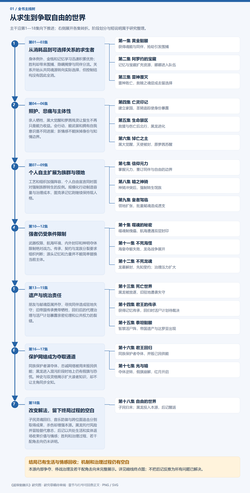

# 主线树与暗线目录

[全书阅读首页](../README.md) · [全部265条语义关系](relations.md)

**[全书一张大树图](whole-book.md)**：七阶段、18集、77个关键事件、15条暗线，在同一张图中阅读。

[打开主线与暗线图片版](images.md)：全书阶段树、18集推进图、15条暗线时间图。PNG可直接保存，SVG可放大。

蓝色主干按小说阅读进度推进；回叙与跨段聚合保留说明。跨集页面的回收状态采用全书终点复核结论。

## 全书主线图片

[PNG原尺寸](images/main-overview.png) · [SVG矢量图](images/main-overview.svg)

## 按集阅读

- [第一集 黄金骷髅](vol-01.md)
- [第二集 阿罗约的宝藏](vol-02.md)
- [第三集 雷神覆灭](vol-03.md)
- [第四集 亡灵印记](vol-04.md)
- [第五集 生命禁区](vol-05.md)
- [第六集 悼亡之主](vol-06.md)
- [第七集 信仰元力](vol-07.md)
- [第八集 暗之神骑](vol-08.md)
- [第九集 皇者驾临](vol-09.md)
- [第十集 噬魂的秘密](vol-10.md)
- [第十一集 不死海怪](vol-11.md)
- [第十二集 不死龙魂](vol-12.md)
- [第十三集 死亡世界](vol-13.md)
- [第十四集 君王的传承](vol-14.md)
- [第十五集 泰坦骷髅](vol-15.md)
- [第十六集 君王回归](vol-16.md)
- [第十七集 光与暗](vol-17.md)
- [第十八集 自由的世界](vol-18.md)

## 46条跨集剧情线

| 剧情线 | 终点状态 | 核心问题 |
|---|---|---|
| [跨集 · 自由存在与同伴关系](threads/book-37dd82abc178.md) | 已回收 | 黑龙如何在成为顶层存在后保住自己想要的自由与关系？ |
| [跨集 · 救赎之魂的真实作用](threads/book-d57a5d7a5b5a.md) | 已回收 | 救赎是否能够让星恢复生前身份？ |
| [跨集 · 子民意识与生存](threads/book-c55cdb2efcb4.md) | 部分回收 | 黑龙子民的意识与存续是否获得完整交代？ |
| [跨集 · 雷神败亡后的利益与部族余波](threads/book-4591509faba8.md) | 部分回收 | 雷神残余和撒拉丁部族如何应对领袖及贸易体系丧失？ |
| [跨集 · 沼泽古国与转生遗产](threads/book-c0fbac950b52.md) | 部分回收 | 祭坛遗产如何延续，帝国消失为何？ |
| [跨集 · 坦克战魂的控制边界](threads/book-9baae09a0d12.md) | 部分回收 | 战魂能否真正炼化或可靠驾驭？ |
| [跨集 · 克丽丝的传承与脱封机会](threads/book-e90db68cb625.md) | 部分回收 | 克丽丝是否能借黑龙和媒介摆脱封印？ |
| [跨集 · 娜娜传承与被保护的生活](threads/book-cb9c67d1cdae.md) | 部分回收 | 娜娜能否从被争夺的传承者成为自由生活的主体？ |
| [全书复核 · 隐蔽不死领地](threads/book-fa62676c9bc3.md) | 部分回收 | 上千长期亡者能否隐蔽成长，何时出现自我意识？ |
| [跨集 · 亡灵印记的发出者与目的地](threads/book-d9427f2553c6.md) | 已回收 | 亡灵印记由谁散播，指向哪里？ |
| [全书复核 · 绝幽谷的建设与庇护](threads/book-1ac1ba7f3ac7.md) | 部分回收 | 新家能否容纳不同生活需求并承受身份暴露后的攻击？ |
| [全书复核 · 海图护送背后的政治风险](threads/book-b2ff15da89c0.md) | 部分回收 | 谁派死士，梅丽雅去首都的具体使命是什么？ |
| [跨集 · 罗得的旧次逃生与新相遇](threads/book-6e1451b9badd.md) | 未回收 | 罗得早先如何逃过审判，何时转生？ |
| [全书复核 · 岗撒罗斯的守护心愿](threads/book-2e1b9f76cfd0.md) | 已回收 | 他长期默默支援萝茜的私人动机是什么？ |
| [跨集 · 黑七圣焰救援的生死结局](threads/book-b3781f6d7341.md) | 已回收 | 第四集圣焰危机中黑七是否获救？ |
| [跨集 · 原萝茜的记忆与借力主体](threads/book-09f441653222.md) | 部分回收 | 原萝茜能否整合残忆并自主运用借来力量？ |
| [跨集 · 罗得的音乐与未明往事](threads/book-bd3759586c4a.md) | 部分回收 | 安魂创作会怎样发展，亡妻线将何时重返？ |
| [跨集 · 吸魂与异族伦理](threads/book-4e6bf7ea8c15.md) | 部分回收 | 公平看待异族风险能否兼容对实际杀戮的约束？ |
| [跨集 · 帝国来源、黑晶与回归](threads/book-2c92e5ad3024.md) | 部分回收 | 旧帝国及黑晶的来源与放逐后果怎样得到说明？ |
| [跨集 · 神骑职责与转生后的终局](threads/book-8477942e0118.md) | 部分回收 | 神骑追索和教会私人指令之间有何关系？ |
| [跨集 · 取石远征与龙墓解封](threads/book-77f072ce087d.md) | 已回收 | 能否取得安息石并让龙墓力量离开封印？ |
| [跨集 · 先知失去私兵优势后的组织制衡](threads/book-bf7a72bd8f37.md) | 部分回收 | 先知在龙群被收归黑龙后怎样行使代理权？ |
| [跨集 · 光复、假旗战争与神力介入](threads/book-db9eea600737.md) | 部分回收 | 同盟光复后，战争怎样演变，群众和军队将付出什么代价？ |
| [跨集 · 阿罗约记忆与被隐藏的旧杀戮](threads/book-49e8bb5d0f08.md) | 未回收 | 氓族若得知阿罗约真实遭遇，联盟会如何改变？ |
| [跨集 · 氓族与骑士灵魂转生后的存续](threads/book-994cfa997ae2.md) | 部分回收 | 已完成转生者如何适应存在形式，其人格与意愿将如何延续？ |
| [跨集 · 光明制度与神祇主体](threads/book-02ba45413b1e.md) | 部分回收 | 信徒力量的分配与神祇代理权最终如何重组？ |
| [跨集 · 图克诞生、守护与祭坛声音来源](threads/book-1a972091c7f4.md) | 已回收 | 图克如何诞生，守护本能和祭坛苍老声音来自何处？ |
| [跨集 · 军力扩张与智慧治理缺口](threads/book-5c6c99356f4d.md) | 部分回收 | 无智兵力扩张如何得到资源与治理配套？ |
| [全书复核 · 老罗格凝魂与临终祈愿](threads/book-c8d5d9e2b50a.md) | 未回收 | 祈愿与死后凝聚魂火有何关系？ |
| [跨集 · 泰戈变异与认知成长](threads/book-15cb5511c407.md) | 部分回收 | 泰戈的身体与智力将怎样发展？ |
| [跨集 · 噬魂权限与死息傀儡](threads/book-be62d277e700.md) | 部分回收 | 如何认主、吞魂制造傀儡，古主遗产何来？ |
| [跨集 · 自然神保教与政治杀人](threads/book-4f19b0c4054c.md) | 部分回收 | 自然神的生存策略会付出什么道德和制度代价？ |
| [跨集 · 海皇解封与夺躯危机](threads/book-67592e865ba5.md) | 已回收 | 海皇是否获释，夺躯危机结果如何？ |
| [跨集 · 龙人迁徙与族群存续](threads/book-7ba6c4bc6db7.md) | 部分回收 | 失踪龙人去了哪里，能否获得自由家园？ |
| [跨集 · 沼泽新来者的身份与邀请](threads/book-a47d35bd1533.md) | 已回收 | 第12集末靠近沼泽的生物是谁、当次来意为何？ |
| [跨集 · 剩余不死龙的作战与归属](threads/book-0ee308c4a60f.md) | 部分回收 | 余下智慧龙如何存续并参与教会战争？ |
| [跨集 · 放逐后的定位与归途](threads/book-688f780712b6.md) | 已回收 | 黑龙能否回到物质位面并恢复同伴联系？ |
| [跨集 · 切罗曼尔遗产的自主使用](threads/book-f6314cbd93ce.md) | 部分回收 | 黑龙如何把继承的知识转为自己的行动，帝国使命是否获得全部实现？ |
| [跨集 · 塞茵祭魂阵的禁令约束](threads/book-f7d8b02957f0.md) | 部分回收 | 百万平民是否免于被阵法牺牲，谁有决定权？ |
| [跨集 · 达罗亚夺体危机的现场解除](threads/book-488aad623ce0.md) | 已回收 | 黑龙能否摆脱此次夺体并重建与子民联系？ |
| [跨集 · 净世假旗与恐惧信仰](threads/book-155fd141a183.md) | 已回收 | 谁把不死军团挂到黑龙名下，借此获取什么？ |
| [跨集 · 尼鲁达双灵格与神格](threads/book-442e53d9c11d.md) | 部分回收 | 两独立灵格怎样面对共同历史与本源危机？ |
| [全书复核 · 深渊入侵与跨族共处](threads/book-2e1eb7a1d515.md) | 部分回收 | 如何阻止无尽深渊入侵并结束死亡循环？ |
| [跨集 · 独立本源与超脱规则](threads/book-3ec69c740e20.md) | 部分回收 | 制造者如何失去本源控制，黑龙能否阻止其吞噬世界？ |
| [跨集 · 音乐魔法与弱者专长](threads/book-0338447aee32.md) | 已回收 | 罗得与普通乐师的体系能否在顶层战争中产生真实作用？ |
| [跨集 · 记忆、知识与力量](threads/book-0a05fa972401.md) | 部分回收 | 记忆所得如何改变选择，哪些能力仍不能继承？ |
