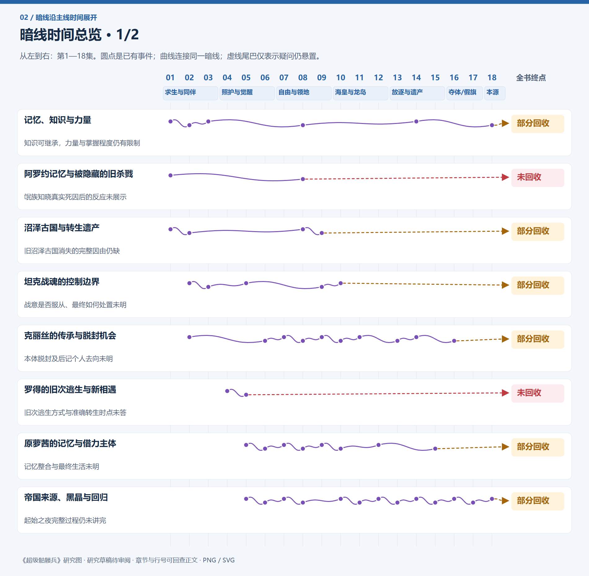
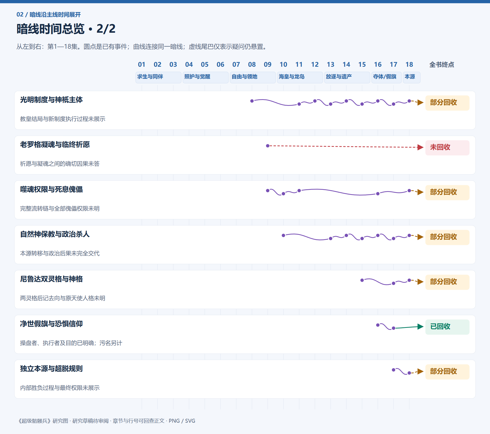

# 主线与暗线图片版

[全书阅读首页](../README.md) · [剧情与证据目录](README.md)

沿小说第1—18集推进。图片可直接保存；点击PNG可查看原尺寸，SVG可继续放大。蓝色主干是阅读顺序，彩色旁路才表示已有语义关系。回叙、旧史和跨段聚合保留标记。

共49张图片：全书主线树、18集时间主干与分支、2张暗线总览、15条暗线分页详图。

**暗线终点：1条已回收，11条部分回收，3条未回收。** 状态针对每条线的问题范围；终点文字写明已知与缺口。空白时间的虚线不表示持续发生事件。

### 全书主线树

[PNG原尺寸](images/main-overview.png) · [SVG矢量图](images/main-overview.svg)

### 暗线时间总览 1

[PNG原尺寸](images/hidden-overview-01.png) · [SVG矢量图](images/hidden-overview-01.svg)

### 暗线时间总览 2

[PNG原尺寸](images/hidden-overview-02.png) · [SVG矢量图](images/hidden-overview-02.svg)

## 18集主线图片

| 集数 | 图片与依据 |
|---|---|
| 第一集 黄金骷髅 | [PNG](images/vol-01.png) · [SVG](images/vol-01.svg) · [事件与证据](vol-01.md) |
| 第二集 阿罗约的宝藏 | [PNG](images/vol-02.png) · [SVG](images/vol-02.svg) · [事件与证据](vol-02.md) |
| 第三集 雷神覆灭 | [PNG](images/vol-03.png) · [SVG](images/vol-03.svg) · [事件与证据](vol-03.md) |
| 第四集 亡灵印记 | [PNG](images/vol-04.png) · [SVG](images/vol-04.svg) · [事件与证据](vol-04.md) |
| 第五集 生命禁区 | [PNG](images/vol-05.png) · [SVG](images/vol-05.svg) · [事件与证据](vol-05.md) |
| 第六集 悼亡之主 | [PNG](images/vol-06.png) · [SVG](images/vol-06.svg) · [事件与证据](vol-06.md) |
| 第七集 信仰元力 | [PNG](images/vol-07.png) · [SVG](images/vol-07.svg) · [事件与证据](vol-07.md) |
| 第八集 暗之神骑 | [PNG](images/vol-08.png) · [SVG](images/vol-08.svg) · [事件与证据](vol-08.md) |
| 第九集 皇者驾临 | [PNG](images/vol-09.png) · [SVG](images/vol-09.svg) · [事件与证据](vol-09.md) |
| 第十集 噬魂的秘密 | [PNG](images/vol-10.png) · [SVG](images/vol-10.svg) · [事件与证据](vol-10.md) |
| 第十一集 不死海怪 | [PNG](images/vol-11.png) · [SVG](images/vol-11.svg) · [事件与证据](vol-11.md) |
| 第十二集 不死龙魂 | [PNG](images/vol-12.png) · [SVG](images/vol-12.svg) · [事件与证据](vol-12.md) |
| 第十三集 死亡世界 | [PNG](images/vol-13.png) · [SVG](images/vol-13.svg) · [事件与证据](vol-13.md) |
| 第十四集 君王的传承 | [PNG](images/vol-14.png) · [SVG](images/vol-14.svg) · [事件与证据](vol-14.md) |
| 第十五集 泰坦骷髅 | [PNG](images/vol-15.png) · [SVG](images/vol-15.svg) · [事件与证据](vol-15.md) |
| 第十六集 君王回归 | [PNG](images/vol-16.png) · [SVG](images/vol-16.svg) · [事件与证据](vol-16.md) |
| 第十七集 光与暗 | [PNG](images/vol-17.png) · [SVG](images/vol-17.svg) · [事件与证据](vol-17.md) |
| 第十八集 自由的世界 | [PNG](images/vol-18.png) · [SVG](images/vol-18.svg) · [事件与证据](vol-18.md) |

## 15条暗线图片

| 暗线 | 终点状态 | 图片与依据 |
|---|---|---|
| 记忆、知识与力量 | 部分回收 | [图1](images/book-0a05fa972401-01.png) · [完整图文](threads/book-0a05fa972401.md) |
| 阿罗约记忆与被隐藏的旧杀戮 | 未回收 | [图1](images/book-49e8bb5d0f08-01.png) · [完整图文](threads/book-49e8bb5d0f08.md) |
| 沼泽古国与转生遗产 | 部分回收 | [图1](images/book-c0fbac950b52-01.png) · [完整图文](threads/book-c0fbac950b52.md) |
| 坦克战魂的控制边界 | 部分回收 | [图1](images/book-9baae09a0d12-01.png) · [完整图文](threads/book-9baae09a0d12.md) |
| 克丽丝的传承与脱封机会 | 部分回收 | [图1](images/book-e90db68cb625-01.png) · [图2](images/book-e90db68cb625-02.png) · [图3](images/book-e90db68cb625-03.png) · [完整图文](threads/book-e90db68cb625.md) |
| 罗得的旧次逃生与新相遇 | 未回收 | [图1](images/book-6e1451b9badd-01.png) · [完整图文](threads/book-6e1451b9badd.md) |
| 原萝茜的记忆与借力主体 | 部分回收 | [图1](images/book-09f441653222-01.png) · [图2](images/book-09f441653222-02.png) · [图3](images/book-09f441653222-03.png) · [完整图文](threads/book-09f441653222.md) |
| 帝国来源、黑晶与回归 | 部分回收 | [图1](images/book-2c92e5ad3024-01.png) · [图2](images/book-2c92e5ad3024-02.png) · [图3](images/book-2c92e5ad3024-03.png) · [图4](images/book-2c92e5ad3024-04.png) · [图5](images/book-2c92e5ad3024-05.png) · [图6](images/book-2c92e5ad3024-06.png) · [完整图文](threads/book-2c92e5ad3024.md) |
| 光明制度与神祇主体 | 部分回收 | [图1](images/book-02ba45413b1e-01.png) · [图2](images/book-02ba45413b1e-02.png) · [图3](images/book-02ba45413b1e-03.png) · [图4](images/book-02ba45413b1e-04.png) · [完整图文](threads/book-02ba45413b1e.md) |
| 老罗格凝魂与临终祈愿 | 未回收 | [图1](images/book-c8d5d9e2b50a-01.png) · [完整图文](threads/book-c8d5d9e2b50a.md) |
| 噬魂权限与死息傀儡 | 部分回收 | [图1](images/book-be62d277e700-01.png) · [完整图文](threads/book-be62d277e700.md) |
| 自然神保教与政治杀人 | 部分回收 | [图1](images/book-4f19b0c4054c-01.png) · [图2](images/book-4f19b0c4054c-02.png) · [完整图文](threads/book-4f19b0c4054c.md) |
| 尼鲁达双灵格与神格 | 部分回收 | [图1](images/book-442e53d9c11d-01.png) · [完整图文](threads/book-442e53d9c11d.md) |
| 净世假旗与恐惧信仰 | 已回收 | [图1](images/book-155fd141a183-01.png) · [完整图文](threads/book-155fd141a183.md) |
| 独立本源与超脱规则 | 部分回收 | [图1](images/book-3ec69c740e20-01.png) · [完整图文](threads/book-3ec69c740e20.md) |

图片摘要由既有研究主档生成，完整关系、认知边界与章节行号保留在图文页。人物卡、研究JSON、个人笔记与版本历史仍是原记录。

重建：先运行报告目录的 `rebuild_plot_images.py`，再用 `render_plot_images.cjs` 生成PNG，最后运行 `rebuild_github_reading.py` 更新页面。需要 Python/Pillow、中文字体及 Node.js/Playwright 浏览器。
