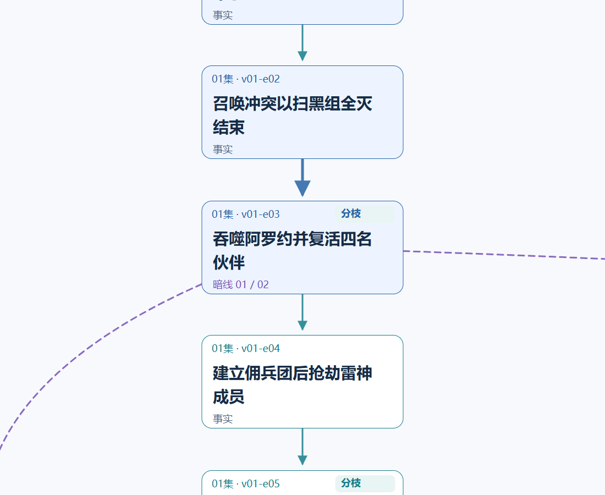
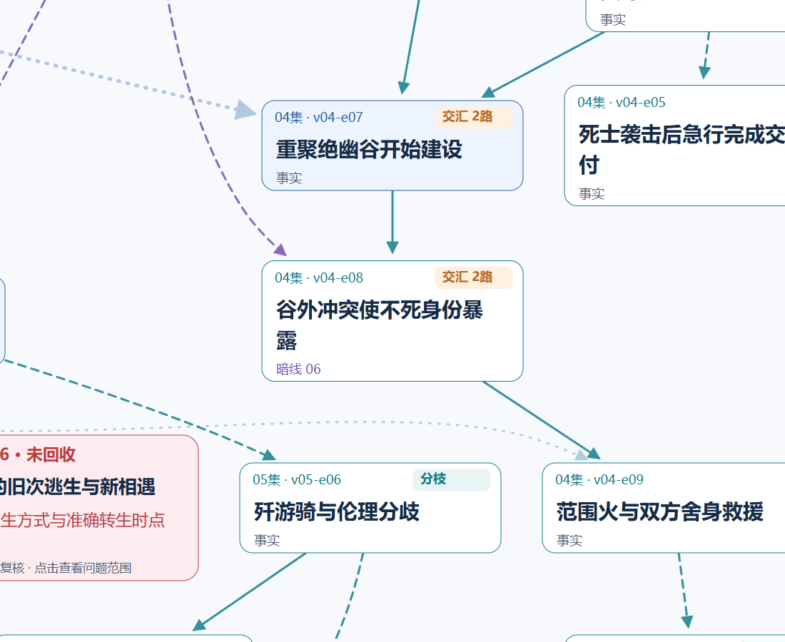
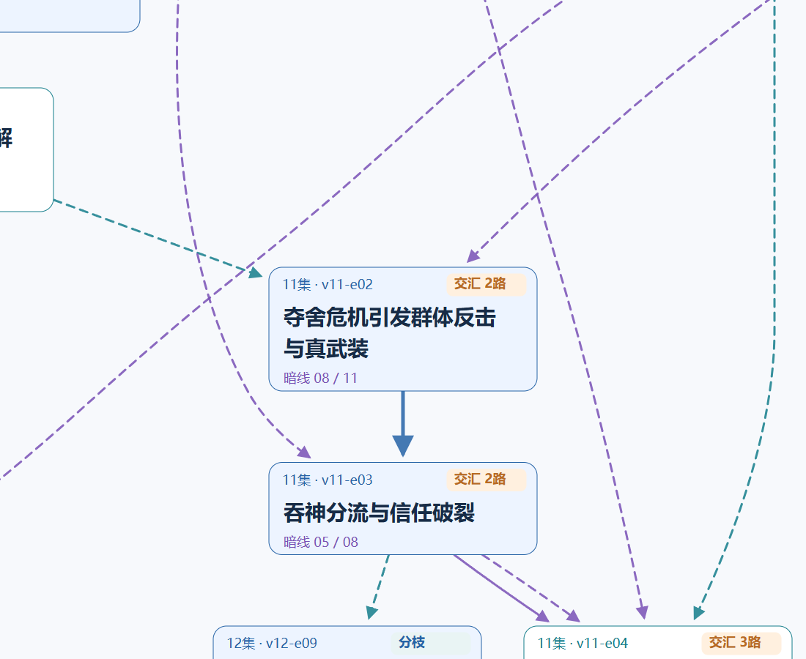
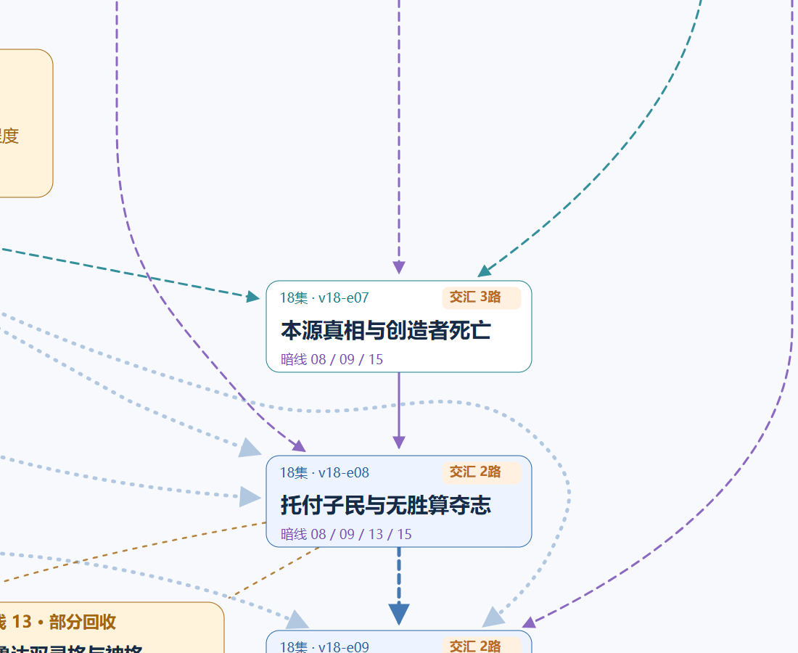

# 《超级骷髅兵》全书剧情地图

**整本书是一张连续大图。放大读文字，缩小看分枝，拖动追踪连线。**

| 想怎样看 | 入口 |
|---|---|
| 在PC／Codex里像地图一样拖动缩放 | **[下载交互地图HTML](https://github.com/medillali/writing-vault/raw/refs/heads/main/library/reports/super-skeleton/reading/plot/reader/index.html)**，下载后在浏览器打开；无需安装插件 |
| 在GitHub直接查看大图 | **[PNG原尺寸图](whole-book/tree.png)** · [SVG矢量图](whole-book/tree.svg)，在图片页打开Raw原图放大 |
| 快速看清交汇处的文字 | [主线分枝](#主线开始分枝) · [前段交汇](#中前段交汇) · [海皇危机](#海皇危机交汇) · [终局暗线](#终局与暗线) |
| 查询事件说明与证据 | [卡片阅读器说明](reader.md) · [全部关系](relations.md) |

GitHub仓库页提供图片和下载文件，不运行交互HTML。上面的下载链接会保存完整阅读器；不要把源码预览当作地图页面。本仓库保持私有，未开启公开GitHub Pages。

## 整张图

点击预览打开原尺寸PNG。蓝色为核心主线，紫色为暗线；交汇以共享事件为准，线条交叉不等于剧情交汇。暗线终点状态保留已回收、部分回收、未回收的区别。

[](whole-book/tree.png)

## 地图操作

- **PC**：拖动平移；滚轮或触控板缩放；双击局部放大。
- **Codex**：本机预览与下载的HTML都是整图入口。“专注”隐藏标题栏，给浏览器面板留出更多画布。
- **左下角小地图**：橙框表示当前视野；点击另一位置可直接跳转。
- **看全图**：回到整书；**可读大小**：放大到清晰文字；右上角可定位到某一集。
- **键盘**：`+`／`-`缩放，`0`看全图；画布聚焦后可用方向键平移。
- **手机**：单指拖动，双指缩放；同一张图与同一套位置关系。
- 浏览器会记住当前位置和缩放。更多菜单可保存PNG／SVG或进入卡片页。

## 主线开始分枝

以下四幅只是同一全书图的原尺寸窗口，没有重新排列事件或连线。点击图片可单独打开；完整关系仍以整张图为准。

[](map/opening.png)

## 中前段交汇

[](map/junction.png)

## 海皇危机交汇

[](map/sea-emperor.png)

## 终局与暗线

[](map/ending.png)

## 本机重开与维护

下载的HTML可以直接离线使用，不需要服务器。Codex本机预览可从资料库目录运行以下命令，再在内置浏览器打开显示的地址：

```text
python -m http.server 8765 --bind 127.0.0.1 --directory library/reports/super-skeleton/reading/plot
```

预览地址：`http://127.0.0.1:8765/reader/index.html`。只绑定本机；退出命令或重启电脑会停止预览，离线HTML仍可打开。这里只是本机预览，不是云端部署。

地图采用[OpenSeadragon](https://openseadragon.github.io/)和589个无损图块，数据及引擎均内嵌，不连接CDN。原图、研究数据和证据未改写。163个事件、265条关系、15条暗线均沿用全书主图。

[设计与模块验收](../../地图阅读方案.md) · [浏览器测试](../../validation/map-browser.json) · [完整性核验](../../validation/map-integrity.json)

重建地图：`python library/reports/super-skeleton/rebuild_map.py`。重建GitHub局部预览：`python library/reports/super-skeleton/rebuild_map_previews.py`。源码与[第三方许可](../../map/vendor/LICENSE.txt)随库保存。
