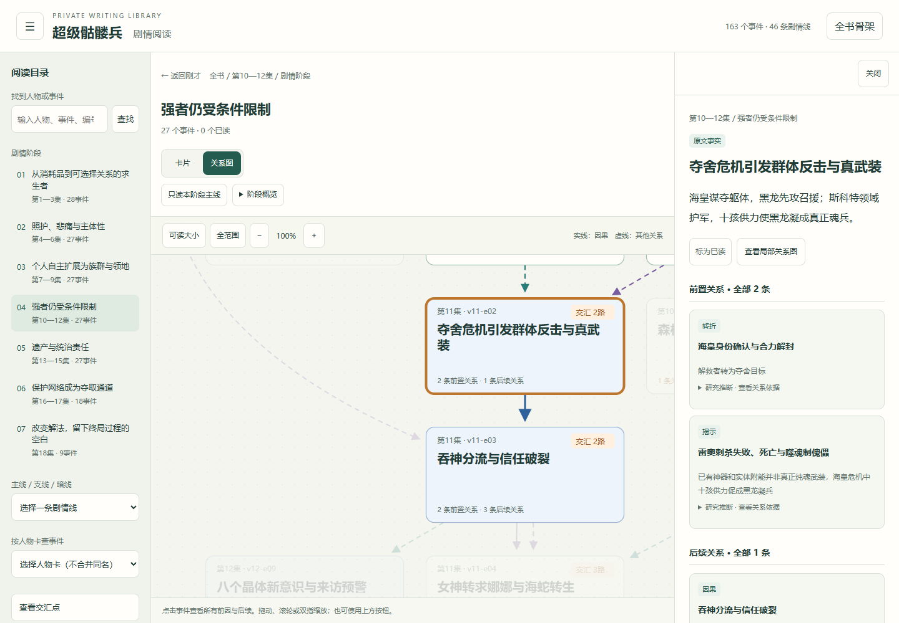
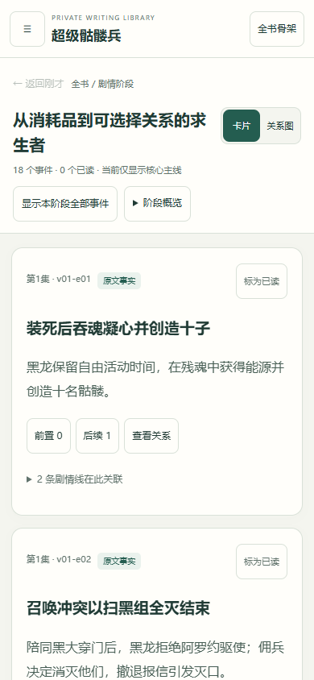

# 《超级骷髅兵》卡片与局部关系阅读器

默认推荐：[像地图一样缩放整张全书图](map.md)。本页保留卡片阅读与研究追溯说明。

[全书阅读首页](../README.md) · [原版全书大图](whole-book.md) · [49张分图](images.md)

把163个事件、265条关系、46条剧情线分层阅读。事件摘要、判断性质、人物认知与原文行号沿用研究主档，仍是待审阅的研究草稿。

## 打开方式

**[阅读器文件](reader/cards.html)**：在GitHub文件页使用下载按钮保存HTML，再用浏览器打开。文件自带数据和界面，无需安装依赖，也不请求在线数据。GitHub文件预览显示源码，不能直接运行交互页面。

PC可用Chrome、Edge等现代浏览器打开本地HTML。手机布局已完成浏览器模拟验证；手机需要能执行本地HTML脚本的浏览器或后续的私有网页入口，文件管理器、聊天附件预览不一定能运行。iOS/Android实机与私有网页部署尚待验收。当前没有公开发布私人资料。

## PC：从骨架进入局部结构

1. 首屏选择七个剧情阶段之一，进入当前阶段关系图。
2. 点击事件，在右侧读完整摘要、**全部前置与后续关系**。范围外的前因也会列出，并标明所在阶段。
3. 从目录切换主线、支线、暗线，或按人物卡筛选。交汇事件共用同一编号和已读标记。
4. “可读大小”回到可读字号；“全范围”看整体形状。拖动、滚轮和缩放按钮可调整视野。



## 手机：先读事件，再看交汇

手机从第一阶段的核心主线卡片开始。摘要直接按正常字号显示，按小说阅读顺序排列；卡片相邻本身不代表因果。

- “显示本阶段全部事件”可看到同时发生的其他剧情。
- 卡片下方展开关联剧情线，可以从共享事件进入一条支线。
- “查看关系”打开一跳局部图，按需“再展开一层”；支持双指缩放，也提供按钮。
- 点击标题或前置／后续按钮进入详情，关系依据可以展开核对。
- **“返回刚才”**恢复上一次的范围、事件、滚动、展开项和图位置。点击前因则是继续追溯，两者分别操作。



## 阅读进度与换设备

已读标记和当前阅读位置保存在当前浏览器。重新打开后点“继续上次”。在目录中展开“阅读进度与文件”，导出JSON，到另一设备导入即可合并已读标记并继续对应事件。

便携进度携带已读事件与书签；当前设备的浏览器还保留范围、滚动和图视窗。不同设备的屏幕尺寸不同，导入时按该设备布局打开书签，不套用另一屏幕的像素位置。浏览器禁止存储时仍能阅读和手动导出。

进度只接受当前书籍与图数据版本。错误文件不会覆盖现有进度。它不是研究笔记，也不会自动写入GitHub或ChatGPT记忆。

## 开源阅览器与图片格式

核对日期：2026-10-22。以下是可选方案，本次没有安装或把个人资料上传到它们的在线服务。

| 需求 | 开源选择 | 本项目如何衔接 |
|---|---|---|
| 把超大图像当地图缩放阅读 | [OpenSeadragon](https://openseadragon.github.io/) | 支持桌面与手机；可接入现有图片，超大图建议生成分块金字塔。需要集成为网页组件。 |
| 手动移动节点、修改连线、导出图片 | [Excalidraw](https://github.com/excalidraw/excalidraw) | 提供PNG、SVG与原生可编辑格式；若要逐节点编辑，应从结构化数据导出元素，导入普通图片不会自动还原事件结构。 |
| 按节点追溯、筛选、查看图关系 | [Cytoscape.js](https://js.cytoscape.org/) | 可作为后续图引擎，支持桌面／触摸交互及PNG、JPG导出；仍需接入本书的事件详情与返回逻辑。 |

当前推荐：用本阅读器进行沿线阅读和追溯，保留[SVG矢量全图与PNG](whole-book.md)作全局参照。SVG适合放大文字，PNG便于保存到相册；更换图片格式不会自动增加支线跳转能力。若主要诉求是浏览整张大图，可再接入OpenSeadragon，不必重做蒸馏数据。

## 验证与维护

[双端验收记录](../../双端阅读验收.md) · [实现设计与计划](../../双端阅读设计与计划.md)

已验证320、390、768、1024、1440像素布局、两层追溯与原位返回、触摸缩放、键盘操作、进度换设备导入、存储不可用与损坏进度降级。验证使用本机Edge和浏览器手机模拟；真实手机与私有部署仍待验证。

数据与布局已随库保存。仅修改界面时运行：

```text
python library/reports/super-skeleton/rebuild_reader.py
```

研究图变化后需先重新生成数据和布局：

```text
python library/reports/super-skeleton/rebuild_reader.py --data
node library/reports/super-skeleton/layout_reader.cjs
python library/reports/super-skeleton/rebuild_reader.py
python library/reports/super-skeleton/rebuild_github_reading.py
```

布局生成使用`@viz-js/viz`（本次3.31.0 / Graphviz 16.1.0）；可通过`VIZ_MODULE`指定其`dist/viz.cjs`路径。浏览器直接阅读无需此依赖。测试需要Node.js、Playwright和Chromium浏览器，通过`PLOT_BROWSER_EXE`指定浏览器程序。
