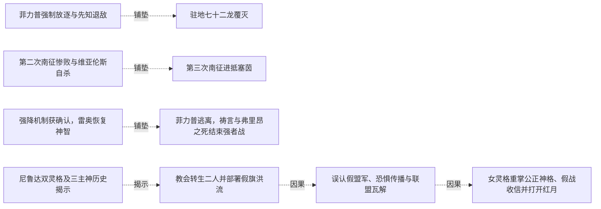
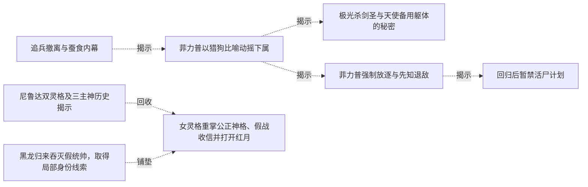
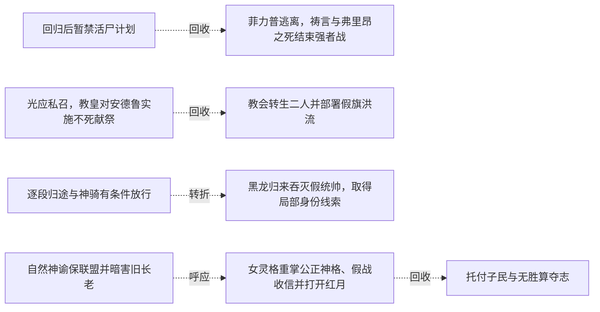

# 跨集 · 光明制度与神祇主体

[剧情目录](../README.md) · [全书阅读首页](../../README.md)

终点状态：**部分回收**

## 核心问题

信徒力量的分配与神祇代理权最终如何重组？

## 全书复核结论

已入库至第18集；最近关联事件在第18集。最新状态审计在第18集。受教会支配的天使可以作不同选择，三主神与尼鲁达双灵格的制度操作逐渐揭明。终卷补送枪机缘、虚设至高称号以及女灵格赠格改立的行为；教皇个人结局、改立的具体执行和完整新制度没有展示。

## 关联事件

- [圣骑溃败与保密灭口](../vol-08.md)：黑龙绕盾多次冲锋击溃圣骑，列奥纳被杀；雷奥救安德鲁后杀光己方幸存者并自报死亡骑士。
- [追兵撤离与蚕食内幕](../vol-08.md)：雷奥和火马转向教会总部；菲力普执行蚕食命令，私下显四翼并害怕沦为无意识工具。
- [菲力普以猎狗比喻动摇下属](../vol-11.md)：占领军停滞与异端集结背景下，菲力普隔离克罗斯并揭露工具处境，迫其面对信仰疑虑。
- [极光杀剑圣与天使备用躯体的秘密](../vol-12.md)：格杀档案在极光屠村杀奥马利多的现场得到具象验证；菲力普得知神迹非针对自己，却仍不懂骑士召回目的，反映教会力量不由他尽知。
- [菲力普强制放逐与先知退敌](../vol-13.md)：菲力普的自保盘算先由独处视角揭示，随后他抢在弗里昂之前隔离并放逐黑龙；另一处先知消灭两低阶天使，弗里昂逃走。
- [驻地七十二龙覆灭](../vol-13.md)：教皇知龙墓解封与驻地；113天使袭击缺乏有智指挥的72骨/尸龙，龙全亡、69天使阵亡；先知余36有智龙，决定回沼泽。
- [逐段归途与神骑有条件放行](../vol-14.md)：黑龙携金龙等十五名强者按位面坐标跳转，古巴避走告警。途中自然神骑阻击，黑龙实练新术；光之神骑自报谢菲里安，按本位面出生及实力承认通行。此时尚未与旧同伴会合。
- [第二次南征惨败与维亚伦斯自杀](../vol-14.md)：帝国四十五万军攻坚并付出巨大代价，守方虚构瘟疫造成军队失序，维亚伦斯射杀逃回者，牧师救助后遭后续屠杀。战报为十六万阵亡、二十万被俘、三万失踪，返不足六万；维亚伦斯交印自杀，菲力普暂代军务。
- [第三次南征进抵塞茵](../vol-14.md)：九个月后教会力量参与再征，帝国约三十万军打下守军不足七千、主力已撤的要塞，继续抵近塞茵；黑龙将于此阶段回来。
- [两神借身对峙，黑龙归来但未裁决](../vol-14.md)：自然神通过娜娜、克丽丝通过萝茜显现，先知威胁眼前两分身。魂链恢复后黑龙携队到场询问是否要打架，活尸阵处置、先知责任和战争结局均未在本集裁决。
- [回归后暂禁活尸计划](../vol-15.md)：黑龙重返同伴，以位面规则和当前利益暂禁百万活尸阵，保留正常交战与撤退选择。
- [独耗禁咒后遇泰坦与来袭天使](../vol-15.md)：黑龙付魂力代价独闯，毁傀儡后封印自行开；泰坦先攻，四翼女子来袭使双方暂联手毁其躯体、迫圣气退走。
- [红月群体异常与祭魂阵重备](../vol-15.md)：红月巫师无人指挥突袭，力量向生还者集中；天使现身后黑龙同意趁机出击并重备祭魂阵，称不到最后不发动。
- [最后巫师自称达罗亚归来](../vol-15.md)：战死、自爆与主动合一只余一人，侵蚀一名降临天使躯体后自报达罗亚力绯克；黑龙会意挥手出城。
- [强降机制获确认，雷奥恢复神智](../vol-16.md)：红月信徒被确认是达罗亚强降路径；黑龙出战并归枪，达罗亚放出旧三傀儡及新近恢复意识的雷奥，哥顿普感魂到来。
- [菲力普逃离，祷言与弗里昂之死结束强者战](../vol-16.md)：菲力普佯作强袭后逃，牧师集体燃命；魅冒耗散风险截击被黑龙救离，达罗亚收祷言。弗里昂拒逃战死，图克半身烧毁；达罗亚随后显出自身光明神格。
- [自然神谕保联盟并暗害旧长老](../vol-16.md)：自然神为亡者正名并引信冥月，暗杀唯一旧长老防教义质疑；娜娜亲感此事并质问，叙述明言兼两神传承但仍是媒介。
- [光应私召，教皇对安德鲁实施不死献祭](../vol-16.md)：光之神骑因教皇而离岗，称敌未必君王；后深夜带安德鲁入黑白雕像密室，贯其心脏，教皇灌入魂火。安德鲁灵魂坠暗，醒后状态未展示。
- [教会转生二人并部署假旗洪流](../vol-17.md)：安德鲁醒为不死者，光之神骑也已转生；二人改名安德鲁西斯、暗拉玛，奉教皇命冒用黑龙名义。凝魄与雕像印记分给指挥、感知和否决权，最终控制尚在更高意志。
- [误认假盟军、恐惧传播与联盟瓦解](../vol-17.md)：先知等把两统帅装低智与称黑龙当归属证明，跟随千万洪流深入帝国。慢进与虐杀制造逃亡潮，教会声望上升，同盟断绝合作，自然神信徒减少。
- [尼鲁达双灵格及三主神历史揭示](../vol-17.md)：圣柜密谈揭教皇与女天使同源分裂后各有独立灵格。历史回叙说明切里莫、尼鲁达、安克瓦斯曾造光明分身，联手放逐大陆，后来互相清除；尼假死分魂潜伏，安已被切消灭，净世军本为切留下的子民。
- [黑龙归来吞灭假统帅，取得局部身份线索](../vol-17.md)：魂链恢复，黑龙到场否认假军归属；光与安德鲁亮出旧身份及尼鲁达名号后，被黑龙吞魂取忆。记忆确认女天使为神骑老师、教皇与尼传承有关，两人随后明确魂散。
- [女灵格重掌公正神格、假战收信并打开红月](../vol-17.md)：女灵格融合封存公正神格，以迦莲娜形态公开显现。她制造表演战斗，黑龙未明全盘目的而克制应战；教皇改祷对象汇聚信力，使她短现十翼再放能量开红月，退回四翼且受伤；黑龙只获其自报尼鲁达，尚未见大陆回归。
- [哈力及子民跨界归来](../vol-18.md)：黑龙、哈力、尼女协作导引，哈力与大批子民进入物质位面；互开灵魂确立信任，双方拟演退兵以换西北至死亡沙漠领地。没有把物理大陆整体迁来。
- [五力量分身吞天使补能](../vol-18.md)：三人遭无自我光影天使拦截，黑龙放出五受控力量体吞噬，全部回收后消化，气息大增；尼女辨黑晶即混沌之灵实体，并回想教皇送枪布局。
- [本源真相与创造者死亡](../vol-18.md)：三人抵巨球，切里莫以起源说辞拖延。黑龙看破收集生命能量，光球随地面屠杀增强互证；切里莫借力时被本源吞噬，残意无本源并把构想和危机传黑龙。
- [托付子民与无胜算夺志](../vol-18.md)：本源吞噬虚无，黑龙要求哈力、尼女回去减少所有种族死亡，将君王烙印交哈力，接受公正神格，以混沌之灵化银团投本源争取代意志。
- [未知年后的共处与归来](../vol-18.md)：后记黑龙意识醒来，看见飞艇、巨龙运输、深渊出入门、多族市场与蓝晶售冰。菲力普、罗得、斯文、娜娜仍在；哈力号角迎回，黑龙重现原形。

## 关系网络

虚线展示因果、铺垫、误导、揭示与回收。每组至多6条关系；组间通过同名节点衔接，不新增时间顺序或因果。

### 关系组1

| 起点 | 关系 | 终点 | 研究说明 |
|---|---|---|---|
| [菲力普强制放逐与先知退敌](../vol-13.md) | 铺垫 | [驻地七十二龙覆灭](../vol-13.md) | 寻找失踪者召走有智龙，使独立袭击击中驻地指挥空缺 |
| [第二次南征惨败与维亚伦斯自杀](../vol-14.md) | 铺垫 | [第三次南征进抵塞茵](../vol-14.md) | 第二次惨败后政军权力变化及教会力量介入，构成第三次攻势条件。 |
| [强降机制获确认，雷奥恢复神智](../vol-16.md) | 铺垫 | [菲力普逃离，祷言与弗里昂之死结束强者战](../vol-16.md) | 君王接应和枪傀儡显力使强者战局压向教会一方。 |
| [教会转生二人并部署假旗洪流](../vol-17.md) | 因果 | [误认假盟军、恐惧传播与联盟瓦解](../vol-17.md) | 借名与分权控制使假军进入先知的盟友模型。 |
| [尼鲁达双灵格及三主神历史揭示](../vol-17.md) | 揭示 | [教会转生二人并部署假旗洪流](../vol-17.md) | 后置历史揭示假旗和指挥印记的真实来源；为解释关系而非叙述先后。 |
| [误认假盟军、恐惧传播与联盟瓦解](../vol-17.md) | 因果 | [女灵格重掌公正神格、假战收信并打开红月](../vol-17.md) | 洪流制造的恐惧和信仰积累为女灵格重掌神格提供条件。 |

### 关系组2

| 起点 | 关系 | 终点 | 研究说明 |
|---|---|---|---|
| [尼鲁达双灵格及三主神历史揭示](../vol-17.md) | 回收 | [女灵格重掌公正神格、假战收信并打开红月](../vol-17.md) | 封存神格和双灵格合作在公开仪式中兑现，旧身份源得到当前行动验证。 |
| [黑龙归来吞灭假统帅，取得局部身份线索](../vol-17.md) | 铺垫 | [女灵格重掌公正神格、假战收信并打开红月](../vol-17.md) | 吞忆得知女天使为老师却仍不明全局，使黑龙交手时保留力量等待解释。 |
| [追兵撤离与蚕食内幕](../vol-08.md) | 揭示 | [菲力普以猎狗比喻动摇下属](../vol-11.md) | 菲力普独处展露的工具恐惧在对克罗斯的猎犬解释中进一步公开，听者动摇不等于已投效 |
| [菲力普强制放逐与先知退敌](../vol-13.md) | 揭示 | [回归后暂禁活尸计划](../vol-15.md) | 菲力普对放逐原因作自我说明，确认其重视黑龙对自身的利用价值 |
| [菲力普以猎狗比喻动摇下属](../vol-11.md) | 揭示 | [菲力普强制放逐与先知退敌](../vol-13.md) | 猎犬比喻背后的自我保存目的发展为扶植敌对势力，强制放逐并非征得黑龙同意的救援 |
| [菲力普以猎狗比喻动摇下属](../vol-11.md) | 揭示 | [极光杀剑圣与天使备用躯体的秘密](../vol-12.md) | 菲力普对工具制度的解释扩展到备用身体来源与机构盲区，了解一层安排不代表掌握教会全局 |

### 关系组3

| 起点 | 关系 | 终点 | 研究说明 |
|---|---|---|---|
| [回归后暂禁活尸计划](../vol-15.md) | 回收 | [菲力普逃离，祷言与弗里昂之死结束强者战](../vol-16.md) | 菲力普对自身价值的重视进一步落实为临阵逃离，弗里昂的拒逃构成另一个选择 |
| [光应私召，教皇对安德鲁实施不死献祭](../vol-16.md) | 回收 | [教会转生二人并部署假旗洪流](../vol-17.md) | 秘密不死献祭的后果落实为安德鲁与光之神骑转生、奉命冒用黑龙名义；转生没有使他们成为黑龙真实部属 |
| [逐段归途与神骑有条件放行](../vol-14.md) | 转折 | [黑龙归来吞灭假统帅，取得局部身份线索](../vol-17.md) | 曾按位面职责放行黑龙的光之神骑，后执行私令成为假旗统帅并被黑龙吞魂，职务与当前选择并不等同 |
| [自然神谕保联盟并暗害旧长老](../vol-16.md) | 呼应 | [女灵格重掌公正神格、假战收信并打开红月](../vol-17.md) | 自然神控制神谕与尼鲁达双灵格经营恐惧信仰相互映照，均把群体信仰转为可调动的权力资源，具体责任和人格仍各自独立 |
| [女灵格重掌公正神格、假战收信并打开红月](../vol-17.md) | 回收 | [托付子民与无胜算夺志](../vol-18.md) | 曾重掌公正神格的女灵格最终主动赠格并疲惫离去，教皇另一人格的寿命后果并未同时得到交代 |

逐条引用依据见[全部语义关系](../relations.md)及事件所在分集页。
