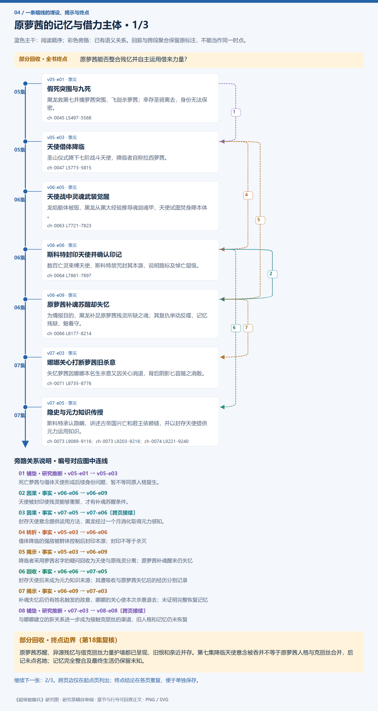
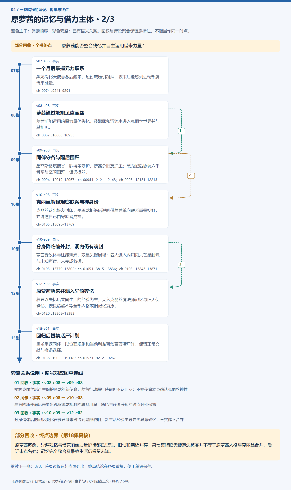
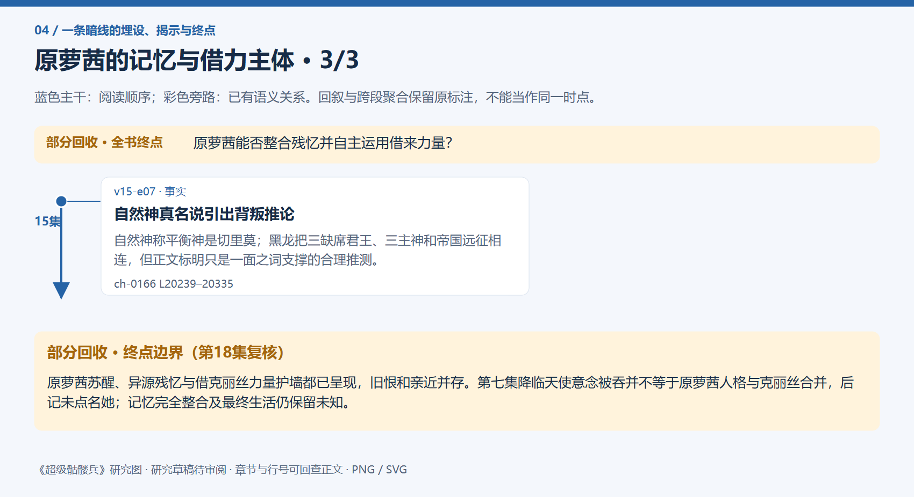
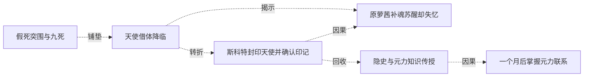
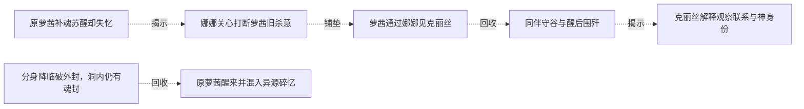

# 跨集 · 原萝茜的记忆与借力主体

[剧情目录](../README.md) · [全书阅读首页](../../README.md)

终点状态：**部分回收**

## 核心问题

原萝茜能否整合残忆并自主运用借来力量？

## 全书复核结论

已入库至第18集；最近关联事件在第15集。最新状态审计在第18集。原萝茜苏醒、异源残忆与借克丽丝力量护墙都已呈现，旧恨和亲近并存。第七集降临天使意念被吞并不等于原萝茜人格与克丽丝合并，后记未点名她；记忆完全整合及最终生活仍保留未知。

## 暗线时间图片

按主线阅读进度向下推进；分页保留关系编号与接续说明，每张均带全书终点状态。

[PNG原尺寸](../images/book-09f441653222-01.png) · [SVG矢量图](../images/book-09f441653222-01.svg)

[PNG原尺寸](../images/book-09f441653222-02.png) · [SVG矢量图](../images/book-09f441653222-02.svg)

[PNG原尺寸](../images/book-09f441653222-03.png) · [SVG矢量图](../images/book-09f441653222-03.svg)

## 关联事件

- [假死突围与九死](../vol-05.md)：黑龙救黑七并擒萝茜突围，飞剑杀萝茜；幸存圣骑离去，身份无法保密。
- [天使借体降临](../vol-05.md)：圣山仪式降下七阶战斗天使，降临者自称拉西萝茜。
- [天使战中灵魂武装觉醒](../vol-06.md)：龙焰躯体被毁，黑龙从黑大经验推导魂剑魂甲，天使试图焚身降本体。
- [斯科特封印天使并确认印记](../vol-06.md)：数百亡灵束缚天使，斯科特禁咒封其本源，说明路标及悼亡层级。
- [原萝茜补魂苏醒却失忆](../vol-06.md)：为情报目的，黑龙补足原萝茜残灵所缺之魂；其复仇举动反噬，记忆残缺，魅看守。
- [娜娜关心打断萝茜旧杀意](../vol-07.md)：失忆萝茜因娜娜本名生杀意又因关心消退，背后阴影匕首随之消散。
- [隐史与元力知识传授](../vol-07.md)：斯科特承认隐瞒，讲述古帝国兴亡和君王依赖链，并以封存天使提供元力运用知识。
- [一个月后掌握元力联系](../vol-07.md)：黑龙消化天使意念后醒来，短暂威压引跪拜，收束后能感到远端部属传来能量。
- [萝茜通过娜娜见克丽丝](../vol-08.md)：萝茜渐能运用暗黑力量仍失忆，经娜娜和沉渊木进入克丽丝世界并与其相见。
- [同伴守谷与醒后围歼](../vol-09.md)：墨菲斯循痕搜谷，罗得等守护，萝茜杀旧友护主；黑龙醒后协调六千骨军与空骑围歼，但仍极弱。
- [克丽丝解释观察联系与神身份](../vol-10.md)：克丽丝认出好友封印，受黑龙拒绝后说明借萝茜单向联系重叠视野，并讲述自己由守族者成神。
- [分身降临破外封，洞内仍有魂封](../vol-10.md)：萝茜受改体与注能耗竭，双星失衡崩塌；四人进入内洞见六芒星封魂与未知声音，未完成救援。
- [原萝茜醒来并混入异源碎忆](../vol-12.md)：萝茜以失忆后共同生活的经验为主，夹入克丽丝魔法师记忆与旧天使碎忆；恢复清醒不等全部人格或旧记忆复原。
- [回归后暂禁活尸计划](../vol-15.md)：黑龙重返同伴，以位面规则和当前利益暂禁百万活尸阵，保留正常交战与撤退选择。
- [自然神真名说引出背叛推论](../vol-15.md)：自然神称平衡神是切里莫；黑龙把三缺席君王、三主神和帝国远征相连，但正文标明只是一面之词支撑的合理推测。

## 关系网络

虚线展示因果、铺垫、误导、揭示与回收。每组至多6条关系；组间通过同名节点衔接，不新增时间顺序或因果。

### 关系组1

| 起点 | 关系 | 终点 | 研究说明 |
|---|---|---|---|
| [假死突围与九死](../vol-05.md) | 铺垫 | [天使借体降临](../vol-05.md) | 死亡萝茜与借体天使形成后续身份问题，暂不等同原人格复生。 |
| [斯科特封印天使并确认印记](../vol-06.md) | 因果 | [原萝茜补魂苏醒却失忆](../vol-06.md) | 天使被封印使残灵能够重聚，才有补魂苏醒条件。 |
| [隐史与元力知识传授](../vol-07.md) | 因果 | [一个月后掌握元力联系](../vol-07.md) | 封存天使意念提供运用方法，黑龙经过一个月消化取得元力感知。 |
| [天使借体降临](../vol-05.md) | 转折 | [斯科特封印天使并确认印记](../vol-06.md) | 借体降临的强敌被群体控制后封印本源；封印不等于杀灭 |
| [天使借体降临](../vol-05.md) | 揭示 | [原萝茜补魂苏醒却失忆](../vol-06.md) | 降临者采用萝茜名字的疑问回收为天使与原残灵分离；原萝茜补魂醒来仍失忆 |
| [斯科特封印天使并确认印记](../vol-06.md) | 回收 | [隐史与元力知识传授](../vol-07.md) | 封存天使后来成为元力知识来源；其遭吸收与原萝茜失忆后的经历分别记录 |

### 关系组2

| 起点 | 关系 | 终点 | 研究说明 |
|---|---|---|---|
| [原萝茜补魂苏醒却失忆](../vol-06.md) | 揭示 | [娜娜关心打断萝茜旧杀意](../vol-07.md) | 补魂失忆后仍有姓名触发的敌意，娜娜的关心使本次杀意退去；未证明完整恢复记忆 |
| [娜娜关心打断萝茜旧杀意](../vol-07.md) | 铺垫 | [萝茜通过娜娜见克丽丝](../vol-08.md) | 与娜娜建立的新关系进一步成为接触克丽丝的渠道，旧人格和记忆仍未恢复 |
| [萝茜通过娜娜见克丽丝](../vol-08.md) | 回收 | [同伴守谷与醒后围歼](../vol-09.md) | 接触克丽丝后产生保护黑龙的新使命，萝茜行动履行使命但不认旧友；不据使命本身确认克丽丝神性 |
| [同伴守谷与醒后围歼](../vol-09.md) | 揭示 | [克丽丝解释观察联系与神身份](../vol-10.md) | 萝茜的新使命后来显出观察黑龙视野的联系用途，角色与读者获知的时点分别保留 |
| [分身降临破外封，洞内仍有魂封](../vol-10.md) | 回收 | [原萝茜醒来并混入异源碎忆](../vol-12.md) | 分身借体后的记忆变化在萝茜醒来时得到局部说明，新生活经验主导并夹异源碎忆，三实体不合并 |

逐条引用依据见[全部语义关系](../relations.md)及事件所在分集页。
