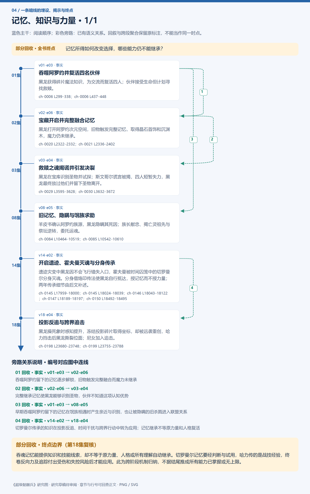
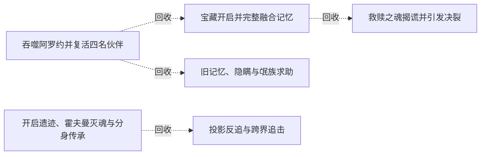

# 跨集 · 记忆、知识与力量

[剧情目录](../README.md) · [全书阅读首页](../../README.md)

终点状态：**部分回收**

## 核心问题

记忆所得如何改变选择，哪些能力仍不能继承？

## 全书复核结论

已入库至第18集；最近关联事件在第18集。最新状态审计在第18集。吞魂记忆能提供知识和技能线索，却不等于原力量、人格或所有理解自动继承。切罗曼尔记忆要经判断与试用，哈力传的是战技经验，终卷反向力及追踪付出受伤和失控风险后才能应用。此为跨阶段机制归纳，不据结尾推成所有能力已掌握或无上限。

## 暗线时间图片

按主线阅读进度向下推进；分页保留关系编号与接续说明，每张均带全书终点状态。

[PNG原尺寸](../images/book-0a05fa972401-01.png) · [SVG矢量图](../images/book-0a05fa972401-01.svg)

## 关联事件

- [吞噬阿罗约并复活四名伙伴](../vol-01.md)：黑龙获得碎片魔法知识，为交流而复活四人；伙伴接受生命但计划寻找救赎。
- [宝藏开启并完整融合记忆](../vol-02.md)：黑龙打开阿罗约次元空间，旧物触发完整记忆，取得晶石首饰和沉渊木，魔力仍未继承。
- [救赎之魂揭谎并引发决裂](../vol-03.md)：黑龙在宝库识别圣物并试探；斯文哥尔谎言被揭，四人短暂失力，黑龙最终放过他们并留下圣物离开。
- [旧记忆、隐瞒与氓族求助](../vol-08.md)：羊皮书确认阿罗约族源，黑龙隐瞒其死因；族长献忠、揭亡灵祖先与祭坛逆转，委托运魂。
- [开启遗迹、霍夫曼灭魂与分身传承](../vol-14.md)：遗迹灾变中黑龙因不会飞行错失入口，霍夫曼被时间囚笼中的切罗曼尔分身灭魂。分身借烙印传法使黑龙自行抵达，授记忆而不授力量；两年传承细节由后文补述。
- [投影反追与跨界追击](../vol-18.md)：黑龙操死象时感知提升，冻结投影碎片取得坐标，却被远袭重创，哈力挡击后黑龙撕裂位面；尼女加入追击。

## 关系网络

虚线展示因果、铺垫、误导、揭示与回收。每组至多6条关系；组间通过同名节点衔接，不新增时间顺序或因果。

### 关系组1

| 起点 | 关系 | 终点 | 研究说明 |
|---|---|---|---|
| [吞噬阿罗约并复活四名伙伴](../vol-01.md) | 回收 | [宝藏开启并完整融合记忆](../vol-02.md) | 吞噬阿罗约留下的记忆逐步解锁，旧物触发完整融合而魔力未继承 |
| [宝藏开启并完整融合记忆](../vol-02.md) | 回收 | [救赎之魂揭谎并引发决裂](../vol-03.md) | 完整继承记忆使黑龙能够识别圣物，伙伴不知道这项认知优势 |
| [吞噬阿罗约并复活四名伙伴](../vol-01.md) | 回收 | [旧记忆、隐瞒与氓族求助](../vol-08.md) | 早期吞噬阿罗约留下的记忆在氓族相遇时产生亲近与识别，也让被隐瞒的旧杀戮进入联盟关系 |
| [开启遗迹、霍夫曼灭魂与分身传承](../vol-14.md) | 回收 | [投影反追与跨界追击](../vol-18.md) | 切罗曼尔传承的知识在投影反追、时间干扰与跨界行动中转为应用；记忆继承不等原力量和人格复活 |

逐条引用依据见[全部语义关系](../relations.md)及事件所在分集页。
