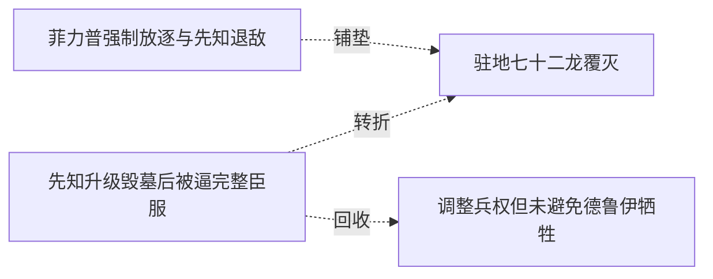

# 跨集 · 剩余不死龙的作战与归属

[剧情目录](../README.md) · [全书阅读首页](../../README.md)

终点状态：**部分回收**

## 核心问题

余下智慧龙如何存续并参与教会战争？

## 全书复核结论

已入库至第18集；最近关联事件在第15集。最新状态审计在第18集。三十六智慧龙存活并从先知转约黑龙，代理指挥与实际魂约归属分离。终卷没有对该固定名单逐名结算；后记出现运输巨龙不能自动认作这些龙全部存活或获得自由。

## 关联事件

- [先知升级毁墓后被逼完整臣服](../vol-12.md)：皇冠转化死气助先知凝不死龙魂并破封；他故意埋骨制造依赖，黑龙以半魂制约、十孩供力和联合护盾压制，最终收完整誓约与皇冠。
- [菲力普强制放逐与先知退敌](../vol-13.md)：菲力普的自保盘算先由独处视角揭示，随后他抢在弗里昂之前隔离并放逐黑龙；另一处先知消灭两低阶天使，弗里昂逃走。
- [驻地七十二龙覆灭](../vol-13.md)：教皇知龙墓解封与驻地；113天使袭击缺乏有智指挥的72骨/尸龙，龙全亡、69天使阵亡；先知余36有智龙，决定回沼泽。
- [调整兵权但未避免德鲁伊牺牲](../vol-15.md)：黑龙把德鲁伊出战数减半，强收先知三十六龙魂约仍留指挥职；已投入的五十余德鲁伊全部战死后尸兵扭转局面。

## 关系网络

虚线展示因果、铺垫、误导、揭示与回收。每组至多6条关系；组间通过同名节点衔接，不新增时间顺序或因果。

### 关系组1

| 起点 | 关系 | 终点 | 研究说明 |
|---|---|---|---|
| [菲力普强制放逐与先知退敌](../vol-13.md) | 铺垫 | [驻地七十二龙覆灭](../vol-13.md) | 寻找失踪者召走有智龙，使独立袭击击中驻地指挥空缺 |
| [先知升级毁墓后被逼完整臣服](../vol-12.md) | 转折 | [驻地七十二龙覆灭](../vol-13.md) | 取石破封后获得的龙群遭遇天使袭击，72无智龙覆灭而36有智龙保留；这是远征完成后的新代价 |
| [先知升级毁墓后被逼完整臣服](../vol-12.md) | 回收 | [调整兵权但未避免德鲁伊牺牲](../vol-15.md) | 先知自身完整魂约之后，黑龙进一步收走剩余三十六龙的魂约；保留其指挥职不等于解除主从限制 |

逐条引用依据见[全部语义关系](../relations.md)及事件所在分集页。
