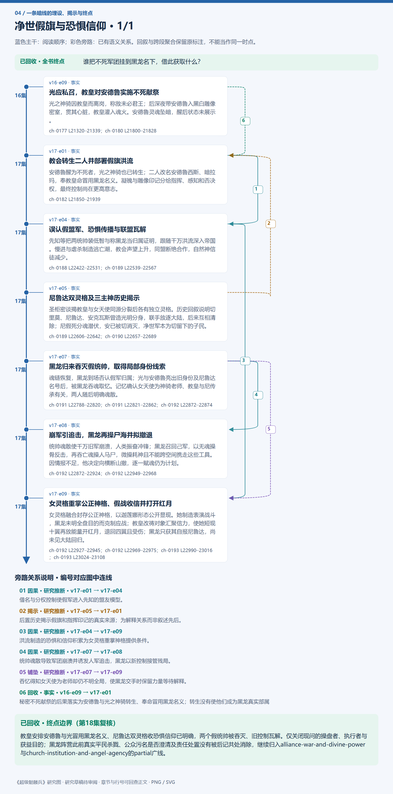
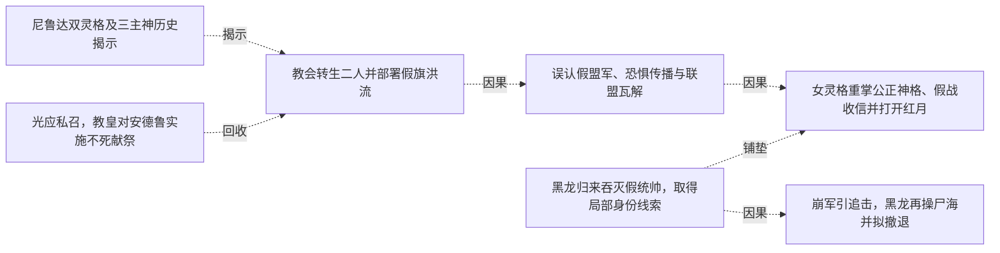

# 跨集 · 净世假旗与恐惧信仰

[剧情目录](../README.md) · [全书阅读首页](../../README.md)

终点状态：**已回收**

## 核心问题

谁把不死军团挂到黑龙名下，借此获取什么？

## 全书复核结论

已入库至第18集；最近关联事件在第17集。最新状态审计在第18集。教皇安排安德鲁与光冒用黑龙名义、尼鲁达双灵格收恐惧信仰已明确，两个假统帅被吞灭、旧控制瓦解。仅关闭现问的操盘者、执行者与获益目的；黑龙阵营此前真实平民杀戮、公众污名是否澄清及责任处置没有被后记共处消除，继续归入alliance-war-and-divine-power与church-institution-and-angel-agency的partial广线。

## 暗线时间图片

按主线阅读进度向下推进；分页保留关系编号与接续说明，每张均带全书终点状态。

[PNG原尺寸](../images/book-155fd141a183-01.png) · [SVG矢量图](../images/book-155fd141a183-01.svg)

## 关联事件

- [光应私召，教皇对安德鲁实施不死献祭](../vol-16.md)：光之神骑因教皇而离岗，称敌未必君王；后深夜带安德鲁入黑白雕像密室，贯其心脏，教皇灌入魂火。安德鲁灵魂坠暗，醒后状态未展示。
- [教会转生二人并部署假旗洪流](../vol-17.md)：安德鲁醒为不死者，光之神骑也已转生；二人改名安德鲁西斯、暗拉玛，奉教皇命冒用黑龙名义。凝魄与雕像印记分给指挥、感知和否决权，最终控制尚在更高意志。
- [误认假盟军、恐惧传播与联盟瓦解](../vol-17.md)：先知等把两统帅装低智与称黑龙当归属证明，跟随千万洪流深入帝国。慢进与虐杀制造逃亡潮，教会声望上升，同盟断绝合作，自然神信徒减少。
- [尼鲁达双灵格及三主神历史揭示](../vol-17.md)：圣柜密谈揭教皇与女天使同源分裂后各有独立灵格。历史回叙说明切里莫、尼鲁达、安克瓦斯曾造光明分身，联手放逐大陆，后来互相清除；尼假死分魂潜伏，安已被切消灭，净世军本为切留下的子民。
- [黑龙归来吞灭假统帅，取得局部身份线索](../vol-17.md)：魂链恢复，黑龙到场否认假军归属；光与安德鲁亮出旧身份及尼鲁达名号后，被黑龙吞魂取忆。记忆确认女天使为神骑老师、教皇与尼传承有关，两人随后明确魂散。
- [崩军引追击，黑龙再操尸海并拟撤退](../vol-17.md)：统帅魂散使千万旧军崩溃，人类振奋冲锋；黑龙召回己军，以无魂操骨反击，再吞亡魂操人马尸，微操耗神且不能跨空间携走这些工具。因情报不足，他决定向横断山撤，逐一赋魂仍为计划。
- [女灵格重掌公正神格、假战收信并打开红月](../vol-17.md)：女灵格融合封存公正神格，以迦莲娜形态公开显现。她制造表演战斗，黑龙未明全盘目的而克制应战；教皇改祷对象汇聚信力，使她短现十翼再放能量开红月，退回四翼且受伤；黑龙只获其自报尼鲁达，尚未见大陆回归。

## 关系网络

虚线展示因果、铺垫、误导、揭示与回收。每组至多6条关系；组间通过同名节点衔接，不新增时间顺序或因果。

### 关系组1

| 起点 | 关系 | 终点 | 研究说明 |
|---|---|---|---|
| [教会转生二人并部署假旗洪流](../vol-17.md) | 因果 | [误认假盟军、恐惧传播与联盟瓦解](../vol-17.md) | 借名与分权控制使假军进入先知的盟友模型。 |
| [尼鲁达双灵格及三主神历史揭示](../vol-17.md) | 揭示 | [教会转生二人并部署假旗洪流](../vol-17.md) | 后置历史揭示假旗和指挥印记的真实来源；为解释关系而非叙述先后。 |
| [误认假盟军、恐惧传播与联盟瓦解](../vol-17.md) | 因果 | [女灵格重掌公正神格、假战收信并打开红月](../vol-17.md) | 洪流制造的恐惧和信仰积累为女灵格重掌神格提供条件。 |
| [黑龙归来吞灭假统帅，取得局部身份线索](../vol-17.md) | 因果 | [崩军引追击，黑龙再操尸海并拟撤退](../vol-17.md) | 统帅魂散导致军团崩溃并诱发人军追击，黑龙以新控制接管残局。 |
| [黑龙归来吞灭假统帅，取得局部身份线索](../vol-17.md) | 铺垫 | [女灵格重掌公正神格、假战收信并打开红月](../vol-17.md) | 吞忆得知女天使为老师却仍不明全局，使黑龙交手时保留力量等待解释。 |
| [光应私召，教皇对安德鲁实施不死献祭](../vol-16.md) | 回收 | [教会转生二人并部署假旗洪流](../vol-17.md) | 秘密不死献祭的后果落实为安德鲁与光之神骑转生、奉命冒用黑龙名义；转生没有使他们成为黑龙真实部属 |

逐条引用依据见[全部语义关系](../relations.md)及事件所在分集页。
