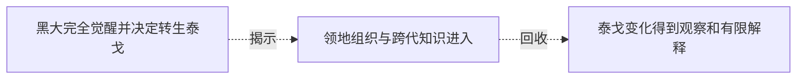

# 跨集 · 泰戈变异与认知成长

[剧情目录](../README.md) · [全书阅读首页](../../README.md)

终点状态：**部分回收**

## 核心问题

泰戈的身体与智力将怎样发展？

## 全书复核结论

已入库至第18集；最近关联事件在第10集。最新状态审计在第18集。泰戈转生、补魂后的体力弹跳和认知提升有观察与实验依据，机制仍有角色推论成分。没有逐项排除训练或体质因素，亦未展示达到普通成人全部认知能力或后记个人终局。

## 关联事件

- [黑大完全觉醒并决定转生泰戈](../vol-06.md)：病情与同行矛盾触发自主发言，身份确认后操控断开，黑大杀泰戈交黑龙转生。
- [领地组织与跨代知识进入](../vol-09.md)：跨段聚合：先祖拜见、斯科特限借，斯文与族人共建领地；后段规划辩论扩展到文化商业，另记泰戈醒来待检，并非同一时点的一场会议。
- [泰戈变化得到观察和有限解释](../vol-10.md)：刀火测试与问答显示身体、智力变化，几名专家提出残魂与悼亡能量变异假说。

## 关系网络

虚线展示因果、铺垫、误导、揭示与回收。每组至多6条关系；组间通过同名节点衔接，不新增时间顺序或因果。

### 关系组1

| 起点 | 关系 | 终点 | 研究说明 |
|---|---|---|---|
| [黑大完全觉醒并决定转生泰戈](../vol-06.md) | 揭示 | [领地组织与跨代知识进入](../vol-09.md) | 转生后的泰戈继续经历沉睡与苏醒，身体变化有表现，修魂解释来自斯科特而具体能力仍待检验 |
| [领地组织与跨代知识进入](../vol-09.md) | 回收 | [泰戈变化得到观察和有限解释](../vol-10.md) | 苏醒时发现的泰戈变化由刀火测试与问答进一步确认，特殊变异原因仍是研究者解释 |

逐条引用依据见[全部语义关系](../relations.md)及事件所在分集页。
