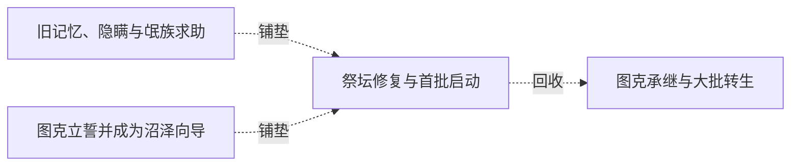

# 跨集 · 图克诞生、守护与祭坛声音来源

[剧情目录](../README.md) · [全书阅读首页](../../README.md)

终点状态：**已回收**

## 核心问题

图克如何诞生，守护本能和祭坛苍老声音来自何处？

## 全书复核结论

已入库至第18集；最近关联事件在第9集。最新状态审计在第18集。祭坛苍老声音来自旧领主记忆烙印，灵魂重新汇聚为图克、末执念形成守护本能，来源问题已明。图克承记忆知识而非旧领主人格复活；后期重伤、祭坛未来与古国消失不能并入本项已回收范围。

## 关联事件

- [图克立誓并成为沼泽向导](../vol-01.md)：图克以灵魂誓约换命，答应服从黑龙并提供沼泽与祭坛知识。
- [黑四受创引出追击失守](../vol-08.md)：雷奥斩断黑四颈，黑龙召公爵图克并全员追敌，火马趁机逃跑；黑四换普通上半身。
- [旧记忆、隐瞒与氓族求助](../vol-08.md)：羊皮书确认阿罗约族源，黑龙隐瞒其死因；族长献忠、揭亡灵祖先与祭坛逆转，委托运魂。
- [祭坛修复与首批启动](../vol-08.md)：阿古力特七日苏醒后与亡灵修复祭坛，黑龙提供魔晶；限载放出三十余魂，启动极致时出现未知苍老声音。
- [图克承继与大批转生](../vol-09.md)：旧领主烙印进入图克，守护和诅咒源头揭开；三千余混合灵魂转生，力王等在威胁下奉誓。

## 关系网络

虚线展示因果、铺垫、误导、揭示与回收。每组至多6条关系；组间通过同名节点衔接，不新增时间顺序或因果。

### 关系组1

| 起点 | 关系 | 终点 | 研究说明 |
|---|---|---|---|
| [旧记忆、隐瞒与氓族求助](../vol-08.md) | 铺垫 | [祭坛修复与首批启动](../vol-08.md) | 族长保存的逆转记录与亡灵传承知识组合，才有修复和重新运行的可能。 |
| [图克立誓并成为沼泽向导](../vol-01.md) | 铺垫 | [祭坛修复与首批启动](../vol-08.md) | 早期提供沼泽与祭坛信息的图克，面对新启动景象显出熟悉感；守护使命的来源仍未揭 |
| [祭坛修复与首批启动](../vol-08.md) | 回收 | [图克承继与大批转生](../vol-09.md) | 祭坛启动后的声音与图克守护来源得到解释，混合灵魂的分批转生完成；知识继承不等于力量或原人格直接替换 |

逐条引用依据见[全部语义关系](../relations.md)及事件所在分集页。
