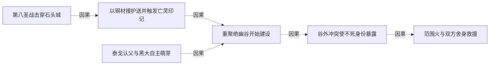

# 全书复核 · 绝幽谷的建设与庇护

[剧情目录](../README.md) · [全书阅读首页](../../README.md)

终点状态：**部分回收**

## 核心问题

新家能否容纳不同生活需求并承受身份暴露后的攻击？

## 全书复核结论

已入库至第18集；最近关联事件在第4集。最新状态审计在第18集。绝幽谷已有水渠房屋并遭身份暴露后的攻击，后文明确原为谷地购买的冶炼工具用于沼泽祭坛炼炉，家园重心发生迁移。终景城市共处不等于旧谷城堡地下城规划完成；旧基地自身结局与新家成果分别记录。

## 关联事件

- [第八圣战击穿石头城](../vol-04.md)：教会在战争中发动献祭召唤摧毁要塞关键工事，帝国攻入同盟；建设物资涨价、教会清洗风险同时落到黑龙队伍。
- [以钢材接护送并触发亡灵印记](../vol-04.md)：梅里尔用十吨钢材换取限期护送，队伍分流；行程中黑龙用灵魂接触宝库徽章，听见北方往生国度的循环召归声。
- [泰戈认父与黑大自主萌芽](../vol-04.md)：返程泰戈误认黑大为父亲，黑龙断联系后观察到自发护人；阿玛去世后复活提议被否，泰戈在母亲治疗的说法下随队。
- [重聚绝幽谷开始建设](../vol-04.md)：队伍重聚，爱琳已引水、洛特已搭房，黑龙与斯文哥尔协商城堡和地下城并建；萝茜同时追踪最后目标娜娜至谷外。
- [谷外冲突使不死身份暴露](../vol-04.md)：斯文哥尔识破伪装圣骑，黑龙抢先冲锋；林间肉搏与诅咒使萝茜识别不死者，双方转入法术和技巧对抗。
- [范围火与双方舍身救援](../vol-04.md)：斯文哥尔范围火被抗火光环应对；黑七受审判失联令黑龙怒伤萝茜，再救黑七而引焰上身；岗撒罗斯转移萝茜致命伤并交出旧吊坠。

## 关系网络

虚线展示因果、铺垫、误导、揭示与回收。每组至多6条关系；组间通过同名节点衔接，不新增时间顺序或因果。

### 关系组1

| 起点 | 关系 | 终点 | 研究说明 |
|---|---|---|---|
| [第八圣战击穿石头城](../vol-04.md) | 因果 | [以钢材接护送并触发亡灵印记](../vol-04.md) | 战时缺钢及征调使实物酬劳促成雇佣 |
| [以钢材接护送并触发亡灵印记](../vol-04.md) | 因果 | [重聚绝幽谷开始建设](../vol-04.md) | 钢材报酬与分队准备供给谷地建设 |
| [泰戈认父与黑大自主萌芽](../vol-04.md) | 因果 | [重聚绝幽谷开始建设](../vol-04.md) | 带走泰戈使其加入谷地生活与劳动 |
| [重聚绝幽谷开始建设](../vol-04.md) | 因果 | [谷外冲突使不死身份暴露](../vol-04.md) | 追踪娜娜的位置使审判小队与据点护卫相遇 |
| [谷外冲突使不死身份暴露](../vol-04.md) | 因果 | [范围火与双方舍身救援](../vol-04.md) | 身份曝光促灭口火攻，交战重伤触发双重救援 |

逐条引用依据见[全部语义关系](../relations.md)及事件所在分集页。
