# 跨集 · 帝国来源、黑晶与回归

[剧情目录](../README.md) · [全书阅读首页](../../README.md)

终点状态：**部分回收**

## 核心问题

旧帝国及黑晶的来源与放逐后果怎样得到说明？

## 全书复核结论

已入库至第18集；最近关联事件在第18集。最新状态审计在第18集。三君王及放逐史、哈力与子民灵魂回归、黑晶为混沌之灵实体、残印被抹及切里莫造新本源陆续明确。起始之夜旧本源觉醒到爆炸的完整讲述被打断，切里莫口述不等独立证实的全部宇宙史；回归也不是物理大陆迁来。

## 暗线时间图片

按主线阅读进度向下推进；分页保留关系编号与接续说明，每张均带全书终点状态。

[PNG原尺寸](../images/book-2c92e5ad3024-01.png) · [SVG矢量图](../images/book-2c92e5ad3024-01.svg)

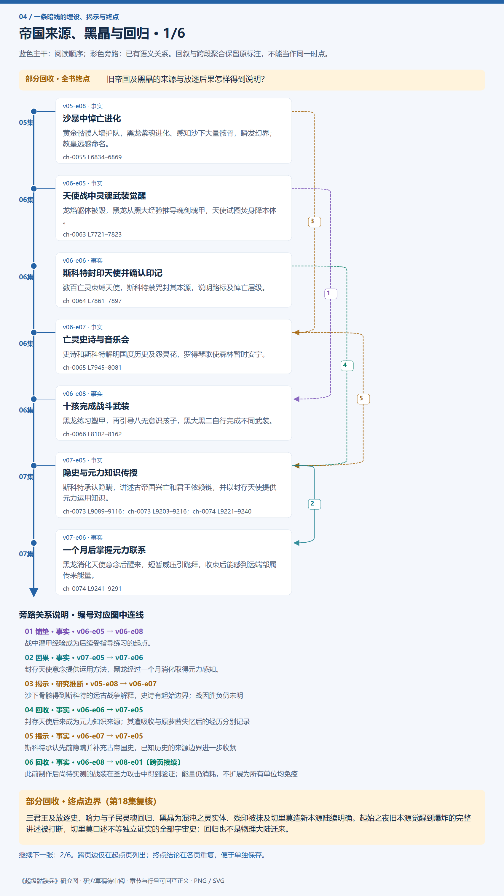

[PNG原尺寸](../images/book-2c92e5ad3024-02.png) · [SVG矢量图](../images/book-2c92e5ad3024-02.svg)

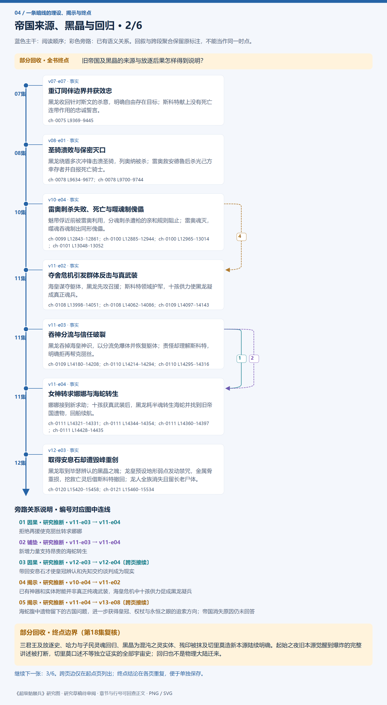

[PNG原尺寸](../images/book-2c92e5ad3024-03.png) · [SVG矢量图](../images/book-2c92e5ad3024-03.svg)

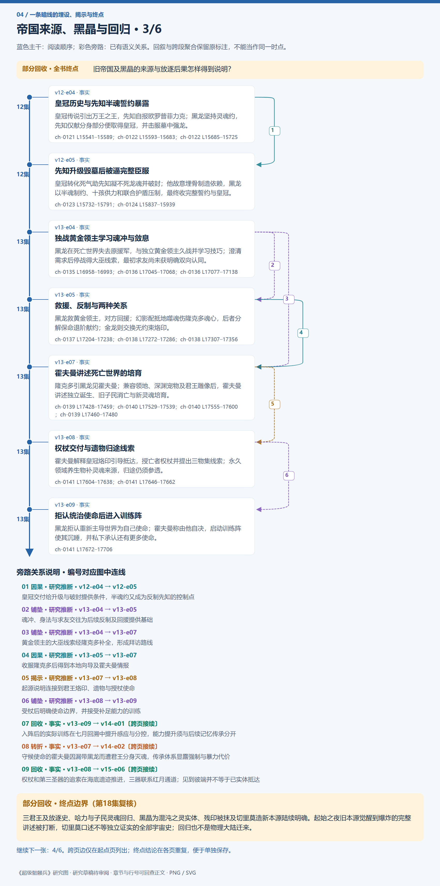

[PNG原尺寸](../images/book-2c92e5ad3024-04.png) · [SVG矢量图](../images/book-2c92e5ad3024-04.svg)

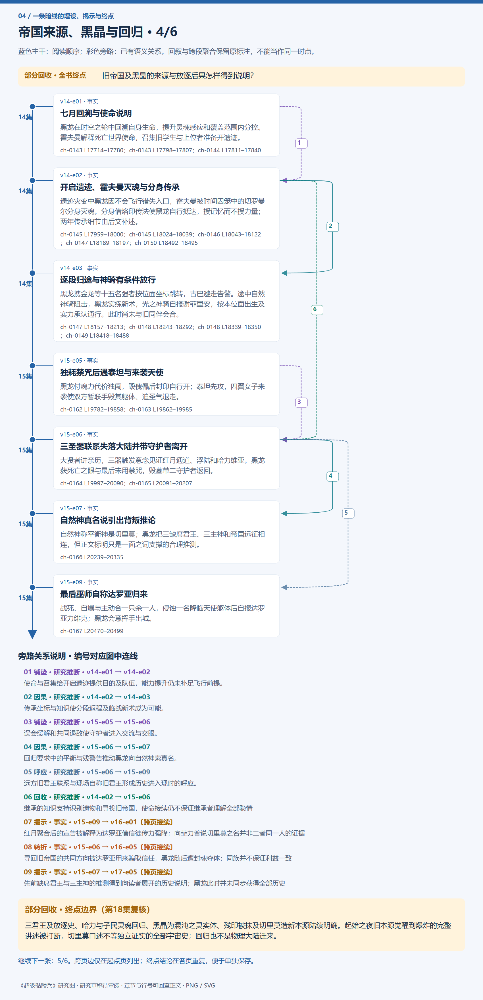

[PNG原尺寸](../images/book-2c92e5ad3024-05.png) · [SVG矢量图](../images/book-2c92e5ad3024-05.svg)

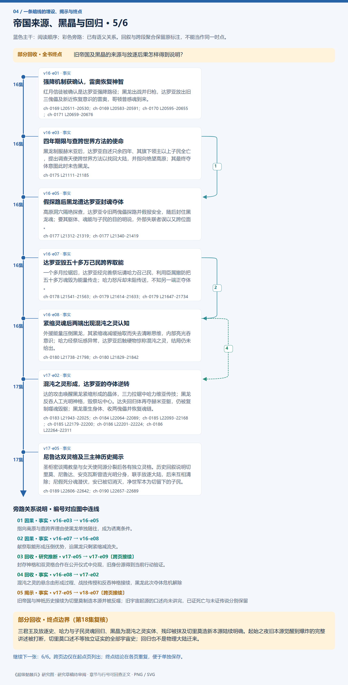

[PNG原尺寸](../images/book-2c92e5ad3024-06.png) · [SVG矢量图](../images/book-2c92e5ad3024-06.svg)

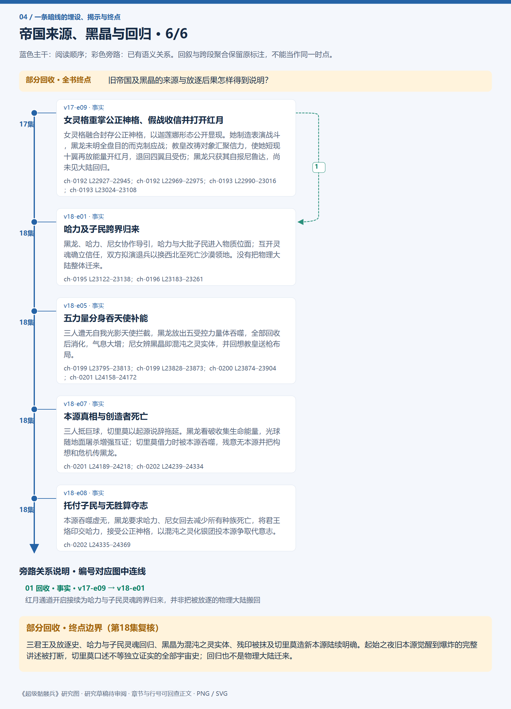

## 关联事件

- [沙暴中悼亡进化](../vol-05.md)：黄金骷髅人墙护队，黑龙紫魂进化、感知沙下大量骸骨，瞬发幻界；教皇远感命名。
- [天使战中灵魂武装觉醒](../vol-06.md)：龙焰躯体被毁，黑龙从黑大经验推导魂剑魂甲，天使试图焚身降本体。
- [斯科特封印天使并确认印记](../vol-06.md)：数百亡灵束缚天使，斯科特禁咒封其本源，说明路标及悼亡层级。
- [亡灵史诗与音乐会](../vol-06.md)：史诗和斯科特解明国度历史及怨灵花，罗得琴歌使森林暂时安宁。
- [十孩完成战斗武装](../vol-06.md)：黑龙练习塑甲，再引导八无意识孩子，黑大黑二自行完成不同武装。
- [隐史与元力知识传授](../vol-07.md)：斯科特承认隐瞒，讲述古帝国兴亡和君王依赖链，并以封存天使提供元力运用知识。
- [一个月后掌握元力联系](../vol-07.md)：黑龙消化天使意念后醒来，短暂威压引跪拜，收束后能感到远端部属传来能量。
- [重订同伴边界并获效忠](../vol-07.md)：黑龙收回针对斯文的杀意，明确自由存在目标；斯科特献上没有死亡连带作用的忠诚誓言。
- [圣骑溃败与保密灭口](../vol-08.md)：黑龙绕盾多次冲锋击溃圣骑，列奥纳被杀；雷奥救安德鲁后杀光己方幸存者并自报死亡骑士。
- [雷奥刺杀失败、死亡与噬魂制傀儡](../vol-10.md)：魅带俘近前被雷奥利用，分魂刺杀遭枪的亲和规则阻止；雷奥魂灭，噬魂吞魂制出同形傀儡。
- [夺舍危机引发群体反击与真武装](../vol-11.md)：海皇谋夺躯体，黑龙先攻召援；斯科特领域护军，十孩供力使黑龙凝成真正魂兵。
- [吞神分流与信任破裂](../vol-11.md)：黑龙吞掉海皇神识，以分流免爆体并恢复躯体；责怪却理解斯科特，明确拒再帮克丽丝。
- [女神转求娜娜与海蛇转生](../vol-11.md)：娜娜接到新求助；十孩获真武装后，黑龙耗半魂转生海蛇并找到旧帝国遗物，回船续航。
- [取得安息石却遭毁峰重创](../vol-12.md)：黑龙取到毕瑟辨认的黑晶之魄；龙皇预设地形弱点发动禁咒，金属骨重损，挖救亡灵后借斯科特撤回；龙人全族消失且留长老尸体。
- [皇冠历史与先知半魂誓约暴露](../vol-12.md)：皇冠传说引出万王之王，先知自报欧罗普菲力克；黑龙坚持灵魂约，先知仅献分身部分便取得皇冠，并击服墓中强龙。
- [先知升级毁墓后被逼完整臣服](../vol-12.md)：皇冠转化死气助先知凝不死龙魂并破封；他故意埋骨制造依赖，黑龙以半魂制约、十孩供力和联合护盾压制，最终收完整誓约与皇冠。
- [独战黄金领主学习魂冲与敛息](../vol-13.md)：黑龙在死亡世界失去原援军，与独立黄金领主久战并学习技巧；澄清需求后停战得大巫线索，最初求友尚未获明确双向认同。
- [救援、反制与两种关系](../vol-13.md)：黑龙救黄金领主，对方回援；幻影配抵地噬魂伤隆克多魂心，后者分解保命退阶献约；金龙则交换无约束烙印。
- [霍夫曼讲述死亡世界的培育](../vol-13.md)：隆克多引黑龙见霍夫曼；兼容领地、深渊宠物及君王雕像后，霍夫曼讲述独立诞生、旧子民消亡与新灵魂培育。
- [权杖交付与遗物归途线索](../vol-13.md)：霍夫曼解释皇冠烙印引导抵达，授亡者权杖并提出三物集线索；永久领域养生物补灵魂来源，归途仍须参透。
- [拒认统治使命后进入训练阵](../vol-13.md)：黑龙拒认重新主导世界为自己使命；霍夫曼称由他自决，启动训练阵使其沉睡，并私下承认还有更多使命。
- [七月回溯与使命说明](../vol-14.md)：黑龙在时空之轮中回溯自身生命，提升灵魂感应和覆盖范围内分控。霍夫曼解释死亡世界使命，召集旧学生与上位者准备开遗迹。
- [开启遗迹、霍夫曼灭魂与分身传承](../vol-14.md)：遗迹灾变中黑龙因不会飞行错失入口，霍夫曼被时间囚笼中的切罗曼尔分身灭魂。分身借烙印传法使黑龙自行抵达，授记忆而不授力量；两年传承细节由后文补述。
- [逐段归途与神骑有条件放行](../vol-14.md)：黑龙携金龙等十五名强者按位面坐标跳转，古巴避走告警。途中自然神骑阻击，黑龙实练新术；光之神骑自报谢菲里安，按本位面出生及实力承认通行。此时尚未与旧同伴会合。
- [独耗禁咒后遇泰坦与来袭天使](../vol-15.md)：黑龙付魂力代价独闯，毁傀儡后封印自行开；泰坦先攻，四翼女子来袭使双方暂联手毁其躯体、迫圣气退走。
- [三圣器联系失落大陆并带守护者离开](../vol-15.md)：大贤者讲亲历，三器触发意念见证红月通道、浮陆和哈力维亚。黑龙获死亡之眼与最后未用禁咒，毁墓带二守护者返回。
- [自然神真名说引出背叛推论](../vol-15.md)：自然神称平衡神是切里莫；黑龙把三缺席君王、三主神和帝国远征相连，但正文标明只是一面之词支撑的合理推测。
- [最后巫师自称达罗亚归来](../vol-15.md)：战死、自爆与主动合一只余一人，侵蚀一名降临天使躯体后自报达罗亚力绯克；黑龙会意挥手出城。
- [强降机制获确认，雷奥恢复神智](../vol-16.md)：红月信徒被确认是达罗亚强降路径；黑龙出战并归枪，达罗亚放出旧三傀儡及新近恢复意识的雷奥，哥顿普感魂到来。
- [四年期限与查跨世界方法的使命](../vol-16.md)：黑龙制服赫米亚后，达罗亚自述只余四年、其旗下领主以上子民全亡，提出调查天使跨世界方法以找回大陆，并指向绝望高原；其最终夺体意图此时未告黑龙。
- [假探路后黑龙遭达罗亚封魂夺体](../vol-16.md)：高原洞穴隔绝探查，达罗亚令旧两傀儡探路并假报安全，随后封住黑龙魂；要其躯体、魂能与子民的目的明说，外部失联者误以又跨位面。
- [达罗亚毁五十多万己民跨界取能](../vol-16.md)：一个多月拉锯后，达罗亚经完善祭坛请哈力召己民，利用臣属撤防把五十多万魂毁为能量传走；哈力怒斥却未阻传送，不知另一端正夺体。
- [紧缩灵魂后两端出现混沌之灵认知](../vol-16.md)：外援能量压倒黑龙，其紧缩魂减缓抽取而失去清晰思维，内部亮光吞意识；哈力经祭坛感异常，达罗亚后触硬物惊称混沌之灵，结局仍未给出。
- [混沌之灵形成，达罗亚的夺体逆转](../vol-17.md)：达的攻击唤醒黑龙紧缩形成的晶体，三力拉锯中哈力维亚传技；黑龙反吞人工光明神格，毁祭坛中心。达失回归体再夺赫米亚躯，仍被复制噬魂毁躯；黑龙重生身体、收两傀儡并恢复魂链。
- [尼鲁达双灵格及三主神历史揭示](../vol-17.md)：圣柜密谈揭教皇与女天使同源分裂后各有独立灵格。历史回叙说明切里莫、尼鲁达、安克瓦斯曾造光明分身，联手放逐大陆，后来互相清除；尼假死分魂潜伏，安已被切消灭，净世军本为切留下的子民。
- [女灵格重掌公正神格、假战收信并打开红月](../vol-17.md)：女灵格融合封存公正神格，以迦莲娜形态公开显现。她制造表演战斗，黑龙未明全盘目的而克制应战；教皇改祷对象汇聚信力，使她短现十翼再放能量开红月，退回四翼且受伤；黑龙只获其自报尼鲁达，尚未见大陆回归。
- [哈力及子民跨界归来](../vol-18.md)：黑龙、哈力、尼女协作导引，哈力与大批子民进入物质位面；互开灵魂确立信任，双方拟演退兵以换西北至死亡沙漠领地。没有把物理大陆整体迁来。
- [五力量分身吞天使补能](../vol-18.md)：三人遭无自我光影天使拦截，黑龙放出五受控力量体吞噬，全部回收后消化，气息大增；尼女辨黑晶即混沌之灵实体，并回想教皇送枪布局。
- [本源真相与创造者死亡](../vol-18.md)：三人抵巨球，切里莫以起源说辞拖延。黑龙看破收集生命能量，光球随地面屠杀增强互证；切里莫借力时被本源吞噬，残意无本源并把构想和危机传黑龙。
- [托付子民与无胜算夺志](../vol-18.md)：本源吞噬虚无，黑龙要求哈力、尼女回去减少所有种族死亡，将君王烙印交哈力，接受公正神格，以混沌之灵化银团投本源争取代意志。

## 关系网络

虚线展示因果、铺垫、误导、揭示与回收。每组至多6条关系；组间通过同名节点衔接，不新增时间顺序或因果。

### 关系组1

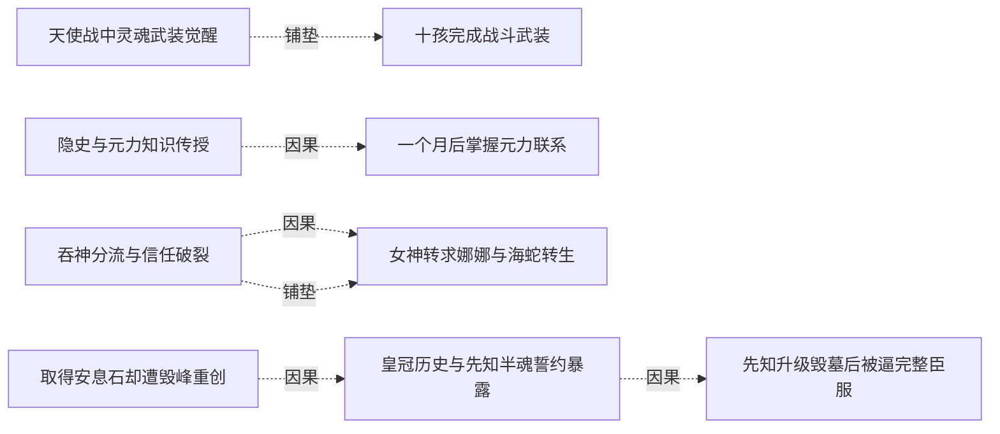

| 起点 | 关系 | 终点 | 研究说明 |
|---|---|---|---|
| [天使战中灵魂武装觉醒](../vol-06.md) | 铺垫 | [十孩完成战斗武装](../vol-06.md) | 战中灌甲经验成为后续受指导练习的起点。 |
| [隐史与元力知识传授](../vol-07.md) | 因果 | [一个月后掌握元力联系](../vol-07.md) | 封存天使意念提供运用方法，黑龙经过一个月消化取得元力感知。 |
| [吞神分流与信任破裂](../vol-11.md) | 因果 | [女神转求娜娜与海蛇转生](../vol-11.md) | 拒绝再援使克丽丝转求娜娜 |
| [吞神分流与信任破裂](../vol-11.md) | 铺垫 | [女神转求娜娜与海蛇转生](../vol-11.md) | 新增力量支持昂贵的海蛇转生 |
| [取得安息石却遭毁峰重创](../vol-12.md) | 因果 | [皇冠历史与先知半魂誓约暴露](../vol-12.md) | 带回安息石才使皇冠辨认和先知交约谈判成为现实 |
| [皇冠历史与先知半魂誓约暴露](../vol-12.md) | 因果 | [先知升级毁墓后被逼完整臣服](../vol-12.md) | 皇冠交付给升级与破封提供条件，半魂约又成为反制先知的控制点 |

### 关系组2

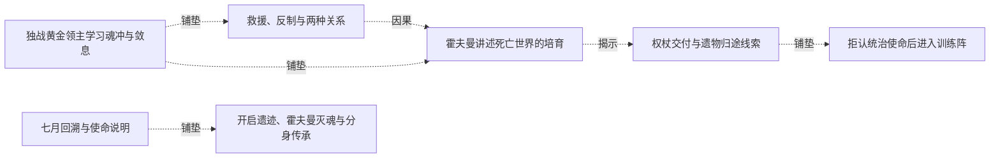

| 起点 | 关系 | 终点 | 研究说明 |
|---|---|---|---|
| [独战黄金领主学习魂冲与敛息](../vol-13.md) | 铺垫 | [救援、反制与两种关系](../vol-13.md) | 魂冲、身法与求友交往为后续反制及回援提供基础 |
| [独战黄金领主学习魂冲与敛息](../vol-13.md) | 铺垫 | [霍夫曼讲述死亡世界的培育](../vol-13.md) | 黄金领主的大巫线索经隆克多补全，形成拜访路线 |
| [救援、反制与两种关系](../vol-13.md) | 因果 | [霍夫曼讲述死亡世界的培育](../vol-13.md) | 收服隆克多后得到本地向导及霍夫曼情报 |
| [霍夫曼讲述死亡世界的培育](../vol-13.md) | 揭示 | [权杖交付与遗物归途线索](../vol-13.md) | 起源说明连接到君王烙印、遗物与授杖使命 |
| [权杖交付与遗物归途线索](../vol-13.md) | 铺垫 | [拒认统治使命后进入训练阵](../vol-13.md) | 受杖后明确使命边界，并接受补足能力的训练 |
| [七月回溯与使命说明](../vol-14.md) | 铺垫 | [开启遗迹、霍夫曼灭魂与分身传承](../vol-14.md) | 使命与召集给开启遗迹提供目的及队伍，能力提升仍未补足飞行前提。 |

### 关系组3

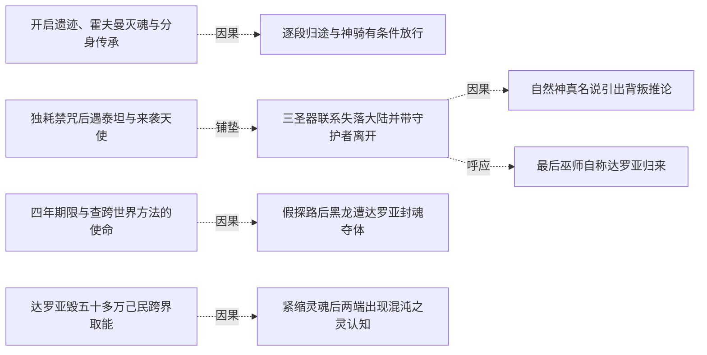

| 起点 | 关系 | 终点 | 研究说明 |
|---|---|---|---|
| [开启遗迹、霍夫曼灭魂与分身传承](../vol-14.md) | 因果 | [逐段归途与神骑有条件放行](../vol-14.md) | 传承坐标与知识使分段返程及临战新术成为可能。 |
| [独耗禁咒后遇泰坦与来袭天使](../vol-15.md) | 铺垫 | [三圣器联系失落大陆并带守护者离开](../vol-15.md) | 误会缓解和共同退敌使守护者进入交流与交眼。 |
| [三圣器联系失落大陆并带守护者离开](../vol-15.md) | 因果 | [自然神真名说引出背叛推论](../vol-15.md) | 回归要求中的平衡与残警告推动黑龙向自然神索真名。 |
| [三圣器联系失落大陆并带守护者离开](../vol-15.md) | 呼应 | [最后巫师自称达罗亚归来](../vol-15.md) | 远方旧君王联系与现场自称旧君王形成历史进入现时的呼应。 |
| [四年期限与查跨世界方法的使命](../vol-16.md) | 因果 | [假探路后黑龙遭达罗亚封魂夺体](../vol-16.md) | 指向高原与查跨界理由使黑龙单独随往，成为诱离条件。 |
| [达罗亚毁五十多万己民跨界取能](../vol-16.md) | 因果 | [紧缩灵魂后两端出现混沌之灵认知](../vol-16.md) | 献祭取能形成压倒优势，迫黑龙只剩紧缩减流失。 |

### 关系组4

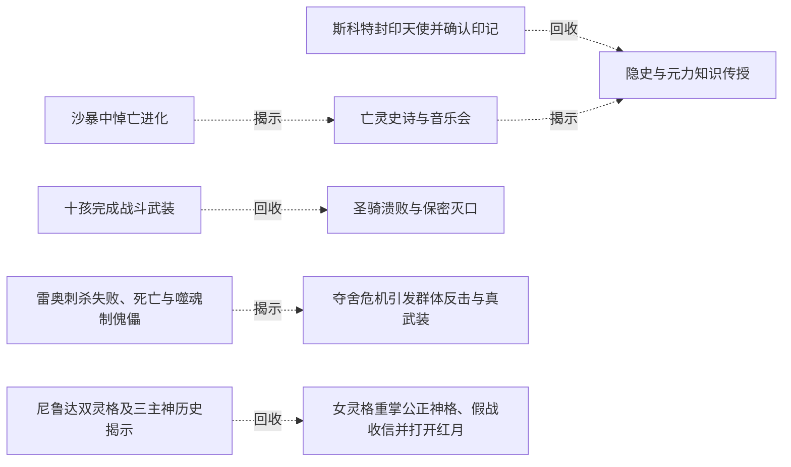

| 起点 | 关系 | 终点 | 研究说明 |
|---|---|---|---|
| [尼鲁达双灵格及三主神历史揭示](../vol-17.md) | 回收 | [女灵格重掌公正神格、假战收信并打开红月](../vol-17.md) | 封存神格和双灵格合作在公开仪式中兑现，旧身份源得到当前行动验证。 |
| [沙暴中悼亡进化](../vol-05.md) | 揭示 | [亡灵史诗与音乐会](../vol-06.md) | 沙下骨骸得到斯科特的远古战争解释，史诗有起始边界；战因胜负仍未明 |
| [斯科特封印天使并确认印记](../vol-06.md) | 回收 | [隐史与元力知识传授](../vol-07.md) | 封存天使后来成为元力知识来源；其遭吸收与原萝茜失忆后的经历分别记录 |
| [亡灵史诗与音乐会](../vol-06.md) | 揭示 | [隐史与元力知识传授](../vol-07.md) | 斯科特承认先前隐瞒并补充古帝国史，已知历史的来源边界进一步收紧 |
| [十孩完成战斗武装](../vol-06.md) | 回收 | [圣骑溃败与保密灭口](../vol-08.md) | 此前制作后尚待实测的战装在圣力攻击中得到验证；能量仍消耗，不扩展为所有单位均免疫 |
| [雷奥刺杀失败、死亡与噬魂制傀儡](../vol-10.md) | 揭示 | [夺舍危机引发群体反击与真武装](../vol-11.md) | 已有神器和实体附能并非真正纯魂武装，海皇危机中十孩供力促成黑龙凝兵 |

### 关系组5

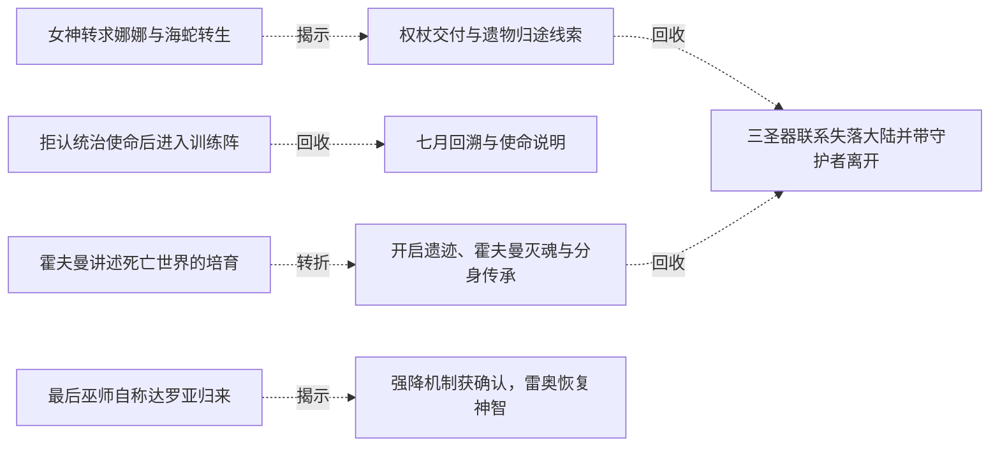

| 起点 | 关系 | 终点 | 研究说明 |
|---|---|---|---|
| [女神转求娜娜与海蛇转生](../vol-11.md) | 揭示 | [权杖交付与遗物归途线索](../vol-13.md) | 海蛇腹中遗物留下的古国问题，进一步获得皇冠、权杖与永恒之眼的追索方向；帝国消失原因仍未回答 |
| [拒认统治使命后进入训练阵](../vol-13.md) | 回收 | [七月回溯与使命说明](../vol-14.md) | 入阵后的实际训练在七月回溯中提升感应与分控，能力提升须与后续记忆传承分开 |
| [霍夫曼讲述死亡世界的培育](../vol-13.md) | 转折 | [开启遗迹、霍夫曼灭魂与分身传承](../vol-14.md) | 守候使命的霍夫曼因漏带黑龙而遭君王分身灭魂，传承体系显露强制与暴力代价 |
| [权杖交付与遗物归途线索](../vol-13.md) | 回收 | [三圣器联系失落大陆并带守护者离开](../vol-15.md) | 权杖和第三圣器的追索在海底遗迹推进，三器联系红月通道；见到彼端并不等于已实体抵达 |
| [开启遗迹、霍夫曼灭魂与分身传承](../vol-14.md) | 回收 | [三圣器联系失落大陆并带守护者离开](../vol-15.md) | 继承的知识支持识别遗物和寻找旧帝国，使命接续仍不保证继承者理解全部隐情 |
| [最后巫师自称达罗亚归来](../vol-15.md) | 揭示 | [强降机制获确认，雷奥恢复神智](../vol-16.md) | 红月聚合后的宣告被解释为达罗亚借信徒传力强降；向菲力普说切里莫之名并非二者同一人的证据 |

### 关系组6

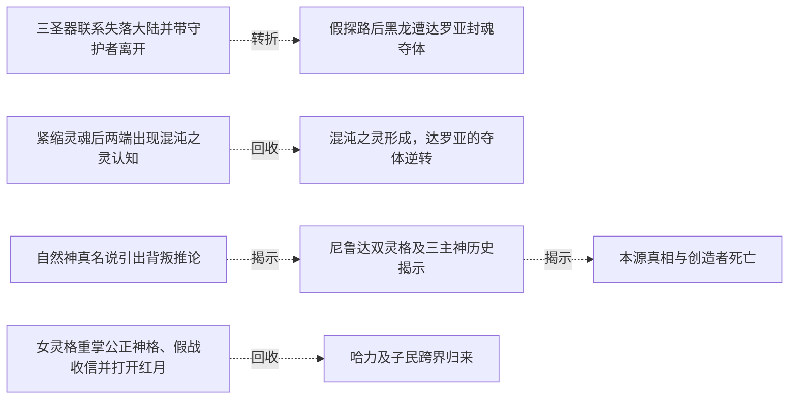

| 起点 | 关系 | 终点 | 研究说明 |
|---|---|---|---|
| [三圣器联系失落大陆并带守护者离开](../vol-15.md) | 转折 | [假探路后黑龙遭达罗亚封魂夺体](../vol-16.md) | 寻回旧帝国的共同方向被达罗亚用来骗取信任，黑龙随后遭封魂夺体；同族并不保证利益一致 |
| [紧缩灵魂后两端出现混沌之灵认知](../vol-16.md) | 回收 | [混沌之灵形成，达罗亚的夺体逆转](../vol-17.md) | 混沌之灵的悬念由形成过程、战技传授和反吞神格接续，黑龙此次夺体危机解除 |
| [自然神真名说引出背叛推论](../vol-15.md) | 揭示 | [尼鲁达双灵格及三主神历史揭示](../vol-17.md) | 先前缺席君王与三主神的推测得到向读者展开的历史说明；黑龙此时并未同步获得全部历史 |
| [女灵格重掌公正神格、假战收信并打开红月](../vol-17.md) | 回收 | [哈力及子民跨界归来](../vol-18.md) | 红月通道开启接续为哈力与子民灵魂跨界归来，并非把被放逐的物理大陆搬回 |
| [尼鲁达双灵格及三主神历史揭示](../vol-17.md) | 揭示 | [本源真相与创造者死亡](../vol-18.md) | 旧帝国与神祇历史接续为切里莫制造本源并被反噬；旧宇宙起源的口述尚未讲完，已证死亡与未证传说分别保留 |

逐条引用依据见[全部语义关系](../relations.md)及事件所在分集页。
