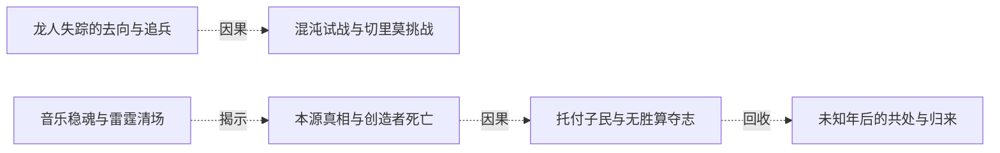

# 全书复核 · 深渊入侵与跨族共处

[剧情目录](../README.md) · [全书阅读首页](../../README.md)

终点状态：**部分回收**

## 核心问题

如何阻止无尽深渊入侵并结束死亡循环？

## 全书复核结论

已入库至第18集；最近关联事件在第18集。最新状态审计在第18集。守门军、稳魂乐章和雷霆清场获得局部战果，魔龙未因此尽灭且门继续输兵。黑龙要求减少各族死亡，后记深渊门转为往来通道；具体停战、统一势力后续和军队终局缺失，不能把方向性和平写成完整军事过程。

## 关联事件

- [龙人失踪的去向与追兵](../vol-18.md)：帝勒说明族群因生计迁深渊、遭统一军队侵略后不足两千返回，自己与龙皇被追兵逼至黑龙处。深渊大巫身份此时主要由尼女判断。
- [混沌试战与切里莫挑战](../vol-18.md)：哈力杀魔眼，黑龙试验冲击转化、受死亡之指毁躯后学会回击并修复；余三魔物受烙活下。切里莫投影现身，随后开启深渊门，哈力军团接战。
- [投影反追与跨界追击](../vol-18.md)：黑龙操死象时感知提升，冻结投影碎片取得坐标，却被远袭重创，哈力挡击后黑龙撕裂位面；尼女加入追击。
- [音乐稳魂与雷霆清场](../vol-18.md)：切里莫投影送雾掩护三领主，施乃图与先知合守。乐团先死六人，罗得安魂曲稳住军队并助杀魔眼；受保护蓄势后雷霆杀近十五万魔物，门仍输兵。
- [本源真相与创造者死亡](../vol-18.md)：三人抵巨球，切里莫以起源说辞拖延。黑龙看破收集生命能量，光球随地面屠杀增强互证；切里莫借力时被本源吞噬，残意无本源并把构想和危机传黑龙。
- [托付子民与无胜算夺志](../vol-18.md)：本源吞噬虚无，黑龙要求哈力、尼女回去减少所有种族死亡，将君王烙印交哈力，接受公正神格，以混沌之灵化银团投本源争取代意志。
- [未知年后的共处与归来](../vol-18.md)：后记黑龙意识醒来，看见飞艇、巨龙运输、深渊出入门、多族市场与蓝晶售冰。菲力普、罗得、斯文、娜娜仍在；哈力号角迎回，黑龙重现原形。

## 关系网络

虚线展示因果、铺垫、误导、揭示与回收。每组至多6条关系；组间通过同名节点衔接，不新增时间顺序或因果。

### 关系组1

| 起点 | 关系 | 终点 | 研究说明 |
|---|---|---|---|
| [龙人失踪的去向与追兵](../vol-18.md) | 因果 | [混沌试战与切里莫挑战](../vol-18.md) | 龙人追兵抵达，提供黑龙实验对象并显出深渊战争方向。 |
| [音乐稳魂与雷霆清场](../vol-18.md) | 揭示 | [本源真相与创造者死亡](../vol-18.md) | 雷霆造成的大量死亡与巨球增幅并置，验证黑龙关于收集生命能量的判断。 |
| [本源真相与创造者死亡](../vol-18.md) | 因果 | [托付子民与无胜算夺志](../vol-18.md) | 切里莫残意提供本源危机和唯一替代方法，使黑龙改变战斗目标。 |
| [托付子民与无胜算夺志](../vol-18.md) | 回收 | [未知年后的共处与归来](../vol-18.md) | 自由存在与同伴生存愿望，在多年后的共处生活和主体归来中获得结果见证，过程未描写。 |

逐条引用依据见[全部语义关系](../relations.md)及事件所在分集页。
