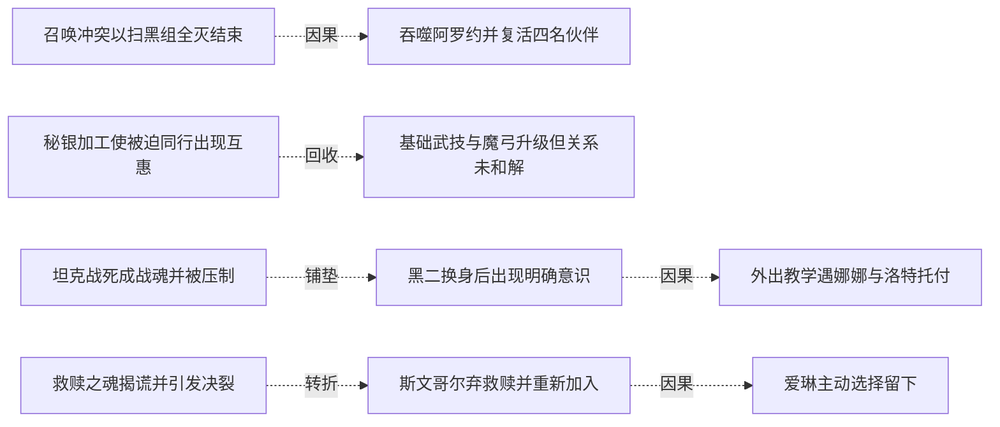
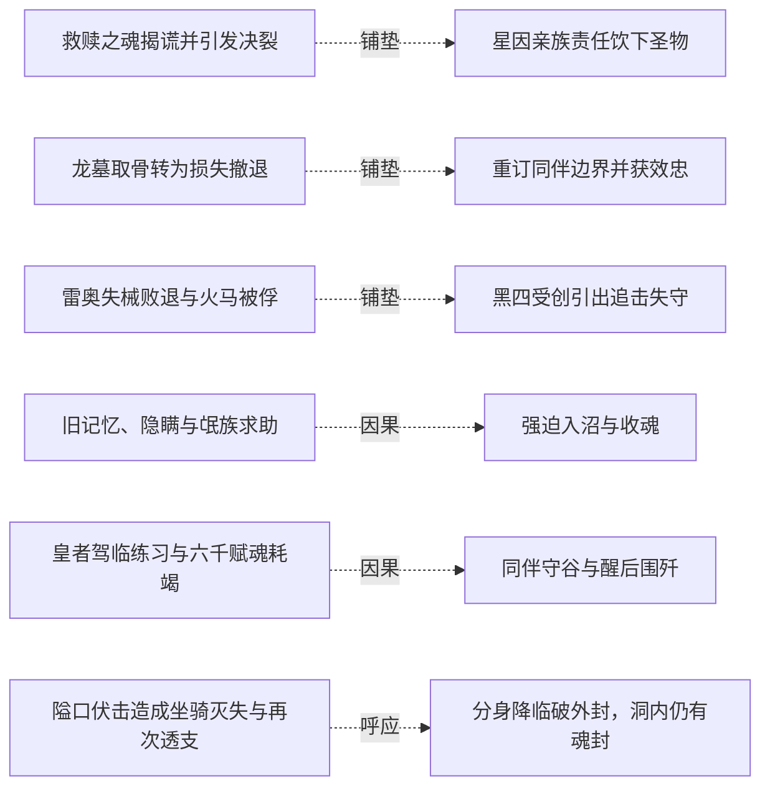
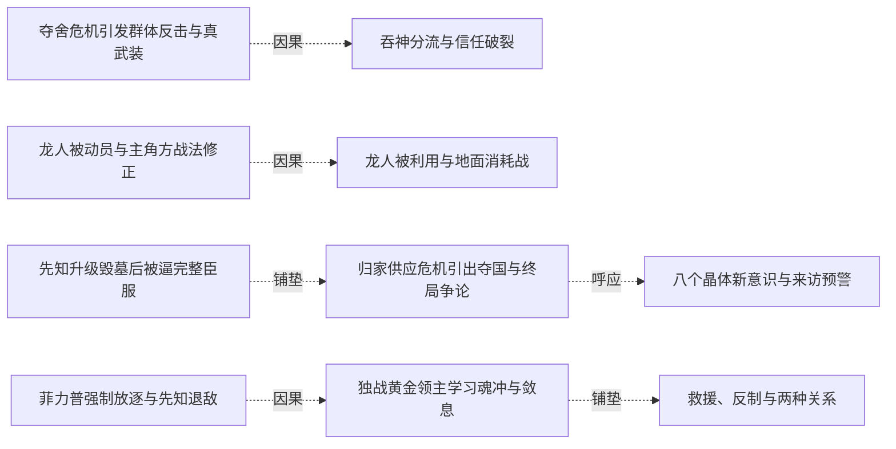
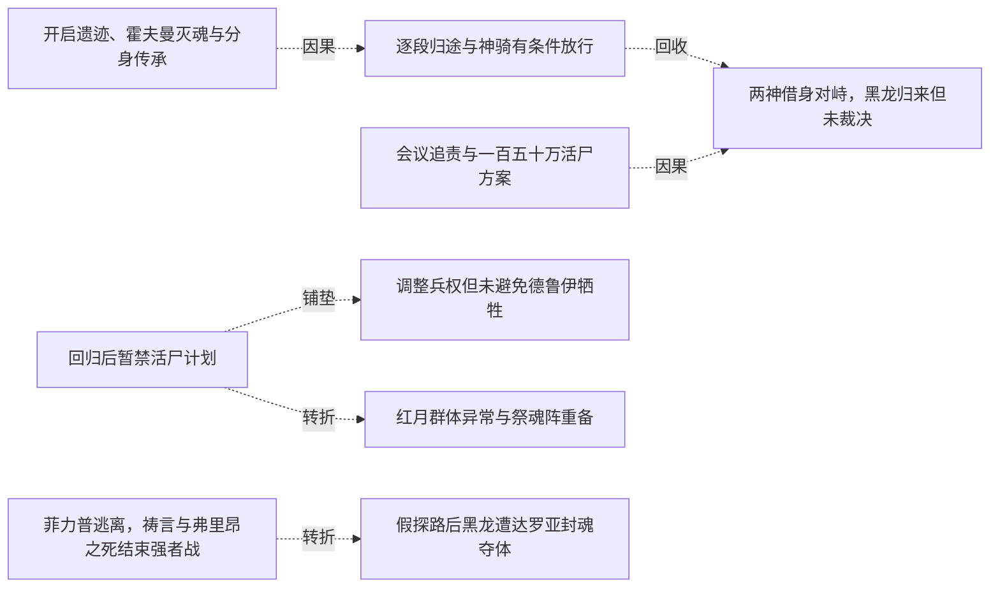
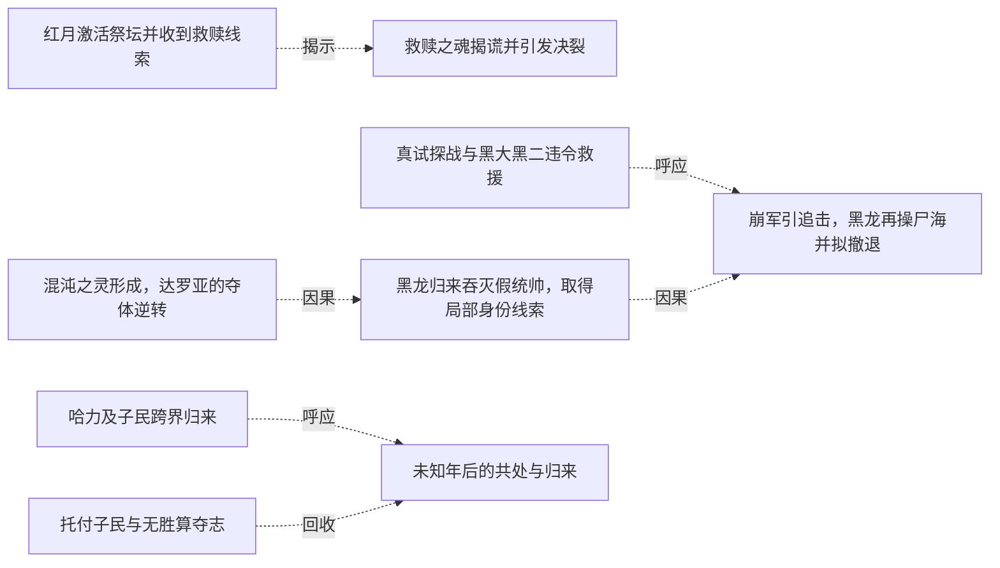
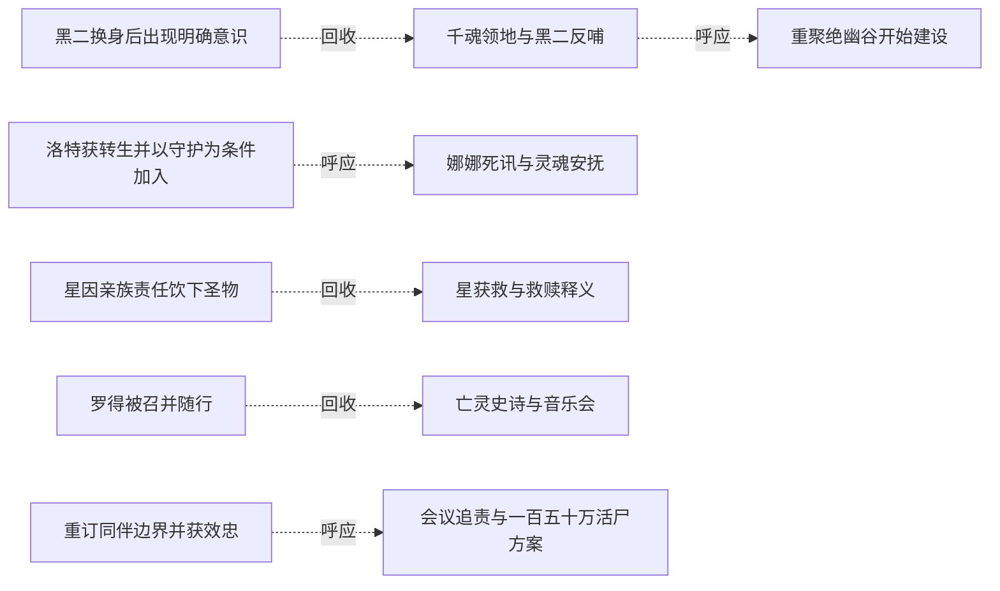
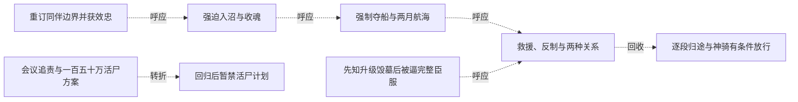
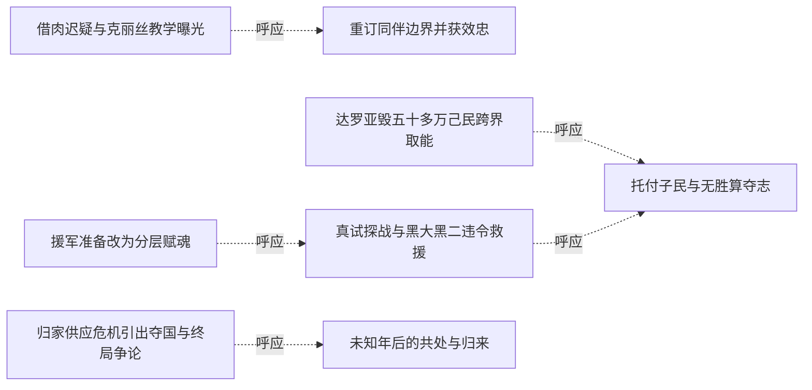

# 跨集 · 自由存在与同伴关系

[剧情目录](../README.md) · [全书阅读首页](../../README.md)

终点状态：**已回收**

## 核心问题

黑龙如何在成为顶层存在后保住自己想要的自由与关系？

## 全书复核结论

已入库至第18集；最近关联事件在第18集。最新状态审计在第18集。从被召唤、拒绝支配到愿为同伴承担风险，终卷明确保留自由存在的动机；托付子民、投入本源和后记重新归来给出核心选择的结果。仅关闭这一价值选择与主体归来，不把它扩大为所有同伴命运或社会制度完成。

## 关联事件

- [装死后吞魂凝心并创造十子](../vol-01.md)：黑龙保留自由活动时间，在残魂中获得能源并创造十名骷髅。
- [召唤冲突以扫黑组全灭结束](../vol-01.md)：陪同黑大穿门后，黑龙拒绝阿罗约驱使；佣兵决定消灭他们，撤退报信引发灭口。
- [吞噬阿罗约并复活四名伙伴](../vol-01.md)：黑龙获得碎片魔法知识，为交流而复活四人；伙伴接受生命但计划寻找救赎。
- [图克立誓并成为沼泽向导](../vol-01.md)：图克以灵魂誓约换命，答应服从黑龙并提供沼泽与祭坛知识。
- [秘银加工使被迫同行出现互惠](../vol-01.md)：斯文哥尔制造诅咒长刀，黑龙赠予五公斤秘银，改变其跟随评价。
- [基础武技与魔弓升级但关系未和解](../vol-01.md)：黑龙完成基础训练进入实战学习；星月获新弓却仍对黑龙有芥蒂。
- [红月激活祭坛并收到救赎线索](../vol-02.md)：红月夜祭坛恢复活性；公会情报指雷克丁拥有救赎之魂，巫妖计划离开。
- [改貌携魂穿过围堵](../vol-02.md)：黑龙把斯文哥尔灵魂随身携带，变为老法师，过雷火检查后潜入塞茵城。
- [侦听后与疾风建立合作](../vol-02.md)：黑夜聆听发现疾风计划，黑龙按教师策略提出雇佣并敲晕拦路电狼。
- [坦克战死成战魂并被压制](../vol-02.md)：营寨战清场导致莫非死亡，黑大能量刃显形；坦克战魂最终被黑龙吞入但无法炼化。
- [黑二换身后出现明确意识](../vol-02.md)：黑二主动称将军并解释理由，黑龙确认首位同类产生意识，仍保留新骨架弱点。
- [外出教学遇娜娜与洛特托付](../vol-02.md)：黑龙带黑二识世，阻止斯文哥尔跟随；遇被白衣信众追杀的娜娜，洛特提出照料请求后死去。
- [洛特获转生并以守护为条件加入](../vol-03.md)：黑龙应娜娜请求转生洛特，七天后洛特接受不死身份与保密要求，要求继续守护娜娜。
- [救赎之魂揭谎并引发决裂](../vol-03.md)：黑龙在宝库识别圣物并试探；斯文哥尔谎言被揭，四人短暂失力，黑龙最终放过他们并留下圣物离开。
- [斯文哥尔弃救赎并重新加入](../vol-03.md)：斯文哥尔主动放弃恢复人身，追出援助黑龙清剿幸存者，再明确请求以不死同伴身份留下。
- [千魂领地与黑二反哺](../vol-03.md)：黑龙召起上千亡者并赐长期灵魂，虚脱后获黑二主动反哺；他提出身体自主，安排亡者沉睡，放弃全面转生构想但保留领地。
- [爱琳主动选择留下](../vol-03.md)：爱琳因亲情、风险与对现有关系的依恋，反驳老师劝返，向黑龙请求继续当不死同伴并获接受。
- [星因亲族责任饮下圣物](../vol-03.md)：星月承认个体善恶不由物种决定，却顾虑家人与部落；星饮下救赎之魂后被圣焰吞没，结果未明。
- [娜娜死讯与灵魂安抚](../vol-04.md)：黑龙告知父母死讯使娜娜晕厥，求助克丽丝后以灵魂交流安抚，承诺找遗体并把沉渊木交给娜娜。
- [重聚绝幽谷开始建设](../vol-04.md)：队伍重聚，爱琳已引水、洛特已搭房，黑龙与斯文哥尔协商城堡和地下城并建；萝茜同时追踪最后目标娜娜至谷外。
- [星获救与救赎释义](../vol-05.md)：黑二炼除神力，星月重新归队，盒文澄清救赎为净化回归神。
- [决定穿越三禁地求力](../vol-05.md)：黑龙拒绝无尽躲藏，在知龙墓危险后仍决定北行。
- [罗得被召并随行](../vol-05.md)：琴烙印引出异常召唤，罗得恢复声音、暴露智慧后受契约与保密限制随行。
- [沙暴中悼亡进化](../vol-05.md)：黄金骷髅人墙护队，黑龙紫魂进化、感知沙下大量骸骨，瞬发幻界；教皇远感命名。
- [黑大完全觉醒并决定转生泰戈](../vol-06.md)：病情与同行矛盾触发自主发言，身份确认后操控断开，黑大杀泰戈交黑龙转生。
- [借肉迟疑与克丽丝教学曝光](../vol-06.md)：火战毁皮后黑龙拟取娜娜肉却迟疑，改取水貂；娜娜治疗时说明克丽丝授术。
- [亡灵史诗与音乐会](../vol-06.md)：史诗和斯科特解明国度历史及怨灵花，罗得琴歌使森林暂时安宁。
- [龙墓取骨转为损失撤退](../vol-07.md)：小骨龙被制服，大骨龙试探遭误伤；怒杀触发群龙追击，七具金属骷髅损失，黑七重伤。
- [重订同伴边界并获效忠](../vol-07.md)：黑龙收回针对斯文的杀意，明确自由存在目标；斯科特献上没有死亡连带作用的忠诚誓言。
- [雷奥失械败退与火马被俘](../vol-08.md)：黑龙夺枪、耐伤并抱住火马，逼雷奥脱身；以饶命问讯取得深渊信息，却以未约期限继续扣留。
- [黑四受创引出追击失守](../vol-08.md)：雷奥斩断黑四颈，黑龙召公爵图克并全员追敌，火马趁机逃跑；黑四换普通上半身。
- [旧记忆、隐瞒与氓族求助](../vol-08.md)：羊皮书确认阿罗约族源，黑龙隐瞒其死因；族长献忠、揭亡灵祖先与祭坛逆转，委托运魂。
- [强迫入沼与收魂](../vol-08.md)：阿古力特杀质疑者、威胁入沼并自献祭；黑龙押行，杀反抗族人及请求速死的余者，将魂收进神器。
- [图克承继与大批转生](../vol-09.md)：旧领主烙印进入图克，守护和诅咒源头揭开；三千余混合灵魂转生，力王等在威胁下奉誓。
- [领地组织与跨代知识进入](../vol-09.md)：跨段聚合：先祖拜见、斯科特限借，斯文与族人共建领地；后段规划辩论扩展到文化商业，另记泰戈醒来待检，并非同一时点的一场会议。
- [皇者驾临练习与六千赋魂耗竭](../vol-09.md)：意控尸体由千具练至约两千，选出六千后一次赋魂耗尽，骨军失去指令停摆。
- [同伴守谷与醒后围歼](../vol-09.md)：墨菲斯循痕搜谷，罗得等守护，萝茜杀旧友护主；黑龙醒后协调六千骨军与空骑围歼，但仍极弱。
- [隘口伏击造成坐骑灭失与再次透支](../vol-10.md)：费尔巴尼私查布伏，普通军队最终覆灭仍杀尽随行战马、伤骨骼，黑龙透支再睡。
- [强制夺船与两月航海](../vol-10.md)：黑龙杀转水手，斯文以拘魂威胁逼从，夺两船赴龙岛；无补给需求仍需导航和心理休整。
- [分身降临破外封，洞内仍有魂封](../vol-10.md)：萝茜受改体与注能耗竭，双星失衡崩塌；四人进入内洞见六芒星封魂与未知声音，未完成救援。
- [夺舍危机引发群体反击与真武装](../vol-11.md)：海皇谋夺躯体，黑龙先攻召援；斯科特领域护军，十孩供力使黑龙凝成真正魂兵。
- [吞神分流与信任破裂](../vol-11.md)：黑龙吞掉海皇神识，以分流免爆体并恢复躯体；责怪却理解斯科特，明确拒再帮克丽丝。
- [龙人被动员与主角方战法修正](../vol-11.md)：龙皇以威压动员龙人，斯文纠正对空布阵并配装备，黑大以投枪展示独立解决方案。
- [龙人被利用与地面消耗战](../vol-11.md)：龙皇期待两方互耗；黑龙留预备队、派魅与图克试探，近战造成双方大量死亡，帝勒逐渐意识到受骗。
- [帝勒继承龙魂力量并率族退战](../vol-12.md)：拿不列斯转出元力与记忆后本源沉睡；帝勒用克制干预和退战谈判争取空间，黑龙最终放行并监视。
- [先知升级毁墓后被逼完整臣服](../vol-12.md)：皇冠转化死气助先知凝不死龙魂并破封；他故意埋骨制造依赖，黑龙以半魂制约、十孩供力和联合护盾压制，最终收完整誓约与皇冠。
- [归家供应危机引出夺国与终局争论](../vol-12.md)：回家重逢与分工使先知看到组织潜力；星报钢铁减半，疾风求助夺沙里克，先知提灭世转生计划，黑龙认为那会无聊并未接受。
- [援军准备改为分层赋魂](../vol-12.md)：黑龙仍为保障供应接受援助，先知指出单点指挥限制；黑大黑二学习赐魂并汇聚十孩能量，疾风半月送来万甲万马，战马转生再次消耗孩子们十余天沉睡后稍复的元气。
- [八个晶体新意识与来访预警](../vol-12.md)：海皇分流后获新魂的晶体骨苏醒，测试造成阿古伤势与一骨架断裂；仅八具初觉醒，黑龙命名十一至十八，魅随后报告大量生物靠近。
- [自然神合作与双神传承安排](../vol-13.md)：自然神确认残源处境，以帝国线索促合作；双神选娜娜共同传承，萝茜留护并开始三力融合，仪式尚未完成。
- [菲力普强制放逐与先知退敌](../vol-13.md)：菲力普的自保盘算先由独处视角揭示，随后他抢在弗里昂之前隔离并放逐黑龙；另一处先知消灭两低阶天使，弗里昂逃走。
- [独战黄金领主学习魂冲与敛息](../vol-13.md)：黑龙在死亡世界失去原援军，与独立黄金领主久战并学习技巧；澄清需求后停战得大巫线索，最初求友尚未获明确双向认同。
- [救援、反制与两种关系](../vol-13.md)：黑龙救黄金领主，对方回援；幻影配抵地噬魂伤隆克多魂心，后者分解保命退阶献约；金龙则交换无约束烙印。
- [拒认统治使命后进入训练阵](../vol-13.md)：黑龙拒认重新主导世界为自己使命；霍夫曼称由他自决，启动训练阵使其沉睡，并私下承认还有更多使命。
- [开启遗迹、霍夫曼灭魂与分身传承](../vol-14.md)：遗迹灾变中黑龙因不会飞行错失入口，霍夫曼被时间囚笼中的切罗曼尔分身灭魂。分身借烙印传法使黑龙自行抵达，授记忆而不授力量；两年传承细节由后文补述。
- [逐段归途与神骑有条件放行](../vol-14.md)：黑龙携金龙等十五名强者按位面坐标跳转，古巴避走告警。途中自然神骑阻击，黑龙实练新术；光之神骑自报谢菲里安，按本位面出生及实力承认通行。此时尚未与旧同伴会合。
- [会议追责与一百五十万活尸方案](../vol-14.md)：斯文哥尔等追问额外杀戮与二十万俘虏中约十万劳死；先知已在塞茵设置活尸阵并试过个体，准备牺牲全城一百五十万人用于毁灭双方军队并扩张。斯科特明确赞同，毕瑟态度只是旁观推测。
- [两神借身对峙，黑龙归来但未裁决](../vol-14.md)：自然神通过娜娜、克丽丝通过萝茜显现，先知威胁眼前两分身。魂链恢复后黑龙携队到场询问是否要打架，活尸阵处置、先知责任和战争结局均未在本集裁决。
- [回归后暂禁活尸计划](../vol-15.md)：黑龙重返同伴，以位面规则和当前利益暂禁百万活尸阵，保留正常交战与撤退选择。
- [海皇武装后遭冰禁咒损失](../vol-15.md)：八晶体补魂获得海皇武装；黑龙经海蛇到海底遗迹，逃禁咒时十七十八被冰封冻碎，未见恢复。
- [调整兵权但未避免德鲁伊牺牲](../vol-15.md)：黑龙把德鲁伊出战数减半，强收先知三十六龙魂约仍留指挥职；已投入的五十余德鲁伊全部战死后尸兵扭转局面。
- [红月群体异常与祭魂阵重备](../vol-15.md)：红月巫师无人指挥突袭，力量向生还者集中；天使现身后黑龙同意趁机出击并重备祭魂阵，称不到最后不发动。
- [菲力普逃离，祷言与弗里昂之死结束强者战](../vol-16.md)：菲力普佯作强袭后逃，牧师集体燃命；魅冒耗散风险截击被黑龙救离，达罗亚收祷言。弗里昂拒逃战死，图克半身烧毁；达罗亚随后显出自身光明神格。
- [假探路后黑龙遭达罗亚封魂夺体](../vol-16.md)：高原洞穴隔绝探查，达罗亚令旧两傀儡探路并假报安全，随后封住黑龙魂；要其躯体、魂能与子民的目的明说，外部失联者误以又跨位面。
- [达罗亚毁五十多万己民跨界取能](../vol-16.md)：一个多月拉锯后，达罗亚经完善祭坛请哈力召己民，利用臣属撤防把五十多万魂毁为能量传走；哈力怒斥却未阻传送，不知另一端正夺体。
- [紧缩灵魂后两端出现混沌之灵认知](../vol-16.md)：外援能量压倒黑龙，其紧缩魂减缓抽取而失去清晰思维，内部亮光吞意识；哈力经祭坛感异常，达罗亚后触硬物惊称混沌之灵，结局仍未给出。
- [混沌之灵形成，达罗亚的夺体逆转](../vol-17.md)：达的攻击唤醒黑龙紧缩形成的晶体，三力拉锯中哈力维亚传技；黑龙反吞人工光明神格，毁祭坛中心。达失回归体再夺赫米亚躯，仍被复制噬魂毁躯；黑龙重生身体、收两傀儡并恢复魂链。
- [真试探战与黑大黑二违令救援](../vol-17.md)：教皇部署正规骑阻拦受己方安排的洪流，先知误以领域使骨军止步，派五千骑真试探。光明老兵一万五千全亡，大二不忍同类消耗，带余骑和原八孩违先知令救回同伴。
- [黑龙归来吞灭假统帅，取得局部身份线索](../vol-17.md)：魂链恢复，黑龙到场否认假军归属；光与安德鲁亮出旧身份及尼鲁达名号后，被黑龙吞魂取忆。记忆确认女天使为神骑老师、教皇与尼传承有关，两人随后明确魂散。
- [崩军引追击，黑龙再操尸海并拟撤退](../vol-17.md)：统帅魂散使千万旧军崩溃，人类振奋冲锋；黑龙召回己军，以无魂操骨反击，再吞亡魂操人马尸，微操耗神且不能跨空间携走这些工具。因情报不足，他决定向横断山撤，逐一赋魂仍为计划。
- [哈力及子民跨界归来](../vol-18.md)：黑龙、哈力、尼女协作导引，哈力与大批子民进入物质位面；互开灵魂确立信任，双方拟演退兵以换西北至死亡沙漠领地。没有把物理大陆整体迁来。
- [托付子民与无胜算夺志](../vol-18.md)：本源吞噬虚无，黑龙要求哈力、尼女回去减少所有种族死亡，将君王烙印交哈力，接受公正神格，以混沌之灵化银团投本源争取代意志。
- [未知年后的共处与归来](../vol-18.md)：后记黑龙意识醒来，看见飞艇、巨龙运输、深渊出入门、多族市场与蓝晶售冰。菲力普、罗得、斯文、娜娜仍在；哈力号角迎回，黑龙重现原形。

## 关系网络

虚线展示因果、铺垫、误导、揭示与回收。每组至多6条关系；组间通过同名节点衔接，不新增时间顺序或因果。

### 关系组1

| 起点 | 关系 | 终点 | 研究说明 |
|---|---|---|---|
| [召唤冲突以扫黑组全灭结束](../vol-01.md) | 因果 | [吞噬阿罗约并复活四名伙伴](../vol-01.md) | 战斗留下可复生尸体和阿罗约灵魂 |
| [秘银加工使被迫同行出现互惠](../vol-01.md) | 回收 | [基础武技与魔弓升级但关系未和解](../vol-01.md) | 赠予秘银转为魔弓与有限关系缓和 |
| [坦克战死成战魂并被压制](../vol-02.md) | 铺垫 | [黑二换身后出现明确意识](../vol-02.md) | 战后取得替换尸体，为黑二修复提供条件；首次主动交流发生于修复后，觉醒原因未知 |
| [黑二换身后出现明确意识](../vol-02.md) | 因果 | [外出教学遇娜娜与洛特托付](../vol-02.md) | 黑二产生意识后，黑龙主动带他见世面 |
| [救赎之魂揭谎并引发决裂](../vol-03.md) | 转折 | [斯文哥尔弃救赎并重新加入](../vol-03.md) | 放过并留圣物后，斯文哥尔自愿舍弃复原 |
| [斯文哥尔弃救赎并重新加入](../vol-03.md) | 因果 | [爱琳主动选择留下](../vol-03.md) | 老师留下成为爱琳不愿分离的重要理由 |

### 关系组2

| 起点 | 关系 | 终点 | 研究说明 |
|---|---|---|---|
| [救赎之魂揭谎并引发决裂](../vol-03.md) | 铺垫 | [星因亲族责任饮下圣物](../vol-03.md) | 留下圣物提供星月的独立选择机会 |
| [龙墓取骨转为损失撤退](../vol-07.md) | 铺垫 | [重订同伴边界并获效忠](../vol-07.md) | 不让孩子挑战过强力量的决策成为斯科特判断君王资格的依据。 |
| [雷奥失械败退与火马被俘](../vol-08.md) | 铺垫 | [黑四受创引出追击失守](../vol-08.md) | 火马仍被扣留且早说明有机会就逃，雷奥返回突袭后出现实际脱困窗口。 |
| [旧记忆、隐瞒与氓族求助](../vol-08.md) | 因果 | [强迫入沼与收魂](../vol-08.md) | 族长提出收魂返坛方案并获黑龙接受，后以武力推动生命形式转换。 |
| [皇者驾临练习与六千赋魂耗竭](../vol-09.md) | 因果 | [同伴守谷与醒后围歼](../vol-09.md) | 主角耗竭未下令使队伍无法撤离，同伴守谷遭循痕搜查。 |
| [隘口伏击造成坐骑灭失与再次透支](../vol-10.md) | 呼应 | [分身降临破外封，洞内仍有魂封](../vol-10.md) | 末尾舍弃复活巨兽回应此前不能再耗尽力量的教训。 |

### 关系组3

| 起点 | 关系 | 终点 | 研究说明 |
|---|---|---|---|
| [夺舍危机引发群体反击与真武装](../vol-11.md) | 因果 | [吞神分流与信任破裂](../vol-11.md) | 本源近身逼出吞噬与容量危机 |
| [龙人被动员与主角方战法修正](../vol-11.md) | 因果 | [龙人被利用与地面消耗战](../vol-11.md) | 动员与越崖被导向预定消耗战 |
| [先知升级毁墓后被逼完整臣服](../vol-12.md) | 铺垫 | [归家供应危机引出夺国与终局争论](../vol-12.md) | 受完整约束的先知随队归家，看见组织潜力后转为提出扩张方案 |
| [归家供应危机引出夺国与终局争论](../vol-12.md) | 呼应 | [八个晶体新意识与来访预警](../vol-12.md) | 不愿所有人沉睡的生活判断与寻找真正同类的喜悦互相照应 |
| [菲力普强制放逐与先知退敌](../vol-13.md) | 因果 | [独战黄金领主学习魂冲与敛息](../vol-13.md) | 放逐切断旧支援，使黑龙独自面对陌生不死社会 |
| [独战黄金领主学习魂冲与敛息](../vol-13.md) | 铺垫 | [救援、反制与两种关系](../vol-13.md) | 魂冲、身法与求友交往为后续反制及回援提供基础 |

### 关系组4

| 起点 | 关系 | 终点 | 研究说明 |
|---|---|---|---|
| [开启遗迹、霍夫曼灭魂与分身传承](../vol-14.md) | 因果 | [逐段归途与神骑有条件放行](../vol-14.md) | 传承坐标与知识使分段返程及临战新术成为可能。 |
| [逐段归途与神骑有条件放行](../vol-14.md) | 回收 | [两神借身对峙，黑龙归来但未裁决](../vol-14.md) | 逐段返程终于兑现为魂链恢复与实体会合，之后的裁决仍待发生。 |
| [会议追责与一百五十万活尸方案](../vol-14.md) | 因果 | [两神借身对峙，黑龙归来但未裁决](../vol-14.md) | 全城活尸方案使两神通过载体介入反对；该因果仅指神祇对峙，不指黑龙因争论而归来。 |
| [回归后暂禁活尸计划](../vol-15.md) | 铺垫 | [调整兵权但未避免德鲁伊牺牲](../vol-15.md) | 回归后的集中决策为收回私人兵权建立权威，具体触发是德鲁伊争执。 |
| [回归后暂禁活尸计划](../vol-15.md) | 转折 | [红月群体异常与祭魂阵重备](../vol-15.md) | 原先暂禁的大阵回到备选清单，表明初禁基于时机和收益。 |
| [菲力普逃离，祷言与弗里昂之死结束强者战](../vol-16.md) | 转折 | [假探路后黑龙遭达罗亚封魂夺体](../vol-16.md) | 保护者与职责教导者变为夺体者，真实救援不等长期可信。 |

### 关系组5

| 起点 | 关系 | 终点 | 研究说明 |
|---|---|---|---|
| [混沌之灵形成，达罗亚的夺体逆转](../vol-17.md) | 因果 | [黑龙归来吞灭假统帅，取得局部身份线索](../vol-17.md) | 破局及搜回魂链使黑龙能定位同伴，实体回来识破借名。 |
| [真试探战与黑大黑二违令救援](../vol-17.md) | 呼应 | [崩军引追击，黑龙再操尸海并拟撤退](../vol-17.md) | 大二先救同类、黑龙后召回己军，保护范围和命令优先级形成对照。 |
| [黑龙归来吞灭假统帅，取得局部身份线索](../vol-17.md) | 因果 | [崩军引追击，黑龙再操尸海并拟撤退](../vol-17.md) | 统帅魂散导致军团崩溃并诱发人军追击，黑龙以新控制接管残局。 |
| [哈力及子民跨界归来](../vol-18.md) | 呼应 | [未知年后的共处与归来](../vol-18.md) | 开篇对共存的愿望与末尾多族市场呼应；不把早期未完成划地计划硬认成后记唯一成因。 |
| [托付子民与无胜算夺志](../vol-18.md) | 回收 | [未知年后的共处与归来](../vol-18.md) | 自由存在与同伴生存愿望，在多年后的共处生活和主体归来中获得结果见证，过程未描写。 |
| [红月激活祭坛并收到救赎线索](../vol-02.md) | 揭示 | [救赎之魂揭谎并引发决裂](../vol-03.md) | 被隐瞒的救赎目标取得实物后曝光，引发同伴关系危机 |

### 关系组6

| 起点 | 关系 | 终点 | 研究说明 |
|---|---|---|---|
| [黑二换身后出现明确意识](../vol-02.md) | 回收 | [千魂领地与黑二反哺](../vol-03.md) | 意识确认继续发展为主动反哺和身体自主讨论，尚未解除灵魂依附 |
| [洛特获转生并以守护为条件加入](../vol-03.md) | 呼应 | [娜娜死讯与灵魂安抚](../vol-04.md) | 对娜娜的守护从维持照料者生命延伸到理解失亲痛苦 |
| [千魂领地与黑二反哺](../vol-03.md) | 呼应 | [重聚绝幽谷开始建设](../vol-04.md) | 朗克岭沉睡领地与绝幽谷生活据点分别体现安全归属需求；两处不可合并为同一基地 |
| [星因亲族责任饮下圣物](../vol-03.md) | 回收 | [星获救与救赎释义](../vol-05.md) | 圣焰后果回收为星获救与盒文释义：救赎是净化，并非恢复生前身份 |
| [罗得被召并随行](../vol-05.md) | 回收 | [亡灵史诗与音乐会](../vol-06.md) | 音乐家随队后的安魂琴歌产生战力之外的集体价值；亡妻现状未因此解决 |
| [重订同伴边界并获效忠](../vol-07.md) | 呼应 | [会议追责与一百五十万活尸方案](../vol-14.md) | 早期重订伙伴边界与后期代理者提出全城活尸计划相对照，组织扩大后授权问题再次出现 |

### 关系组7

| 起点 | 关系 | 终点 | 研究说明 |
|---|---|---|---|
| [重订同伴边界并获效忠](../vol-07.md) | 呼应 | [强迫入沼与收魂](../vol-08.md) | 自由存在的宣言与强迫族群接受死亡/运魂安排形成价值冲突；这是主题对照，不声称宣言导致屠杀 |
| [强迫入沼与收魂](../vol-08.md) | 呼应 | [强制夺船与两月航海](../vol-10.md) | 两次以转生和魂约组织行动均包含强迫，后来获得人力不抹去当时的拒绝权缺失 |
| [强制夺船与两月航海](../vol-10.md) | 呼应 | [救援、反制与两种关系](../vol-13.md) | 夺船时的杀转与拘魂，同异界无约束互助并置，显示主角关系选择存在差异而非已经普遍尊重自由 |
| [先知升级毁墓后被逼完整臣服](../vol-12.md) | 呼应 | [救援、反制与两种关系](../vol-13.md) | 先知被逼交出完整魂约，金龙则与黑龙交换无约束烙印；依存与平等关系的条件不同 |
| [救援、反制与两种关系](../vol-13.md) | 回收 | [逐段归途与神骑有条件放行](../vol-14.md) | 无约束互助烙印支持金龙应邀随行；同行不等于改为主从魂约 |
| [会议追责与一百五十万活尸方案](../vol-14.md) | 转折 | [回归后暂禁活尸计划](../vol-15.md) | 黑龙回归后暂时否决全城活尸计划，依据是时机与收益，并非宣布永久放弃或普遍人道原则 |

### 关系组8

| 起点 | 关系 | 终点 | 研究说明 |
|---|---|---|---|
| [借肉迟疑与克丽丝教学曝光](../vol-06.md) | 呼应 | [重订同伴边界并获效忠](../vol-07.md) | 对具体伙伴的关爱边界发展为明确的自由存在宣言；两次选择都未解除灵魂支配关系 |
| [援军准备改为分层赋魂](../vol-12.md) | 呼应 | [真试探战与黑大黑二违令救援](../vol-17.md) | 承担赋魂工作后的大二在战场违先知命令救同类，工具能力与独立价值选择形成不同层次的成长 |
| [达罗亚毁五十多万己民跨界取能](../vol-16.md) | 呼应 | [托付子民与无胜算夺志](../vol-18.md) | 达罗亚毁己民取能与黑龙要求减少所有种族死亡、托付子民形成价值对照；这一选择不抹去黑龙阵营此前杀戮责任 |
| [真试探战与黑大黑二违令救援](../vol-17.md) | 呼应 | [托付子民与无胜算夺志](../vol-18.md) | 大二主动救同类之后，黑龙把君王烙印交哈力保子民，主体选择与保护责任相连；其余孩子是否觉醒仍未知 |
| [归家供应危机引出夺国与终局争论](../vol-12.md) | 呼应 | [未知年后的共处与归来](../vol-18.md) | 旧领地供应与治理困难在后记自由城市生活中获得方向性回应，具体停战和制度过程仍被省略 |

逐条引用依据见[全部语义关系](../relations.md)及事件所在分集页。
