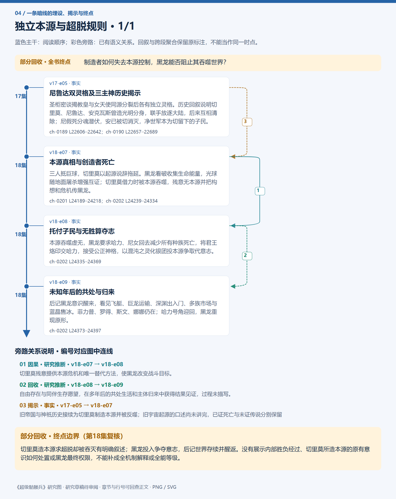
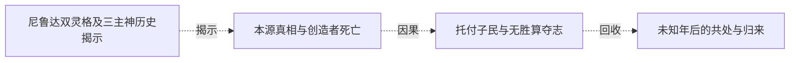

# 跨集 · 独立本源与超脱规则

[剧情目录](../README.md) · [全书阅读首页](../../README.md)

终点状态：**部分回收**

## 核心问题

制造者如何失去本源控制，黑龙能否阻止其吞噬世界？

## 全书复核结论

已入库至第18集；最近关联事件在第18集。最新状态审计在第18集。切里莫造本源求超脱却被吞灭有明确叙述；黑龙投入争夺意志，后记世界存续并醒返。没有展示内部胜负经过、切里莫所造本源的原有意识如何处置或黑龙最终权限，不能补成全机制解释或全能等级。

## 暗线时间图片

按主线阅读进度向下推进；分页保留关系编号与接续说明，每张均带全书终点状态。

[PNG原尺寸](../images/book-3ec69c740e20-01.png) · [SVG矢量图](../images/book-3ec69c740e20-01.svg)

## 关联事件

- [尼鲁达双灵格及三主神历史揭示](../vol-17.md)：圣柜密谈揭教皇与女天使同源分裂后各有独立灵格。历史回叙说明切里莫、尼鲁达、安克瓦斯曾造光明分身，联手放逐大陆，后来互相清除；尼假死分魂潜伏，安已被切消灭，净世军本为切留下的子民。
- [本源真相与创造者死亡](../vol-18.md)：三人抵巨球，切里莫以起源说辞拖延。黑龙看破收集生命能量，光球随地面屠杀增强互证；切里莫借力时被本源吞噬，残意无本源并把构想和危机传黑龙。
- [托付子民与无胜算夺志](../vol-18.md)：本源吞噬虚无，黑龙要求哈力、尼女回去减少所有种族死亡，将君王烙印交哈力，接受公正神格，以混沌之灵化银团投本源争取代意志。
- [未知年后的共处与归来](../vol-18.md)：后记黑龙意识醒来，看见飞艇、巨龙运输、深渊出入门、多族市场与蓝晶售冰。菲力普、罗得、斯文、娜娜仍在；哈力号角迎回，黑龙重现原形。

## 关系网络

虚线展示因果、铺垫、误导、揭示与回收。每组至多6条关系；组间通过同名节点衔接，不新增时间顺序或因果。

### 关系组1

| 起点 | 关系 | 终点 | 研究说明 |
|---|---|---|---|
| [本源真相与创造者死亡](../vol-18.md) | 因果 | [托付子民与无胜算夺志](../vol-18.md) | 切里莫残意提供本源危机和唯一替代方法，使黑龙改变战斗目标。 |
| [托付子民与无胜算夺志](../vol-18.md) | 回收 | [未知年后的共处与归来](../vol-18.md) | 自由存在与同伴生存愿望，在多年后的共处生活和主体归来中获得结果见证，过程未描写。 |
| [尼鲁达双灵格及三主神历史揭示](../vol-17.md) | 揭示 | [本源真相与创造者死亡](../vol-18.md) | 旧帝国与神祇历史接续为切里莫制造本源并被反噬；旧宇宙起源的口述尚未讲完，已证死亡与未证传说分别保留 |

逐条引用依据见[全部语义关系](../relations.md)及事件所在分集页。
