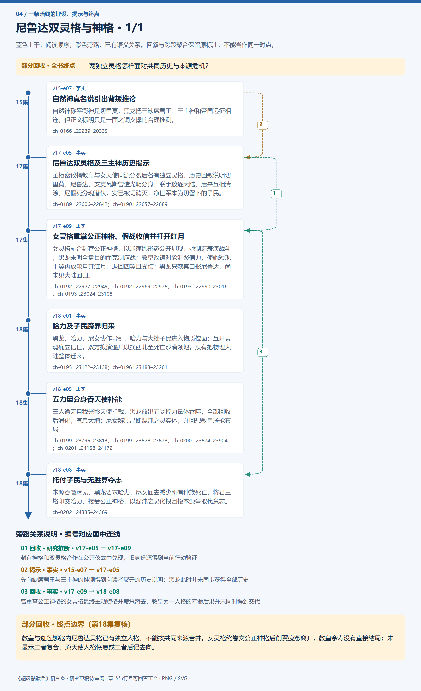
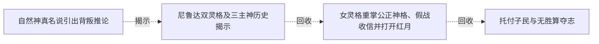

# 跨集 · 尼鲁达双灵格与神格

[剧情目录](../README.md) · [全书阅读首页](../../README.md)

终点状态：**部分回收**

## 核心问题

两独立灵格怎样面对共同历史与本源危机？

## 全书复核结论

已入库至第18集；最近关联事件在第18集。最新状态审计在第18集。教皇与迦莲娜躯内尼鲁达灵格已有独立人格，不能按共同来源合并。女灵格终卷交公正神格后削翼疲惫离开，教皇余寿没有直接结局；未显示二者复合、原天使人格恢复或二者后记去向。

## 暗线时间图片

按主线阅读进度向下推进；分页保留关系编号与接续说明，每张均带全书终点状态。

[PNG原尺寸](../images/book-442e53d9c11d-01.png) · [SVG矢量图](../images/book-442e53d9c11d-01.svg)

## 关联事件

- [自然神真名说引出背叛推论](../vol-15.md)：自然神称平衡神是切里莫；黑龙把三缺席君王、三主神和帝国远征相连，但正文标明只是一面之词支撑的合理推测。
- [尼鲁达双灵格及三主神历史揭示](../vol-17.md)：圣柜密谈揭教皇与女天使同源分裂后各有独立灵格。历史回叙说明切里莫、尼鲁达、安克瓦斯曾造光明分身，联手放逐大陆，后来互相清除；尼假死分魂潜伏，安已被切消灭，净世军本为切留下的子民。
- [女灵格重掌公正神格、假战收信并打开红月](../vol-17.md)：女灵格融合封存公正神格，以迦莲娜形态公开显现。她制造表演战斗，黑龙未明全盘目的而克制应战；教皇改祷对象汇聚信力，使她短现十翼再放能量开红月，退回四翼且受伤；黑龙只获其自报尼鲁达，尚未见大陆回归。
- [哈力及子民跨界归来](../vol-18.md)：黑龙、哈力、尼女协作导引，哈力与大批子民进入物质位面；互开灵魂确立信任，双方拟演退兵以换西北至死亡沙漠领地。没有把物理大陆整体迁来。
- [五力量分身吞天使补能](../vol-18.md)：三人遭无自我光影天使拦截，黑龙放出五受控力量体吞噬，全部回收后消化，气息大增；尼女辨黑晶即混沌之灵实体，并回想教皇送枪布局。
- [托付子民与无胜算夺志](../vol-18.md)：本源吞噬虚无，黑龙要求哈力、尼女回去减少所有种族死亡，将君王烙印交哈力，接受公正神格，以混沌之灵化银团投本源争取代意志。

## 关系网络

虚线展示因果、铺垫、误导、揭示与回收。每组至多6条关系；组间通过同名节点衔接，不新增时间顺序或因果。

### 关系组1

| 起点 | 关系 | 终点 | 研究说明 |
|---|---|---|---|
| [尼鲁达双灵格及三主神历史揭示](../vol-17.md) | 回收 | [女灵格重掌公正神格、假战收信并打开红月](../vol-17.md) | 封存神格和双灵格合作在公开仪式中兑现，旧身份源得到当前行动验证。 |
| [自然神真名说引出背叛推论](../vol-15.md) | 揭示 | [尼鲁达双灵格及三主神历史揭示](../vol-17.md) | 先前缺席君王与三主神的推测得到向读者展开的历史说明；黑龙此时并未同步获得全部历史 |
| [女灵格重掌公正神格、假战收信并打开红月](../vol-17.md) | 回收 | [托付子民与无胜算夺志](../vol-18.md) | 曾重掌公正神格的女灵格最终主动赠格并疲惫离去，教皇另一人格的寿命后果并未同时得到交代 |

逐条引用依据见[全部语义关系](../relations.md)及事件所在分集页。
