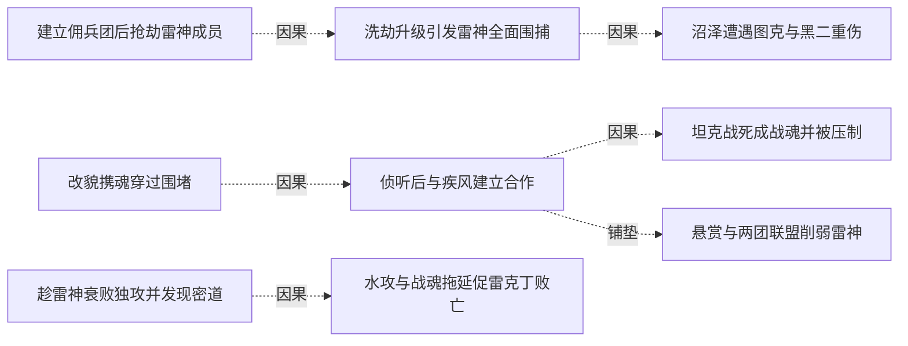
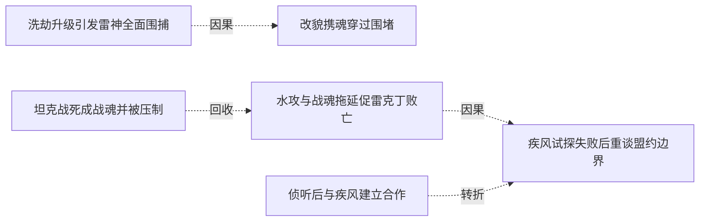

# 跨集 · 雷神败亡后的利益与部族余波

[剧情目录](../README.md) · [全书阅读首页](../../README.md)

终点状态：**部分回收**

## 核心问题

雷神残余和撒拉丁部族如何应对领袖及贸易体系丧失？

## 全书复核结论

已入库至第18集；最近关联事件在第3集。最新状态审计在第18集。雷神总部与雷克丁败亡的直接冲突已结束，但外围成员、撒拉丁部族与贸易丧失的具体后果没有完整后续。不能以故事转场或后记繁荣推成所有相关利益均已安置。

## 关联事件

- [建立佣兵团后抢劫雷神成员](../vol-01.md)：低报酬与装备需求促使黑龙采纳抢劫建议，获得装备并结仇。
- [洗劫升级引发雷神全面围捕](../vol-01.md)：击溃雷火、杀死狂战后继续袭击分部，雷神总部调动组织资源。
- [沼泽遭遇图克与黑二重伤](../vol-01.md)：避入禁地后遭黑武士攻击，黑二自发挡斗气，骷髅队伍以抱杀制服图克。
- [基础武技与魔弓升级但关系未和解](../vol-01.md)：黑龙完成基础训练进入实战学习；星月获新弓却仍对黑龙有芥蒂。
- [改貌携魂穿过围堵](../vol-02.md)：黑龙把斯文哥尔灵魂随身携带，变为老法师，过雷火检查后潜入塞茵城。
- [侦听后与疾风建立合作](../vol-02.md)：黑夜聆听发现疾风计划，黑龙按教师策略提出雇佣并敲晕拦路电狼。
- [坦克战死成战魂并被压制](../vol-02.md)：营寨战清场导致莫非死亡，黑大能量刃显形；坦克战魂最终被黑龙吞入但无法炼化。
- [悬赏与两团联盟削弱雷神](../vol-02.md)：檄文和赏金兑现引动第三方，疾风及火狐狸共同扩张，雷神人员和情报网遭重创。
- [趁雷神衰败独攻并发现密道](../vol-03.md)：艾力克斯被盟军击杀后，斯文哥尔为秘密取得救赎之魂主张自行进攻；黑龙从骸骨信息推测并找到密道。
- [水攻与战魂拖延促雷克丁败亡](../vol-03.md)：密道连到首领卧室导致暴露；黑龙付出断臂等损伤，用战魂与贴身缠抱阻其换气，最后吞其灵魂。
- [疾风试探失败后重谈盟约边界](../vol-03.md)：疾风因战果而来，潜行被黑龙识破；道歉后围绕是否有通报义务交锋，黑龙保留感知机制秘密。

## 关系网络

虚线展示因果、铺垫、误导、揭示与回收。每组至多6条关系；组间通过同名节点衔接，不新增时间顺序或因果。

### 关系组1

| 起点 | 关系 | 终点 | 研究说明 |
|---|---|---|---|
| [建立佣兵团后抢劫雷神成员](../vol-01.md) | 因果 | [洗劫升级引发雷神全面围捕](../vol-01.md) | 抢劫与羞辱引发追击，反击扩大组织损失 |
| [洗劫升级引发雷神全面围捕](../vol-01.md) | 因果 | [沼泽遭遇图克与黑二重伤](../vol-01.md) | 全面围捕逼队伍进入沼泽 |
| [改貌携魂穿过围堵](../vol-02.md) | 因果 | [侦听后与疾风建立合作](../vol-02.md) | 潜入酒馆后获得侦听和政治接触机会 |
| [侦听后与疾风建立合作](../vol-02.md) | 因果 | [坦克战死成战魂并被压制](../vol-02.md) | 约定攻营展示实力，遇留守坦克 |
| [侦听后与疾风建立合作](../vol-02.md) | 铺垫 | [悬赏与两团联盟削弱雷神](../vol-02.md) | 联盟给予情报和公开名义，扩大反雷神行动 |
| [趁雷神衰败独攻并发现密道](../vol-03.md) | 因果 | [水攻与战魂拖延促雷克丁败亡](../vol-03.md) | 独攻与密道潜入触发首领近战及提前水攻 |

### 关系组2

| 起点 | 关系 | 终点 | 研究说明 |
|---|---|---|---|
| [水攻与战魂拖延促雷克丁败亡](../vol-03.md) | 因果 | [疾风试探失败后重谈盟约边界](../vol-03.md) | 异常战果促盟友亲自核实与试探 |
| [洗劫升级引发雷神全面围捕](../vol-01.md) | 因果 | [改貌携魂穿过围堵](../vol-02.md) | 前集全面围捕延续为出沼泽障碍，促成改貌携魂的突围方案 |
| [坦克战死成战魂并被压制](../vol-02.md) | 回收 | [水攻与战魂拖延促雷克丁败亡](../vol-03.md) | 未炼化的坦克战魂被释放拖延雷克丁，随后再次压回体内 |
| [侦听后与疾风建立合作](../vol-02.md) | 转折 | [疾风试探失败后重谈盟约边界](../vol-03.md) | 互利联盟在胜利后转为权限与情报边界争论，合作仍继续 |

逐条引用依据见[全部语义关系](../relations.md)及事件所在分集页。
