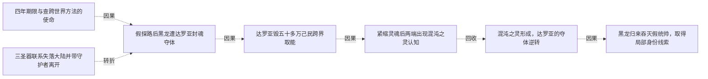

# 跨集 · 达罗亚夺体危机的现场解除

[剧情目录](../README.md) · [全书阅读首页](../../README.md)

终点状态：**已回收**

## 核心问题

黑龙能否摆脱此次夺体并重建与子民联系？

## 全书复核结论

已入库至第18集；最近关联事件在第17集。最新状态审计在第18集。混沌之灵形成后黑龙反制达罗亚，回归部分躯体及所夺赫米亚躯体遭毁，黑龙复躯、恢复魂链并重返队伍。仅关闭这次夺体现场求存；另界残余本源没有被直接证明完全消亡。

## 关联事件

- [三圣器联系失落大陆并带守护者离开](../vol-15.md)：大贤者讲亲历，三器触发意念见证红月通道、浮陆和哈力维亚。黑龙获死亡之眼与最后未用禁咒，毁墓带二守护者返回。
- [四年期限与查跨世界方法的使命](../vol-16.md)：黑龙制服赫米亚后，达罗亚自述只余四年、其旗下领主以上子民全亡，提出调查天使跨世界方法以找回大陆，并指向绝望高原；其最终夺体意图此时未告黑龙。
- [假探路后黑龙遭达罗亚封魂夺体](../vol-16.md)：高原洞穴隔绝探查，达罗亚令旧两傀儡探路并假报安全，随后封住黑龙魂；要其躯体、魂能与子民的目的明说，外部失联者误以又跨位面。
- [达罗亚毁五十多万己民跨界取能](../vol-16.md)：一个多月拉锯后，达罗亚经完善祭坛请哈力召己民，利用臣属撤防把五十多万魂毁为能量传走；哈力怒斥却未阻传送，不知另一端正夺体。
- [紧缩灵魂后两端出现混沌之灵认知](../vol-16.md)：外援能量压倒黑龙，其紧缩魂减缓抽取而失去清晰思维，内部亮光吞意识；哈力经祭坛感异常，达罗亚后触硬物惊称混沌之灵，结局仍未给出。
- [混沌之灵形成，达罗亚的夺体逆转](../vol-17.md)：达的攻击唤醒黑龙紧缩形成的晶体，三力拉锯中哈力维亚传技；黑龙反吞人工光明神格，毁祭坛中心。达失回归体再夺赫米亚躯，仍被复制噬魂毁躯；黑龙重生身体、收两傀儡并恢复魂链。
- [黑龙归来吞灭假统帅，取得局部身份线索](../vol-17.md)：魂链恢复，黑龙到场否认假军归属；光与安德鲁亮出旧身份及尼鲁达名号后，被黑龙吞魂取忆。记忆确认女天使为神骑老师、教皇与尼传承有关，两人随后明确魂散。

## 关系网络

虚线展示因果、铺垫、误导、揭示与回收。每组至多6条关系；组间通过同名节点衔接，不新增时间顺序或因果。

### 关系组1

| 起点 | 关系 | 终点 | 研究说明 |
|---|---|---|---|
| [四年期限与查跨世界方法的使命](../vol-16.md) | 因果 | [假探路后黑龙遭达罗亚封魂夺体](../vol-16.md) | 指向高原与查跨界理由使黑龙单独随往，成为诱离条件。 |
| [假探路后黑龙遭达罗亚封魂夺体](../vol-16.md) | 因果 | [达罗亚毁五十多万己民跨界取能](../vol-16.md) | 黑龙抵抗令局部吞噬僵持，达罗亚启动远方取能后手。 |
| [达罗亚毁五十多万己民跨界取能](../vol-16.md) | 因果 | [紧缩灵魂后两端出现混沌之灵认知](../vol-16.md) | 献祭取能形成压倒优势，迫黑龙只剩紧缩减流失。 |
| [混沌之灵形成，达罗亚的夺体逆转](../vol-17.md) | 因果 | [黑龙归来吞灭假统帅，取得局部身份线索](../vol-17.md) | 破局及搜回魂链使黑龙能定位同伴，实体回来识破借名。 |
| [三圣器联系失落大陆并带守护者离开](../vol-15.md) | 转折 | [假探路后黑龙遭达罗亚封魂夺体](../vol-16.md) | 寻回旧帝国的共同方向被达罗亚用来骗取信任，黑龙随后遭封魂夺体；同族并不保证利益一致 |
| [紧缩灵魂后两端出现混沌之灵认知](../vol-16.md) | 回收 | [混沌之灵形成，达罗亚的夺体逆转](../vol-17.md) | 混沌之灵的悬念由形成过程、战技传授和反吞神格接续，黑龙此次夺体危机解除 |

逐条引用依据见[全部语义关系](../relations.md)及事件所在分集页。
