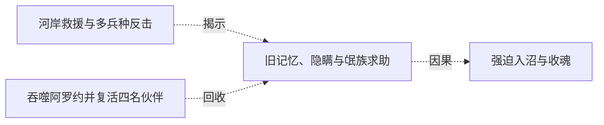

# 跨集 · 阿罗约记忆与被隐藏的旧杀戮

[剧情目录](../README.md) · [全书阅读首页](../../README.md)

终点状态：**未回收**

## 核心问题

氓族若得知阿罗约真实遭遇，联盟会如何改变？

## 全书复核结论

已入库至第18集；最近关联事件在第8集。最新状态审计在第18集。阿罗约与氓族的身份关系已确认，黑龙记忆上的亲近与隐瞒杀人事实同时成立。没有直接展示族长或族民得知死因后的反应，不能以后来奉誓或共同作战视作已知情谅解。

## 关联事件

- [吞噬阿罗约并复活四名伙伴](../vol-01.md)：黑龙获得碎片魔法知识，为交流而复活四人；伙伴接受生命但计划寻找救赎。
- [河岸救援与多兵种反击](../vol-08.md)：黑龙从河底介入氓族断后战，召金属兵和魅率亡灵；菲力普重整后撤，金属骷髅累计损十六。
- [旧记忆、隐瞒与氓族求助](../vol-08.md)：羊皮书确认阿罗约族源，黑龙隐瞒其死因；族长献忠、揭亡灵祖先与祭坛逆转，委托运魂。
- [强迫入沼与收魂](../vol-08.md)：阿古力特杀质疑者、威胁入沼并自献祭；黑龙押行，杀反抗族人及请求速死的余者，将魂收进神器。

## 关系网络

虚线展示因果、铺垫、误导、揭示与回收。每组至多6条关系；组间通过同名节点衔接，不新增时间顺序或因果。

### 关系组1

| 起点 | 关系 | 终点 | 研究说明 |
|---|---|---|---|
| [河岸救援与多兵种反击](../vol-08.md) | 揭示 | [旧记忆、隐瞒与氓族求助](../vol-08.md) | 战后服饰与羊皮书识别，把获救者接回阿罗约的族源和祭坛历史。 |
| [旧记忆、隐瞒与氓族求助](../vol-08.md) | 因果 | [强迫入沼与收魂](../vol-08.md) | 族长提出收魂返坛方案并获黑龙接受，后以武力推动生命形式转换。 |
| [吞噬阿罗约并复活四名伙伴](../vol-01.md) | 回收 | [旧记忆、隐瞒与氓族求助](../vol-08.md) | 早期吞噬阿罗约留下的记忆在氓族相遇时产生亲近与识别，也让被隐瞒的旧杀戮进入联盟关系 |

逐条引用依据见[全部语义关系](../relations.md)及事件所在分集页。
