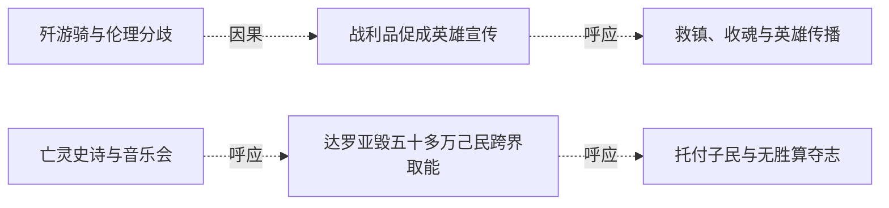

# 跨集 · 吸魂与异族伦理

[剧情目录](../README.md) · [全书阅读首页](../../README.md)

终点状态：**部分回收**

## 核心问题

公平看待异族风险能否兼容对实际杀戮的约束？

## 全书复核结论

已入库至第18集；最近关联事件在第18集。最新状态审计在第18集。吸魂风险争论后出现强制转生、先知杀平民与达罗亚毁己民取能等具体代价。终卷黑龙要求减少任何种族死亡并托付子民，给出价值选择，但未逐项清算己方旧杀戮、所有魂约同意或建立完整约束制度。不能把最终选择写成此前行为均合理。

## 关联事件

- [歼游骑与伦理分歧](../vol-05.md)：远射触发屠俘，团队歼敌；龙焰骨损后修复，黑龙吸能引发罗得抗议。
- [战利品促成英雄宣传](../vol-05.md)：出售帝国战马引官方传播战绩，黑龙获得公共英雄名声。
- [黑大完全觉醒并决定转生泰戈](../vol-06.md)：病情与同行矛盾触发自主发言，身份确认后操控断开，黑大杀泰戈交黑龙转生。
- [亡灵史诗与音乐会](../vol-06.md)：史诗和斯科特解明国度历史及怨灵花，罗得琴歌使森林暂时安宁。
- [救镇、收魂与英雄传播](../vol-09.md)：跨段追踪：黑龙为魂骨消灭屠镇敌军，同伴救助平民，老罗格残魂异常；后段回叙救民事迹被群众和反抗组织传播。
- [达罗亚毁五十多万己民跨界取能](../vol-16.md)：一个多月拉锯后，达罗亚经完善祭坛请哈力召己民，利用臣属撤防把五十多万魂毁为能量传走；哈力怒斥却未阻传送，不知另一端正夺体。
- [托付子民与无胜算夺志](../vol-18.md)：本源吞噬虚无，黑龙要求哈力、尼女回去减少所有种族死亡，将君王烙印交哈力，接受公正神格，以混沌之灵化银团投本源争取代意志。

## 关系网络

虚线展示因果、铺垫、误导、揭示与回收。每组至多6条关系；组间通过同名节点衔接，不新增时间顺序或因果。

### 关系组1

| 起点 | 关系 | 终点 | 研究说明 |
|---|---|---|---|
| [歼游骑与伦理分歧](../vol-05.md) | 因果 | [战利品促成英雄宣传](../vol-05.md) | 战利品作为可见证据经城守转为宣传战绩。 |
| [战利品促成英雄宣传](../vol-05.md) | 呼应 | [救镇、收魂与英雄传播](../vol-09.md) | 两次私人取利与公共救援结果重叠，见证和组织传播分别塑造英雄形象；不是同一宣传活动 |
| [亡灵史诗与音乐会](../vol-06.md) | 呼应 | [达罗亚毁五十多万己民跨界取能](../vol-16.md) | 早期围绕异族危险与吞魂的争论，到毁掉忠诚子民取能时呈现具体权力代价；不能以同族求存理由抹去被牺牲者意愿 |
| [达罗亚毁五十多万己民跨界取能](../vol-16.md) | 呼应 | [托付子民与无胜算夺志](../vol-18.md) | 达罗亚毁己民取能与黑龙要求减少所有种族死亡、托付子民形成价值对照；这一选择不抹去黑龙阵营此前杀戮责任 |

逐条引用依据见[全部语义关系](../relations.md)及事件所在分集页。
