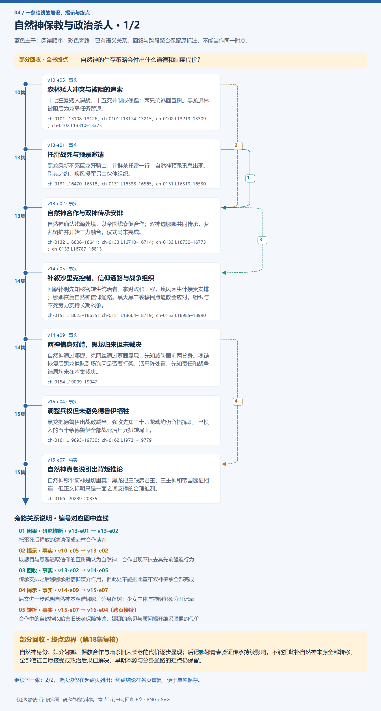
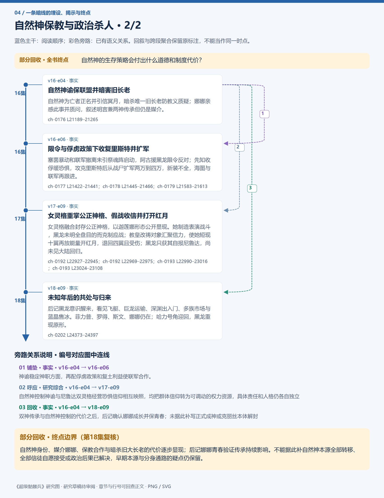
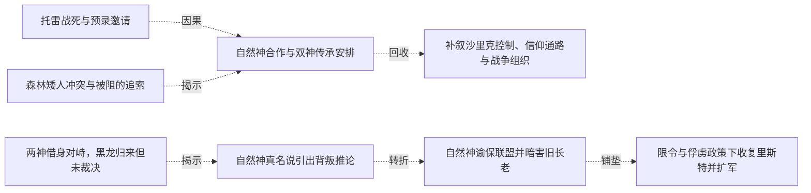
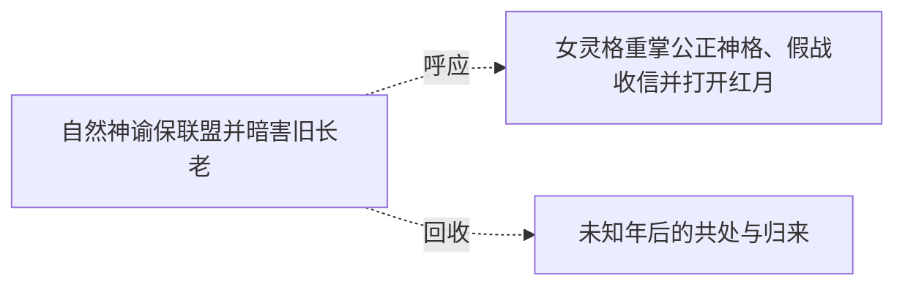

# 跨集 · 自然神保教与政治杀人

[剧情目录](../README.md) · [全书阅读首页](../../README.md)

终点状态：**部分回收**

## 核心问题

自然神的生存策略会付出什么道德和制度代价？

## 全书复核结论

已入库至第18集；最近关联事件在第18集。最新状态审计在第18集。自然神身份、媒介娜娜、保教合作与暗杀旧大长老的代价逐步显现；后记娜娜青春验证传承持续影响。不能据此补自然神本源全部转移、全部信徒自愿接受或政治后果已解决，早期本源与分身通路的疑点仍保留。

## 暗线时间图片

按主线阅读进度向下推进；分页保留关系编号与接续说明，每张均带全书终点状态。

[PNG原尺寸](../images/book-4f19b0c4054c-01.png) · [SVG矢量图](../images/book-4f19b0c4054c-01.svg)

[PNG原尺寸](../images/book-4f19b0c4054c-02.png) · [SVG矢量图](../images/book-4f19b0c4054c-02.svg)

## 关联事件

- [森林矮人冲突与被阻的追索](../vol-10.md)：十七狂暴矮人遇战，十五死并制成傀儡；两兄弟逃回巨树。黑龙追林被阻后为龙岛任务暂退。
- [托雷战死与预录邀请](../vol-13.md)：黑龙乘新不死巨龙歼骑士，并群杀托雷一行；自然神预录讯息出现，引其赴约；疾风援军另由伙伴组织。
- [自然神合作与双神传承安排](../vol-13.md)：自然神确认残源处境，以帝国线索促合作；双神选娜娜共同传承，萝茜留护并开始三力融合，仪式尚未完成。
- [补叙沙里克控制、信仰通路与战争组织](../vol-14.md)：回叙补明先知秘密转生统治者、掌财政和工程，疾风因生计接受安排；娜娜恢复自然神信仰通路。黑大黑二袭移民点逼教会应对，组织与不死劳力支持长期战争。
- [两神借身对峙，黑龙归来但未裁决](../vol-14.md)：自然神通过娜娜、克丽丝通过萝茜显现，先知威胁眼前两分身。魂链恢复后黑龙携队到场询问是否要打架，活尸阵处置、先知责任和战争结局均未在本集裁决。
- [调整兵权但未避免德鲁伊牺牲](../vol-15.md)：黑龙把德鲁伊出战数减半，强收先知三十六龙魂约仍留指挥职；已投入的五十余德鲁伊全部战死后尸兵扭转局面。
- [自然神真名说引出背叛推论](../vol-15.md)：自然神称平衡神是切里莫；黑龙把三缺席君王、三主神和帝国远征相连，但正文标明只是一面之词支撑的合理推测。
- [自然神谕保联盟并暗害旧长老](../vol-16.md)：自然神为亡者正名并引信冥月，暗杀唯一旧长老防教义质疑；娜娜亲感此事并质问，叙述明言兼两神传承但仍是媒介。
- [限令与俘虏政策下收复里斯特并扩军](../vol-16.md)：塞茵暴动和联军撤离未引祭魂阵启动，阿古援黑龙限令反对；先知收俘缓恐惧，攻克里斯特后从战尸扩军两万到四万，新装不全，海图与联军再跟进。
- [女灵格重掌公正神格、假战收信并打开红月](../vol-17.md)：女灵格融合封存公正神格，以迦莲娜形态公开显现。她制造表演战斗，黑龙未明全盘目的而克制应战；教皇改祷对象汇聚信力，使她短现十翼再放能量开红月，退回四翼且受伤；黑龙只获其自报尼鲁达，尚未见大陆回归。
- [未知年后的共处与归来](../vol-18.md)：后记黑龙意识醒来，看见飞艇、巨龙运输、深渊出入门、多族市场与蓝晶售冰。菲力普、罗得、斯文、娜娜仍在；哈力号角迎回，黑龙重现原形。

## 关系网络

虚线展示因果、铺垫、误导、揭示与回收。每组至多6条关系；组间通过同名节点衔接，不新增时间顺序或因果。

### 关系组1

| 起点 | 关系 | 终点 | 研究说明 |
|---|---|---|---|
| [托雷战死与预录邀请](../vol-13.md) | 因果 | [自然神合作与双神传承安排](../vol-13.md) | 托雷死后释放的邀请促成赴林合作谈判 |
| [自然神谕保联盟并暗害旧长老](../vol-16.md) | 铺垫 | [限令与俘虏政策下收复里斯特并扩军](../vol-16.md) | 神谕稳定神职方面，再配俘虏政策和复土利益使联军合作。 |
| [森林矮人冲突与被阻的追索](../vol-10.md) | 揭示 | [自然神合作与双神传承安排](../vol-13.md) | 以惩罚与恩赐逼取信仰的巨树确认为自然神，合作出现不抹去其先前强迫行为 |
| [自然神合作与双神传承安排](../vol-13.md) | 回收 | [补叙沙里克控制、信仰通路与战争组织](../vol-14.md) | 传承安排之后娜娜承担信仰媒介作用，但此处不能据此宣布双神传承全部完成 |
| [两神借身对峙，黑龙归来但未裁决](../vol-14.md) | 揭示 | [自然神真名说引出背叛推论](../vol-15.md) | 后文进一步说明自然神本源借娜娜、分身留树；少女主体与神明仍须分开记录 |
| [自然神真名说引出背叛推论](../vol-15.md) | 转折 | [自然神谕保联盟并暗害旧长老](../vol-16.md) | 合作中的自然神以暗害旧长老保障神谕，娜娜的亲见与质问揭开维系联盟的代价 |

### 关系组2

| 起点 | 关系 | 终点 | 研究说明 |
|---|---|---|---|
| [自然神谕保联盟并暗害旧长老](../vol-16.md) | 呼应 | [女灵格重掌公正神格、假战收信并打开红月](../vol-17.md) | 自然神控制神谕与尼鲁达双灵格经营恐惧信仰相互映照，均把群体信仰转为可调动的权力资源，具体责任和人格仍各自独立 |
| [自然神谕保联盟并暗害旧长老](../vol-16.md) | 回收 | [未知年后的共处与归来](../vol-18.md) | 双神传承与自然神控制的代价之后，后记确认娜娜成长并保青春；未据此补写正式成神或克丽丝本体解封 |

逐条引用依据见[全部语义关系](../relations.md)及事件所在分集页。
