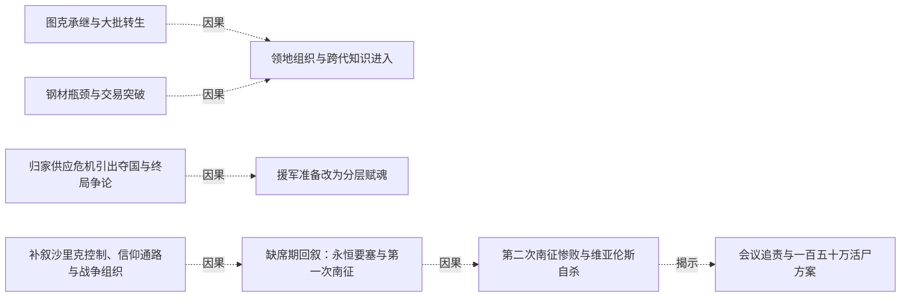
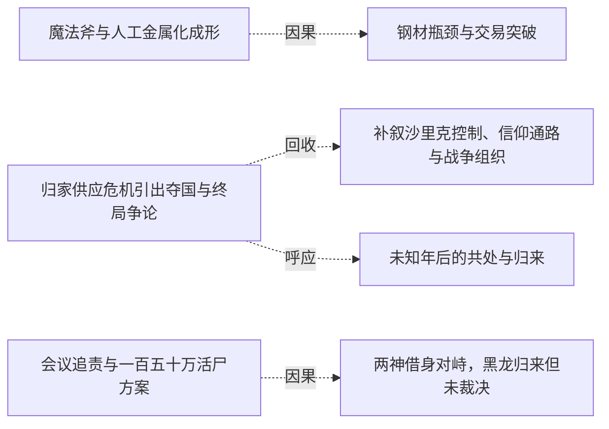

# 跨集 · 军力扩张与智慧治理缺口

[剧情目录](../README.md) · [全书阅读首页](../../README.md)

终点状态：**部分回收**

## 核心问题

无智兵力扩张如何得到资源与治理配套？

## 全书复核结论

已入库至第18集；最近关联事件在第18集。最新状态审计在第18集。资源供应、赋魂分工、无智骑兵扩张与智慧治理不足贯穿领地发展。后记自由城市交通、交易与多族劳动提供生活结果，祭坛被雕像占用且叙述判断原用途已无用；具体制度如何建立、旧居民安置及战争到共处的转换过程仍留白。

## 关联事件

- [魔法斧与人工金属化成形](../vol-07.md)：斯文协助造斧，黑龙与斯科特以无形置换制造金属骷髅，发现附肉和产能限制。
- [图克承继与大批转生](../vol-09.md)：旧领主烙印进入图克，守护和诅咒源头揭开；三千余混合灵魂转生，力王等在威胁下奉誓。
- [钢材瓶颈与交易突破](../vol-09.md)：斯文产能不足促黑龙入城；海图招揽失败，疾风订每月五十吨口头供货并备首批。
- [领地组织与跨代知识进入](../vol-09.md)：跨段聚合：先祖拜见、斯科特限借，斯文与族人共建领地；后段规划辩论扩展到文化商业，另记泰戈醒来待检，并非同一时点的一场会议。
- [归家供应危机引出夺国与终局争论](../vol-12.md)：回家重逢与分工使先知看到组织潜力；星报钢铁减半，疾风求助夺沙里克，先知提灭世转生计划，黑龙认为那会无聊并未接受。
- [援军准备改为分层赋魂](../vol-12.md)：黑龙仍为保障供应接受援助，先知指出单点指挥限制；黑大黑二学习赐魂并汇聚十孩能量，疾风半月送来万甲万马，战马转生再次消耗孩子们十余天沉睡后稍复的元气。
- [缺席期回叙：永恒要塞与第一次南征](../vol-14.md)：外界三年三月的回叙展开。要塞由魔法、骨劳力与人类后勤建成；太子谋军功，第一次三十万大军受黑大、黑二夜袭断粮而撤。十三万损失包括伤员与逃亡，非全部阵亡。
- [补叙沙里克控制、信仰通路与战争组织](../vol-14.md)：回叙补明先知秘密转生统治者、掌财政和工程，疾风因生计接受安排；娜娜恢复自然神信仰通路。黑大黑二袭移民点逼教会应对，组织与不死劳力支持长期战争。
- [第二次南征惨败与维亚伦斯自杀](../vol-14.md)：帝国四十五万军攻坚并付出巨大代价，守方虚构瘟疫造成军队失序，维亚伦斯射杀逃回者，牧师救助后遭后续屠杀。战报为十六万阵亡、二十万被俘、三万失踪，返不足六万；维亚伦斯交印自杀，菲力普暂代军务。
- [会议追责与一百五十万活尸方案](../vol-14.md)：斯文哥尔等追问额外杀戮与二十万俘虏中约十万劳死；先知已在塞茵设置活尸阵并试过个体，准备牺牲全城一百五十万人用于毁灭双方军队并扩张。斯科特明确赞同，毕瑟态度只是旁观推测。
- [两神借身对峙，黑龙归来但未裁决](../vol-14.md)：自然神通过娜娜、克丽丝通过萝茜显现，先知威胁眼前两分身。魂链恢复后黑龙携队到场询问是否要打架，活尸阵处置、先知责任和战争结局均未在本集裁决。
- [音乐魔法获得教学任务](../vol-15.md)：罗得的异常力场经误认和排除后被解释为音乐魔法，黑龙安排招人并令其教学。
- [限令与俘虏政策下收复里斯特并扩军](../vol-16.md)：塞茵暴动和联军撤离未引祭魂阵启动，阿古援黑龙限令反对；先知收俘缓恐惧，攻克里斯特后从战尸扩军两万到四万，新装不全，海图与联军再跟进。
- [未知年后的共处与归来](../vol-18.md)：后记黑龙意识醒来，看见飞艇、巨龙运输、深渊出入门、多族市场与蓝晶售冰。菲力普、罗得、斯文、娜娜仍在；哈力号角迎回，黑龙重现原形。

## 关系网络

虚线展示因果、铺垫、误导、揭示与回收。每组至多6条关系；组间通过同名节点衔接，不新增时间顺序或因果。

### 关系组1

| 起点 | 关系 | 终点 | 研究说明 |
|---|---|---|---|
| [图克承继与大批转生](../vol-09.md) | 因果 | [领地组织与跨代知识进入](../vol-09.md) | 大批转生和先人记忆为领地建设提供人口与知识。 |
| [钢材瓶颈与交易突破](../vol-09.md) | 因果 | [领地组织与跨代知识进入](../vol-09.md) | 首批钢材使骷髅强化可以启动，而建设与制造争用劳力。 |
| [归家供应危机引出夺国与终局争论](../vol-12.md) | 因果 | [援军准备改为分层赋魂](../vol-12.md) | 拒绝灭世终局但接受保供应的有限请求，因此需要隐蔽援军与赋魂分工 |
| [补叙沙里克控制、信仰通路与战争组织](../vol-14.md) | 因果 | [缺席期回叙：永恒要塞与第一次南征](../vol-14.md) | 后置补叙揭示早先工程、财政与军队组织怎样支持要塞防守；这条边追溯故事时间，非叙述顺序。 |
| [缺席期回叙：永恒要塞与第一次南征](../vol-14.md) | 因果 | [第二次南征惨败与维亚伦斯自杀](../vol-14.md) | 首次后方袭击促使第二次大军谨慎推进并保护补给。 |
| [第二次南征惨败与维亚伦斯自杀](../vol-14.md) | 揭示 | [会议追责与一百五十万活尸方案](../vol-14.md) | 战后会议揭示战争结算之外的决策争议和俘虏持续死亡，改变对胜利代价的认识。 |

### 关系组2

| 起点 | 关系 | 终点 | 研究说明 |
|---|---|---|---|
| [会议追责与一百五十万活尸方案](../vol-14.md) | 因果 | [两神借身对峙，黑龙归来但未裁决](../vol-14.md) | 全城活尸方案使两神通过载体介入反对；该因果仅指神祇对峙，不指黑龙因争论而归来。 |
| [魔法斧与人工金属化成形](../vol-07.md) | 因果 | [钢材瓶颈与交易突破](../vol-09.md) | 人工金属化进入扩张阶段后受钢材供给与单人产能限制，促成城中采购和贸易谈判 |
| [归家供应危机引出夺国与终局争论](../vol-12.md) | 回收 | [补叙沙里克控制、信仰通路与战争组织](../vol-14.md) | 夺取沙里克的计划由缺席期回叙补明，财政工程扩张同时伴随统治者秘密转生 |
| [归家供应危机引出夺国与终局争论](../vol-12.md) | 呼应 | [未知年后的共处与归来](../vol-18.md) | 旧领地供应与治理困难在后记自由城市生活中获得方向性回应，具体停战和制度过程仍被省略 |

逐条引用依据见[全部语义关系](../relations.md)及事件所在分集页。
