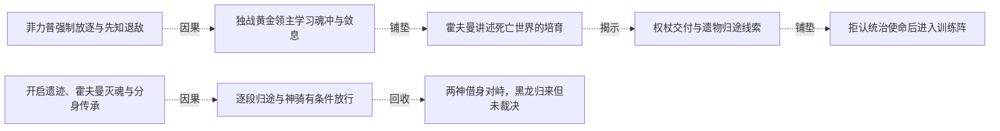
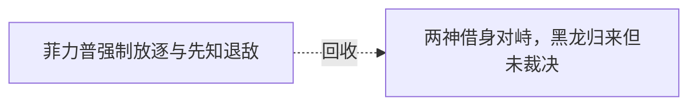

# 跨集 · 放逐后的定位与归途

[剧情目录](../README.md) · [全书阅读首页](../../README.md)

终点状态：**已回收**

## 核心问题

黑龙能否回到物质位面并恢复同伴联系？

## 全书复核结论

已入库至第18集；最近关联事件在第15集。最新状态审计在第18集。黑龙在第十四集抵达归途、十五集开篇带十五同伴重返并参与决策，放逐后的该次归家目标明确完成。终卷再次跨界是另一次行动，不重新打开这项已经达成的旧目标。

## 关联事件

- [菲力普强制放逐与先知退敌](../vol-13.md)：菲力普的自保盘算先由独处视角揭示，随后他抢在弗里昂之前隔离并放逐黑龙；另一处先知消灭两低阶天使，弗里昂逃走。
- [独战黄金领主学习魂冲与敛息](../vol-13.md)：黑龙在死亡世界失去原援军，与独立黄金领主久战并学习技巧；澄清需求后停战得大巫线索，最初求友尚未获明确双向认同。
- [霍夫曼讲述死亡世界的培育](../vol-13.md)：隆克多引黑龙见霍夫曼；兼容领地、深渊宠物及君王雕像后，霍夫曼讲述独立诞生、旧子民消亡与新灵魂培育。
- [权杖交付与遗物归途线索](../vol-13.md)：霍夫曼解释皇冠烙印引导抵达，授亡者权杖并提出三物集线索；永久领域养生物补灵魂来源，归途仍须参透。
- [拒认统治使命后进入训练阵](../vol-13.md)：黑龙拒认重新主导世界为自己使命；霍夫曼称由他自决，启动训练阵使其沉睡，并私下承认还有更多使命。
- [开启遗迹、霍夫曼灭魂与分身传承](../vol-14.md)：遗迹灾变中黑龙因不会飞行错失入口，霍夫曼被时间囚笼中的切罗曼尔分身灭魂。分身借烙印传法使黑龙自行抵达，授记忆而不授力量；两年传承细节由后文补述。
- [逐段归途与神骑有条件放行](../vol-14.md)：黑龙携金龙等十五名强者按位面坐标跳转，古巴避走告警。途中自然神骑阻击，黑龙实练新术；光之神骑自报谢菲里安，按本位面出生及实力承认通行。此时尚未与旧同伴会合。
- [两神借身对峙，黑龙归来但未裁决](../vol-14.md)：自然神通过娜娜、克丽丝通过萝茜显现，先知威胁眼前两分身。魂链恢复后黑龙携队到场询问是否要打架，活尸阵处置、先知责任和战争结局均未在本集裁决。
- [回归后暂禁活尸计划](../vol-15.md)：黑龙重返同伴，以位面规则和当前利益暂禁百万活尸阵，保留正常交战与撤退选择。

## 关系网络

虚线展示因果、铺垫、误导、揭示与回收。每组至多6条关系；组间通过同名节点衔接，不新增时间顺序或因果。

### 关系组1

| 起点 | 关系 | 终点 | 研究说明 |
|---|---|---|---|
| [菲力普强制放逐与先知退敌](../vol-13.md) | 因果 | [独战黄金领主学习魂冲与敛息](../vol-13.md) | 放逐切断旧支援，使黑龙独自面对陌生不死社会 |
| [独战黄金领主学习魂冲与敛息](../vol-13.md) | 铺垫 | [霍夫曼讲述死亡世界的培育](../vol-13.md) | 黄金领主的大巫线索经隆克多补全，形成拜访路线 |
| [霍夫曼讲述死亡世界的培育](../vol-13.md) | 揭示 | [权杖交付与遗物归途线索](../vol-13.md) | 起源说明连接到君王烙印、遗物与授杖使命 |
| [权杖交付与遗物归途线索](../vol-13.md) | 铺垫 | [拒认统治使命后进入训练阵](../vol-13.md) | 受杖后明确使命边界，并接受补足能力的训练 |
| [开启遗迹、霍夫曼灭魂与分身传承](../vol-14.md) | 因果 | [逐段归途与神骑有条件放行](../vol-14.md) | 传承坐标与知识使分段返程及临战新术成为可能。 |
| [逐段归途与神骑有条件放行](../vol-14.md) | 回收 | [两神借身对峙，黑龙归来但未裁决](../vol-14.md) | 逐段返程终于兑现为魂链恢复与实体会合，之后的裁决仍待发生。 |

### 关系组2

| 起点 | 关系 | 终点 | 研究说明 |
|---|---|---|---|
| [菲力普强制放逐与先知退敌](../vol-13.md) | 回收 | [两神借身对峙，黑龙归来但未裁决](../vol-14.md) | 强制放逐导致的失联以实体返场和魂链恢复收束，会议危机仍待处置 |

逐条引用依据见[全部语义关系](../relations.md)及事件所在分集页。
