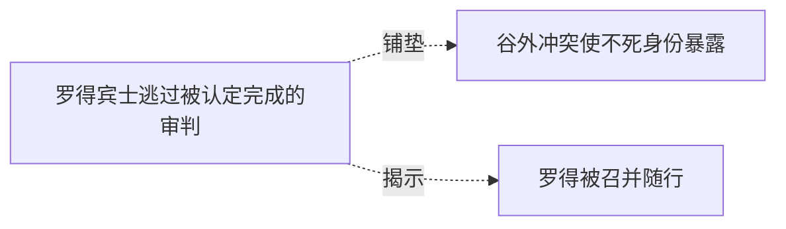

# 跨集 · 罗得的旧次逃生与新相遇

[剧情目录](../README.md) · [全书阅读首页](../../README.md)

终点状态：**未回收**

## 核心问题

罗得早先如何逃过审判，何时转生？

## 全书复核结论

已入库至第18集；最近关联事件在第5集。最新状态审计在第18集。第五集相遇、后来的音乐发展和后记演奏都没有回答此处所问的旧次逃过审判方式与准确转生时点，因此保留open。后续生存和专长进展属其他问法，不能仅凭同一人物的新经历把本项旧案标为部分获答。

## 关联事件

- [罗得宾士逃过被认定完成的审判](../vol-04.md)：萝茜被琴曲短暂打动，遭音攻后焚杀目标并离开；罗得宾士随后再次现身，脱身机制未知。
- [谷外冲突使不死身份暴露](../vol-04.md)：斯文哥尔识破伪装圣骑，黑龙抢先冲锋；林间肉搏与诅咒使萝茜识别不死者，双方转入法术和技巧对抗。
- [罗得被召并随行](../vol-05.md)：琴烙印引出异常召唤，罗得恢复声音、暴露智慧后受契约与保密限制随行。

## 关系网络

虚线展示因果、铺垫、误导、揭示与回收。每组至多6条关系；组间通过同名节点衔接，不新增时间顺序或因果。

### 关系组1

| 起点 | 关系 | 终点 | 研究说明 |
|---|---|---|---|
| [罗得宾士逃过被认定完成的审判](../vol-04.md) | 铺垫 | [谷外冲突使不死身份暴露](../vol-04.md) | 前场展示的圣焰祷言能力为主角遭遇其战法提供准备 |
| [罗得宾士逃过被认定完成的审判](../vol-04.md) | 揭示 | [罗得被召并随行](../vol-05.md) | 此前独立出现且逃过审判的音乐家经异常琴召唤进入主角队伍，逃脱原理仍不能据此推定 |

逐条引用依据见[全部语义关系](../relations.md)及事件所在分集页。
