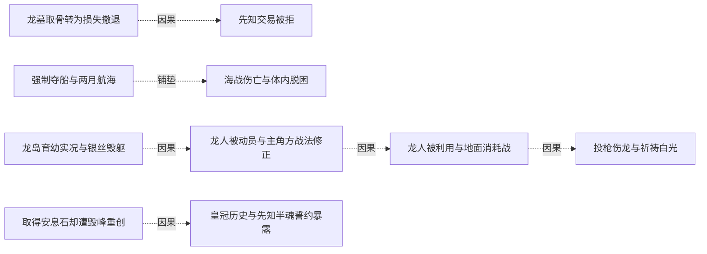
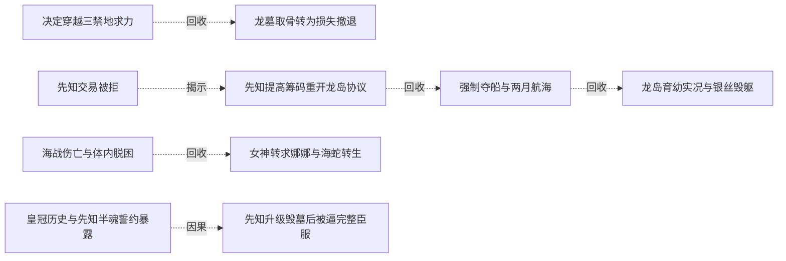
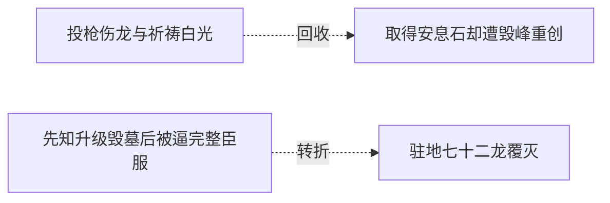

# 跨集 · 取石远征与龙墓解封

[剧情目录](../README.md) · [全书阅读首页](../../README.md)

终点状态：**已回收**

## 核心问题

能否取得安息石并让龙墓力量离开封印？

## 全书复核结论

已入库至第18集；最近关联事件在第13集。最新状态审计在第18集。取安息石、破龙墓封印与取得受制龙群的本次目标已完成，金属兵及大量骨骸损失是代价。仅关闭远征目标，龙皇族群命运、皇冠历史全部细节和后来组织稳定另行追踪。

## 关联事件

- [决定穿越三禁地求力](../vol-05.md)：黑龙拒绝无尽躲藏，在知龙墓危险后仍决定北行。
- [龙墓取骨转为损失撤退](../vol-07.md)：小骨龙被制服，大骨龙试探遭误伤；怒杀触发群龙追击，七具金属骷髅损失，黑七重伤。
- [先知交易被拒](../vol-07.md)：先知以誓约和安息石情报求破约自由，黑龙因龙岛风险拒绝；先知独处显龙亡灵形态。
- [先知提高筹码重开龙岛协议](../vol-09.md)：先知承认龙灵分身及关键隐瞒，以全墓忠诚求取安息石，黑龙答应但暂不赴险。
- [森林矮人冲突与被阻的追索](../vol-10.md)：十七狂暴矮人遇战，十五死并制成傀儡；两兄弟逃回巨树。黑龙追林被阻后为龙岛任务暂退。
- [强制夺船与两月航海](../vol-10.md)：黑龙杀转水手，斯文以拘魂威胁逼从，夺两船赴龙岛；无补给需求仍需导航和心理休整。
- [海战伤亡与体内脱困](../vol-10.md)：巨海蛇好奇探船引来主角先攻，几亡灵法师死、魅受损；黑龙被吞后杀兽脱困，海底见双峰。
- [分身降临破外封，洞内仍有魂封](../vol-10.md)：萝茜受改体与注能耗竭，双星失衡崩塌；四人进入内洞见六芒星封魂与未知声音，未完成救援。
- [女神转求娜娜与海蛇转生](../vol-11.md)：娜娜接到新求助；十孩获真武装后，黑龙耗半魂转生海蛇并找到旧帝国遗物，回船续航。
- [龙岛育幼实况与银丝毁躯](../vol-11.md)：读者获知九龙分布、繁殖危机及龙人来历；登陆队伍的银丝引发龙皇愤怒，海蛇和法师力量迫其转入警告。
- [龙人被动员与主角方战法修正](../vol-11.md)：龙皇以威压动员龙人，斯文纠正对空布阵并配装备，黑大以投枪展示独立解决方案。
- [龙人被利用与地面消耗战](../vol-11.md)：龙皇期待两方互耗；黑龙留预备队、派魅与图克试探，近战造成双方大量死亡，帝勒逐渐意识到受骗。
- [投枪伤龙与祈祷白光](../vol-11.md)：龙皇空袭和傀儡造成额外伤亡，黑龙投噬魂伤其腿，阿古力特配合法术遭冰盾抵消；龙人败势中帝勒祈祷引来白光。
- [取得安息石却遭毁峰重创](../vol-12.md)：黑龙取到毕瑟辨认的黑晶之魄；龙皇预设地形弱点发动禁咒，金属骨重损，挖救亡灵后借斯科特撤回；龙人全族消失且留长老尸体。
- [皇冠历史与先知半魂誓约暴露](../vol-12.md)：皇冠传说引出万王之王，先知自报欧罗普菲力克；黑龙坚持灵魂约，先知仅献分身部分便取得皇冠，并击服墓中强龙。
- [先知升级毁墓后被逼完整臣服](../vol-12.md)：皇冠转化死气助先知凝不死龙魂并破封；他故意埋骨制造依赖，黑龙以半魂制约、十孩供力和联合护盾压制，最终收完整誓约与皇冠。
- [驻地七十二龙覆灭](../vol-13.md)：教皇知龙墓解封与驻地；113天使袭击缺乏有智指挥的72骨/尸龙，龙全亡、69天使阵亡；先知余36有智龙，决定回沼泽。

## 关系网络

虚线展示因果、铺垫、误导、揭示与回收。每组至多6条关系；组间通过同名节点衔接，不新增时间顺序或因果。

### 关系组1

| 起点 | 关系 | 终点 | 研究说明 |
|---|---|---|---|
| [龙墓取骨转为损失撤退](../vol-07.md) | 因果 | [先知交易被拒](../vol-07.md) | 亲历墓地实力与同伴损失，使黑龙拒绝更高风险的取石方案。 |
| [强制夺船与两月航海](../vol-10.md) | 铺垫 | [海战伤亡与体内脱困](../vol-10.md) | 船只与未知航线把不会游泳的主角置于海洋威胁中。 |
| [龙岛育幼实况与银丝毁躯](../vol-11.md) | 因果 | [龙人被动员与主角方战法修正](../vol-11.md) | 空骑损失与飞行威胁推动战术补强 |
| [龙人被动员与主角方战法修正](../vol-11.md) | 因果 | [龙人被利用与地面消耗战](../vol-11.md) | 动员与越崖被导向预定消耗战 |
| [龙人被利用与地面消耗战](../vol-11.md) | 因果 | [投枪伤龙与祈祷白光](../vol-11.md) | 增援改变战局促龙皇介入，损失促帝勒祈祷 |
| [取得安息石却遭毁峰重创](../vol-12.md) | 因果 | [皇冠历史与先知半魂誓约暴露](../vol-12.md) | 带回安息石才使皇冠辨认和先知交约谈判成为现实 |

### 关系组2

| 起点 | 关系 | 终点 | 研究说明 |
|---|---|---|---|
| [皇冠历史与先知半魂誓约暴露](../vol-12.md) | 因果 | [先知升级毁墓后被逼完整臣服](../vol-12.md) | 皇冠交付给升级与破封提供条件，半魂约又成为反制先知的控制点 |
| [决定穿越三禁地求力](../vol-05.md) | 回收 | [龙墓取骨转为损失撤退](../vol-07.md) | 北行求力遇到曾预告的龙墓危险；损失使风险判断改变，但不重开已解决的印记源头疑问 |
| [先知交易被拒](../vol-07.md) | 揭示 | [先知提高筹码重开龙岛协议](../vol-09.md) | 先知披露本名、分身和先前隐瞒，并提高筹码使拒绝转为有条件承诺；尚未实际取回安息石 |
| [先知提高筹码重开龙岛协议](../vol-09.md) | 回收 | [强制夺船与两月航海](../vol-10.md) | 暂不定时的龙岛承诺进入夺船启航阶段，旅程两月仅至中继岛，不等于取得安息石 |
| [强制夺船与两月航海](../vol-10.md) | 回收 | [龙岛育幼实况与银丝毁躯](../vol-11.md) | 中继岛之后终于登龙岛，现场政治和守卫改变取石行动，尚未取得安息石 |
| [海战伤亡与体内脱困](../vol-10.md) | 回收 | [女神转求娜娜与海蛇转生](../vol-11.md) | 海兽被杀后其躯体进一步被转生为远征资源，转生耗半魂而非无成本扩军 |

### 关系组3

| 起点 | 关系 | 终点 | 研究说明 |
|---|---|---|---|
| [投枪伤龙与祈祷白光](../vol-11.md) | 回收 | [取得安息石却遭毁峰重创](../vol-12.md) | 岛上冲突最终伴随取得安息石和毁峰重损，取物成功不等于击败龙皇或保全队伍 |
| [先知升级毁墓后被逼完整臣服](../vol-12.md) | 转折 | [驻地七十二龙覆灭](../vol-13.md) | 取石破封后获得的龙群遭遇天使袭击，72无智龙覆灭而36有智龙保留；这是远征完成后的新代价 |

逐条引用依据见[全部语义关系](../relations.md)及事件所在分集页。
