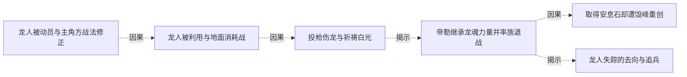

# 跨集 · 龙人迁徙与族群存续

[剧情目录](../README.md) · [全书阅读首页](../../README.md)

终点状态：**部分回收**

## 核心问题

失踪龙人去了哪里，能否获得自由家园？

## 全书复核结论

已入库至第18集；最近关联事件在第18集。最新状态审计在第18集。帝勒与泰特尼斯存活返场，族群因贫荒迁深渊、遭侵略后不足两千返回，失踪去向得到说明。各具名族人的命运、龙皇与龙人关系及自由家园的具体落实并未逐项完结。

## 关联事件

- [龙岛育幼实况与银丝毁躯](../vol-11.md)：读者获知九龙分布、繁殖危机及龙人来历；登陆队伍的银丝引发龙皇愤怒，海蛇和法师力量迫其转入警告。
- [龙人被动员与主角方战法修正](../vol-11.md)：龙皇以威压动员龙人，斯文纠正对空布阵并配装备，黑大以投枪展示独立解决方案。
- [龙人被利用与地面消耗战](../vol-11.md)：龙皇期待两方互耗；黑龙留预备队、派魅与图克试探，近战造成双方大量死亡，帝勒逐渐意识到受骗。
- [投枪伤龙与祈祷白光](../vol-11.md)：龙皇空袭和傀儡造成额外伤亡，黑龙投噬魂伤其腿，阿古力特配合法术遭冰盾抵消；龙人败势中帝勒祈祷引来白光。
- [帝勒继承龙魂力量并率族退战](../vol-12.md)：拿不列斯转出元力与记忆后本源沉睡；帝勒用克制干预和退战谈判争取空间，黑龙最终放行并监视。
- [取得安息石却遭毁峰重创](../vol-12.md)：黑龙取到毕瑟辨认的黑晶之魄；龙皇预设地形弱点发动禁咒，金属骨重损，挖救亡灵后借斯科特撤回；龙人全族消失且留长老尸体。
- [龙人失踪的去向与追兵](../vol-18.md)：帝勒说明族群因生计迁深渊、遭统一军队侵略后不足两千返回，自己与龙皇被追兵逼至黑龙处。深渊大巫身份此时主要由尼女判断。

## 关系网络

虚线展示因果、铺垫、误导、揭示与回收。每组至多6条关系；组间通过同名节点衔接，不新增时间顺序或因果。

### 关系组1

| 起点 | 关系 | 终点 | 研究说明 |
|---|---|---|---|
| [龙人被动员与主角方战法修正](../vol-11.md) | 因果 | [龙人被利用与地面消耗战](../vol-11.md) | 动员与越崖被导向预定消耗战 |
| [龙人被利用与地面消耗战](../vol-11.md) | 因果 | [投枪伤龙与祈祷白光](../vol-11.md) | 增援改变战局促龙皇介入，损失促帝勒祈祷 |
| [帝勒继承龙魂力量并率族退战](../vol-12.md) | 因果 | [取得安息石却遭毁峰重创](../vol-12.md) | 龙人退出使龙皇失去掩护，取石行动继续并遭其地形反击 |
| [投枪伤龙与祈祷白光](../vol-11.md) | 揭示 | [帝勒继承龙魂力量并率族退战](../vol-12.md) | 祈祷白光揭为拿不列斯转出元力与记忆，帝勒获得能力并自主退战，拿本源仍沉睡 |
| [帝勒继承龙魂力量并率族退战](../vol-12.md) | 揭示 | [龙人失踪的去向与追兵](../vol-18.md) | 帝勒带族退离后的去向得到补叙：贫荒促使迁往深渊，侵略后不足两千返归；不能据此补全每位族人的命运 |

逐条引用依据见[全部语义关系](../relations.md)及事件所在分集页。
