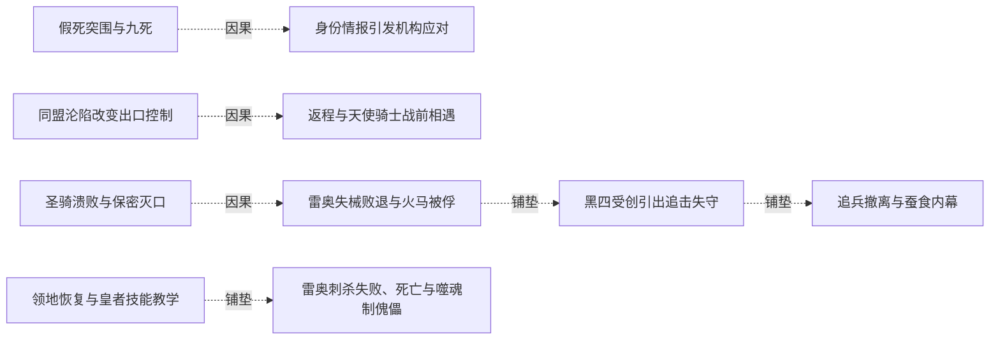
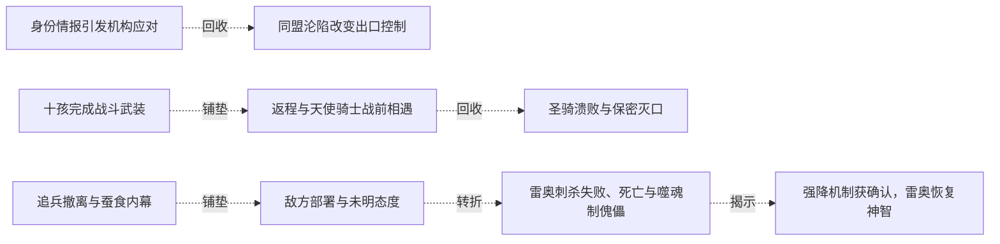
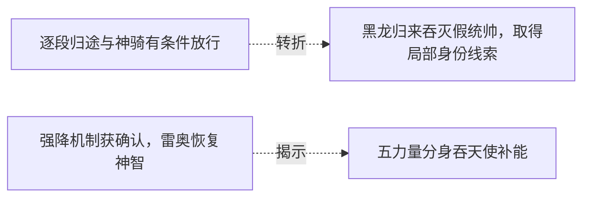

# 跨集 · 神骑职责与转生后的终局

[剧情目录](../README.md) · [全书阅读首页](../../README.md)

终点状态：**部分回收**

## 核心问题

神骑追索和教会私人指令之间有何关系？

## 全书复核结论

已入库至第18集；最近关联事件在第18集。最新状态审计在第18集。雷奥经历死亡、噬魂傀儡阶段及恢复神智，谢菲里安转为假旗统帅后被黑龙吞灭；女灵格为历代神骑老师。终卷补明教皇借雷奥送枪布置机缘，但全部武器流转、雷奥最后状态和其他神骑命运未逐一补足。

## 关联事件

- [假死突围与九死](../vol-05.md)：黑龙救黑七并擒萝茜突围，飞剑杀萝茜；幸存圣骑离去，身份无法保密。
- [身份情报引发机构应对](../vol-06.md)：疾风权衡关系，同盟封存秘密，教会另调暗之神骑雷奥。
- [十孩完成战斗武装](../vol-06.md)：黑龙练习塑甲，再引导八无意识孩子，黑大黑二自行完成不同武装。
- [同盟沦陷改变出口控制](../vol-07.md)：同盟军和自然神殿被击败，安德鲁知道神明层面败亡；教会控制两处沙漠出口并按雷奥定位改道。
- [返程与天使骑士战前相遇](../vol-07.md)：黑七与法师等留后，黑龙带九孩返程；黑大银丝侦察引敌误读，黑龙凭既有灵魂运用和武装决定正面应战，列奥纳布双层盾墙等冲撞。
- [圣骑溃败与保密灭口](../vol-08.md)：黑龙绕盾多次冲锋击溃圣骑，列奥纳被杀；雷奥救安德鲁后杀光己方幸存者并自报死亡骑士。
- [雷奥失械败退与火马被俘](../vol-08.md)：黑龙夺枪、耐伤并抱住火马，逼雷奥脱身；以饶命问讯取得深渊信息，却以未约期限继续扣留。
- [黑四受创引出追击失守](../vol-08.md)：雷奥斩断黑四颈，黑龙召公爵图克并全员追敌，火马趁机逃跑；黑四换普通上半身。
- [追兵撤离与蚕食内幕](../vol-08.md)：雷奥和火马转向教会总部；菲力普执行蚕食命令，私下显四翼并害怕沦为无意识工具。
- [敌方部署与未明态度](../vol-09.md)：穿插于多章的敌方行动：安德鲁动摇回圣山，雷奥获噬魂，菲力普派队查失踪；到黑龙赋魂释能时，教皇和菲力普感到强波动却未出手。
- [领地恢复与皇者技能教学](../vol-10.md)：黑龙醒来反思，召回骨军，黑大先领会、黑二随后参与尸体操控练习；雷奥在外围观察等待。
- [雷奥刺杀失败、死亡与噬魂制傀儡](../vol-10.md)：魅带俘近前被雷奥利用，分魂刺杀遭枪的亲和规则阻止；雷奥魂灭，噬魂吞魂制出同形傀儡。
- [逐段归途与神骑有条件放行](../vol-14.md)：黑龙携金龙等十五名强者按位面坐标跳转，古巴避走告警。途中自然神骑阻击，黑龙实练新术；光之神骑自报谢菲里安，按本位面出生及实力承认通行。此时尚未与旧同伴会合。
- [强降机制获确认，雷奥恢复神智](../vol-16.md)：红月信徒被确认是达罗亚强降路径；黑龙出战并归枪，达罗亚放出旧三傀儡及新近恢复意识的雷奥，哥顿普感魂到来。
- [光应私召，教皇对安德鲁实施不死献祭](../vol-16.md)：光之神骑因教皇而离岗，称敌未必君王；后深夜带安德鲁入黑白雕像密室，贯其心脏，教皇灌入魂火。安德鲁灵魂坠暗，醒后状态未展示。
- [教会转生二人并部署假旗洪流](../vol-17.md)：安德鲁醒为不死者，光之神骑也已转生；二人改名安德鲁西斯、暗拉玛，奉教皇命冒用黑龙名义。凝魄与雕像印记分给指挥、感知和否决权，最终控制尚在更高意志。
- [黑龙归来吞灭假统帅，取得局部身份线索](../vol-17.md)：魂链恢复，黑龙到场否认假军归属；光与安德鲁亮出旧身份及尼鲁达名号后，被黑龙吞魂取忆。记忆确认女天使为神骑老师、教皇与尼传承有关，两人随后明确魂散。
- [五力量分身吞天使补能](../vol-18.md)：三人遭无自我光影天使拦截，黑龙放出五受控力量体吞噬，全部回收后消化，气息大增；尼女辨黑晶即混沌之灵实体，并回想教皇送枪布局。

## 关系网络

虚线展示因果、铺垫、误导、揭示与回收。每组至多6条关系；组间通过同名节点衔接，不新增时间顺序或因果。

### 关系组1

| 起点 | 关系 | 终点 | 研究说明 |
|---|---|---|---|
| [同盟沦陷改变出口控制](../vol-07.md) | 因果 | [返程与天使骑士战前相遇](../vol-07.md) | 出口被控制和雷奥持续定位让安德鲁绕行到返程方向完成拦截。 |
| [圣骑溃败与保密灭口](../vol-08.md) | 因果 | [雷奥失械败退与火马被俘](../vol-08.md) | 雷奥出手保密并迎战，黑龙据其身体与兵器特点展开下一层对决。 |
| [雷奥失械败退与火马被俘](../vol-08.md) | 铺垫 | [黑四受创引出追击失守](../vol-08.md) | 火马仍被扣留且早说明有机会就逃，雷奥返回突袭后出现实际脱困窗口。 |
| [黑四受创引出追击失守](../vol-08.md) | 铺垫 | [追兵撤离与蚕食内幕](../vol-08.md) | 雷奥与火马重组尾随，观察新增援力后转向总部，当前追击中止。 |
| [领地恢复与皇者技能教学](../vol-10.md) | 铺垫 | [雷奥刺杀失败、死亡与噬魂制傀儡](../vol-10.md) | 雷奥在领地观察后暴露于魅，借被俘进入近身范围。 |
| [假死突围与九死](../vol-05.md) | 因果 | [身份情报引发机构应对](../vol-06.md) | 幸存者带回的不死身份情报引起疾风、同盟及教会不同应对 |

### 关系组2

| 起点 | 关系 | 终点 | 研究说明 |
|---|---|---|---|
| [身份情报引发机构应对](../vol-06.md) | 回收 | [同盟沦陷改变出口控制](../vol-07.md) | 出岛的暗之神骑提供持续方位，追索在同盟败亡后转为出口拦截 |
| [十孩完成战斗武装](../vol-06.md) | 铺垫 | [返程与天使骑士战前相遇](../vol-07.md) | 已掌握的灵魂运用与武装支撑正面应战信心，战果留待下一集；不归因为本集金属化实验 |
| [返程与天使骑士战前相遇](../vol-07.md) | 回收 | [圣骑溃败与保密灭口](../vol-08.md) | 上集盾墙冲撞前的悬停在本集战斗中兑现；雷奥救主教并灭口使胜负之外再生身份问题 |
| [追兵撤离与蚕食内幕](../vol-08.md) | 铺垫 | [敌方部署与未明态度](../vol-09.md) | 撤回总部的雷奥获得噬魂，先前离开的追兵转成新武器威胁；本集尚未交锋 |
| [敌方部署与未明态度](../vol-09.md) | 转折 | [雷奥刺杀失败、死亡与噬魂制傀儡](../vol-10.md) | 雷奥所持噬魂因同源亲和未能伤害黑龙灵魂，刺杀反转为雷奥死亡及同形傀儡生成，教皇动机仍未明 |
| [雷奥刺杀失败、死亡与噬魂制傀儡](../vol-10.md) | 揭示 | [强降机制获确认，雷奥恢复神智](../vol-16.md) | 噬魂枪的无意识傀儡阶段出现新进展：雷奥因吞魂进化并恢复神智；后来的恢复不能倒填此前意识状态 |

### 关系组3

| 起点 | 关系 | 终点 | 研究说明 |
|---|---|---|---|
| [逐段归途与神骑有条件放行](../vol-14.md) | 转折 | [黑龙归来吞灭假统帅，取得局部身份线索](../vol-17.md) | 曾按位面职责放行黑龙的光之神骑，后执行私令成为假旗统帅并被黑龙吞魂，职务与当前选择并不等同 |
| [强降机制获确认，雷奥恢复神智](../vol-16.md) | 揭示 | [五力量分身吞天使补能](../vol-18.md) | 雷奥恢复神智后续出送枪机缘的布局说明：教皇借他送枪，为黑龙布置机缘，不等雷奥知晓全部计划 |

逐条引用依据见[全部语义关系](../relations.md)及事件所在分集页。
