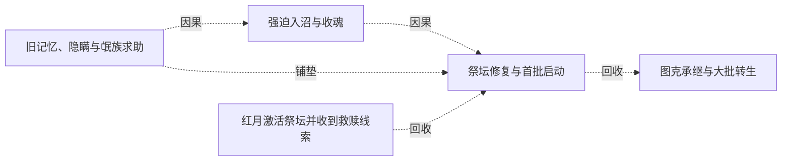

# 跨集 · 氓族与骑士灵魂转生后的存续

[剧情目录](../README.md) · [全书阅读首页](../../README.md)

终点状态：**部分回收**

## 核心问题

已完成转生者如何适应存在形式，其人格与意愿将如何延续？

## 全书复核结论

已入库至第18集；最近关联事件在第9集。最新状态审计在第18集。三千余混合灵魂的分批转生成功已明确，其中并非全部为氓族；强制奉誓与弱魂适应问题没有被成功结果抹平。后来无智部属扩张和君王烙印托付也未逐项解释这些原始族民的自主选择与最终命运。

## 关联事件

- [红月激活祭坛并收到救赎线索](../vol-02.md)：红月夜祭坛恢复活性；公会情报指雷克丁拥有救赎之魂，巫妖计划离开。
- [旧记忆、隐瞒与氓族求助](../vol-08.md)：羊皮书确认阿罗约族源，黑龙隐瞒其死因；族长献忠、揭亡灵祖先与祭坛逆转，委托运魂。
- [强迫入沼与收魂](../vol-08.md)：阿古力特杀质疑者、威胁入沼并自献祭；黑龙押行，杀反抗族人及请求速死的余者，将魂收进神器。
- [祭坛修复与首批启动](../vol-08.md)：阿古力特七日苏醒后与亡灵修复祭坛，黑龙提供魔晶；限载放出三十余魂，启动极致时出现未知苍老声音。
- [图克承继与大批转生](../vol-09.md)：旧领主烙印进入图克，守护和诅咒源头揭开；三千余混合灵魂转生，力王等在威胁下奉誓。

## 关系网络

虚线展示因果、铺垫、误导、揭示与回收。每组至多6条关系；组间通过同名节点衔接，不新增时间顺序或因果。

### 关系组1

| 起点 | 关系 | 终点 | 研究说明 |
|---|---|---|---|
| [旧记忆、隐瞒与氓族求助](../vol-08.md) | 因果 | [强迫入沼与收魂](../vol-08.md) | 族长提出收魂返坛方案并获黑龙接受，后以武力推动生命形式转换。 |
| [强迫入沼与收魂](../vol-08.md) | 因果 | [祭坛修复与首批启动](../vol-08.md) | 灵魂被收集并送到祭坛，缺失逆转知识与设施损坏迫使等待族长苏醒后修复启动。 |
| [旧记忆、隐瞒与氓族求助](../vol-08.md) | 铺垫 | [祭坛修复与首批启动](../vol-08.md) | 族长保存的逆转记录与亡灵传承知识组合，才有修复和重新运行的可能。 |
| [红月激活祭坛并收到救赎线索](../vol-02.md) | 回收 | [祭坛修复与首批启动](../vol-08.md) | 曾观察到活性的古祭坛回到主线，经修复后首批限载启动；本集结尾还不能确认全族转生成功 |
| [祭坛修复与首批启动](../vol-08.md) | 回收 | [图克承继与大批转生](../vol-09.md) | 祭坛启动后的声音与图克守护来源得到解释，混合灵魂的分批转生完成；知识继承不等于力量或原人格直接替换 |

逐条引用依据见[全部语义关系](../relations.md)及事件所在分集页。
