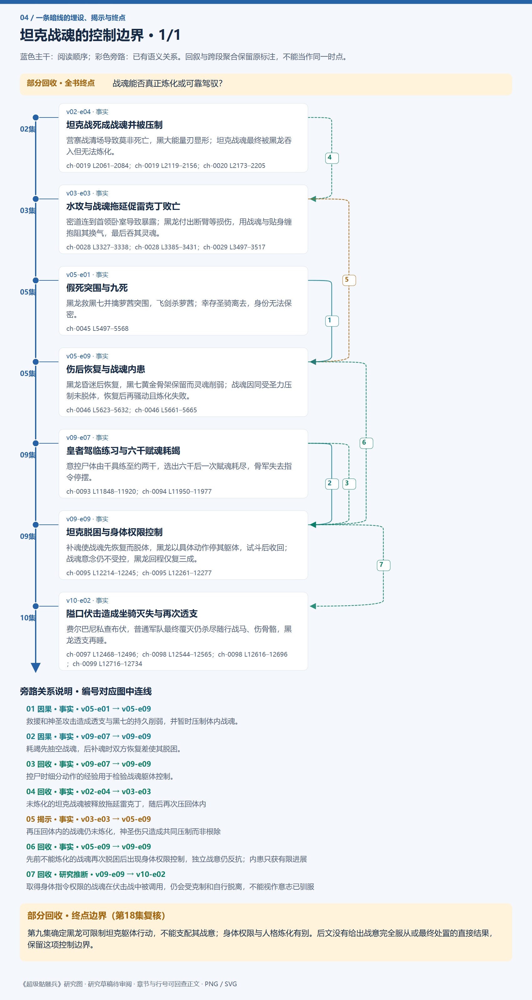
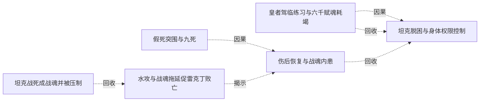
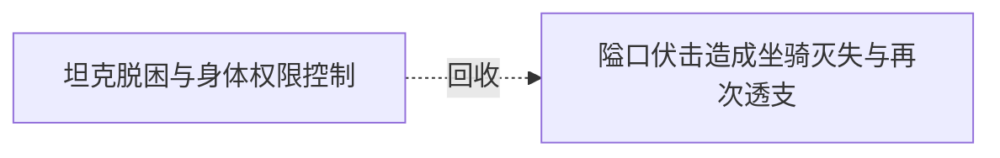

# 跨集 · 坦克战魂的控制边界

[剧情目录](../README.md) · [全书阅读首页](../../README.md)

终点状态：**部分回收**

## 核心问题

战魂能否真正炼化或可靠驾驭？

## 全书复核结论

已入库至第18集；最近关联事件在第10集。最新状态审计在第18集。第九集确定黑龙可限制坦克躯体行动，不能支配其战意；身体权限与人格炼化有别。后文没有给出战意完全服从或最终处置的直接结果，保留这项控制边界。

## 暗线时间图片

按主线阅读进度向下推进；分页保留关系编号与接续说明，每张均带全书终点状态。

[PNG原尺寸](../images/book-9baae09a0d12-01.png) · [SVG矢量图](../images/book-9baae09a0d12-01.svg)

## 关联事件

- [坦克战死成战魂并被压制](../vol-02.md)：营寨战清场导致莫非死亡，黑大能量刃显形；坦克战魂最终被黑龙吞入但无法炼化。
- [水攻与战魂拖延促雷克丁败亡](../vol-03.md)：密道连到首领卧室导致暴露；黑龙付出断臂等损伤，用战魂与贴身缠抱阻其换气，最后吞其灵魂。
- [假死突围与九死](../vol-05.md)：黑龙救黑七并擒萝茜突围，飞剑杀萝茜；幸存圣骑离去，身份无法保密。
- [伤后恢复与战魂内患](../vol-05.md)：黑龙昏迷后恢复，黑七黄金骨架保留而灵魂削弱；战魂因同受圣力压制未脱体，恢复后再骚动且炼化失败。
- [皇者驾临练习与六千赋魂耗竭](../vol-09.md)：意控尸体由千具练至约两千，选出六千后一次赋魂耗尽，骨军失去指令停摆。
- [坦克脱困与身体权限控制](../vol-09.md)：补魂使战魂先恢复而脱体，黑龙以具体动作停其躯体，试斗后收回；战魂意念仍不受控，黑龙回程仅复三成。
- [隘口伏击造成坐骑灭失与再次透支](../vol-10.md)：费尔巴尼私查布伏，普通军队最终覆灭仍杀尽随行战马、伤骨骼，黑龙透支再睡。

## 关系网络

虚线展示因果、铺垫、误导、揭示与回收。每组至多6条关系；组间通过同名节点衔接，不新增时间顺序或因果。

### 关系组1

| 起点 | 关系 | 终点 | 研究说明 |
|---|---|---|---|
| [假死突围与九死](../vol-05.md) | 因果 | [伤后恢复与战魂内患](../vol-05.md) | 救援和神圣攻击造成透支与黑七的持久削弱，并暂时压制体内战魂。 |
| [皇者驾临练习与六千赋魂耗竭](../vol-09.md) | 因果 | [坦克脱困与身体权限控制](../vol-09.md) | 耗竭先抽空战魂，后补魂时双方恢复差使其脱困。 |
| [皇者驾临练习与六千赋魂耗竭](../vol-09.md) | 回收 | [坦克脱困与身体权限控制](../vol-09.md) | 控尸时细分动作的经验用于检验战魂躯体控制。 |
| [坦克战死成战魂并被压制](../vol-02.md) | 回收 | [水攻与战魂拖延促雷克丁败亡](../vol-03.md) | 未炼化的坦克战魂被释放拖延雷克丁，随后再次压回体内 |
| [水攻与战魂拖延促雷克丁败亡](../vol-03.md) | 揭示 | [伤后恢复与战魂内患](../vol-05.md) | 再压回体内的战魂仍未炼化，神圣伤只造成共同压制而非根除 |
| [伤后恢复与战魂内患](../vol-05.md) | 回收 | [坦克脱困与身体权限控制](../vol-09.md) | 先前不能炼化的战魂再次脱困后出现身体权限控制，独立战意仍反抗；内患只获有限进展 |

### 关系组2

| 起点 | 关系 | 终点 | 研究说明 |
|---|---|---|---|
| [坦克脱困与身体权限控制](../vol-09.md) | 回收 | [隘口伏击造成坐骑灭失与再次透支](../vol-10.md) | 取得身体指令权限的战魂在伏击战中被调用，仍会受克制和自行脱离，不能视作意志已驯服 |

逐条引用依据见[全部语义关系](../relations.md)及事件所在分集页。
