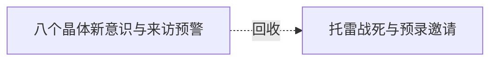

# 跨集 · 沼泽新来者的身份与邀请

[剧情目录](../README.md) · [全书阅读首页](../../README.md)

终点状态：**已回收**

## 核心问题

第12集末靠近沼泽的生物是谁、当次来意为何？

## 全书复核结论

已入库至第18集；最近关联事件在第13集。最新状态审计在第18集。第十二集末的新来者由托雷矮人一行与追兵的开篇行动接续，带出自然神预录邀请。本条仅关闭该次来访身份和当次来意，合作的真实风险由自然神等线程继续追踪。

## 关联事件

- [八个晶体新意识与来访预警](../vol-12.md)：海皇分流后获新魂的晶体骨苏醒，测试造成阿古伤势与一骨架断裂；仅八具初觉醒，黑龙命名十一至十八，魅随后报告大量生物靠近。
- [托雷战死与预录邀请](../vol-13.md)：黑龙乘新不死巨龙歼骑士，并群杀托雷一行；自然神预录讯息出现，引其赴约；疾风援军另由伙伴组织。

## 关系网络

虚线展示因果、铺垫、误导、揭示与回收。每组至多6条关系；组间通过同名节点衔接，不新增时间顺序或因果。

### 关系组1

| 起点 | 关系 | 终点 | 研究说明 |
|---|---|---|---|
| [八个晶体新意识与来访预警](../vol-12.md) | 回收 | [托雷战死与预录邀请](../vol-13.md) | 来者悬念由沼泽边矮人与追兵的交战接续，托雷所载预录消息进一步解释神的邀请 |

逐条引用依据见[全部语义关系](../relations.md)及事件所在分集页。
