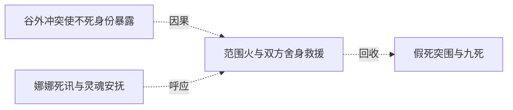

# 跨集 · 黑七圣焰救援的生死结局

[剧情目录](../README.md) · [全书阅读首页](../../README.md)

终点状态：**已回收**

## 核心问题

第四集圣焰危机中黑七是否获救？

## 全书复核结论

已入库至第18集；最近关联事件在第5集。最新状态审计在第18集。第五集明确黑七在第四集圣焰危机后存活，黄金骨架尚在而灵魂退近白银。关闭的是当次生死悬念，并未据此保证其后每次战斗无伤或后记已逐名出现。

## 关联事件

- [娜娜死讯与灵魂安抚](../vol-04.md)：黑龙告知父母死讯使娜娜晕厥，求助克丽丝后以灵魂交流安抚，承诺找遗体并把沉渊木交给娜娜。
- [谷外冲突使不死身份暴露](../vol-04.md)：斯文哥尔识破伪装圣骑，黑龙抢先冲锋；林间肉搏与诅咒使萝茜识别不死者，双方转入法术和技巧对抗。
- [范围火与双方舍身救援](../vol-04.md)：斯文哥尔范围火被抗火光环应对；黑七受审判失联令黑龙怒伤萝茜，再救黑七而引焰上身；岗撒罗斯转移萝茜致命伤并交出旧吊坠。
- [假死突围与九死](../vol-05.md)：黑龙救黑七并擒萝茜突围，飞剑杀萝茜；幸存圣骑离去，身份无法保密。

## 关系网络

虚线展示因果、铺垫、误导、揭示与回收。每组至多6条关系；组间通过同名节点衔接，不新增时间顺序或因果。

### 关系组1

| 起点 | 关系 | 终点 | 研究说明 |
|---|---|---|---|
| [谷外冲突使不死身份暴露](../vol-04.md) | 因果 | [范围火与双方舍身救援](../vol-04.md) | 身份曝光促灭口火攻，交战重伤触发双重救援 |
| [娜娜死讯与灵魂安抚](../vol-04.md) | 呼应 | [范围火与双方舍身救援](../vol-04.md) | 以额头和灵魂接触救助他人，末场由安抚转为危险反噬 |
| [范围火与双方舍身救援](../vol-04.md) | 回收 | [假死突围与九死](../vol-05.md) | 上集救援与战局在本集突围中续接，黑七存活而黑龙随后因透支昏迷 |

逐条引用依据见[全部语义关系](../relations.md)及事件所在分集页。
