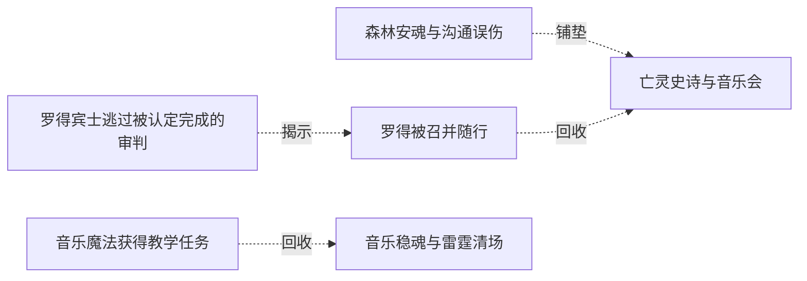

# 跨集 · 罗得的音乐与未明往事

[剧情目录](../README.md) · [全书阅读首页](../../README.md)

终点状态：**部分回收**

## 核心问题

安魂创作会怎样发展，亡妻线将何时重返？

## 全书复核结论

已入库至第18集；最近关联事件在第18集。最新状态审计在第18集。安魂和新曲能力后来发展为乐团教学、稳军与雷霆杀伤，后记罗得继续演奏，音乐用途获得明确延伸。亡妻及相关旧事没有因此获答；音乐成功不能代替亡妻线回收。

## 关联事件

- [罗得宾士逃过被认定完成的审判](../vol-04.md)：萝茜被琴曲短暂打动，遭音攻后焚杀目标并离开；罗得宾士随后再次现身，脱身机制未知。
- [罗得被召并随行](../vol-05.md)：琴烙印引出异常召唤，罗得恢复声音、暴露智慧后受契约与保密限制随行。
- [森林安魂与沟通误伤](../vol-06.md)：罗得安魂止哀嚎，黑龙过量魂问伤使者，随后发生亡灵冲突。
- [亡灵史诗与音乐会](../vol-06.md)：史诗和斯科特解明国度历史及怨灵花，罗得琴歌使森林暂时安宁。
- [音乐魔法获得教学任务](../vol-15.md)：罗得的异常力场经误认和排除后被解释为音乐魔法，黑龙安排招人并令其教学。
- [音乐稳魂与雷霆清场](../vol-18.md)：切里莫投影送雾掩护三领主，施乃图与先知合守。乐团先死六人，罗得安魂曲稳住军队并助杀魔眼；受保护蓄势后雷霆杀近十五万魔物，门仍输兵。

## 关系网络

虚线展示因果、铺垫、误导、揭示与回收。每组至多6条关系；组间通过同名节点衔接，不新增时间顺序或因果。

### 关系组1

| 起点 | 关系 | 终点 | 研究说明 |
|---|---|---|---|
| [森林安魂与沟通误伤](../vol-06.md) | 铺垫 | [亡灵史诗与音乐会](../vol-06.md) | 首次安魂的有效性促成斯科特邀请罗得举办正式音乐会。 |
| [罗得宾士逃过被认定完成的审判](../vol-04.md) | 揭示 | [罗得被召并随行](../vol-05.md) | 此前独立出现且逃过审判的音乐家经异常琴召唤进入主角队伍，逃脱原理仍不能据此推定 |
| [罗得被召并随行](../vol-05.md) | 回收 | [亡灵史诗与音乐会](../vol-06.md) | 音乐家随队后的安魂琴歌产生战力之外的集体价值；亡妻现状未因此解决 |
| [音乐魔法获得教学任务](../vol-15.md) | 回收 | [音乐稳魂与雷霆清场](../vol-18.md) | 音乐教学形成乐团，安魂稳军与雷霆清场取得实际战果；乐师有伤亡，杀敌同时给本源供能，不能当全场战争已胜 |

逐条引用依据见[全部语义关系](../relations.md)及事件所在分集页。
