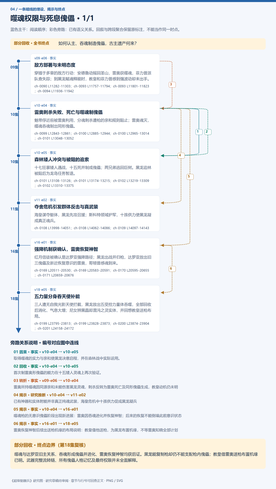
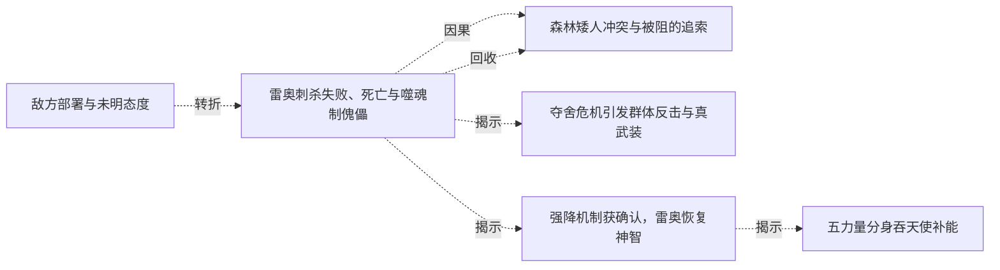

# 跨集 · 噬魂权限与死息傀儡

[剧情目录](../README.md) · [全书阅读首页](../../README.md)

终点状态：**部分回收**

## 核心问题

如何认主、吞魂制造傀儡，古主遗产何来？

## 全书复核结论

已入库至第18集；最近关联事件在第18集。最新状态审计在第18集。噬魂与达罗亚旧主关系、吞魂形成傀儡并进化、雷奥恢复神智均获后证。黑龙能复制枪却仍不能支配枪内傀儡；教皇借雷奥送枪布置机缘已明。武器完整流转链、所有傀儡人格记忆及最终权限并未全面解释。

## 暗线时间图片

按主线阅读进度向下推进；分页保留关系编号与接续说明，每张均带全书终点状态。

[PNG原尺寸](../images/book-be62d277e700-01.png) · [SVG矢量图](../images/book-be62d277e700-01.svg)

## 关联事件

- [敌方部署与未明态度](../vol-09.md)：穿插于多章的敌方行动：安德鲁动摇回圣山，雷奥获噬魂，菲力普派队查失踪；到黑龙赋魂释能时，教皇和菲力普感到强波动却未出手。
- [雷奥刺杀失败、死亡与噬魂制傀儡](../vol-10.md)：魅带俘近前被雷奥利用，分魂刺杀遭枪的亲和规则阻止；雷奥魂灭，噬魂吞魂制出同形傀儡。
- [森林矮人冲突与被阻的追索](../vol-10.md)：十七狂暴矮人遇战，十五死并制成傀儡；两兄弟逃回巨树。黑龙追林被阻后为龙岛任务暂退。
- [夺舍危机引发群体反击与真武装](../vol-11.md)：海皇谋夺躯体，黑龙先攻召援；斯科特领域护军，十孩供力使黑龙凝成真正魂兵。
- [强降机制获确认，雷奥恢复神智](../vol-16.md)：红月信徒被确认是达罗亚强降路径；黑龙出战并归枪，达罗亚放出旧三傀儡及新近恢复意识的雷奥，哥顿普感魂到来。
- [五力量分身吞天使补能](../vol-18.md)：三人遭无自我光影天使拦截，黑龙放出五受控力量体吞噬，全部回收后消化，气息大增；尼女辨黑晶即混沌之灵实体，并回想教皇送枪布局。

## 关系网络

虚线展示因果、铺垫、误导、揭示与回收。每组至多6条关系；组间通过同名节点衔接，不新增时间顺序或因果。

### 关系组1

| 起点 | 关系 | 终点 | 研究说明 |
|---|---|---|---|
| [雷奥刺杀失败、死亡与噬魂制傀儡](../vol-10.md) | 因果 | [森林矮人冲突与被阻的追索](../vol-10.md) | 取得噬魂的实力与亲和使黑龙决意启程，并在森林战中实际运用。 |
| [雷奥刺杀失败、死亡与噬魂制傀儡](../vol-10.md) | 回收 | [森林矮人冲突与被阻的追索](../vol-10.md) | 首次制雷奥形傀儡的能力在十五矮人灵魂上再次验证。 |
| [敌方部署与未明态度](../vol-09.md) | 转折 | [雷奥刺杀失败、死亡与噬魂制傀儡](../vol-10.md) | 雷奥所持噬魂因同源亲和未能伤害黑龙灵魂，刺杀反转为雷奥死亡及同形傀儡生成，教皇动机仍未明 |
| [雷奥刺杀失败、死亡与噬魂制傀儡](../vol-10.md) | 揭示 | [夺舍危机引发群体反击与真武装](../vol-11.md) | 已有神器和实体附能并非真正纯魂武装，海皇危机中十孩供力促成黑龙凝兵 |
| [雷奥刺杀失败、死亡与噬魂制傀儡](../vol-10.md) | 揭示 | [强降机制获确认，雷奥恢复神智](../vol-16.md) | 噬魂枪的无意识傀儡阶段出现新进展：雷奥因吞魂进化并恢复神智；后来的恢复不能倒填此前意识状态 |
| [强降机制获确认，雷奥恢复神智](../vol-16.md) | 揭示 | [五力量分身吞天使补能](../vol-18.md) | 雷奥恢复神智后续出送枪机缘的布局说明：教皇借他送枪，为黑龙布置机缘，不等雷奥知晓全部计划 |

逐条引用依据见[全部语义关系](../relations.md)及事件所在分集页。
