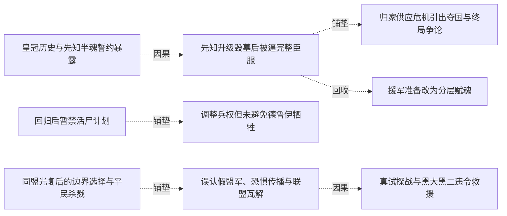
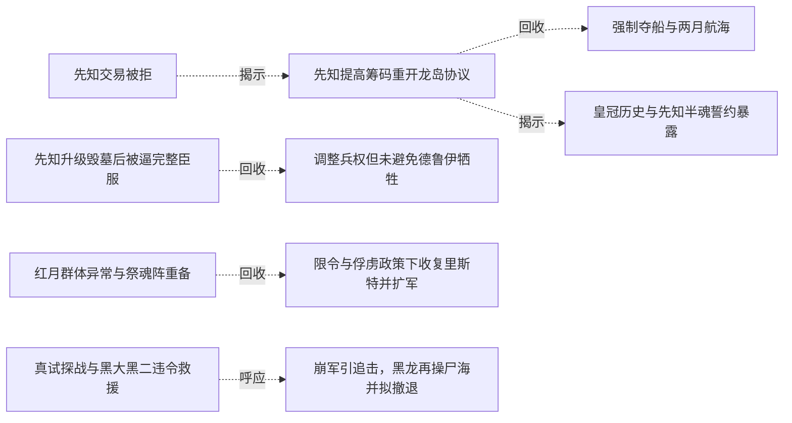

# 跨集 · 先知失去私兵优势后的组织制衡

[剧情目录](../README.md) · [全书阅读首页](../../README.md)

终点状态：**部分回收**

## 核心问题

先知在龙群被收归黑龙后怎样行使代理权？

## 全书复核结论

已入库至第18集；最近关联事件在第17集。最新状态审计在第18集。先知先以半魂约和私兵保自主，后来三十六龙转约黑龙并受多阵营制约；这未消除其平民杀戮，终卷又与施乃图协作守门。组织权限制衡有进展，责任结算及最终权力安排未完整交代。

## 关联事件

- [先知交易被拒](../vol-07.md)：先知以誓约和安息石情报求破约自由，黑龙因龙岛风险拒绝；先知独处显龙亡灵形态。
- [先知提高筹码重开龙岛协议](../vol-09.md)：先知承认龙灵分身及关键隐瞒，以全墓忠诚求取安息石，黑龙答应但暂不赴险。
- [强制夺船与两月航海](../vol-10.md)：黑龙杀转水手，斯文以拘魂威胁逼从，夺两船赴龙岛；无补给需求仍需导航和心理休整。
- [皇冠历史与先知半魂誓约暴露](../vol-12.md)：皇冠传说引出万王之王，先知自报欧罗普菲力克；黑龙坚持灵魂约，先知仅献分身部分便取得皇冠，并击服墓中强龙。
- [先知升级毁墓后被逼完整臣服](../vol-12.md)：皇冠转化死气助先知凝不死龙魂并破封；他故意埋骨制造依赖，黑龙以半魂制约、十孩供力和联合护盾压制，最终收完整誓约与皇冠。
- [归家供应危机引出夺国与终局争论](../vol-12.md)：回家重逢与分工使先知看到组织潜力；星报钢铁减半，疾风求助夺沙里克，先知提灭世转生计划，黑龙认为那会无聊并未接受。
- [援军准备改为分层赋魂](../vol-12.md)：黑龙仍为保障供应接受援助，先知指出单点指挥限制；黑大黑二学习赐魂并汇聚十孩能量，疾风半月送来万甲万马，战马转生再次消耗孩子们十余天沉睡后稍复的元气。
- [回归后暂禁活尸计划](../vol-15.md)：黑龙重返同伴，以位面规则和当前利益暂禁百万活尸阵，保留正常交战与撤退选择。
- [调整兵权但未避免德鲁伊牺牲](../vol-15.md)：黑龙把德鲁伊出战数减半，强收先知三十六龙魂约仍留指挥职；已投入的五十余德鲁伊全部战死后尸兵扭转局面。
- [红月群体异常与祭魂阵重备](../vol-15.md)：红月巫师无人指挥突袭，力量向生还者集中；天使现身后黑龙同意趁机出击并重备祭魂阵，称不到最后不发动。
- [限令与俘虏政策下收复里斯特并扩军](../vol-16.md)：塞茵暴动和联军撤离未引祭魂阵启动，阿古援黑龙限令反对；先知收俘缓恐惧，攻克里斯特后从战尸扩军两万到四万，新装不全，海图与联军再跟进。
- [同盟光复后的边界选择与平民杀戮](../vol-17.md)：并行战争线三月扩军至八万骑，大二魂强增而未晋悼亡。先知受组织制衡拟停在边境，但空取石头城后追杀一万五千平民至圣罗兰，随后发现帝国后方陌生洪流。
- [误认假盟军、恐惧传播与联盟瓦解](../vol-17.md)：先知等把两统帅装低智与称黑龙当归属证明，跟随千万洪流深入帝国。慢进与虐杀制造逃亡潮，教会声望上升，同盟断绝合作，自然神信徒减少。
- [真试探战与黑大黑二违令救援](../vol-17.md)：教皇部署正规骑阻拦受己方安排的洪流，先知误以领域使骨军止步，派五千骑真试探。光明老兵一万五千全亡，大二不忍同类消耗，带余骑和原八孩违先知令救回同伴。
- [崩军引追击，黑龙再操尸海并拟撤退](../vol-17.md)：统帅魂散使千万旧军崩溃，人类振奋冲锋；黑龙召回己军，以无魂操骨反击，再吞亡魂操人马尸，微操耗神且不能跨空间携走这些工具。因情报不足，他决定向横断山撤，逐一赋魂仍为计划。

## 关系网络

虚线展示因果、铺垫、误导、揭示与回收。每组至多6条关系；组间通过同名节点衔接，不新增时间顺序或因果。

### 关系组1

| 起点 | 关系 | 终点 | 研究说明 |
|---|---|---|---|
| [皇冠历史与先知半魂誓约暴露](../vol-12.md) | 因果 | [先知升级毁墓后被逼完整臣服](../vol-12.md) | 皇冠交付给升级与破封提供条件，半魂约又成为反制先知的控制点 |
| [先知升级毁墓后被逼完整臣服](../vol-12.md) | 铺垫 | [归家供应危机引出夺国与终局争论](../vol-12.md) | 受完整约束的先知随队归家，看见组织潜力后转为提出扩张方案 |
| [先知升级毁墓后被逼完整臣服](../vol-12.md) | 回收 | [援军准备改为分层赋魂](../vol-12.md) | 战斗中有效的十孩供能被黑龙迁移到规模赋魂 |
| [回归后暂禁活尸计划](../vol-15.md) | 铺垫 | [调整兵权但未避免德鲁伊牺牲](../vol-15.md) | 回归后的集中决策为收回私人兵权建立权威，具体触发是德鲁伊争执。 |
| [同盟光复后的边界选择与平民杀戮](../vol-17.md) | 铺垫 | [误认假盟军、恐惧传播与联盟瓦解](../vol-17.md) | 边境推进使先知与从帝国后方来的洪流接触，其保留力量意图促使跟进。 |
| [误认假盟军、恐惧传播与联盟瓦解](../vol-17.md) | 因果 | [真试探战与黑大黑二违令救援](../vol-17.md) | 跟随假军进入预置战场，令先知为名义盟友投入真实试探兵力。 |

### 关系组2

| 起点 | 关系 | 终点 | 研究说明 |
|---|---|---|---|
| [真试探战与黑大黑二违令救援](../vol-17.md) | 呼应 | [崩军引追击，黑龙再操尸海并拟撤退](../vol-17.md) | 大二先救同类、黑龙后召回己军，保护范围和命令优先级形成对照。 |
| [先知交易被拒](../vol-07.md) | 揭示 | [先知提高筹码重开龙岛协议](../vol-09.md) | 先知披露本名、分身和先前隐瞒，并提高筹码使拒绝转为有条件承诺；尚未实际取回安息石 |
| [先知提高筹码重开龙岛协议](../vol-09.md) | 回收 | [强制夺船与两月航海](../vol-10.md) | 暂不定时的龙岛承诺进入夺船启航阶段，旅程两月仅至中继岛，不等于取得安息石 |
| [先知提高筹码重开龙岛协议](../vol-09.md) | 揭示 | [皇冠历史与先知半魂誓约暴露](../vol-12.md) | 早先效忠承诺在交付宝物时显出分身半魂漏洞，控制范围并非黑龙最初所想 |
| [先知升级毁墓后被逼完整臣服](../vol-12.md) | 回收 | [调整兵权但未避免德鲁伊牺牲](../vol-15.md) | 先知自身完整魂约之后，黑龙进一步收走剩余三十六龙的魂约；保留其指挥职不等于解除主从限制 |
| [红月群体异常与祭魂阵重备](../vol-15.md) | 回收 | [限令与俘虏政策下收复里斯特并扩军](../vol-16.md) | 此前最后关头才启阵的限制在主角再次失联时被援引，塞茵祭魂阵仍未发动 |

### 关系组3

| 起点 | 关系 | 终点 | 研究说明 |
|---|---|---|---|
| [调整兵权但未避免德鲁伊牺牲](../vol-15.md) | 回收 | [同盟光复后的边界选择与平民杀戮](../vol-17.md) | 收走先知私兵魂约形成后续组织制衡，但其平民杀戮仍发生，权力受限不等于道德问题解决 |

逐条引用依据见[全部语义关系](../relations.md)及事件所在分集页。
