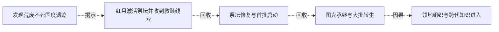

# 跨集 · 沼泽古国与转生遗产

[剧情目录](../README.md) · [全书阅读首页](../../README.md)

终点状态：**部分回收**

## 核心问题

祭坛遗产如何延续，帝国消失为何？

## 全书复核结论

已入库至第18集；最近关联事件在第9集。最新状态审计在第18集。沼泽遗迹的诅咒、图克诞生与旧领主守护记忆获得说明；后来揭示的是三君王、放逐大陆及帝国子民回归。两层历史不可凭同称不死国度直接等同，旧沼泽古国消失的完整因由仍未充分解释。

## 关联事件

- [发现荒废不死国度遗迹](../vol-01.md)：在图克带领下抵达祭坛，队伍发现古老不死领地遗迹，衰亡原因仍无从得知。
- [红月激活祭坛并收到救赎线索](../vol-02.md)：红月夜祭坛恢复活性；公会情报指雷克丁拥有救赎之魂，巫妖计划离开。
- [祭坛修复与首批启动](../vol-08.md)：阿古力特七日苏醒后与亡灵修复祭坛，黑龙提供魔晶；限载放出三十余魂，启动极致时出现未知苍老声音。
- [图克承继与大批转生](../vol-09.md)：旧领主烙印进入图克，守护和诅咒源头揭开；三千余混合灵魂转生，力王等在威胁下奉誓。
- [领地组织与跨代知识进入](../vol-09.md)：跨段聚合：先祖拜见、斯科特限借，斯文与族人共建领地；后段规划辩论扩展到文化商业，另记泰戈醒来待检，并非同一时点的一场会议。

## 关系网络

虚线展示因果、铺垫、误导、揭示与回收。每组至多6条关系；组间通过同名节点衔接，不新增时间顺序或因果。

### 关系组1

| 起点 | 关系 | 终点 | 研究说明 |
|---|---|---|---|
| [图克承继与大批转生](../vol-09.md) | 因果 | [领地组织与跨代知识进入](../vol-09.md) | 大批转生和先人记忆为领地建设提供人口与知识。 |
| [发现荒废不死国度遗迹](../vol-01.md) | 揭示 | [红月激活祭坛并收到救赎线索](../vol-02.md) | 已发现的荒废遗迹在红月下出现祭坛反应，古史仍未证实 |
| [红月激活祭坛并收到救赎线索](../vol-02.md) | 回收 | [祭坛修复与首批启动](../vol-08.md) | 曾观察到活性的古祭坛回到主线，经修复后首批限载启动；本集结尾还不能确认全族转生成功 |
| [祭坛修复与首批启动](../vol-08.md) | 回收 | [图克承继与大批转生](../vol-09.md) | 祭坛启动后的声音与图克守护来源得到解释，混合灵魂的分批转生完成；知识继承不等于力量或原人格直接替换 |

逐条引用依据见[全部语义关系](../relations.md)及事件所在分集页。
