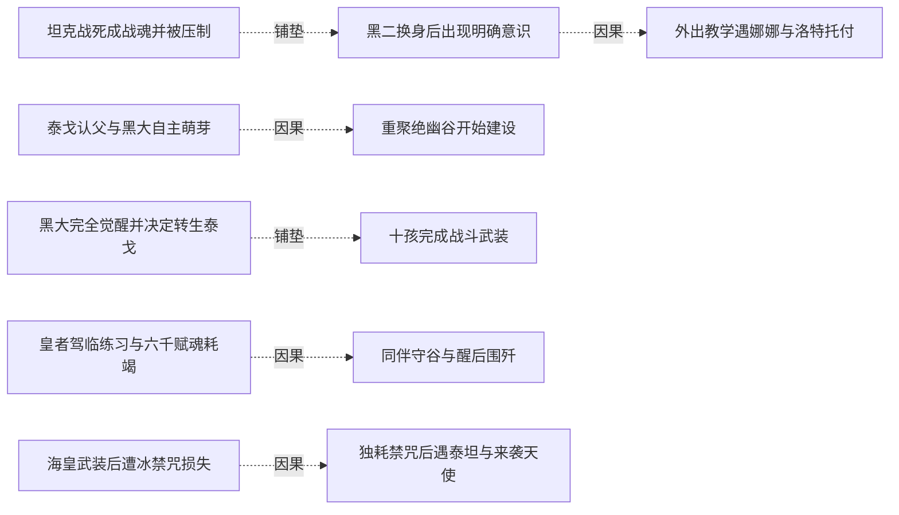
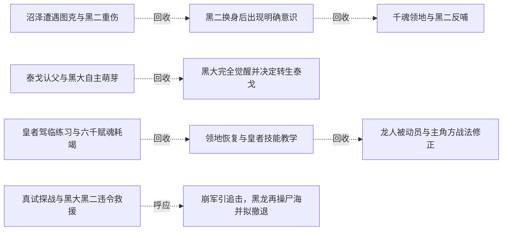
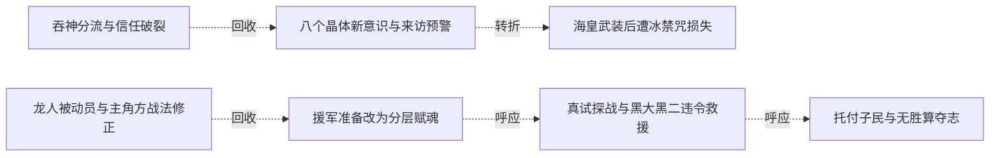

# 跨集 · 子民意识与生存

[剧情目录](../README.md) · [全书阅读首页](../../README.md)

终点状态：**部分回收**

## 核心问题

黑龙子民的意识与存续是否获得完整交代？

## 全书复核结论

已入库至第18集；最近关联事件在第18集。最新状态审计在第18集。黑大、黑二的觉醒和违令救同类已有实证，终卷继续参战；黑龙托付君王烙印保护深约子民。原黑三至黑十是否全部觉醒、十七十八能否恢复、每位子民最终契约与生死均未逐名交代。后记未署名蓝晶工匠不能充作这些问题的答案。

## 关联事件

- [装死后吞魂凝心并创造十子](../vol-01.md)：黑龙保留自由活动时间，在残魂中获得能源并创造十名骷髅。
- [沼泽遭遇图克与黑二重伤](../vol-01.md)：避入禁地后遭黑武士攻击，黑二自发挡斗气，骷髅队伍以抱杀制服图克。
- [坦克战死成战魂并被压制](../vol-02.md)：营寨战清场导致莫非死亡，黑大能量刃显形；坦克战魂最终被黑龙吞入但无法炼化。
- [黑二换身后出现明确意识](../vol-02.md)：黑二主动称将军并解释理由，黑龙确认首位同类产生意识，仍保留新骨架弱点。
- [外出教学遇娜娜与洛特托付](../vol-02.md)：黑龙带黑二识世，阻止斯文哥尔跟随；遇被白衣信众追杀的娜娜，洛特提出照料请求后死去。
- [千魂领地与黑二反哺](../vol-03.md)：黑龙召起上千亡者并赐长期灵魂，虚脱后获黑二主动反哺；他提出身体自主，安排亡者沉睡，放弃全面转生构想但保留领地。
- [泰戈认父与黑大自主萌芽](../vol-04.md)：返程泰戈误认黑大为父亲，黑龙断联系后观察到自发护人；阿玛去世后复活提议被否，泰戈在母亲治疗的说法下随队。
- [重聚绝幽谷开始建设](../vol-04.md)：队伍重聚，爱琳已引水、洛特已搭房，黑龙与斯文哥尔协商城堡和地下城并建；萝茜同时追踪最后目标娜娜至谷外。
- [谷外冲突使不死身份暴露](../vol-04.md)：斯文哥尔识破伪装圣骑，黑龙抢先冲锋；林间肉搏与诅咒使萝茜识别不死者，双方转入法术和技巧对抗。
- [星获救与救赎释义](../vol-05.md)：黑二炼除神力，星月重新归队，盒文澄清救赎为净化回归神。
- [黑大完全觉醒并决定转生泰戈](../vol-06.md)：病情与同行矛盾触发自主发言，身份确认后操控断开，黑大杀泰戈交黑龙转生。
- [十孩完成战斗武装](../vol-06.md)：黑龙练习塑甲，再引导八无意识孩子，黑大黑二自行完成不同武装。
- [皇者驾临练习与六千赋魂耗竭](../vol-09.md)：意控尸体由千具练至约两千，选出六千后一次赋魂耗尽，骨军失去指令停摆。
- [同伴守谷与醒后围歼](../vol-09.md)：墨菲斯循痕搜谷，罗得等守护，萝茜杀旧友护主；黑龙醒后协调六千骨军与空骑围歼，但仍极弱。
- [领地恢复与皇者技能教学](../vol-10.md)：黑龙醒来反思，召回骨军，黑大先领会、黑二随后参与尸体操控练习；雷奥在外围观察等待。
- [夺舍危机引发群体反击与真武装](../vol-11.md)：海皇谋夺躯体，黑龙先攻召援；斯科特领域护军，十孩供力使黑龙凝成真正魂兵。
- [吞神分流与信任破裂](../vol-11.md)：黑龙吞掉海皇神识，以分流免爆体并恢复躯体；责怪却理解斯科特，明确拒再帮克丽丝。
- [女神转求娜娜与海蛇转生](../vol-11.md)：娜娜接到新求助；十孩获真武装后，黑龙耗半魂转生海蛇并找到旧帝国遗物，回船续航。
- [龙人被动员与主角方战法修正](../vol-11.md)：龙皇以威压动员龙人，斯文纠正对空布阵并配装备，黑大以投枪展示独立解决方案。
- [援军准备改为分层赋魂](../vol-12.md)：黑龙仍为保障供应接受援助，先知指出单点指挥限制；黑大黑二学习赐魂并汇聚十孩能量，疾风半月送来万甲万马，战马转生再次消耗孩子们十余天沉睡后稍复的元气。
- [八个晶体新意识与来访预警](../vol-12.md)：海皇分流后获新魂的晶体骨苏醒，测试造成阿古伤势与一骨架断裂；仅八具初觉醒，黑龙命名十一至十八，魅随后报告大量生物靠近。
- [海皇武装后遭冰禁咒损失](../vol-15.md)：八晶体补魂获得海皇武装；黑龙经海蛇到海底遗迹，逃禁咒时十七十八被冰封冻碎，未见恢复。
- [独耗禁咒后遇泰坦与来袭天使](../vol-15.md)：黑龙付魂力代价独闯，毁傀儡后封印自行开；泰坦先攻，四翼女子来袭使双方暂联手毁其躯体、迫圣气退走。
- [限令与俘虏政策下收复里斯特并扩军](../vol-16.md)：塞茵暴动和联军撤离未引祭魂阵启动，阿古援黑龙限令反对；先知收俘缓恐惧，攻克里斯特后从战尸扩军两万到四万，新装不全，海图与联军再跟进。
- [同盟光复后的边界选择与平民杀戮](../vol-17.md)：并行战争线三月扩军至八万骑，大二魂强增而未晋悼亡。先知受组织制衡拟停在边境，但空取石头城后追杀一万五千平民至圣罗兰，随后发现帝国后方陌生洪流。
- [真试探战与黑大黑二违令救援](../vol-17.md)：教皇部署正规骑阻拦受己方安排的洪流，先知误以领域使骨军止步，派五千骑真试探。光明老兵一万五千全亡，大二不忍同类消耗，带余骑和原八孩违先知令救回同伴。
- [崩军引追击，黑龙再操尸海并拟撤退](../vol-17.md)：统帅魂散使千万旧军崩溃，人类振奋冲锋；黑龙召回己军，以无魂操骨反击，再吞亡魂操人马尸，微操耗神且不能跨空间携走这些工具。因情报不足，他决定向横断山撤，逐一赋魂仍为计划。
- [音乐稳魂与雷霆清场](../vol-18.md)：切里莫投影送雾掩护三领主，施乃图与先知合守。乐团先死六人，罗得安魂曲稳住军队并助杀魔眼；受保护蓄势后雷霆杀近十五万魔物，门仍输兵。
- [托付子民与无胜算夺志](../vol-18.md)：本源吞噬虚无，黑龙要求哈力、尼女回去减少所有种族死亡，将君王烙印交哈力，接受公正神格，以混沌之灵化银团投本源争取代意志。
- [未知年后的共处与归来](../vol-18.md)：后记黑龙意识醒来，看见飞艇、巨龙运输、深渊出入门、多族市场与蓝晶售冰。菲力普、罗得、斯文、娜娜仍在；哈力号角迎回，黑龙重现原形。

## 关系网络

虚线展示因果、铺垫、误导、揭示与回收。每组至多6条关系；组间通过同名节点衔接，不新增时间顺序或因果。

### 关系组1

| 起点 | 关系 | 终点 | 研究说明 |
|---|---|---|---|
| [坦克战死成战魂并被压制](../vol-02.md) | 铺垫 | [黑二换身后出现明确意识](../vol-02.md) | 战后取得替换尸体，为黑二修复提供条件；首次主动交流发生于修复后，觉醒原因未知 |
| [黑二换身后出现明确意识](../vol-02.md) | 因果 | [外出教学遇娜娜与洛特托付](../vol-02.md) | 黑二产生意识后，黑龙主动带他见世面 |
| [泰戈认父与黑大自主萌芽](../vol-04.md) | 因果 | [重聚绝幽谷开始建设](../vol-04.md) | 带走泰戈使其加入谷地生活与劳动 |
| [黑大完全觉醒并决定转生泰戈](../vol-06.md) | 铺垫 | [十孩完成战斗武装](../vol-06.md) | 独立意识使黑大黑二自主塑造武装，而八个无意识孩子仍需代操。 |
| [皇者驾临练习与六千赋魂耗竭](../vol-09.md) | 因果 | [同伴守谷与醒后围歼](../vol-09.md) | 主角耗竭未下令使队伍无法撤离，同伴守谷遭循痕搜查。 |
| [海皇武装后遭冰禁咒损失](../vol-15.md) | 因果 | [独耗禁咒后遇泰坦与来袭天使](../vol-15.md) | 孩子损失促使黑龙独返，用个人魂力换取突破。 |

### 关系组2

| 起点 | 关系 | 终点 | 研究说明 |
|---|---|---|---|
| [真试探战与黑大黑二违令救援](../vol-17.md) | 呼应 | [崩军引追击，黑龙再操尸海并拟撤退](../vol-17.md) | 大二先救同类、黑龙后召回己军，保护范围和命令优先级形成对照。 |
| [沼泽遭遇图克与黑二重伤](../vol-01.md) | 回收 | [黑二换身后出现明确意识](../vol-02.md) | 自发护主的意识线索发展为主动称呼和解释；觉醒原因仍未知 |
| [黑二换身后出现明确意识](../vol-02.md) | 回收 | [千魂领地与黑二反哺](../vol-03.md) | 意识确认继续发展为主动反哺和身体自主讨论，尚未解除灵魂依附 |
| [泰戈认父与黑大自主萌芽](../vol-04.md) | 回收 | [黑大完全觉醒并决定转生泰戈](../vol-06.md) | 对泰戈的特殊反应发展为黑大主动开口和控制断开；骨架原主仍未确认 |
| [皇者驾临练习与六千赋魂耗竭](../vol-09.md) | 回收 | [领地恢复与皇者技能教学](../vol-10.md) | 黑龙通过实践掌握的意控能力进一步进入教学，黑大和黑二参与练习，不扩为十孩全会 |
| [领地恢复与皇者技能教学](../vol-10.md) | 回收 | [龙人被动员与主角方战法修正](../vol-11.md) | 教学与个体意识发展进入实战，黑大自主提出投枪，不代表其余八孩觉醒 |

### 关系组3

| 起点 | 关系 | 终点 | 研究说明 |
|---|---|---|---|
| [吞神分流与信任破裂](../vol-11.md) | 回收 | [八个晶体新意识与来访预警](../vol-12.md) | 海皇战后接受分流的金属骨后来呈晶体并有八具初觉醒；海皇本源是否为觉醒机制仍属人物推测 |
| [龙人被动员与主角方战法修正](../vol-11.md) | 回收 | [援军准备改为分层赋魂](../vol-12.md) | 黑大的自主战法之后，黑大黑二进一步承担赐魂与指挥，八个旧孩子仍没有自主意识 |
| [八个晶体新意识与来访预警](../vol-12.md) | 转折 | [海皇武装后遭冰禁咒损失](../vol-15.md) | 八晶体初觉醒后的武装成长伴随十七、十八冻碎损失，成长不能抹去个体存亡代价 |
| [援军准备改为分层赋魂](../vol-12.md) | 呼应 | [真试探战与黑大黑二违令救援](../vol-17.md) | 承担赋魂工作后的大二在战场违先知命令救同类，工具能力与独立价值选择形成不同层次的成长 |
| [真试探战与黑大黑二违令救援](../vol-17.md) | 呼应 | [托付子民与无胜算夺志](../vol-18.md) | 大二主动救同类之后，黑龙把君王烙印交哈力保子民，主体选择与保护责任相连；其余孩子是否觉醒仍未知 |

逐条引用依据见[全部语义关系](../relations.md)及事件所在分集页。
