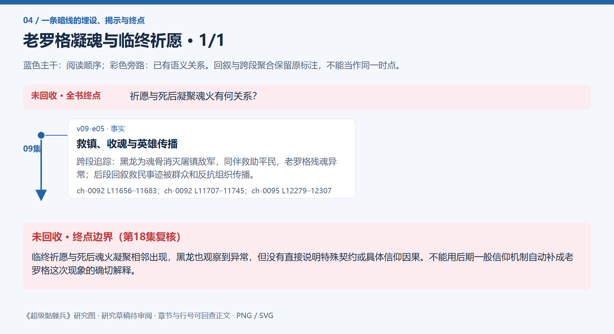

# 全书复核 · 老罗格凝魂与临终祈愿

[剧情目录](../README.md) · [全书阅读首页](../../README.md)

终点状态：**未回收**

## 核心问题

祈愿与死后凝聚魂火有何关系？

## 全书复核结论

已入库至第18集；最近关联事件在第9集。最新状态审计在第18集。临终祈愿与死后魂火凝聚相邻出现，黑龙也观察到异常，但没有直接说明特殊契约或具体信仰因果。不能用后期一般信仰机制自动补成老罗格这次现象的确切解释。

## 暗线时间图片

按主线阅读进度向下推进；分页保留关系编号与接续说明，每张均带全书终点状态。

[PNG原尺寸](../images/book-c8d5d9e2b50a-01.png) · [SVG矢量图](../images/book-c8d5d9e2b50a-01.svg)

## 关联事件

- [救镇、收魂与英雄传播](../vol-09.md)：跨段追踪：黑龙为魂骨消灭屠镇敌军，同伴救助平民，老罗格残魂异常；后段回叙救民事迹被群众和反抗组织传播。

## 关系网络

虚线展示因果、铺垫、误导、揭示与回收。每组至多6条关系；组间通过同名节点衔接，不新增时间顺序或因果。

此线未单列关系边；保留事件及终点说明。

逐条引用依据见[全部语义关系](../relations.md)及事件所在分集页。
