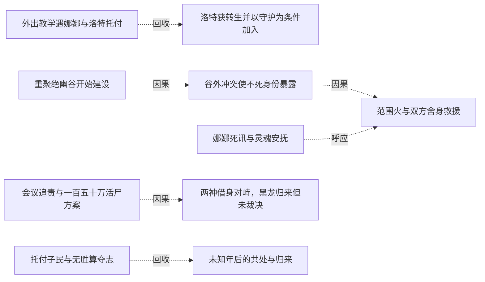
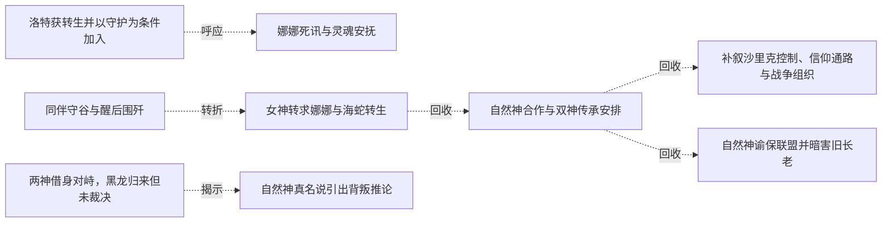
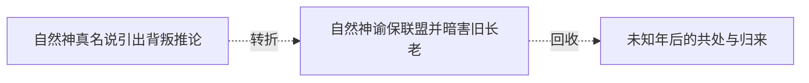

# 跨集 · 娜娜传承与被保护的生活

[剧情目录](../README.md) · [全书阅读首页](../../README.md)

终点状态：**部分回收**

## 核心问题

娜娜能否从被争夺的传承者成为自由生活的主体？

## 全书复核结论

已入库至第18集；最近关联事件在第18集。最新状态审计在第18集。娜娜由遭迫害、被救护到承双神传承并质问自然神，后记明确成长、青春与认出黑龙。她已活到终景，但正式成神、完整身世、克丽丝本体结局没有相应直接证据；保留主体意愿与被选作媒介之间的张力。

## 关联事件

- [外出教学遇娜娜与洛特托付](../vol-02.md)：黑龙带黑二识世，阻止斯文哥尔跟随；遇被白衣信众追杀的娜娜，洛特提出照料请求后死去。
- [洛特获转生并以守护为条件加入](../vol-03.md)：黑龙应娜娜请求转生洛特，七天后洛特接受不死身份与保密要求，要求继续守护娜娜。
- [娜娜死讯与灵魂安抚](../vol-04.md)：黑龙告知父母死讯使娜娜晕厥，求助克丽丝后以灵魂交流安抚，承诺找遗体并把沉渊木交给娜娜。
- [第八圣战击穿石头城](../vol-04.md)：教会在战争中发动献祭召唤摧毁要塞关键工事，帝国攻入同盟；建设物资涨价、教会清洗风险同时落到黑龙队伍。
- [重聚绝幽谷开始建设](../vol-04.md)：队伍重聚，爱琳已引水、洛特已搭房，黑龙与斯文哥尔协商城堡和地下城并建；萝茜同时追踪最后目标娜娜至谷外。
- [谷外冲突使不死身份暴露](../vol-04.md)：斯文哥尔识破伪装圣骑，黑龙抢先冲锋；林间肉搏与诅咒使萝茜识别不死者，双方转入法术和技巧对抗。
- [范围火与双方舍身救援](../vol-04.md)：斯文哥尔范围火被抗火光环应对；黑七受审判失联令黑龙怒伤萝茜，再救黑七而引焰上身；岗撒罗斯转移萝茜致命伤并交出旧吊坠。
- [借肉迟疑与克丽丝教学曝光](../vol-06.md)：火战毁皮后黑龙拟取娜娜肉却迟疑，改取水貂；娜娜治疗时说明克丽丝授术。
- [同伴守谷与醒后围歼](../vol-09.md)：墨菲斯循痕搜谷，罗得等守护，萝茜杀旧友护主；黑龙醒后协调六千骨军与空骑围歼，但仍极弱。
- [女神转求娜娜与海蛇转生](../vol-11.md)：娜娜接到新求助；十孩获真武装后，黑龙耗半魂转生海蛇并找到旧帝国遗物，回船续航。
- [自然神合作与双神传承安排](../vol-13.md)：自然神确认残源处境，以帝国线索促合作；双神选娜娜共同传承，萝茜留护并开始三力融合，仪式尚未完成。
- [补叙沙里克控制、信仰通路与战争组织](../vol-14.md)：回叙补明先知秘密转生统治者、掌财政和工程，疾风因生计接受安排；娜娜恢复自然神信仰通路。黑大黑二袭移民点逼教会应对，组织与不死劳力支持长期战争。
- [会议追责与一百五十万活尸方案](../vol-14.md)：斯文哥尔等追问额外杀戮与二十万俘虏中约十万劳死；先知已在塞茵设置活尸阵并试过个体，准备牺牲全城一百五十万人用于毁灭双方军队并扩张。斯科特明确赞同，毕瑟态度只是旁观推测。
- [两神借身对峙，黑龙归来但未裁决](../vol-14.md)：自然神通过娜娜、克丽丝通过萝茜显现，先知威胁眼前两分身。魂链恢复后黑龙携队到场询问是否要打架，活尸阵处置、先知责任和战争结局均未在本集裁决。
- [回归后暂禁活尸计划](../vol-15.md)：黑龙重返同伴，以位面规则和当前利益暂禁百万活尸阵，保留正常交战与撤退选择。
- [自然神真名说引出背叛推论](../vol-15.md)：自然神称平衡神是切里莫；黑龙把三缺席君王、三主神和帝国远征相连，但正文标明只是一面之词支撑的合理推测。
- [自然神谕保联盟并暗害旧长老](../vol-16.md)：自然神为亡者正名并引信冥月，暗杀唯一旧长老防教义质疑；娜娜亲感此事并质问，叙述明言兼两神传承但仍是媒介。
- [托付子民与无胜算夺志](../vol-18.md)：本源吞噬虚无，黑龙要求哈力、尼女回去减少所有种族死亡，将君王烙印交哈力，接受公正神格，以混沌之灵化银团投本源争取代意志。
- [未知年后的共处与归来](../vol-18.md)：后记黑龙意识醒来，看见飞艇、巨龙运输、深渊出入门、多族市场与蓝晶售冰。菲力普、罗得、斯文、娜娜仍在；哈力号角迎回，黑龙重现原形。

## 关系网络

虚线展示因果、铺垫、误导、揭示与回收。每组至多6条关系；组间通过同名节点衔接，不新增时间顺序或因果。

### 关系组1

| 起点 | 关系 | 终点 | 研究说明 |
|---|---|---|---|
| [重聚绝幽谷开始建设](../vol-04.md) | 因果 | [谷外冲突使不死身份暴露](../vol-04.md) | 追踪娜娜的位置使审判小队与据点护卫相遇 |
| [谷外冲突使不死身份暴露](../vol-04.md) | 因果 | [范围火与双方舍身救援](../vol-04.md) | 身份曝光促灭口火攻，交战重伤触发双重救援 |
| [娜娜死讯与灵魂安抚](../vol-04.md) | 呼应 | [范围火与双方舍身救援](../vol-04.md) | 以额头和灵魂接触救助他人，末场由安抚转为危险反噬 |
| [会议追责与一百五十万活尸方案](../vol-14.md) | 因果 | [两神借身对峙，黑龙归来但未裁决](../vol-14.md) | 全城活尸方案使两神通过载体介入反对；该因果仅指神祇对峙，不指黑龙因争论而归来。 |
| [托付子民与无胜算夺志](../vol-18.md) | 回收 | [未知年后的共处与归来](../vol-18.md) | 自由存在与同伴生存愿望，在多年后的共处生活和主体归来中获得结果见证，过程未描写。 |
| [外出教学遇娜娜与洛特托付](../vol-02.md) | 回收 | [洛特获转生并以守护为条件加入](../vol-03.md) | 上集未答复的托付转为洛特复生，并经条件协商加入队伍 |

### 关系组2

| 起点 | 关系 | 终点 | 研究说明 |
|---|---|---|---|
| [洛特获转生并以守护为条件加入](../vol-03.md) | 呼应 | [娜娜死讯与灵魂安抚](../vol-04.md) | 对娜娜的守护从维持照料者生命延伸到理解失亲痛苦 |
| [同伴守谷与醒后围歼](../vol-09.md) | 转折 | [女神转求娜娜与海蛇转生](../vol-11.md) | 先借萝茜保护并接近黑龙，黑龙拒援后转向娜娜求助；新请求尚未等于脱困成功 |
| [女神转求娜娜与海蛇转生](../vol-11.md) | 回收 | [自然神合作与双神传承安排](../vol-13.md) | 克丽丝向娜娜求助后进入双神共同传承安排，已选定与开始准备不等于完成仪式或解除封印 |
| [自然神合作与双神传承安排](../vol-13.md) | 回收 | [补叙沙里克控制、信仰通路与战争组织](../vol-14.md) | 传承安排之后娜娜承担信仰媒介作用，但此处不能据此宣布双神传承全部完成 |
| [两神借身对峙，黑龙归来但未裁决](../vol-14.md) | 揭示 | [自然神真名说引出背叛推论](../vol-15.md) | 后文进一步说明自然神本源借娜娜、分身留树；少女主体与神明仍须分开记录 |
| [自然神合作与双神传承安排](../vol-13.md) | 回收 | [自然神谕保联盟并暗害旧长老](../vol-16.md) | 双神传承安排获得后文叙述确认，但媒介娜娜的意愿、神明本源与成神仍是不同问题 |

### 关系组3

| 起点 | 关系 | 终点 | 研究说明 |
|---|---|---|---|
| [自然神真名说引出背叛推论](../vol-15.md) | 转折 | [自然神谕保联盟并暗害旧长老](../vol-16.md) | 合作中的自然神以暗害旧长老保障神谕，娜娜的亲见与质问揭开维系联盟的代价 |
| [自然神谕保联盟并暗害旧长老](../vol-16.md) | 回收 | [未知年后的共处与归来](../vol-18.md) | 双神传承与自然神控制的代价之后，后记确认娜娜成长并保青春；未据此补写正式成神或克丽丝本体解封 |

逐条引用依据见[全部语义关系](../relations.md)及事件所在分集页。
