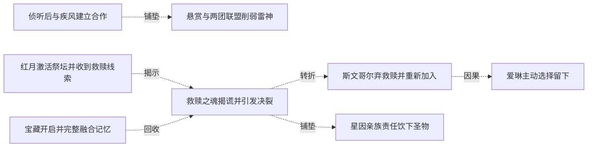
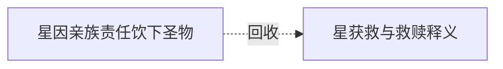

# 跨集 · 救赎之魂的真实作用

[剧情目录](../README.md) · [全书阅读首页](../../README.md)

终点状态：**已回收**

## 核心问题

救赎是否能够让星恢复生前身份？

## 全书复核结论

已入库至第18集；最近关联事件在第5集。最新状态审计在第18集。第五集已揭明救赎的净化目的，星获救归队，恢复生前身份的该次尝试得到否定与救援的实际结果。后文没有把这次救赎改成恢复原身份；仅关闭此项尝试，星的全部后记生活仍未逐项交代。

## 关联事件

- [吞噬阿罗约并复活四名伙伴](../vol-01.md)：黑龙获得碎片魔法知识，为交流而复活四人；伙伴接受生命但计划寻找救赎。
- [建立佣兵团后抢劫雷神成员](../vol-01.md)：低报酬与装备需求促使黑龙采纳抢劫建议，获得装备并结仇。
- [红月激活祭坛并收到救赎线索](../vol-02.md)：红月夜祭坛恢复活性；公会情报指雷克丁拥有救赎之魂，巫妖计划离开。
- [侦听后与疾风建立合作](../vol-02.md)：黑夜聆听发现疾风计划，黑龙按教师策略提出雇佣并敲晕拦路电狼。
- [宝藏开启并完整融合记忆](../vol-02.md)：黑龙打开阿罗约次元空间，旧物触发完整记忆，取得晶石首饰和沉渊木，魔力仍未继承。
- [悬赏与两团联盟削弱雷神](../vol-02.md)：檄文和赏金兑现引动第三方，疾风及火狐狸共同扩张，雷神人员和情报网遭重创。
- [趁雷神衰败独攻并发现密道](../vol-03.md)：艾力克斯被盟军击杀后，斯文哥尔为秘密取得救赎之魂主张自行进攻；黑龙从骸骨信息推测并找到密道。
- [救赎之魂揭谎并引发决裂](../vol-03.md)：黑龙在宝库识别圣物并试探；斯文哥尔谎言被揭，四人短暂失力，黑龙最终放过他们并留下圣物离开。
- [斯文哥尔弃救赎并重新加入](../vol-03.md)：斯文哥尔主动放弃恢复人身，追出援助黑龙清剿幸存者，再明确请求以不死同伴身份留下。
- [爱琳主动选择留下](../vol-03.md)：爱琳因亲情、风险与对现有关系的依恋，反驳老师劝返，向黑龙请求继续当不死同伴并获接受。
- [星因亲族责任饮下圣物](../vol-03.md)：星月承认个体善恶不由物种决定，却顾虑家人与部落；星饮下救赎之魂后被圣焰吞没，结果未明。
- [星获救与救赎释义](../vol-05.md)：黑二炼除神力，星月重新归队，盒文澄清救赎为净化回归神。

## 关系网络

虚线展示因果、铺垫、误导、揭示与回收。每组至多6条关系；组间通过同名节点衔接，不新增时间顺序或因果。

### 关系组1

| 起点 | 关系 | 终点 | 研究说明 |
|---|---|---|---|
| [侦听后与疾风建立合作](../vol-02.md) | 铺垫 | [悬赏与两团联盟削弱雷神](../vol-02.md) | 联盟给予情报和公开名义，扩大反雷神行动 |
| [救赎之魂揭谎并引发决裂](../vol-03.md) | 转折 | [斯文哥尔弃救赎并重新加入](../vol-03.md) | 放过并留圣物后，斯文哥尔自愿舍弃复原 |
| [斯文哥尔弃救赎并重新加入](../vol-03.md) | 因果 | [爱琳主动选择留下](../vol-03.md) | 老师留下成为爱琳不愿分离的重要理由 |
| [救赎之魂揭谎并引发决裂](../vol-03.md) | 铺垫 | [星因亲族责任饮下圣物](../vol-03.md) | 留下圣物提供星月的独立选择机会 |
| [红月激活祭坛并收到救赎线索](../vol-02.md) | 揭示 | [救赎之魂揭谎并引发决裂](../vol-03.md) | 被隐瞒的救赎目标取得实物后曝光，引发同伴关系危机 |
| [宝藏开启并完整融合记忆](../vol-02.md) | 回收 | [救赎之魂揭谎并引发决裂](../vol-03.md) | 完整继承记忆使黑龙能够识别圣物，伙伴不知道这项认知优势 |

### 关系组2

| 起点 | 关系 | 终点 | 研究说明 |
|---|---|---|---|
| [星因亲族责任饮下圣物](../vol-03.md) | 回收 | [星获救与救赎释义](../vol-05.md) | 圣焰后果回收为星获救与盒文释义：救赎是净化，并非恢复生前身份 |

逐条引用依据见[全部语义关系](../relations.md)及事件所在分集页。
