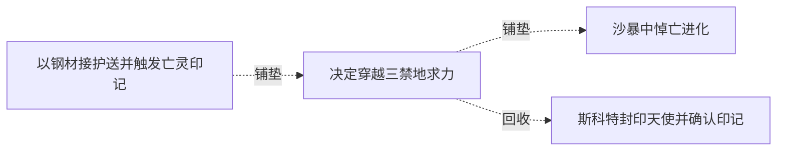

# 跨集 · 亡灵印记的发出者与目的地

[剧情目录](../README.md) · [全书阅读首页](../../README.md)

终点状态：**已回收**

## 核心问题

亡灵印记由谁散播，指向哪里？

## 全书复核结论

已入库至第18集；最近关联事件在第6集。最新状态审计在第18集。亡灵印记由斯科特散播、指向哀嚎森林往生者国度的定位问题已明确。此项只关闭发行者和地点；不能把印记旧诅咒功能、红月自然周期等其他问题一并关闭。

## 关联事件

- [以钢材接护送并触发亡灵印记](../vol-04.md)：梅里尔用十吨钢材换取限期护送，队伍分流；行程中黑龙用灵魂接触宝库徽章，听见北方往生国度的循环召归声。
- [决定穿越三禁地求力](../vol-05.md)：黑龙拒绝无尽躲藏，在知龙墓危险后仍决定北行。
- [沙暴中悼亡进化](../vol-05.md)：黄金骷髅人墙护队，黑龙紫魂进化、感知沙下大量骸骨，瞬发幻界；教皇远感命名。
- [斯科特封印天使并确认印记](../vol-06.md)：数百亡灵束缚天使，斯科特禁咒封其本源，说明路标及悼亡层级。

## 关系网络

虚线展示因果、铺垫、误导、揭示与回收。每组至多6条关系；组间通过同名节点衔接，不新增时间顺序或因果。

### 关系组1

| 起点 | 关系 | 终点 | 研究说明 |
|---|---|---|---|
| [决定穿越三禁地求力](../vol-05.md) | 铺垫 | [沙暴中悼亡进化](../vol-05.md) | 北行决定带队进入沙漠，并触及未知骨骸历史。 |
| [以钢材接护送并触发亡灵印记](../vol-04.md) | 铺垫 | [决定穿越三禁地求力](../vol-05.md) | 印记的北方召归声从未明信息发展为寻求力量的旅行方向 |
| [决定穿越三禁地求力](../vol-05.md) | 回收 | [斯科特封印天使并确认印记](../vol-06.md) | 北行寻找印记源头后，斯科特确认自己散播印记；龙墓假设未成立 |

逐条引用依据见[全部语义关系](../relations.md)及事件所在分集页。
