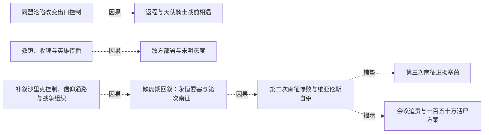
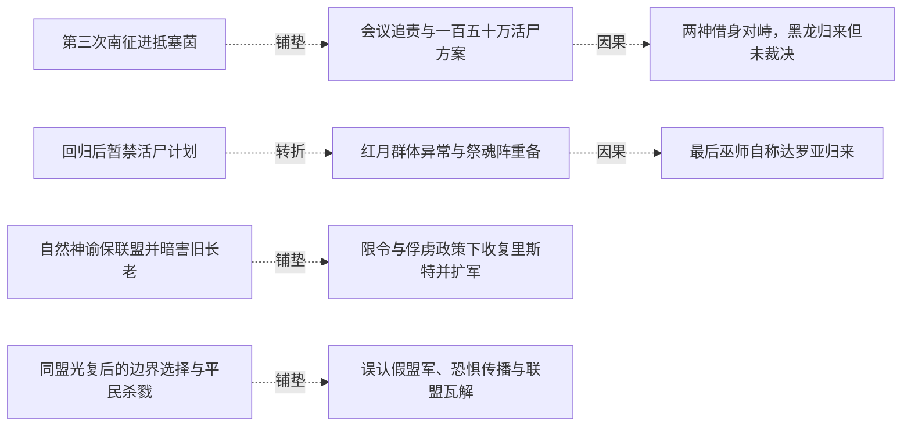
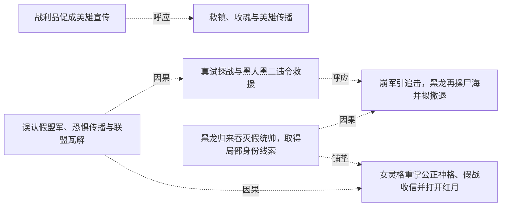
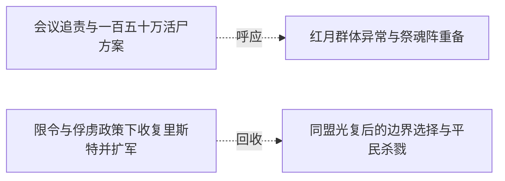

# 跨集 · 光复、假旗战争与神力介入

[剧情目录](../README.md) · [全书阅读首页](../../README.md)

终点状态：**部分回收**

## 核心问题

同盟光复后，战争怎样演变，群众和军队将付出什么代价？

## 全书复核结论

已入库至第18集；最近关联事件在第17集。最新状态审计在第18集。同盟光复后发生继续进攻、假旗屠杀与联盟破裂，继而转为深渊门战场。终卷有限退兵约定、止损要求和后记多族共处给出方向性结果；停战过程、各国协议与战争代价的完整处置没有展示。

## 关联事件

- [战利品促成英雄宣传](../vol-05.md)：出售帝国战马引官方传播战绩，黑龙获得公共英雄名声。
- [同盟沦陷改变出口控制](../vol-07.md)：同盟军和自然神殿被击败，安德鲁知道神明层面败亡；教会控制两处沙漠出口并按雷奥定位改道。
- [返程与天使骑士战前相遇](../vol-07.md)：黑七与法师等留后，黑龙带九孩返程；黑大银丝侦察引敌误读，黑龙凭既有灵魂运用和武装决定正面应战，列奥纳布双层盾墙等冲撞。
- [救镇、收魂与英雄传播](../vol-09.md)：跨段追踪：黑龙为魂骨消灭屠镇敌军，同伴救助平民，老罗格残魂异常；后段回叙救民事迹被群众和反抗组织传播。
- [敌方部署与未明态度](../vol-09.md)：穿插于多章的敌方行动：安德鲁动摇回圣山，雷奥获噬魂，菲力普派队查失踪；到黑龙赋魂释能时，教皇和菲力普感到强波动却未出手。
- [隘口伏击造成坐骑灭失与再次透支](../vol-10.md)：费尔巴尼私查布伏，普通军队最终覆灭仍杀尽随行战马、伤骨骼，黑龙透支再睡。
- [雷奥刺杀失败、死亡与噬魂制傀儡](../vol-10.md)：魅带俘近前被雷奥利用，分魂刺杀遭枪的亲和规则阻止；雷奥魂灭，噬魂吞魂制出同形傀儡。
- [分身降临破外封，洞内仍有魂封](../vol-10.md)：萝茜受改体与注能耗竭，双星失衡崩塌；四人进入内洞见六芒星封魂与未知声音，未完成救援。
- [帝勒继承龙魂力量并率族退战](../vol-12.md)：拿不列斯转出元力与记忆后本源沉睡；帝勒用克制干预和退战谈判争取空间，黑龙最终放行并监视。
- [归家供应危机引出夺国与终局争论](../vol-12.md)：回家重逢与分工使先知看到组织潜力；星报钢铁减半，疾风求助夺沙里克，先知提灭世转生计划，黑龙认为那会无聊并未接受。
- [极光杀剑圣与天使备用躯体的秘密](../vol-12.md)：格杀档案在极光屠村杀奥马利多的现场得到具象验证；菲力普得知神迹非针对自己，却仍不懂骑士召回目的，反映教会力量不由他尽知。
- [缺席期回叙：永恒要塞与第一次南征](../vol-14.md)：外界三年三月的回叙展开。要塞由魔法、骨劳力与人类后勤建成；太子谋军功，第一次三十万大军受黑大、黑二夜袭断粮而撤。十三万损失包括伤员与逃亡，非全部阵亡。
- [补叙沙里克控制、信仰通路与战争组织](../vol-14.md)：回叙补明先知秘密转生统治者、掌财政和工程，疾风因生计接受安排；娜娜恢复自然神信仰通路。黑大黑二袭移民点逼教会应对，组织与不死劳力支持长期战争。
- [第二次南征惨败与维亚伦斯自杀](../vol-14.md)：帝国四十五万军攻坚并付出巨大代价，守方虚构瘟疫造成军队失序，维亚伦斯射杀逃回者，牧师救助后遭后续屠杀。战报为十六万阵亡、二十万被俘、三万失踪，返不足六万；维亚伦斯交印自杀，菲力普暂代军务。
- [第三次南征进抵塞茵](../vol-14.md)：九个月后教会力量参与再征，帝国约三十万军打下守军不足七千、主力已撤的要塞，继续抵近塞茵；黑龙将于此阶段回来。
- [会议追责与一百五十万活尸方案](../vol-14.md)：斯文哥尔等追问额外杀戮与二十万俘虏中约十万劳死；先知已在塞茵设置活尸阵并试过个体，准备牺牲全城一百五十万人用于毁灭双方军队并扩张。斯科特明确赞同，毕瑟态度只是旁观推测。
- [两神借身对峙，黑龙归来但未裁决](../vol-14.md)：自然神通过娜娜、克丽丝通过萝茜显现，先知威胁眼前两分身。魂链恢复后黑龙携队到场询问是否要打架，活尸阵处置、先知责任和战争结局均未在本集裁决。
- [回归后暂禁活尸计划](../vol-15.md)：黑龙重返同伴，以位面规则和当前利益暂禁百万活尸阵，保留正常交战与撤退选择。
- [调整兵权但未避免德鲁伊牺牲](../vol-15.md)：黑龙把德鲁伊出战数减半，强收先知三十六龙魂约仍留指挥职；已投入的五十余德鲁伊全部战死后尸兵扭转局面。
- [红月群体异常与祭魂阵重备](../vol-15.md)：红月巫师无人指挥突袭，力量向生还者集中；天使现身后黑龙同意趁机出击并重备祭魂阵，称不到最后不发动。
- [最后巫师自称达罗亚归来](../vol-15.md)：战死、自爆与主动合一只余一人，侵蚀一名降临天使躯体后自报达罗亚力绯克；黑龙会意挥手出城。
- [菲力普逃离，祷言与弗里昂之死结束强者战](../vol-16.md)：菲力普佯作强袭后逃，牧师集体燃命；魅冒耗散风险截击被黑龙救离，达罗亚收祷言。弗里昂拒逃战死，图克半身烧毁；达罗亚随后显出自身光明神格。
- [自然神谕保联盟并暗害旧长老](../vol-16.md)：自然神为亡者正名并引信冥月，暗杀唯一旧长老防教义质疑；娜娜亲感此事并质问，叙述明言兼两神传承但仍是媒介。
- [限令与俘虏政策下收复里斯特并扩军](../vol-16.md)：塞茵暴动和联军撤离未引祭魂阵启动，阿古援黑龙限令反对；先知收俘缓恐惧，攻克里斯特后从战尸扩军两万到四万，新装不全，海图与联军再跟进。
- [同盟光复后的边界选择与平民杀戮](../vol-17.md)：并行战争线三月扩军至八万骑，大二魂强增而未晋悼亡。先知受组织制衡拟停在边境，但空取石头城后追杀一万五千平民至圣罗兰，随后发现帝国后方陌生洪流。
- [误认假盟军、恐惧传播与联盟瓦解](../vol-17.md)：先知等把两统帅装低智与称黑龙当归属证明，跟随千万洪流深入帝国。慢进与虐杀制造逃亡潮，教会声望上升，同盟断绝合作，自然神信徒减少。
- [真试探战与黑大黑二违令救援](../vol-17.md)：教皇部署正规骑阻拦受己方安排的洪流，先知误以领域使骨军止步，派五千骑真试探。光明老兵一万五千全亡，大二不忍同类消耗，带余骑和原八孩违先知令救回同伴。
- [黑龙归来吞灭假统帅，取得局部身份线索](../vol-17.md)：魂链恢复，黑龙到场否认假军归属；光与安德鲁亮出旧身份及尼鲁达名号后，被黑龙吞魂取忆。记忆确认女天使为神骑老师、教皇与尼传承有关，两人随后明确魂散。
- [崩军引追击，黑龙再操尸海并拟撤退](../vol-17.md)：统帅魂散使千万旧军崩溃，人类振奋冲锋；黑龙召回己军，以无魂操骨反击，再吞亡魂操人马尸，微操耗神且不能跨空间携走这些工具。因情报不足，他决定向横断山撤，逐一赋魂仍为计划。
- [女灵格重掌公正神格、假战收信并打开红月](../vol-17.md)：女灵格融合封存公正神格，以迦莲娜形态公开显现。她制造表演战斗，黑龙未明全盘目的而克制应战；教皇改祷对象汇聚信力，使她短现十翼再放能量开红月，退回四翼且受伤；黑龙只获其自报尼鲁达，尚未见大陆回归。

## 关系网络

虚线展示因果、铺垫、误导、揭示与回收。每组至多6条关系；组间通过同名节点衔接，不新增时间顺序或因果。

### 关系组1

| 起点 | 关系 | 终点 | 研究说明 |
|---|---|---|---|
| [同盟沦陷改变出口控制](../vol-07.md) | 因果 | [返程与天使骑士战前相遇](../vol-07.md) | 出口被控制和雷奥持续定位让安德鲁绕行到返程方向完成拦截。 |
| [救镇、收魂与英雄传播](../vol-09.md) | 因果 | [敌方部署与未明态度](../vol-09.md) | e05中沿途消灭小队这一部分促成e06中菲力普派队调查；不表示后段英雄传播造成前段敌方部署。 |
| [补叙沙里克控制、信仰通路与战争组织](../vol-14.md) | 因果 | [缺席期回叙：永恒要塞与第一次南征](../vol-14.md) | 后置补叙揭示早先工程、财政与军队组织怎样支持要塞防守；这条边追溯故事时间，非叙述顺序。 |
| [缺席期回叙：永恒要塞与第一次南征](../vol-14.md) | 因果 | [第二次南征惨败与维亚伦斯自杀](../vol-14.md) | 首次后方袭击促使第二次大军谨慎推进并保护补给。 |
| [第二次南征惨败与维亚伦斯自杀](../vol-14.md) | 铺垫 | [第三次南征进抵塞茵](../vol-14.md) | 第二次惨败后政军权力变化及教会力量介入，构成第三次攻势条件。 |
| [第二次南征惨败与维亚伦斯自杀](../vol-14.md) | 揭示 | [会议追责与一百五十万活尸方案](../vol-14.md) | 战后会议揭示战争结算之外的决策争议和俘虏持续死亡，改变对胜利代价的认识。 |

### 关系组2

| 起点 | 关系 | 终点 | 研究说明 |
|---|---|---|---|
| [第三次南征进抵塞茵](../vol-14.md) | 铺垫 | [会议追责与一百五十万活尸方案](../vol-14.md) | 帝国逼近塞茵形成计划公布的军事压力，但不构成屠城唯一或必然动机。 |
| [会议追责与一百五十万活尸方案](../vol-14.md) | 因果 | [两神借身对峙，黑龙归来但未裁决](../vol-14.md) | 全城活尸方案使两神通过载体介入反对；该因果仅指神祇对峙，不指黑龙因争论而归来。 |
| [回归后暂禁活尸计划](../vol-15.md) | 转折 | [红月群体异常与祭魂阵重备](../vol-15.md) | 原先暂禁的大阵回到备选清单，表明初禁基于时机和收益。 |
| [红月群体异常与祭魂阵重备](../vol-15.md) | 因果 | [最后巫师自称达罗亚归来](../vol-15.md) | 死亡后聚能的规律经主动献身推向单一主体。 |
| [自然神谕保联盟并暗害旧长老](../vol-16.md) | 铺垫 | [限令与俘虏政策下收复里斯特并扩军](../vol-16.md) | 神谕稳定神职方面，再配俘虏政策和复土利益使联军合作。 |
| [同盟光复后的边界选择与平民杀戮](../vol-17.md) | 铺垫 | [误认假盟军、恐惧传播与联盟瓦解](../vol-17.md) | 边境推进使先知与从帝国后方来的洪流接触，其保留力量意图促使跟进。 |

### 关系组3

| 起点 | 关系 | 终点 | 研究说明 |
|---|---|---|---|
| [误认假盟军、恐惧传播与联盟瓦解](../vol-17.md) | 因果 | [真试探战与黑大黑二违令救援](../vol-17.md) | 跟随假军进入预置战场，令先知为名义盟友投入真实试探兵力。 |
| [误认假盟军、恐惧传播与联盟瓦解](../vol-17.md) | 因果 | [女灵格重掌公正神格、假战收信并打开红月](../vol-17.md) | 洪流制造的恐惧和信仰积累为女灵格重掌神格提供条件。 |
| [真试探战与黑大黑二违令救援](../vol-17.md) | 呼应 | [崩军引追击，黑龙再操尸海并拟撤退](../vol-17.md) | 大二先救同类、黑龙后召回己军，保护范围和命令优先级形成对照。 |
| [黑龙归来吞灭假统帅，取得局部身份线索](../vol-17.md) | 因果 | [崩军引追击，黑龙再操尸海并拟撤退](../vol-17.md) | 统帅魂散导致军团崩溃并诱发人军追击，黑龙以新控制接管残局。 |
| [黑龙归来吞灭假统帅，取得局部身份线索](../vol-17.md) | 铺垫 | [女灵格重掌公正神格、假战收信并打开红月](../vol-17.md) | 吞忆得知女天使为老师却仍不明全局，使黑龙交手时保留力量等待解释。 |
| [战利品促成英雄宣传](../vol-05.md) | 呼应 | [救镇、收魂与英雄传播](../vol-09.md) | 两次私人取利与公共救援结果重叠，见证和组织传播分别塑造英雄形象；不是同一宣传活动 |

### 关系组4

| 起点 | 关系 | 终点 | 研究说明 |
|---|---|---|---|
| [会议追责与一百五十万活尸方案](../vol-14.md) | 呼应 | [红月群体异常与祭魂阵重备](../vol-15.md) | 原先全城方案在红月转机中获得重新准备授权，仍未实际发动 |
| [限令与俘虏政策下收复里斯特并扩军](../vol-16.md) | 回收 | [同盟光复后的边界选择与平民杀戮](../vol-17.md) | 收复里斯特及扩军之后，同盟领土光复；后续继续入侵与假旗危机须另计，不能当战争已彻底结束 |

逐条引用依据见[全部语义关系](../relations.md)及事件所在分集页。
