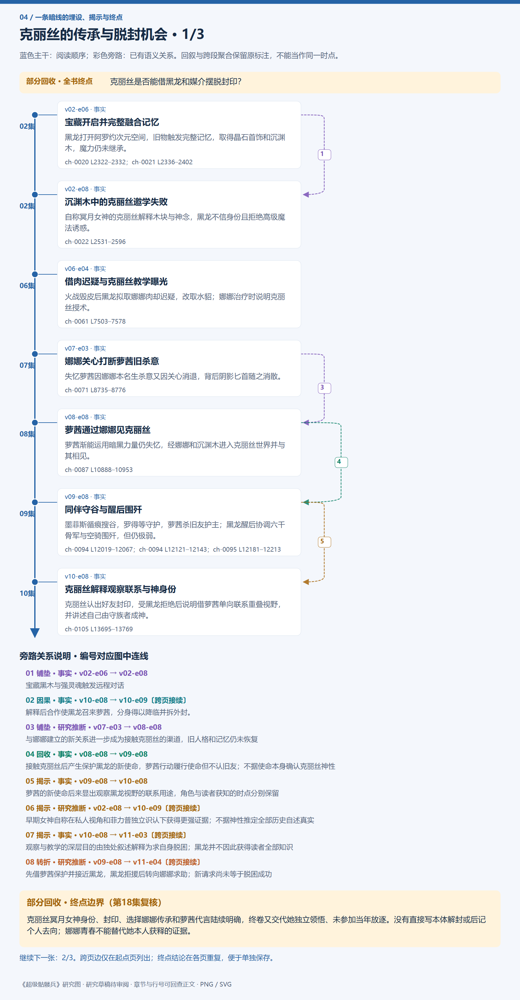
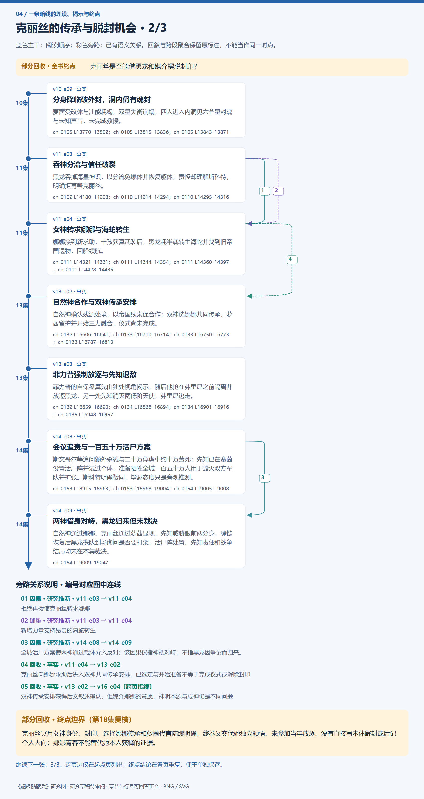
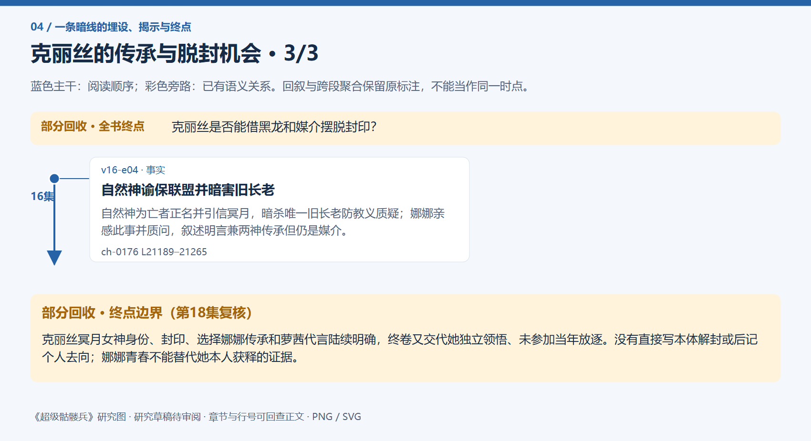
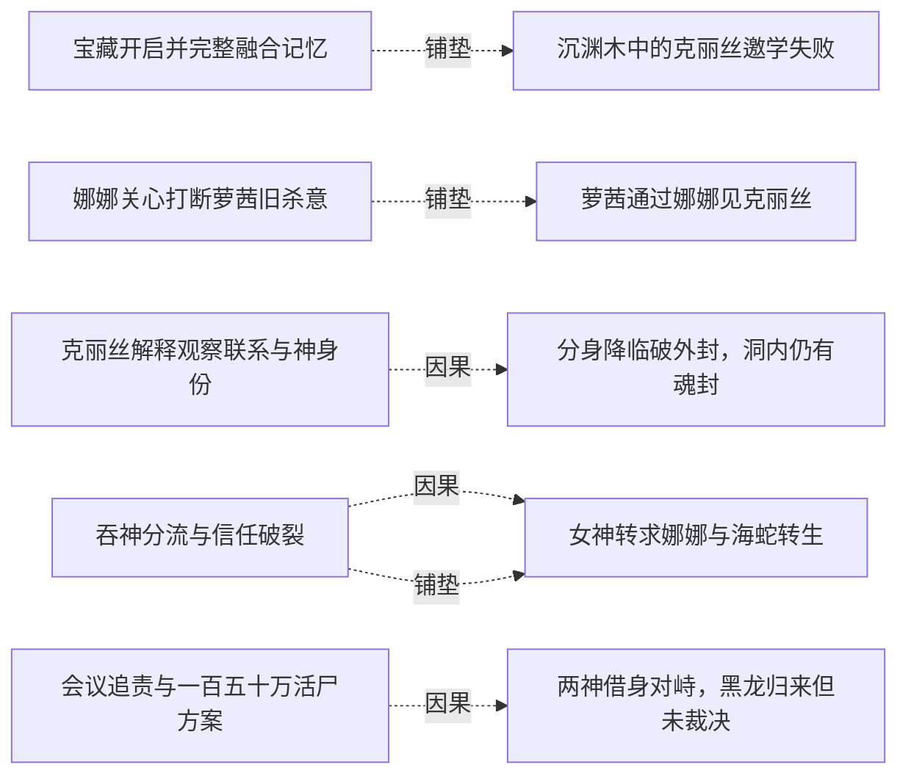
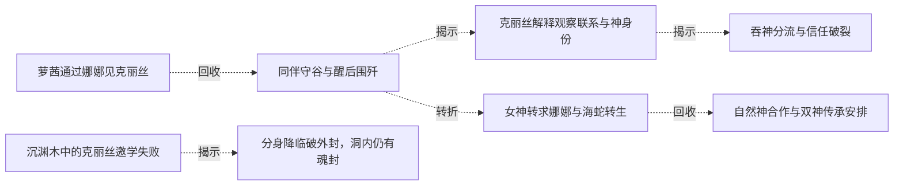
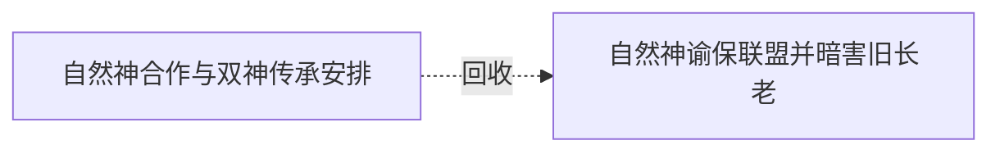

# 跨集 · 克丽丝的传承与脱封机会

[剧情目录](../README.md) · [全书阅读首页](../../README.md)

终点状态：**部分回收**

## 核心问题

克丽丝是否能借黑龙和媒介摆脱封印？

## 全书复核结论

已入库至第18集；最近关联事件在第16集。最新状态审计在第18集。克丽丝冥月女神身份、封印、选择娜娜传承和萝茜代言陆续明确，终卷又交代她独立领悟、未参加当年放逐。没有直接写本体解封或后记个人去向；娜娜青春不能替代她本人获释的证据。

## 暗线时间图片

按主线阅读进度向下推进；分页保留关系编号与接续说明，每张均带全书终点状态。

[PNG原尺寸](../images/book-e90db68cb625-01.png) · [SVG矢量图](../images/book-e90db68cb625-01.svg)

[PNG原尺寸](../images/book-e90db68cb625-02.png) · [SVG矢量图](../images/book-e90db68cb625-02.svg)

[PNG原尺寸](../images/book-e90db68cb625-03.png) · [SVG矢量图](../images/book-e90db68cb625-03.svg)

## 关联事件

- [宝藏开启并完整融合记忆](../vol-02.md)：黑龙打开阿罗约次元空间，旧物触发完整记忆，取得晶石首饰和沉渊木，魔力仍未继承。
- [沉渊木中的克丽丝邀学失败](../vol-02.md)：自称冥月女神的克丽丝解释木块与神念，黑龙不信身份且拒绝高级魔法诱惑。
- [借肉迟疑与克丽丝教学曝光](../vol-06.md)：火战毁皮后黑龙拟取娜娜肉却迟疑，改取水貂；娜娜治疗时说明克丽丝授术。
- [娜娜关心打断萝茜旧杀意](../vol-07.md)：失忆萝茜因娜娜本名生杀意又因关心消退，背后阴影匕首随之消散。
- [萝茜通过娜娜见克丽丝](../vol-08.md)：萝茜渐能运用暗黑力量仍失忆，经娜娜和沉渊木进入克丽丝世界并与其相见。
- [同伴守谷与醒后围歼](../vol-09.md)：墨菲斯循痕搜谷，罗得等守护，萝茜杀旧友护主；黑龙醒后协调六千骨军与空骑围歼，但仍极弱。
- [克丽丝解释观察联系与神身份](../vol-10.md)：克丽丝认出好友封印，受黑龙拒绝后说明借萝茜单向联系重叠视野，并讲述自己由守族者成神。
- [分身降临破外封，洞内仍有魂封](../vol-10.md)：萝茜受改体与注能耗竭，双星失衡崩塌；四人进入内洞见六芒星封魂与未知声音，未完成救援。
- [吞神分流与信任破裂](../vol-11.md)：黑龙吞掉海皇神识，以分流免爆体并恢复躯体；责怪却理解斯科特，明确拒再帮克丽丝。
- [女神转求娜娜与海蛇转生](../vol-11.md)：娜娜接到新求助；十孩获真武装后，黑龙耗半魂转生海蛇并找到旧帝国遗物，回船续航。
- [自然神合作与双神传承安排](../vol-13.md)：自然神确认残源处境，以帝国线索促合作；双神选娜娜共同传承，萝茜留护并开始三力融合，仪式尚未完成。
- [菲力普强制放逐与先知退敌](../vol-13.md)：菲力普的自保盘算先由独处视角揭示，随后他抢在弗里昂之前隔离并放逐黑龙；另一处先知消灭两低阶天使，弗里昂逃走。
- [会议追责与一百五十万活尸方案](../vol-14.md)：斯文哥尔等追问额外杀戮与二十万俘虏中约十万劳死；先知已在塞茵设置活尸阵并试过个体，准备牺牲全城一百五十万人用于毁灭双方军队并扩张。斯科特明确赞同，毕瑟态度只是旁观推测。
- [两神借身对峙，黑龙归来但未裁决](../vol-14.md)：自然神通过娜娜、克丽丝通过萝茜显现，先知威胁眼前两分身。魂链恢复后黑龙携队到场询问是否要打架，活尸阵处置、先知责任和战争结局均未在本集裁决。
- [自然神谕保联盟并暗害旧长老](../vol-16.md)：自然神为亡者正名并引信冥月，暗杀唯一旧长老防教义质疑；娜娜亲感此事并质问，叙述明言兼两神传承但仍是媒介。

## 关系网络

虚线展示因果、铺垫、误导、揭示与回收。每组至多6条关系；组间通过同名节点衔接，不新增时间顺序或因果。

### 关系组1

| 起点 | 关系 | 终点 | 研究说明 |
|---|---|---|---|
| [宝藏开启并完整融合记忆](../vol-02.md) | 铺垫 | [沉渊木中的克丽丝邀学失败](../vol-02.md) | 宝藏黑木与强灵魂触发远程对话 |
| [克丽丝解释观察联系与神身份](../vol-10.md) | 因果 | [分身降临破外封，洞内仍有魂封](../vol-10.md) | 解释后合作使黑龙召来萝茜，分身得以降临并拆外封。 |
| [吞神分流与信任破裂](../vol-11.md) | 因果 | [女神转求娜娜与海蛇转生](../vol-11.md) | 拒绝再援使克丽丝转求娜娜 |
| [吞神分流与信任破裂](../vol-11.md) | 铺垫 | [女神转求娜娜与海蛇转生](../vol-11.md) | 新增力量支持昂贵的海蛇转生 |
| [会议追责与一百五十万活尸方案](../vol-14.md) | 因果 | [两神借身对峙，黑龙归来但未裁决](../vol-14.md) | 全城活尸方案使两神通过载体介入反对；该因果仅指神祇对峙，不指黑龙因争论而归来。 |
| [娜娜关心打断萝茜旧杀意](../vol-07.md) | 铺垫 | [萝茜通过娜娜见克丽丝](../vol-08.md) | 与娜娜建立的新关系进一步成为接触克丽丝的渠道，旧人格和记忆仍未恢复 |

### 关系组2

| 起点 | 关系 | 终点 | 研究说明 |
|---|---|---|---|
| [萝茜通过娜娜见克丽丝](../vol-08.md) | 回收 | [同伴守谷与醒后围歼](../vol-09.md) | 接触克丽丝后产生保护黑龙的新使命，萝茜行动履行使命但不认旧友；不据使命本身确认克丽丝神性 |
| [同伴守谷与醒后围歼](../vol-09.md) | 揭示 | [克丽丝解释观察联系与神身份](../vol-10.md) | 萝茜的新使命后来显出观察黑龙视野的联系用途，角色与读者获知的时点分别保留 |
| [沉渊木中的克丽丝邀学失败](../vol-02.md) | 揭示 | [分身降临破外封，洞内仍有魂封](../vol-10.md) | 早期女神自称在私人视角和菲力普独立识认下获得更强证据；不据神性推定全部历史自述真实 |
| [克丽丝解释观察联系与神身份](../vol-10.md) | 揭示 | [吞神分流与信任破裂](../vol-11.md) | 观察与教学的深层目的由独处叙述解释为求自身脱困；黑龙并不因此获得读者全部知识 |
| [同伴守谷与醒后围歼](../vol-09.md) | 转折 | [女神转求娜娜与海蛇转生](../vol-11.md) | 先借萝茜保护并接近黑龙，黑龙拒援后转向娜娜求助；新请求尚未等于脱困成功 |
| [女神转求娜娜与海蛇转生](../vol-11.md) | 回收 | [自然神合作与双神传承安排](../vol-13.md) | 克丽丝向娜娜求助后进入双神共同传承安排，已选定与开始准备不等于完成仪式或解除封印 |

### 关系组3

| 起点 | 关系 | 终点 | 研究说明 |
|---|---|---|---|
| [自然神合作与双神传承安排](../vol-13.md) | 回收 | [自然神谕保联盟并暗害旧长老](../vol-16.md) | 双神传承安排获得后文叙述确认，但媒介娜娜的意愿、神明本源与成神仍是不同问题 |

逐条引用依据见[全部语义关系](../relations.md)及事件所在分集页。
