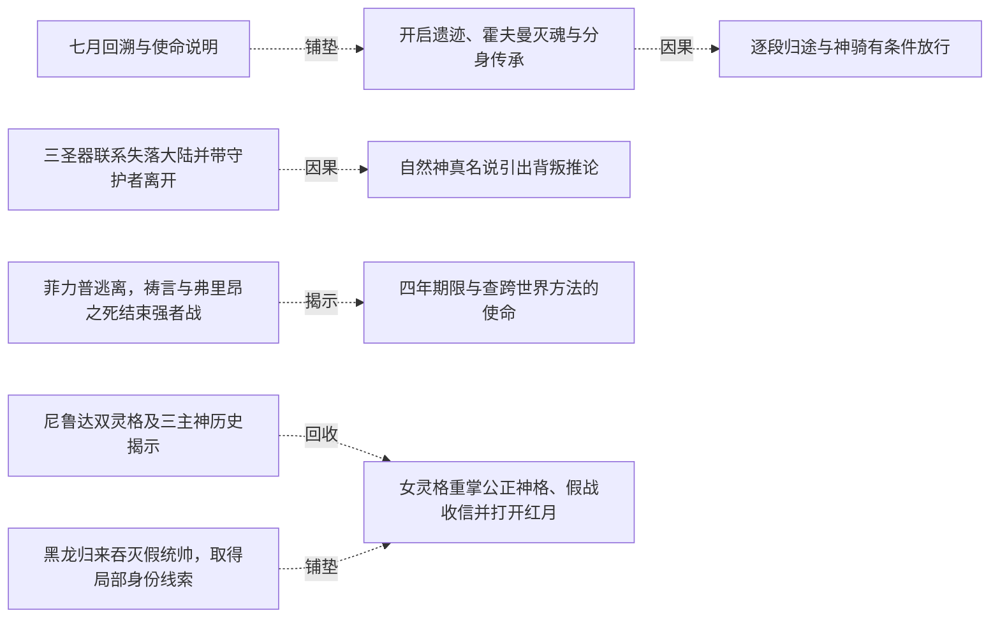
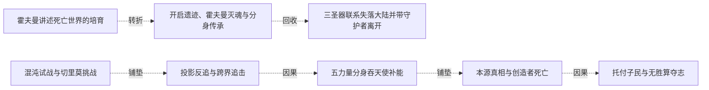
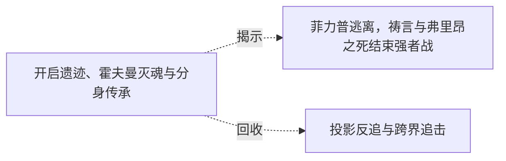

# 跨集 · 切罗曼尔遗产的自主使用

[剧情目录](../README.md) · [全书阅读首页](../../README.md)

终点状态：**部分回收**

## 核心问题

黑龙如何把继承的知识转为自己的行动，帝国使命是否获得全部实现？

## 全书复核结论

已入库至第18集；最近关联事件在第18集。最新状态审计在第18集。记忆传承、分身三年内消失和主意识之死的说明与黑龙自主人格分开；终卷把反向力、时间干扰和追踪知识用于行动。哈力及子民回归兑现部分帝国目标，但未证明所有旧制度重建；两神植格等历史口径问题未获完整统一。

## 关联事件

- [霍夫曼讲述死亡世界的培育](../vol-13.md)：隆克多引黑龙见霍夫曼；兼容领地、深渊宠物及君王雕像后，霍夫曼讲述独立诞生、旧子民消亡与新灵魂培育。
- [七月回溯与使命说明](../vol-14.md)：黑龙在时空之轮中回溯自身生命，提升灵魂感应和覆盖范围内分控。霍夫曼解释死亡世界使命，召集旧学生与上位者准备开遗迹。
- [开启遗迹、霍夫曼灭魂与分身传承](../vol-14.md)：遗迹灾变中黑龙因不会飞行错失入口，霍夫曼被时间囚笼中的切罗曼尔分身灭魂。分身借烙印传法使黑龙自行抵达，授记忆而不授力量；两年传承细节由后文补述。
- [逐段归途与神骑有条件放行](../vol-14.md)：黑龙携金龙等十五名强者按位面坐标跳转，古巴避走告警。途中自然神骑阻击，黑龙实练新术；光之神骑自报谢菲里安，按本位面出生及实力承认通行。此时尚未与旧同伴会合。
- [三圣器联系失落大陆并带守护者离开](../vol-15.md)：大贤者讲亲历，三器触发意念见证红月通道、浮陆和哈力维亚。黑龙获死亡之眼与最后未用禁咒，毁墓带二守护者返回。
- [自然神真名说引出背叛推论](../vol-15.md)：自然神称平衡神是切里莫；黑龙把三缺席君王、三主神和帝国远征相连，但正文标明只是一面之词支撑的合理推测。
- [菲力普逃离，祷言与弗里昂之死结束强者战](../vol-16.md)：菲力普佯作强袭后逃，牧师集体燃命；魅冒耗散风险截击被黑龙救离，达罗亚收祷言。弗里昂拒逃战死，图克半身烧毁；达罗亚随后显出自身光明神格。
- [四年期限与查跨世界方法的使命](../vol-16.md)：黑龙制服赫米亚后，达罗亚自述只余四年、其旗下领主以上子民全亡，提出调查天使跨世界方法以找回大陆，并指向绝望高原；其最终夺体意图此时未告黑龙。
- [假探路后黑龙遭达罗亚封魂夺体](../vol-16.md)：高原洞穴隔绝探查，达罗亚令旧两傀儡探路并假报安全，随后封住黑龙魂；要其躯体、魂能与子民的目的明说，外部失联者误以又跨位面。
- [紧缩灵魂后两端出现混沌之灵认知](../vol-16.md)：外援能量压倒黑龙，其紧缩魂减缓抽取而失去清晰思维，内部亮光吞意识；哈力经祭坛感异常，达罗亚后触硬物惊称混沌之灵，结局仍未给出。
- [混沌之灵形成，达罗亚的夺体逆转](../vol-17.md)：达的攻击唤醒黑龙紧缩形成的晶体，三力拉锯中哈力维亚传技；黑龙反吞人工光明神格，毁祭坛中心。达失回归体再夺赫米亚躯，仍被复制噬魂毁躯；黑龙重生身体、收两傀儡并恢复魂链。
- [尼鲁达双灵格及三主神历史揭示](../vol-17.md)：圣柜密谈揭教皇与女天使同源分裂后各有独立灵格。历史回叙说明切里莫、尼鲁达、安克瓦斯曾造光明分身，联手放逐大陆，后来互相清除；尼假死分魂潜伏，安已被切消灭，净世军本为切留下的子民。
- [黑龙归来吞灭假统帅，取得局部身份线索](../vol-17.md)：魂链恢复，黑龙到场否认假军归属；光与安德鲁亮出旧身份及尼鲁达名号后，被黑龙吞魂取忆。记忆确认女天使为神骑老师、教皇与尼传承有关，两人随后明确魂散。
- [女灵格重掌公正神格、假战收信并打开红月](../vol-17.md)：女灵格融合封存公正神格，以迦莲娜形态公开显现。她制造表演战斗，黑龙未明全盘目的而克制应战；教皇改祷对象汇聚信力，使她短现十翼再放能量开红月，退回四翼且受伤；黑龙只获其自报尼鲁达，尚未见大陆回归。
- [混沌试战与切里莫挑战](../vol-18.md)：哈力杀魔眼，黑龙试验冲击转化、受死亡之指毁躯后学会回击并修复；余三魔物受烙活下。切里莫投影现身，随后开启深渊门，哈力军团接战。
- [投影反追与跨界追击](../vol-18.md)：黑龙操死象时感知提升，冻结投影碎片取得坐标，却被远袭重创，哈力挡击后黑龙撕裂位面；尼女加入追击。
- [五力量分身吞天使补能](../vol-18.md)：三人遭无自我光影天使拦截，黑龙放出五受控力量体吞噬，全部回收后消化，气息大增；尼女辨黑晶即混沌之灵实体，并回想教皇送枪布局。
- [本源真相与创造者死亡](../vol-18.md)：三人抵巨球，切里莫以起源说辞拖延。黑龙看破收集生命能量，光球随地面屠杀增强互证；切里莫借力时被本源吞噬，残意无本源并把构想和危机传黑龙。
- [托付子民与无胜算夺志](../vol-18.md)：本源吞噬虚无，黑龙要求哈力、尼女回去减少所有种族死亡，将君王烙印交哈力，接受公正神格，以混沌之灵化银团投本源争取代意志。

## 关系网络

虚线展示因果、铺垫、误导、揭示与回收。每组至多6条关系；组间通过同名节点衔接，不新增时间顺序或因果。

### 关系组1

| 起点 | 关系 | 终点 | 研究说明 |
|---|---|---|---|
| [七月回溯与使命说明](../vol-14.md) | 铺垫 | [开启遗迹、霍夫曼灭魂与分身传承](../vol-14.md) | 使命与召集给开启遗迹提供目的及队伍，能力提升仍未补足飞行前提。 |
| [开启遗迹、霍夫曼灭魂与分身传承](../vol-14.md) | 因果 | [逐段归途与神骑有条件放行](../vol-14.md) | 传承坐标与知识使分段返程及临战新术成为可能。 |
| [三圣器联系失落大陆并带守护者离开](../vol-15.md) | 因果 | [自然神真名说引出背叛推论](../vol-15.md) | 回归要求中的平衡与残警告推动黑龙向自然神索真名。 |
| [菲力普逃离，祷言与弗里昂之死结束强者战](../vol-16.md) | 揭示 | [四年期限与查跨世界方法的使命](../vol-16.md) | 祷言危机后显光明神格，使回归期限与查法使命进入对话。 |
| [尼鲁达双灵格及三主神历史揭示](../vol-17.md) | 回收 | [女灵格重掌公正神格、假战收信并打开红月](../vol-17.md) | 封存神格和双灵格合作在公开仪式中兑现，旧身份源得到当前行动验证。 |
| [黑龙归来吞灭假统帅，取得局部身份线索](../vol-17.md) | 铺垫 | [女灵格重掌公正神格、假战收信并打开红月](../vol-17.md) | 吞忆得知女天使为老师却仍不明全局，使黑龙交手时保留力量等待解释。 |

### 关系组2

| 起点 | 关系 | 终点 | 研究说明 |
|---|---|---|---|
| [混沌试战与切里莫挑战](../vol-18.md) | 铺垫 | [投影反追与跨界追击](../vol-18.md) | 切里莫投影暴露可反追路径，黑龙在继续试验新力时抓住它。 |
| [投影反追与跨界追击](../vol-18.md) | 因果 | [五力量分身吞天使补能](../vol-18.md) | 沿坐标跨界追击遭到切里莫部署的天使拦截，黑龙以吞噬应战。 |
| [五力量分身吞天使补能](../vol-18.md) | 铺垫 | [本源真相与创造者死亡](../vol-18.md) | 天使能量被消化后黑龙更轻易跨越多层位面，抵达最终来源。 |
| [本源真相与创造者死亡](../vol-18.md) | 因果 | [托付子民与无胜算夺志](../vol-18.md) | 切里莫残意提供本源危机和唯一替代方法，使黑龙改变战斗目标。 |
| [霍夫曼讲述死亡世界的培育](../vol-13.md) | 转折 | [开启遗迹、霍夫曼灭魂与分身传承](../vol-14.md) | 守候使命的霍夫曼因漏带黑龙而遭君王分身灭魂，传承体系显露强制与暴力代价 |
| [开启遗迹、霍夫曼灭魂与分身传承](../vol-14.md) | 回收 | [三圣器联系失落大陆并带守护者离开](../vol-15.md) | 继承的知识支持识别遗物和寻找旧帝国，使命接续仍不保证继承者理解全部隐情 |

### 关系组3

| 起点 | 关系 | 终点 | 研究说明 |
|---|---|---|---|
| [开启遗迹、霍夫曼灭魂与分身传承](../vol-14.md) | 揭示 | [菲力普逃离，祷言与弗里昂之死结束强者战](../vol-16.md) | 君王遗产线补明切罗曼尔被两神植入光明神格、因持续信仰供能消融而亡的机制 |
| [开启遗迹、霍夫曼灭魂与分身传承](../vol-14.md) | 回收 | [投影反追与跨界追击](../vol-18.md) | 切罗曼尔传承的知识在投影反追、时间干扰与跨界行动中转为应用；记忆继承不等原力量和人格复活 |

逐条引用依据见[全部语义关系](../relations.md)及事件所在分集页。
