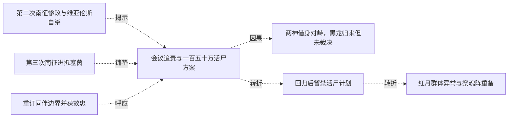

# 跨集 · 塞茵祭魂阵的禁令约束

[剧情目录](../README.md) · [全书阅读首页](../../README.md)

终点状态：**部分回收**

## 核心问题

百万平民是否免于被阵法牺牲，谁有决定权？

## 全书复核结论

已入库至第18集；最近关联事件在第16集。最新状态审计在第18集。活尸祭魂阵提出、预备后被黑龙设限，第十六集失联时仍援引限令，没有展示全城发动。另界五十多万毁魂是达罗亚行为，不是此阵。后记塞茵繁华不能证明一百五十万原居民逐名安全或阵法已永久拆除。

## 关联事件

- [重订同伴边界并获效忠](../vol-07.md)：黑龙收回针对斯文的杀意，明确自由存在目标；斯科特献上没有死亡连带作用的忠诚誓言。
- [第二次南征惨败与维亚伦斯自杀](../vol-14.md)：帝国四十五万军攻坚并付出巨大代价，守方虚构瘟疫造成军队失序，维亚伦斯射杀逃回者，牧师救助后遭后续屠杀。战报为十六万阵亡、二十万被俘、三万失踪，返不足六万；维亚伦斯交印自杀，菲力普暂代军务。
- [第三次南征进抵塞茵](../vol-14.md)：九个月后教会力量参与再征，帝国约三十万军打下守军不足七千、主力已撤的要塞，继续抵近塞茵；黑龙将于此阶段回来。
- [会议追责与一百五十万活尸方案](../vol-14.md)：斯文哥尔等追问额外杀戮与二十万俘虏中约十万劳死；先知已在塞茵设置活尸阵并试过个体，准备牺牲全城一百五十万人用于毁灭双方军队并扩张。斯科特明确赞同，毕瑟态度只是旁观推测。
- [两神借身对峙，黑龙归来但未裁决](../vol-14.md)：自然神通过娜娜、克丽丝通过萝茜显现，先知威胁眼前两分身。魂链恢复后黑龙携队到场询问是否要打架，活尸阵处置、先知责任和战争结局均未在本集裁决。
- [回归后暂禁活尸计划](../vol-15.md)：黑龙重返同伴，以位面规则和当前利益暂禁百万活尸阵，保留正常交战与撤退选择。
- [红月群体异常与祭魂阵重备](../vol-15.md)：红月巫师无人指挥突袭，力量向生还者集中；天使现身后黑龙同意趁机出击并重备祭魂阵，称不到最后不发动。
- [最后巫师自称达罗亚归来](../vol-15.md)：战死、自爆与主动合一只余一人，侵蚀一名降临天使躯体后自报达罗亚力绯克；黑龙会意挥手出城。
- [限令与俘虏政策下收复里斯特并扩军](../vol-16.md)：塞茵暴动和联军撤离未引祭魂阵启动，阿古援黑龙限令反对；先知收俘缓恐惧，攻克里斯特后从战尸扩军两万到四万，新装不全，海图与联军再跟进。

## 关系网络

虚线展示因果、铺垫、误导、揭示与回收。每组至多6条关系；组间通过同名节点衔接，不新增时间顺序或因果。

### 关系组1

| 起点 | 关系 | 终点 | 研究说明 |
|---|---|---|---|
| [第二次南征惨败与维亚伦斯自杀](../vol-14.md) | 揭示 | [会议追责与一百五十万活尸方案](../vol-14.md) | 战后会议揭示战争结算之外的决策争议和俘虏持续死亡，改变对胜利代价的认识。 |
| [第三次南征进抵塞茵](../vol-14.md) | 铺垫 | [会议追责与一百五十万活尸方案](../vol-14.md) | 帝国逼近塞茵形成计划公布的军事压力，但不构成屠城唯一或必然动机。 |
| [会议追责与一百五十万活尸方案](../vol-14.md) | 因果 | [两神借身对峙，黑龙归来但未裁决](../vol-14.md) | 全城活尸方案使两神通过载体介入反对；该因果仅指神祇对峙，不指黑龙因争论而归来。 |
| [回归后暂禁活尸计划](../vol-15.md) | 转折 | [红月群体异常与祭魂阵重备](../vol-15.md) | 原先暂禁的大阵回到备选清单，表明初禁基于时机和收益。 |
| [重订同伴边界并获效忠](../vol-07.md) | 呼应 | [会议追责与一百五十万活尸方案](../vol-14.md) | 早期重订伙伴边界与后期代理者提出全城活尸计划相对照，组织扩大后授权问题再次出现 |
| [会议追责与一百五十万活尸方案](../vol-14.md) | 转折 | [回归后暂禁活尸计划](../vol-15.md) | 黑龙回归后暂时否决全城活尸计划，依据是时机与收益，并非宣布永久放弃或普遍人道原则 |

### 关系组2

| 起点 | 关系 | 终点 | 研究说明 |
|---|---|---|---|
| [会议追责与一百五十万活尸方案](../vol-14.md) | 呼应 | [红月群体异常与祭魂阵重备](../vol-15.md) | 原先全城方案在红月转机中获得重新准备授权，仍未实际发动 |
| [红月群体异常与祭魂阵重备](../vol-15.md) | 回收 | [限令与俘虏政策下收复里斯特并扩军](../vol-16.md) | 此前最后关头才启阵的限制在主角再次失联时被援引，塞茵祭魂阵仍未发动 |

逐条引用依据见[全部语义关系](../relations.md)及事件所在分集页。
