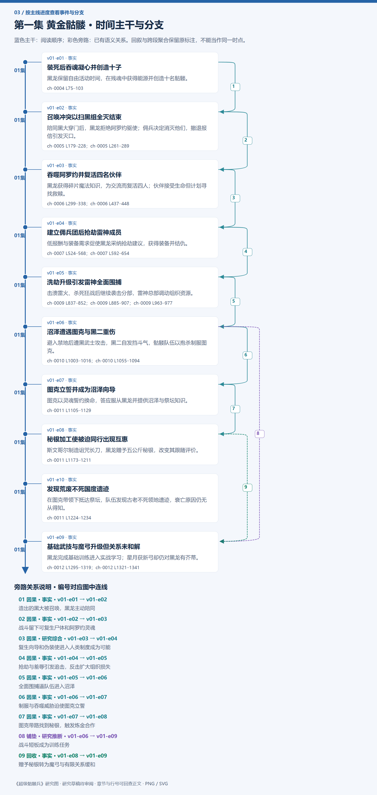

# 第一集 黄金骷髅 · 剧情结构

[剧情目录](README.md) · [本集九维报告](../../vol01.md)

## 主线时间与分支图片

[PNG原尺寸](images/vol-01.png) · [SVG矢量图](images/vol-01.svg) · [全书图片目录](images.md)

## 本集因果、伏笔与回收关系

| 起点 | 关系 | 终点 | 研究说明 |
|---|---|---|---|
| [装死后吞魂凝心并创造十子](vol-01.md) | 因果 | [召唤冲突以扫黑组全灭结束](vol-01.md) | 造出的黑大被召唤，黑龙主动陪同 |
| [召唤冲突以扫黑组全灭结束](vol-01.md) | 因果 | [吞噬阿罗约并复活四名伙伴](vol-01.md) | 战斗留下可复生尸体和阿罗约灵魂 |
| [吞噬阿罗约并复活四名伙伴](vol-01.md) | 因果 | [建立佣兵团后抢劫雷神成员](vol-01.md) | 复生向导和伪装使进入人类制度成为可能 |
| [建立佣兵团后抢劫雷神成员](vol-01.md) | 因果 | [洗劫升级引发雷神全面围捕](vol-01.md) | 抢劫与羞辱引发追击，反击扩大组织损失 |
| [洗劫升级引发雷神全面围捕](vol-01.md) | 因果 | [沼泽遭遇图克与黑二重伤](vol-01.md) | 全面围捕逼队伍进入沼泽 |
| [沼泽遭遇图克与黑二重伤](vol-01.md) | 因果 | [图克立誓并成为沼泽向导](vol-01.md) | 制服与吞噬威胁迫使图克立誓 |
| [图克立誓并成为沼泽向导](vol-01.md) | 因果 | [秘银加工使被迫同行出现互惠](vol-01.md) | 图克带路找到秘银，触发炼金合作 |
| [沼泽遭遇图克与黑二重伤](vol-01.md) | 铺垫 | [基础武技与魔弓升级但关系未和解](vol-01.md) | 战斗短板成为训练任务 |
| [秘银加工使被迫同行出现互惠](vol-01.md) | 回收 | [基础武技与魔弓升级但关系未和解](vol-01.md) | 赠予秘银转为魔弓与有限关系缓和 |

跨集联系见[全部语义关系](relations.md)与[跨集剧情线](README.md)。

## 事件、人物与认知依据

### 装死后吞魂凝心并创造十子

判断类型：原文事实

黑龙保留自由活动时间，在残魂中获得能源并创造十名骷髅。

人物：[黑龙](../cards/chr-9f2e5fcbba87455eb37e35869ea8854d.md)、[黑大](../cards/chr-632a4344b53f478a93f4d308f3890b92.md)

- 黑龙：未知；不明白灵魂之心与自身智慧的成因。

| 章节 | 行号 | 判断类型 |
|---|---|---|
| ch-0004 第一章 灵魂之心 | 75–103 | 原文事实 |

### 召唤冲突以扫黑组全灭结束

判断类型：原文事实

陪同黑大穿门后，黑龙拒绝阿罗约驱使；佣兵决定消灭他们，撤退报信引发灭口。

人物：[黑龙](../cards/chr-9f2e5fcbba87455eb37e35869ea8854d.md)、[黑大](../cards/chr-632a4344b53f478a93f4d308f3890b92.md)、[斯文哥尔](../cards/chr-24438669720a4bb8a0a27cbd25eadb33.md)、[艾琳](../cards/chr-29cb2b388f194a1c8b2e424c96dee814.md)、[星](../cards/chr-d2d3971153154607bb651d6a0c827216.md)、[月](../cards/chr-5c605c7ecd20495ca665d15c2bdf2562.md)、[阿罗约](../cards/chr-c128fbc5576e4683b433463c7468e03d.md)

- 斯文哥尔：怀疑；基于不死生物危险性的既有观念，判断留下他们可能造成生灵涂炭。

| 章节 | 行号 | 判断类型 |
|---|---|---|
| ch-0005 第二章 佣兵 | 179–228 | 原文事实 |
| ch-0005 第二章 佣兵 | 261–289 | 原文事实 |

### 吞噬阿罗约并复活四名伙伴

判断类型：原文事实

黑龙获得碎片魔法知识，为交流而复活四人；伙伴接受生命但计划寻找救赎。

人物：[黑龙](../cards/chr-9f2e5fcbba87455eb37e35869ea8854d.md)、[斯文哥尔](../cards/chr-24438669720a4bb8a0a27cbd25eadb33.md)、[艾琳](../cards/chr-29cb2b388f194a1c8b2e424c96dee814.md)、[星](../cards/chr-d2d3971153154607bb651d6a0c827216.md)、[月](../cards/chr-5c605c7ecd20495ca665d15c2bdf2562.md)

- 斯文哥尔：怀疑；救赎之魂也许能恢复原本生命。

| 章节 | 行号 | 判断类型 |
|---|---|---|
| ch-0006 第三章 复活 | 299–338 | 原文事实 |
| ch-0006 第三章 复活 | 437–448 | 原文事实 |

### 建立佣兵团后抢劫雷神成员

判断类型：原文事实

低报酬与装备需求促使黑龙采纳抢劫建议，获得装备并结仇。

人物：[黑龙](../cards/chr-9f2e5fcbba87455eb37e35869ea8854d.md)、[黑大](../cards/chr-632a4344b53f478a93f4d308f3890b92.md)、[斯文哥尔](../cards/chr-24438669720a4bb8a0a27cbd25eadb33.md)

- 黑龙：知道；完成任务能赚钱，金钱能兑换装备。

| 章节 | 行号 | 判断类型 |
|---|---|---|
| ch-0007 第四章 人类世界 | 524–568 | 原文事实 |
| ch-0007 第四章 人类世界 | 592–654 | 原文事实 |

### 洗劫升级引发雷神全面围捕

判断类型：原文事实

击溃雷火、杀死狂战后继续袭击分部，雷神总部调动组织资源。

人物：[黑龙](../cards/chr-9f2e5fcbba87455eb37e35869ea8854d.md)、[斯文哥尔](../cards/chr-24438669720a4bb8a0a27cbd25eadb33.md)、[坦克](../cards/chr-201a3f9df7a64c6b807871acb89f436a.md)、[撒拉丁·雷火](../cards/chr-0e4a599e5370441789c42e68db20737e.md)、[雷克丁](../cards/chr-f36c19e234d748a9b9081aa40e061e32.md)、[法兰西斯](../cards/chr-6bcffb34b20f4a97b5df49135920effa.md)

- 雷克丁：怀疑；黑龙可能由竞争佣兵团派出。

| 章节 | 行号 | 判断类型 |
|---|---|---|
| ch-0009 第六章 洗劫 | 837–852 | 原文事实 |
| ch-0009 第六章 洗劫 | 885–907 | 原文事实 |
| ch-0009 第六章 洗劫 | 963–977 | 原文事实 |

### 沼泽遭遇图克与黑二重伤

判断类型：原文事实

避入禁地后遭黑武士攻击，黑二自发挡斗气，骷髅队伍以抱杀制服图克。

人物：[黑龙](../cards/chr-9f2e5fcbba87455eb37e35869ea8854d.md)、[黑大](../cards/chr-632a4344b53f478a93f4d308f3890b92.md)、[黑二](../cards/chr-24b9d252fb624865a46d717832261c68.md)、[图克](../cards/chr-6ebb35c20edf4908b3b64159c8fd7a73.md)

- 黑龙：怀疑；黑二自发行动可能是意识萌芽。

| 章节 | 行号 | 判断类型 |
|---|---|---|
| ch-0010 第七章 暗黑沼泽 | 1003–1016 | 原文事实 |
| ch-0010 第七章 暗黑沼泽 | 1055–1094 | 原文事实 |

### 图克立誓并成为沼泽向导

判断类型：原文事实

图克以灵魂誓约换命，答应服从黑龙并提供沼泽与祭坛知识。

人物：[黑龙](../cards/chr-9f2e5fcbba87455eb37e35869ea8854d.md)、[图克](../cards/chr-6ebb35c20edf4908b3b64159c8fd7a73.md)、[斯文哥尔](../cards/chr-24438669720a4bb8a0a27cbd25eadb33.md)

- 图克：未知；不知道同族去向和国度荒废原因。

| 章节 | 行号 | 判断类型 |
|---|---|---|
| ch-0011 第八章 黑武士侯爵 | 1105–1129 | 原文事实 |

### 秘银加工使被迫同行出现互惠

判断类型：原文事实

斯文哥尔制造诅咒长刀，黑龙赠予五公斤秘银，改变其跟随评价。

人物：[黑龙](../cards/chr-9f2e5fcbba87455eb37e35869ea8854d.md)、[斯文哥尔](../cards/chr-24438669720a4bb8a0a27cbd25eadb33.md)、[图克](../cards/chr-6ebb35c20edf4908b3b64159c8fd7a73.md)

- 黑龙：知道；魔法兵器不需要整把由秘银制造。

| 章节 | 行号 | 判断类型 |
|---|---|---|
| ch-0011 第八章 黑武士侯爵 | 1173–1211 | 原文事实 |

### 发现荒废不死国度遗迹

判断类型：原文事实

在图克带领下抵达祭坛，队伍发现古老不死领地遗迹，衰亡原因仍无从得知。

人物：[黑龙](../cards/chr-9f2e5fcbba87455eb37e35869ea8854d.md)、[图克](../cards/chr-6ebb35c20edf4908b3b64159c8fd7a73.md)、[斯文哥尔](../cards/chr-24438669720a4bb8a0a27cbd25eadb33.md)

- 斯文哥尔：知道；此地存在未见于其知识的古老不死领地遗迹。

| 章节 | 行号 | 判断类型 |
|---|---|---|
| ch-0011 第八章 黑武士侯爵 | 1224–1234 | 原文事实 |

### 基础武技与魔弓升级但关系未和解

判断类型：原文事实

黑龙完成基础训练进入实战学习；星月获新弓却仍对黑龙有芥蒂。

人物：[黑龙](../cards/chr-9f2e5fcbba87455eb37e35869ea8854d.md)、[图克](../cards/chr-6ebb35c20edf4908b3b64159c8fd7a73.md)、[斯文哥尔](../cards/chr-24438669720a4bb8a0a27cbd25eadb33.md)、[星](../cards/chr-d2d3971153154607bb651d6a0c827216.md)、[月](../cards/chr-5c605c7ecd20495ca665d15c2bdf2562.md)

- 星：知道；生存与装备收益同黑龙相连，但情感仍难接受过去。

| 章节 | 行号 | 判断类型 |
|---|---|---|
| ch-0012 第九章 武技 | 1295–1319 | 原文事实 |
| ch-0012 第九章 武技 | 1321–1341 | 原文事实 |

## 本集当时的剧情线判断

这是分集历史判断，后续回收结果以跨集终点页为准。

### 第1集 · 自由存续与交流需求

当时状态：部分回收

黑龙获得不被驱使的生存后，能否建立不依赖控制的关系？

自主行动和伙伴已获得，平等交流与生命控制矛盾仍未解决。

[查看全书终点判断](threads/book-37dd82abc178.md)

### 第1集 · 救赎之魂

当时状态：未回收

能否找到流落民间的救赎之魂，它是否真能恢复生命？

仅建立传说、教会收藏及民间流失情报；已留传讯玉悬赏，无实物与效果验证。

[查看全书终点判断](threads/book-d57a5d7a5b5a.md)

### 第1集 · 十子意识与黑龙起源

当时状态：未回收

黑龙为何能思考，黑二的自主护主是否代表孩子意识萌芽？

自主护主为已见行为，意识觉醒仍为黑龙猜测。

[查看全书终点判断](threads/book-c55cdb2efcb4.md)

### 第1集 · 雷神报复与信誉危机

当时状态：未回收

雷神能否识别黑龙身份并追回信誉与损失？

主角暂脱追踪，雷神仍全力寻人，冲突未结束。

[查看全书终点判断](threads/book-4591509faba8.md)

### 第1集 · 沉沦国度与转生祭坛

当时状态：未回收

不死领地为何荒废并被已知历史遗漏，同族去了哪里？

存在遗迹得到现场确认，成因未明；图克苏醒时已荒废。

[查看全书终点判断](threads/book-c0fbac950b52.md)
