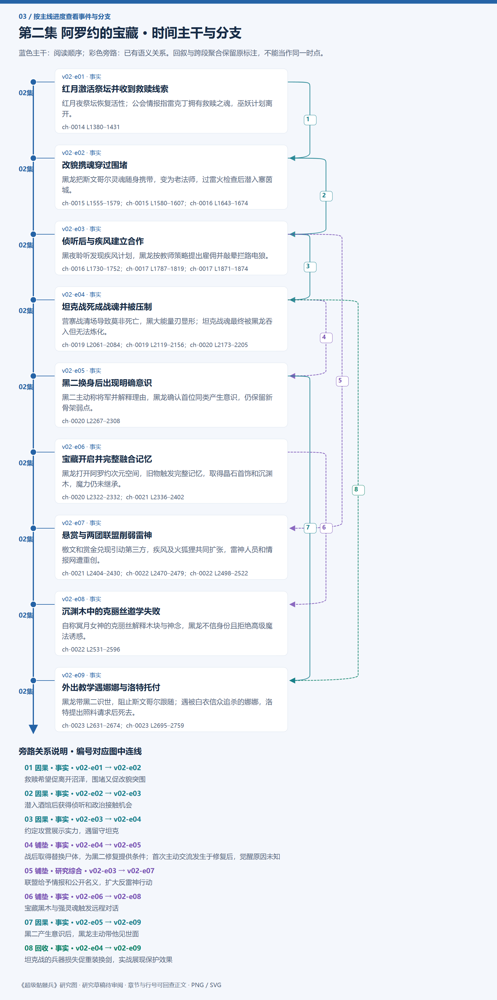

# 第二集 阿罗约的宝藏 · 剧情结构

[剧情目录](README.md) · [本集九维报告](../../vol02.md)

## 主线时间与分支图片

[PNG原尺寸](images/vol-02.png) · [SVG矢量图](images/vol-02.svg) · [全书图片目录](images.md)

## 本集因果、伏笔与回收关系

| 起点 | 关系 | 终点 | 研究说明 |
|---|---|---|---|
| [红月激活祭坛并收到救赎线索](vol-02.md) | 因果 | [改貌携魂穿过围堵](vol-02.md) | 救赎希望促离开沼泽，围堵又促改貌突围 |
| [改貌携魂穿过围堵](vol-02.md) | 因果 | [侦听后与疾风建立合作](vol-02.md) | 潜入酒馆后获得侦听和政治接触机会 |
| [侦听后与疾风建立合作](vol-02.md) | 因果 | [坦克战死成战魂并被压制](vol-02.md) | 约定攻营展示实力，遇留守坦克 |
| [坦克战死成战魂并被压制](vol-02.md) | 铺垫 | [黑二换身后出现明确意识](vol-02.md) | 战后取得替换尸体，为黑二修复提供条件；首次主动交流发生于修复后，觉醒原因未知 |
| [侦听后与疾风建立合作](vol-02.md) | 铺垫 | [悬赏与两团联盟削弱雷神](vol-02.md) | 联盟给予情报和公开名义，扩大反雷神行动 |
| [宝藏开启并完整融合记忆](vol-02.md) | 铺垫 | [沉渊木中的克丽丝邀学失败](vol-02.md) | 宝藏黑木与强灵魂触发远程对话 |
| [黑二换身后出现明确意识](vol-02.md) | 因果 | [外出教学遇娜娜与洛特托付](vol-02.md) | 黑二产生意识后，黑龙主动带他见世面 |
| [坦克战死成战魂并被压制](vol-02.md) | 回收 | [外出教学遇娜娜与洛特托付](vol-02.md) | 坦克战的兵器损失促重装换剑，实战展现保护效果 |

跨集联系见[全部语义关系](relations.md)与[跨集剧情线](README.md)。

## 事件、人物与认知依据

### 红月激活祭坛并收到救赎线索

判断类型：原文事实

红月夜祭坛恢复活性；公会情报指雷克丁拥有救赎之魂，巫妖计划离开。

人物：[黑龙](../cards/chr-9f2e5fcbba87455eb37e35869ea8854d.md)、[图克](../cards/chr-6ebb35c20edf4908b3b64159c8fd7a73.md)、[斯文哥尔](../cards/chr-24438669720a4bb8a0a27cbd25eadb33.md)、[艾琳](../cards/chr-29cb2b388f194a1c8b2e424c96dee814.md)、[星](../cards/chr-d2d3971153154607bb651d6a0c827216.md)、[月](../cards/chr-5c605c7ecd20495ca665d15c2bdf2562.md)

- 斯文哥尔：怀疑；红月为古祭坛供能，古国文明可能极古老。

- 斯文哥尔：知道；公会情报报告雷克丁家族持有救赎之魂，效果未证。

| 章节 | 行号 | 判断类型 |
|---|---|---|
| ch-0014 第一章 红月之夜 | 1380–1431 | 原文事实 |

### 改貌携魂穿过围堵

判断类型：原文事实

黑龙把斯文哥尔灵魂随身携带，变为老法师，过雷火检查后潜入塞茵城。

人物：[黑龙](../cards/chr-9f2e5fcbba87455eb37e35869ea8854d.md)、[斯文哥尔](../cards/chr-24438669720a4bb8a0a27cbd25eadb33.md)、[艾琳](../cards/chr-29cb2b388f194a1c8b2e424c96dee814.md)、[撒拉丁·雷火](../cards/chr-0e4a599e5370441789c42e68db20737e.md)

- 撒拉丁·雷火：怀疑；老法师眼神熟悉，却未确认是黑龙。

| 章节 | 行号 | 判断类型 |
|---|---|---|
| ch-0015 第二章 离开沼泽 | 1555–1579 | 原文事实 |
| ch-0015 第二章 离开沼泽 | 1580–1607 | 原文事实 |
| ch-0016 第三章 黑夜聆听 | 1643–1674 | 原文事实 |

### 侦听后与疾风建立合作

判断类型：原文事实

黑夜聆听发现疾风计划，黑龙按教师策略提出雇佣并敲晕拦路电狼。

人物：[黑龙](../cards/chr-9f2e5fcbba87455eb37e35869ea8854d.md)、[斯文哥尔](../cards/chr-24438669720a4bb8a0a27cbd25eadb33.md)、[智狼](../cards/chr-0989216ff50241d5b42f4b36f221009b.md)、[电狼](../cards/chr-d9fb9bf6d4ca4af08fe623935b911827.md)

- 黑龙：怀疑；四名巫妖态度改变，必有事瞒着自己。

| 章节 | 行号 | 判断类型 |
|---|---|---|
| ch-0016 第三章 黑夜聆听 | 1730–1752 | 原文事实 |
| ch-0017 第四章 疾风之狼 | 1787–1819 | 原文事实 |
| ch-0017 第四章 疾风之狼 | 1871–1874 | 原文事实 |

### 坦克战死成战魂并被压制

判断类型：原文事实

营寨战清场导致莫非死亡，黑大能量刃显形；坦克战魂最终被黑龙吞入但无法炼化。

人物：[黑龙](../cards/chr-9f2e5fcbba87455eb37e35869ea8854d.md)、[黑大](../cards/chr-632a4344b53f478a93f4d308f3890b92.md)、[坦克](../cards/chr-201a3f9df7a64c6b807871acb89f436a.md)、[莫非](../cards/chr-8dd944fda1a94021a83147113195fd76.md)、[斯文哥尔](../cards/chr-24438669720a4bb8a0a27cbd25eadb33.md)

- 坦克：知道；黑龙团队是不死生物，坐骑也非活马。

- 黑龙：知道；战魂尚未炼化，是体内隐忧。

| 章节 | 行号 | 判断类型 |
|---|---|---|
| ch-0019 第六章 不死战魂 | 2061–2084 | 原文事实 |
| ch-0019 第六章 不死战魂 | 2119–2156 | 原文事实 |
| ch-0020 第七章 黑二的意识 | 2173–2205 | 原文事实 |

### 黑二换身后出现明确意识

判断类型：原文事实

黑二主动称将军并解释理由，黑龙确认首位同类产生意识，仍保留新骨架弱点。

人物：[黑龙](../cards/chr-9f2e5fcbba87455eb37e35869ea8854d.md)、[黑二](../cards/chr-24b9d252fb624865a46d717832261c68.md)、[斯文哥尔](../cards/chr-24438669720a4bb8a0a27cbd25eadb33.md)

- 黑龙：知道；黑二已有自主意识，但仍无条件服从。

- 斯文哥尔：未知；不知道黑龙与黑二刚才的心灵交流内容。

| 章节 | 行号 | 判断类型 |
|---|---|---|
| ch-0020 第七章 黑二的意识 | 2267–2308 | 原文事实 |

### 宝藏开启并完整融合记忆

判断类型：原文事实

黑龙打开阿罗约次元空间，旧物触发完整记忆，取得晶石首饰和沉渊木，魔力仍未继承。

人物：[黑龙](../cards/chr-9f2e5fcbba87455eb37e35869ea8854d.md)

- 黑龙：知道；魔法知识可得，魔力不能从阿罗约处吞噬继承。

| 章节 | 行号 | 判断类型 |
|---|---|---|
| ch-0020 第七章 黑二的意识 | 2322–2332 | 原文事实 |
| ch-0021 第八章 阿罗约的宝藏 | 2336–2402 | 原文事实 |

### 悬赏与两团联盟削弱雷神

判断类型：原文事实

檄文和赏金兑现引动第三方，疾风及火狐狸共同扩张，雷神人员和情报网遭重创。

人物：[黑龙](../cards/chr-9f2e5fcbba87455eb37e35869ea8854d.md)、[斯文哥尔](../cards/chr-24438669720a4bb8a0a27cbd25eadb33.md)、[智狼](../cards/chr-0989216ff50241d5b42f4b36f221009b.md)、[火狐狸](../cards/chr-f64ee852b2ba42eda0ef54987527d2c2.md)、[雷克丁](../cards/chr-f36c19e234d748a9b9081aa40e061e32.md)、[法兰西斯](../cards/chr-6bcffb34b20f4a97b5df49135920effa.md)、[艾力克斯](../cards/chr-b75497cb42e9472389d225984dd5a951.md)

- 雷克丁：怀疑；黑龙背后原本可能由疾风指使，实际合作时间并不知悉。

| 章节 | 行号 | 判断类型 |
|---|---|---|
| ch-0021 第八章 阿罗约的宝藏 | 2404–2430 | 原文事实 |
| ch-0022 第九章 冥月女神 | 2470–2479 | 原文事实 |
| ch-0022 第九章 冥月女神 | 2498–2522 | 原文事实 |

### 沉渊木中的克丽丝邀学失败

判断类型：原文事实

自称冥月女神的克丽丝解释木块与神念，黑龙不信身份且拒绝高级魔法诱惑。

人物：[黑龙](../cards/chr-9f2e5fcbba87455eb37e35869ea8854d.md)、[克丽丝](../cards/chr-d1af2401c91342228738940630a00180.md)

- 克丽丝：知道；对方能用暗黑魔法，但实际不死身份未告知。

- 黑龙：未知；克丽丝真实身份与目的。

| 章节 | 行号 | 判断类型 |
|---|---|---|
| ch-0022 第九章 冥月女神 | 2531–2596 | 原文事实 |

### 外出教学遇娜娜与洛特托付

判断类型：原文事实

黑龙带黑二识世，阻止斯文哥尔跟随；遇被白衣信众追杀的娜娜，洛特提出照料请求后死去。

人物：[黑龙](../cards/chr-9f2e5fcbba87455eb37e35869ea8854d.md)、[黑二](../cards/chr-24b9d252fb624865a46d717832261c68.md)、[斯文哥尔](../cards/chr-24438669720a4bb8a0a27cbd25eadb33.md)、[娜娜](../cards/chr-1d629a39da3e41149707e5f9f636defd.md)、[洛特](../cards/chr-345d1d88371947b7815469b3740c9e78.md)

- 斯文哥尔：知道；黑龙能通过坐骑限制自己行动。

- 黑龙：未知；娜娜为何未经学魔法便有暗黑气息。

| 章节 | 行号 | 判断类型 |
|---|---|---|
| ch-0023 第十章 暗黑气息 | 2631–2674 | 原文事实 |
| ch-0023 第十章 暗黑气息 | 2695–2759 | 原文事实 |

## 本集当时的剧情线判断

这是分集历史判断，后续回收结果以跨集终点页为准。

### 第2集 · 自由、控制与同伴关系

当时状态：部分回收

黑龙能否在自身成长和孩子意识出现后重新看待受控伙伴？

有同类交流得到兑现，生命控制与道德分歧变得更明显，尚未解决。

[查看全书终点判断](threads/book-37dd82abc178.md)

### 第2集 · 十子意识与进化条件

当时状态：部分回收

黑二为何觉醒，其他孩子为何仍无意识？

黑二意识已确认；黑大仅觉醒技能，成因仍未知。

[查看全书终点判断](threads/book-c55cdb2efcb4.md)

### 第2集 · 救赎之魂

当时状态：未回收

雷克丁家族持物能否取得，其效果是否真实？

增加持有者情报并推动联盟，实物与效力都尚未验证；黑龙未获全情。

[查看全书终点判断](threads/book-d57a5d7a5b5a.md)

### 第2集 · 红月与沉沦国度

当时状态：未回收

祭坛供能与自修复机制、古国消失原因是什么？

现场观察到祭坛波动与外观变新，斯文哥尔判断其具自修复功能；建造年代和转生机制仍为推断。

[查看全书终点判断](threads/book-c0fbac950b52.md)

### 第2集 · 雷神冲突的组织化

当时状态：部分回收

雷神能否在联盟和悬赏夹击中保全，双方是否继续升级？

坦克肉体死亡，雷神损失两千成员与情报网络，但团长及组织尚存。

[查看全书终点判断](threads/book-4591509faba8.md)

### 第2集 · 坦克战魂残留

当时状态：未回收

黑龙如何处理无法炼化的狂暴战魂？

只是压到体内深处，尚无根除证据。

[查看全书终点判断](threads/book-9baae09a0d12.md)

### 第2集 · 克丽丝身份与邀学动机

当时状态：未回收

她是否真为女神，为何急于教黑龙？

确认木块可沟通未知存在，自称、能力承诺及动机均待核验。

[查看全书终点判断](threads/book-e90db68cb625.md)

### 第2集 · 娜娜暗黑气息与托付

当时状态：未回收

娜娜为何被追杀，黑龙会否接受保护请求？

洛特提出照顾至成年并给出报酬，黑龙尚未答复；女孩求救也未得到结果。

[查看全书终点判断](threads/book-cb9c67d1cdae.md)
