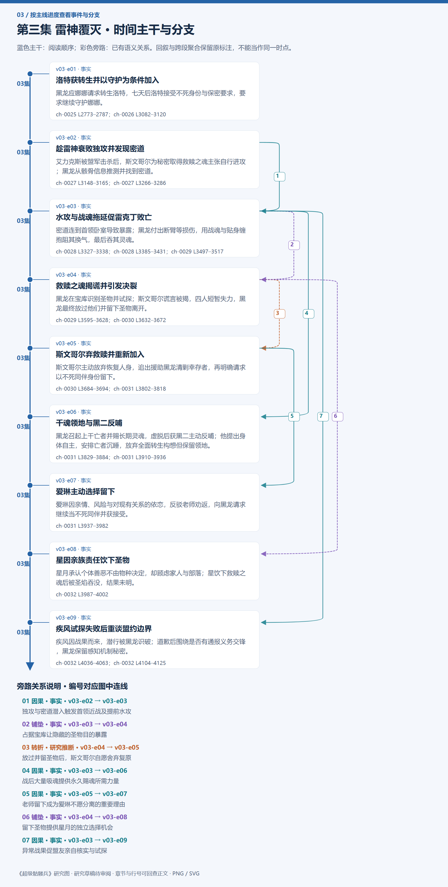

# 第三集 雷神覆灭 · 剧情结构

[剧情目录](README.md) · [本集九维报告](../../vol03.md)

## 主线时间与分支图片

[PNG原尺寸](images/vol-03.png) · [SVG矢量图](images/vol-03.svg) · [全书图片目录](images.md)

## 本集因果、伏笔与回收关系

| 起点 | 关系 | 终点 | 研究说明 |
|---|---|---|---|
| [趁雷神衰败独攻并发现密道](vol-03.md) | 因果 | [水攻与战魂拖延促雷克丁败亡](vol-03.md) | 独攻与密道潜入触发首领近战及提前水攻 |
| [水攻与战魂拖延促雷克丁败亡](vol-03.md) | 铺垫 | [救赎之魂揭谎并引发决裂](vol-03.md) | 占据宝库让隐藏的圣物目的暴露 |
| [救赎之魂揭谎并引发决裂](vol-03.md) | 转折 | [斯文哥尔弃救赎并重新加入](vol-03.md) | 放过并留圣物后，斯文哥尔自愿舍弃复原 |
| [水攻与战魂拖延促雷克丁败亡](vol-03.md) | 因果 | [千魂领地与黑二反哺](vol-03.md) | 战后大量吸魂提供永久赐魂所需力量 |
| [斯文哥尔弃救赎并重新加入](vol-03.md) | 因果 | [爱琳主动选择留下](vol-03.md) | 老师留下成为爱琳不愿分离的重要理由 |
| [救赎之魂揭谎并引发决裂](vol-03.md) | 铺垫 | [星因亲族责任饮下圣物](vol-03.md) | 留下圣物提供星月的独立选择机会 |
| [水攻与战魂拖延促雷克丁败亡](vol-03.md) | 因果 | [疾风试探失败后重谈盟约边界](vol-03.md) | 异常战果促盟友亲自核实与试探 |

跨集联系见[全部语义关系](relations.md)与[跨集剧情线](README.md)。

## 事件、人物与认知依据

### 洛特获转生并以守护为条件加入

判断类型：原文事实

黑龙应娜娜请求转生洛特，七天后洛特接受不死身份与保密要求，要求继续守护娜娜。

人物：[黑龙](../cards/chr-9f2e5fcbba87455eb37e35869ea8854d.md)、[洛特](../cards/chr-345d1d88371947b7815469b3740c9e78.md)、[娜娜](../cards/chr-1d629a39da3e41149707e5f9f636defd.md)

- 娜娜：未知；获救当时不知道洛特已非人类

- 洛特：知道；自己已成不死生物，黑龙掌握灵魂之火

| 章节 | 行号 | 判断类型 |
|---|---|---|
| ch-0025 第一章 帝国女孩 | 2773–2787 | 原文事实 |
| ch-0026 第二章 浴室 | 3082–3120 | 原文事实 |

### 趁雷神衰败独攻并发现密道

判断类型：原文事实

艾力克斯被盟军击杀后，斯文哥尔为秘密取得救赎之魂主张自行进攻；黑龙从骸骨信息推测并找到密道。

人物：[黑龙](../cards/chr-9f2e5fcbba87455eb37e35869ea8854d.md)、[斯文哥尔](../cards/chr-24438669720a4bb8a0a27cbd25eadb33.md)、[星](../cards/chr-d2d3971153154607bb651d6a0c827216.md)

- 斯文哥尔：知道；独攻用于避免盟友知悉救赎之魂目的

- 黑龙：怀疑；骸骨残缺信息指向入内通道，随后现场证实

| 章节 | 行号 | 判断类型 |
|---|---|---|
| ch-0027 第三章 朗克岭 | 3148–3165 | 原文事实 |
| ch-0027 第三章 朗克岭 | 3266–3286 | 原文事实 |

### 水攻与战魂拖延促雷克丁败亡

判断类型：原文事实

密道连到首领卧室导致暴露；黑龙付出断臂等损伤，用战魂与贴身缠抱阻其换气，最后吞其灵魂。

人物：[黑龙](../cards/chr-9f2e5fcbba87455eb37e35869ea8854d.md)、[雷克丁](../cards/chr-f36c19e234d748a9b9081aa40e061e32.md)、[斯文哥尔](../cards/chr-24438669720a4bb8a0a27cbd25eadb33.md)、[坦克](../cards/chr-201a3f9df7a64c6b807871acb89f436a.md)

- 雷克丁：知道；黑龙是不死生物

- 雷克丁：未知；集中攻击头部可能震散灵魂之心

- 黑龙：知道；自己已为黄金骷髅，灵魂力量也会疲惫

| 章节 | 行号 | 判断类型 |
|---|---|---|
| ch-0028 第四章 狂暴战士 | 3327–3338 | 原文事实 |
| ch-0028 第四章 狂暴战士 | 3385–3431 | 原文事实 |
| ch-0029 第五章 救赎之魂 | 3497–3517 | 原文事实 |

### 救赎之魂揭谎并引发决裂

判断类型：原文事实

黑龙在宝库识别圣物并试探；斯文哥尔谎言被揭，四人短暂失力，黑龙最终放过他们并留下圣物离开。

人物：[黑龙](../cards/chr-9f2e5fcbba87455eb37e35869ea8854d.md)、[斯文哥尔](../cards/chr-24438669720a4bb8a0a27cbd25eadb33.md)、[艾琳](../cards/chr-29cb2b388f194a1c8b2e424c96dee814.md)、[星](../cards/chr-d2d3971153154607bb651d6a0c827216.md)、[月](../cards/chr-5c605c7ecd20495ca665d15c2bdf2562.md)

- 斯文哥尔：误以为；黑龙不知救赎之魂名称与作用，询问不是试探

- 黑龙：知道；四人瞒着自己寻找救赎之魂

| 章节 | 行号 | 判断类型 |
|---|---|---|
| ch-0029 第五章 救赎之魂 | 3595–3628 | 原文事实 |
| ch-0030 第六章 决裂 | 3632–3672 | 原文事实 |

### 斯文哥尔弃救赎并重新加入

判断类型：原文事实

斯文哥尔主动放弃恢复人身，追出援助黑龙清剿幸存者，再明确请求以不死同伴身份留下。

人物：[斯文哥尔](../cards/chr-24438669720a4bb8a0a27cbd25eadb33.md)、[黑龙](../cards/chr-9f2e5fcbba87455eb37e35869ea8854d.md)

- 黑龙：知道；斯文哥尔自愿继续做不死生物与同伴

| 章节 | 行号 | 判断类型 |
|---|---|---|
| ch-0030 第六章 决裂 | 3684–3694 | 原文事实 |
| ch-0031 第七章 不死领地 | 3802–3818 | 原文事实 |

### 千魂领地与黑二反哺

判断类型：原文事实

黑龙召起上千亡者并赐长期灵魂，虚脱后获黑二主动反哺；他提出身体自主，安排亡者沉睡，放弃全面转生构想但保留领地。

人物：[黑龙](../cards/chr-9f2e5fcbba87455eb37e35869ea8854d.md)、[黑二](../cards/chr-24b9d252fb624865a46d717832261c68.md)、[斯文哥尔](../cards/chr-24438669720a4bb8a0a27cbd25eadb33.md)

- 黑二：知道；黑龙承认能自由支配身体者的一切归其自己

- 斯文哥尔：知道；自己没有说服黑龙撤销地下不死领地

| 章节 | 行号 | 判断类型 |
|---|---|---|
| ch-0031 第七章 不死领地 | 3829–3884 | 原文事实 |
| ch-0031 第七章 不死领地 | 3910–3936 | 原文事实 |

### 爱琳主动选择留下

判断类型：原文事实

爱琳因亲情、风险与对现有关系的依恋，反驳老师劝返，向黑龙请求继续当不死同伴并获接受。

人物：[艾琳](../cards/chr-29cb2b388f194a1c8b2e424c96dee814.md)、[斯文哥尔](../cards/chr-24438669720a4bb8a0a27cbd25eadb33.md)、[黑龙](../cards/chr-9f2e5fcbba87455eb37e35869ea8854d.md)

- 斯文哥尔：怀疑；爱琳可能喜欢上黑龙

| 章节 | 行号 | 判断类型 |
|---|---|---|
| ch-0031 第七章 不死领地 | 3937–3982 | 原文事实 |

### 星因亲族责任饮下圣物

判断类型：原文事实

星月承认个体善恶不由物种决定，却顾虑家人与部落；星饮下救赎之魂后被圣焰吞没，结果未明。

人物：[星](../cards/chr-d2d3971153154607bb651d6a0c827216.md)、[月](../cards/chr-5c605c7ecd20495ca665d15c2bdf2562.md)

- 读者：未知；圣焰后的生死及恢复效果尚未交代

| 章节 | 行号 | 判断类型 |
|---|---|---|
| ch-0032 第八章 疾风团长 | 3987–4002 | 原文事实 |

### 疾风试探失败后重谈盟约边界

判断类型：原文事实

疾风因战果而来，潜行被黑龙识破；道歉后围绕是否有通报义务交锋，黑龙保留感知机制秘密。

人物：[疾风](../cards/chr-d403f485486b44e08a2fe1e3d87c7788.md)、[黑龙](../cards/chr-9f2e5fcbba87455eb37e35869ea8854d.md)、[斯文哥尔](../cards/chr-24438669720a4bb8a0a27cbd25eadb33.md)、[智狼](../cards/chr-0989216ff50241d5b42f4b36f221009b.md)、[菲蕾娜](../cards/chr-d243aea683a64bbe8829b0216deb68dc.md)

- 疾风：误以为；最初相信最高隐匿足以避免被发现，随即被准确追视反证

- 疾风：未知；黑龙以灵魂观察世界的机制

| 章节 | 行号 | 判断类型 |
|---|---|---|
| ch-0032 第八章 疾风团长 | 4036–4063 | 原文事实 |
| ch-0032 第八章 疾风团长 | 4104–4125 | 原文事实 |

## 本集当时的剧情线判断

这是分集历史判断，后续回收结果以跨集终点页为准。

### 第3集 · 救赎之魂的希望与实效

当时状态：部分回收

圣物是否真能恢复人身，星的圣焰结局如何？

物品已取得并分化队伍；只有星饮用，效果尚未交代。

### 第3集 · 灵魂依附与自愿同伴

当时状态：未回收

身体自主的承认能否在灵魂控制仍存时落地？

条件忠诚、主动回归与选择离开并存，黑二获自主定义但控制机制未解除。

### 第3集 · 雷神败亡后的利益与部族余波

当时状态：部分回收

雷神残余和撒拉丁部族如何应对领袖及贸易体系丧失？

总部及雷克丁已败；外围成员、部落影响和盟友分利并未全部解决。

### 第3集 · 隐蔽不死领地

当时状态：未回收

上千长期亡者能否隐蔽成长，何时出现自我意识？

已安置沉睡，全面转生构想被劝退，建领地计划未撤销。

### 第3集 · 坦克战魂的压制与利用

当时状态：未回收

反复释放和重新压制能否继续控制战魂？

被利用拖延雷克丁后再次吸回，仍有躁动，未被炼化。
