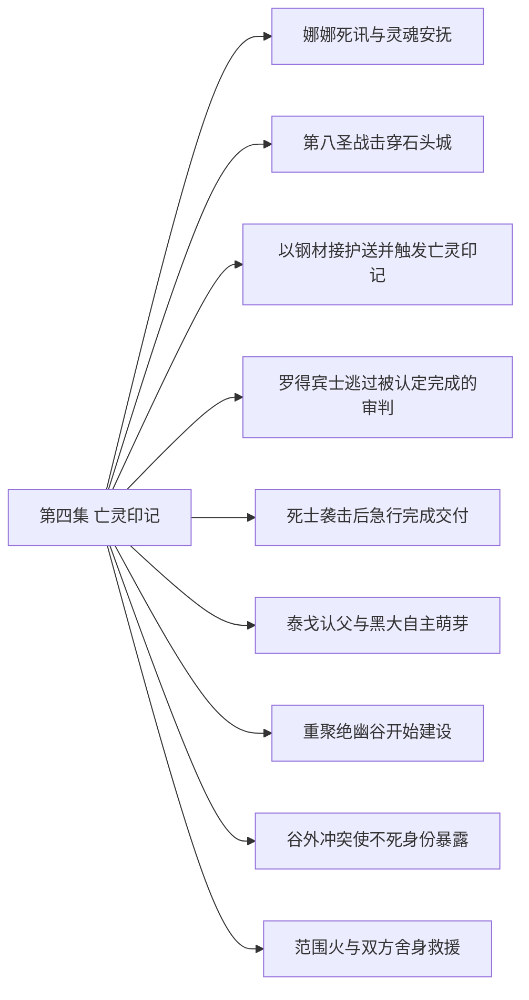

# 第四集 亡灵印记 · 剧情结构

[剧情目录](README.md) · [本集九维报告](../../vol04.md)

## 主线树

## 本集因果、伏笔与回收关系

| 起点 | 关系 | 终点 | 研究说明 |
|---|---|---|---|
| [第八圣战击穿石头城](vol-04.md) | 因果 | [以钢材接护送并触发亡灵印记](vol-04.md) | 战时缺钢及征调使实物酬劳促成雇佣 |
| [以钢材接护送并触发亡灵印记](vol-04.md) | 铺垫 | [死士袭击后急行完成交付](vol-04.md) | 接受护送使队伍承接雇主所面临的袭击风险 |
| [以钢材接护送并触发亡灵印记](vol-04.md) | 因果 | [重聚绝幽谷开始建设](vol-04.md) | 钢材报酬与分队准备供给谷地建设 |
| [泰戈认父与黑大自主萌芽](vol-04.md) | 因果 | [重聚绝幽谷开始建设](vol-04.md) | 带走泰戈使其加入谷地生活与劳动 |
| [罗得宾士逃过被认定完成的审判](vol-04.md) | 铺垫 | [谷外冲突使不死身份暴露](vol-04.md) | 前场展示的圣焰祷言能力为主角遭遇其战法提供准备 |
| [重聚绝幽谷开始建设](vol-04.md) | 因果 | [谷外冲突使不死身份暴露](vol-04.md) | 追踪娜娜的位置使审判小队与据点护卫相遇 |
| [谷外冲突使不死身份暴露](vol-04.md) | 因果 | [范围火与双方舍身救援](vol-04.md) | 身份曝光促灭口火攻，交战重伤触发双重救援 |
| [娜娜死讯与灵魂安抚](vol-04.md) | 呼应 | [范围火与双方舍身救援](vol-04.md) | 以额头和灵魂接触救助他人，末场由安抚转为危险反噬 |

跨集联系见[全部语义关系](relations.md)与[跨集剧情线](README.md)。

## 事件、人物与认知依据

### 娜娜死讯与灵魂安抚

判断类型：原文事实

黑龙告知父母死讯使娜娜晕厥，求助克丽丝后以灵魂交流安抚，承诺找遗体并把沉渊木交给娜娜。

人物：[黑龙](../cards/chr-9f2e5fcbba87455eb37e35869ea8854d.md)、[娜娜](../cards/chr-1d629a39da3e41149707e5f9f636defd.md)、[克丽丝](../cards/chr-d1af2401c91342228738940630a00180.md)、[艾琳](../cards/chr-29cb2b388f194a1c8b2e424c96dee814.md)、[斯文哥尔](../cards/chr-24438669720a4bb8a0a27cbd25eadb33.md)、[洛特](../cards/chr-345d1d88371947b7815469b3740c9e78.md)

- 娜娜：知道；父母已死，但寄望黑龙寻找遗体

- 黑龙：未知；是否能复活娜娜父母

- 斯文哥尔：怀疑；黑龙的灵魂能力可能适合学习念系魔法

| 章节 | 行号 | 判断类型 |
|---|---|---|
| ch-0034 第一章 抚慰灵魂 | 4151–4190 | 原文事实 |
| ch-0034 第一章 抚慰灵魂 | 4215–4257 | 原文事实 |

### 第八圣战击穿石头城

判断类型：原文事实

教会在战争中发动献祭召唤摧毁要塞关键工事，帝国攻入同盟；建设物资涨价、教会清洗风险同时落到黑龙队伍。

人物：[亚美里克斯](../cards/chr-9e9f720be15841d29768c1d0c4a68657.md)、[拉西萝茜](../cards/chr-54e84c6e82214a26921887c503f519ee.md)、[斯文哥尔](../cards/chr-24438669720a4bb8a0a27cbd25eadb33.md)、[黑龙](../cards/chr-9f2e5fcbba87455eb37e35869ea8854d.md)

- 读者：知道；亚美里克斯实际展翅并献祭，正团长是否天使尚无同样现场展示

- 斯文哥尔：知道；帝国入侵将使同盟境内不死身份更难隐藏

| 章节 | 行号 | 判断类型 |
|---|---|---|
| ch-0035 第二章 第八次圣战 | 4334–4369 | 原文事实 |
| ch-0035 第二章 第八次圣战 | 4383–4396 | 原文事实 |

### 以钢材接护送并触发亡灵印记

判断类型：原文事实

梅里尔用十吨钢材换取限期护送，队伍分流；行程中黑龙用灵魂接触宝库徽章，听见北方往生国度的循环召归声。

人物：[梅里尔](../cards/chr-4c01016288e94894a77ec1e46b38d667.md)、[梅丽雅](../cards/chr-36d3c517958f4eff803a6713817b254f.md)、[黑龙](../cards/chr-9f2e5fcbba87455eb37e35869ea8854d.md)、[斯文哥尔](../cards/chr-24438669720a4bb8a0a27cbd25eadb33.md)

- 斯文哥尔：怀疑；梅丽雅被家族作为政治筹码送去首都

- 黑龙：知道；亡灵印记灵魂接触会传出无法对答的召归讯息

- 黑龙：未知；所指国度真实位置和性质

| 章节 | 行号 | 判断类型 |
|---|---|---|
| ch-0037 第四章 亡灵印记 | 4570–4594 | 原文事实 |
| ch-0037 第四章 亡灵印记 | 4638–4674 | 原文事实 |

### 罗得宾士逃过被认定完成的审判

判断类型：原文事实

萝茜被琴曲短暂打动，遭音攻后焚杀目标并离开；罗得宾士随后再次现身，脱身机制未知。

人物：[拉西萝茜](../cards/chr-54e84c6e82214a26921887c503f519ee.md)、[岗撒罗斯](../cards/chr-f5c1dd47a8a24768896eeb8630a04ad5.md)、[罗得宾士](../cards/chr-0d52140c20bf4dc5be05fbdc80d9ace1.md)

- 拉西萝茜：误以为；罗得宾士已被圣焰消灭

- 读者：知道；罗得宾士仍存在，但不知道如何脱身

| 章节 | 行号 | 判断类型 |
|---|---|---|
| ch-0038 第五章 音乐家 | 4757–4809 | 原文事实 |

### 死士袭击后急行完成交付

判断类型：原文事实

炼金识药后装晕反伏，死士自杀且隐藏观察者逃掉，幕后未查明；队伍加速送达，梅丽雅决定告诫家族勿招惹，同行侍女艾蕾与艾丽疲惫不堪，艾蕾在交付后显出隐藏的稳重。

人物：[黑龙](../cards/chr-9f2e5fcbba87455eb37e35869ea8854d.md)、[黑二](../cards/chr-24b9d252fb624865a46d717832261c68.md)、[斯文哥尔](../cards/chr-24438669720a4bb8a0a27cbd25eadb33.md)、[梅丽雅](../cards/chr-36d3c517958f4eff803a6713817b254f.md)

- 斯文哥尔：知道；袭击者是死士，目标指向梅丽雅

- 斯文哥尔：未知；谁在幕后派遣刺客

- 梅丽雅：怀疑；黑龙团实力异常，可能真由剑圣与大魔导师组成

| 章节 | 行号 | 判断类型 |
|---|---|---|
| ch-0039 第六章 死士突袭 | 4829–4846 | 原文事实 |
| ch-0039 第六章 死士突袭 | 4880–4919 | 原文事实 |
| ch-0039 第六章 死士突袭 | 4921–4937 | 原文事实 |

### 泰戈认父与黑大自主萌芽

判断类型：原文事实

返程泰戈误认黑大为父亲，黑龙断联系后观察到自发护人；阿玛去世后复活提议被否，泰戈在母亲治疗的说法下随队。

人物：[黑龙](../cards/chr-9f2e5fcbba87455eb37e35869ea8854d.md)、[黑大](../cards/chr-632a4344b53f478a93f4d308f3890b92.md)、[泰戈](../cards/chr-d991a470980d4716bf4e09af3d17d913.md)、[阿玛](../cards/chr-47d8283c833e49a8a4ec7a7771b2f98e.md)、[斯文哥尔](../cards/chr-24438669720a4bb8a0a27cbd25eadb33.md)

- 泰戈：误以为；母亲仍活着并被送到大城市治病

- 黑龙：怀疑；黑大骨架可能来自三十年前失踪的阿格

- 读者：知道；黑大有自发行为但尚未完成意识觉醒

| 章节 | 行号 | 判断类型 |
|---|---|---|
| ch-0040 第七章 黑大的家 | 4972–5029 | 原文事实 |
| ch-0040 第七章 黑大的家 | 5051–5067 | 原文事实 |
| ch-0041 第八章 绝幽谷 | 5089–5124 | 原文事实 |

### 重聚绝幽谷开始建设

判断类型：原文事实

队伍重聚，爱琳已引水、洛特已搭房，黑龙与斯文哥尔协商城堡和地下城并建；萝茜同时追踪最后目标娜娜至谷外。

人物：[黑龙](../cards/chr-9f2e5fcbba87455eb37e35869ea8854d.md)、[斯文哥尔](../cards/chr-24438669720a4bb8a0a27cbd25eadb33.md)、[艾琳](../cards/chr-29cb2b388f194a1c8b2e424c96dee814.md)、[洛特](../cards/chr-345d1d88371947b7815469b3740c9e78.md)、[娜娜](../cards/chr-1d629a39da3e41149707e5f9f636defd.md)、[泰戈](../cards/chr-d991a470980d4716bf4e09af3d17d913.md)、[拉西萝茜](../cards/chr-54e84c6e82214a26921887c503f519ee.md)

- 拉西萝茜：知道；娜娜与黑龙初级佣兵团在一起

- 拉西萝茜：未知；黑龙团灭雷神与攻陷朗克岭的战绩

| 章节 | 行号 | 判断类型 |
|---|---|---|
| ch-0041 第八章 绝幽谷 | 5148–5197 | 原文事实 |

### 谷外冲突使不死身份暴露

判断类型：原文事实

斯文哥尔识破伪装圣骑，黑龙抢先冲锋；林间肉搏与诅咒使萝茜识别不死者，双方转入法术和技巧对抗。

人物：[黑龙](../cards/chr-9f2e5fcbba87455eb37e35869ea8854d.md)、[黑大](../cards/chr-632a4344b53f478a93f4d308f3890b92.md)、[黑二](../cards/chr-24b9d252fb624865a46d717832261c68.md)、[斯文哥尔](../cards/chr-24438669720a4bb8a0a27cbd25eadb33.md)、[拉西萝茜](../cards/chr-54e84c6e82214a26921887c503f519ee.md)、[岗撒罗斯](../cards/chr-f5c1dd47a8a24768896eeb8630a04ad5.md)

- 拉西萝茜：知道；眼前黑龙等人是不死生物并使用暗黑法术

- 斯文哥尔：知道；若对方传出身份消息，队伍面临广泛追杀

| 章节 | 行号 | 判断类型 |
|---|---|---|
| ch-0042 第九章 光与暗的第一次接触 | 5227–5249 | 原文事实 |
| ch-0042 第九章 光与暗的第一次接触 | 5265–5285 | 原文事实 |
| ch-0043 第十章 守护骑士 | 5353–5358 | 原文事实 |

### 范围火与双方舍身救援

判断类型：原文事实

斯文哥尔范围火被抗火光环应对；黑七受审判失联令黑龙怒伤萝茜，再救黑七而引焰上身；岗撒罗斯转移萝茜致命伤并交出旧吊坠。

人物：[黑龙](../cards/chr-9f2e5fcbba87455eb37e35869ea8854d.md)、[黑七](../cards/chr-775349c3c9654daaae30acf69aadff21.md)、[斯文哥尔](../cards/chr-24438669720a4bb8a0a27cbd25eadb33.md)、[拉西萝茜](../cards/chr-54e84c6e82214a26921887c503f519ee.md)、[岗撒罗斯](../cards/chr-f5c1dd47a8a24768896eeb8630a04ad5.md)

- 黑龙：知道；接触后仍能感到黑七灵魂受焚痛苦，失联不等于已确认死亡

- 拉西萝茜：知道；岗撒罗斯是十年前打坏护身吊坠、一直想守护自己的人

- 读者：未知；黑龙与黑七救援结局和全场胜负

| 章节 | 行号 | 判断类型 |
|---|---|---|
| ch-0043 第十章 守护骑士 | 5397–5457 | 原文事实 |

## 本集当时的剧情线判断

这是分集历史判断，后续回收结果以跨集终点页为准。

### 第4集 · 娜娜的身世、失亲与追捕

当时状态：未回收

她的暗黑气息来源为何，父母遗体能否找到，追捕如何结束？

已获父母死亡消息并得到寻遗体承诺，教会审判追至谷外，战斗未完。

### 第4集 · 亡灵印记的真正用途

当时状态：未回收

召归之声与北方国度是什么，和传统诅咒功能有何关系？

知晓付命诅咒传说，也实际听到灵魂触发的重复消息；未启程验证。

### 第4集 · 黑大的意识与骨架来源

当时状态：部分回收

自主动作会否成长为意识，身体是否来自阿格？

自发护泰戈已发生，黑龙仍认为觉醒未完成；父亲身份没有确认。

### 第4集 · 绝幽谷的建设与庇护

当时状态：部分回收

新家能否容纳不同生活需求并承受身份暴露后的攻击？

已有水渠与房屋，城堡地下城仅开始规划，敌袭打断建设。

[查看全书终点判断](threads/book-1ac1ba7f3ac7.md)

### 第4集 · 海图护送背后的政治风险

当时状态：部分回收

谁派死士，梅丽雅去首都的具体使命是什么？

护送交付已完成，主使和雇主完整底细未查明。

[查看全书终点判断](threads/book-b2ff15da89c0.md)

### 第4集 · 音乐家的身世与逃脱

当时状态：未回收

罗得宾士为何复仇、何时转生，如何骗过圣焰审判？

读者已知他仍存在，审判小队并不知道；与主角暂无相识证据。

[查看全书终点判断](threads/book-6e1451b9badd.md)

### 第4集 · 岗撒罗斯的守护心愿

当时状态：已回收

他长期默默支援萝茜的私人动机是什么？

破吊坠揭出十年前缘由，以神圣牺牲兑现守护；只标该承诺线回收，不代表整场战争结束。

[查看全书终点判断](threads/book-2e1b9f76cfd0.md)

### 第4集 · 黑七与黑龙的圣焰危机

当时状态：未回收

灵魂援助能否救黑七，圣焰转移将怎样影响黑龙？

黑七仍有受焚痛苦，黑龙也遭圣焰，生死与战果均未完成。

[查看全书终点判断](threads/book-b3781f6d7341.md)
