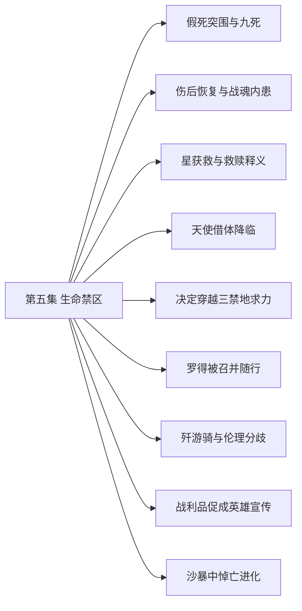

# 第五集 生命禁区 · 剧情结构

[剧情目录](README.md) · [本集九维报告](../../vol05.md)

## 主线树

## 本集因果、伏笔与回收关系

| 起点 | 关系 | 终点 | 研究说明 |
|---|---|---|---|
| [假死突围与九死](vol-05.md) | 因果 | [决定穿越三禁地求力](vol-05.md) | 身份暴露使无限躲藏和寻求力量成为明确选择压力。 |
| [假死突围与九死](vol-05.md) | 铺垫 | [天使借体降临](vol-05.md) | 死亡萝茜与借体天使形成后续身份问题，暂不等同原人格复生。 |
| [罗得被召并随行](vol-05.md) | 铺垫 | [歼游骑与伦理分歧](vol-05.md) | 罗得随行提供战斗支援，也带来吸魂伦理质询。 |
| [歼游骑与伦理分歧](vol-05.md) | 因果 | [战利品促成英雄宣传](vol-05.md) | 战利品作为可见证据经城守转为宣传战绩。 |
| [歼游骑与伦理分歧](vol-05.md) | 铺垫 | [沙暴中悼亡进化](vol-05.md) | 吸取新鲜灵魂为再次到达瓶颈提供积累，风暴中发生突破。 |
| [决定穿越三禁地求力](vol-05.md) | 铺垫 | [沙暴中悼亡进化](vol-05.md) | 北行决定带队进入沙漠，并触及未知骨骸历史。 |
| [假死突围与九死](vol-05.md) | 因果 | [伤后恢复与战魂内患](vol-05.md) | 救援和神圣攻击造成透支与黑七的持久削弱，并暂时压制体内战魂。 |

跨集联系见[全部语义关系](relations.md)与[跨集剧情线](README.md)。

## 事件、人物与认知依据

### 假死突围与九死

判断类型：原文事实

黑龙救黑七并擒萝茜突围，飞剑杀萝茜；幸存圣骑离去，身份无法保密。

人物：[黑龙](../cards/chr-9f2e5fcbba87455eb37e35869ea8854d.md)、[黑七](../cards/chr-775349c3c9654daaae30acf69aadff21.md)、[拉西萝茜](../cards/chr-54e84c6e82214a26921887c503f519ee.md)、[斯文哥尔](../cards/chr-24438669720a4bb8a0a27cbd25eadb33.md)

- 斯文哥尔：知道；黑龙未死，身份已暴露。

| 章节 | 行号 | 判断类型 |
|---|---|---|
| ch-0045 第一章 身分暴露 | 5497–5568 | 原文事实 |

### 伤后恢复与战魂内患

判断类型：原文事实

黑龙昏迷后恢复，黑七黄金骨架保留而灵魂削弱；战魂因同受圣力压制未脱体，恢复后再骚动且炼化失败。

人物：[黑龙](../cards/chr-9f2e5fcbba87455eb37e35869ea8854d.md)、[黑七](../cards/chr-775349c3c9654daaae30acf69aadff21.md)

- 黑龙：知道；自己的灵魂仍不能炼化体内不死战魂。

| 章节 | 行号 | 判断类型 |
|---|---|---|
| ch-0046 第二章 星、月归来 | 5623–5632 | 原文事实 |
| ch-0046 第二章 星、月归来 | 5661–5665 | 原文事实 |

### 星获救与救赎释义

判断类型：原文事实

黑二炼除神力，星月重新归队，盒文澄清救赎为净化回归神。

人物：[黑龙](../cards/chr-9f2e5fcbba87455eb37e35869ea8854d.md)、[黑二](../cards/chr-24b9d252fb624865a46d717832261c68.md)、[星](../cards/chr-d2d3971153154607bb651d6a0c827216.md)、[月](../cards/chr-5c605c7ecd20495ca665d15c2bdf2562.md)、[斯文哥尔](../cards/chr-24438669720a4bb8a0a27cbd25eadb33.md)

- 斯文哥尔：知道；救赎之魂并非恢复原生身份的办法。

| 章节 | 行号 | 判断类型 |
|---|---|---|
| ch-0047 第三章 天使降临 | 5738–5769 | 原文事实 |

### 天使借体降临

判断类型：原文事实

圣山仪式降下七阶战斗天使，降临者自称拉西萝茜。

人物：[拉西萝茜](../cards/chr-54e84c6e82214a26921887c503f519ee.md)、[教皇](../cards/chr-fa5f928c72f34e6292fef0b12b0579e9.md)

- 读者：知道；有天使降临并采用萝茜之名。

| 章节 | 行号 | 判断类型 |
|---|---|---|
| ch-0047 第三章 天使降临 | 5773–5815 | 原文事实 |

### 决定穿越三禁地求力

判断类型：原文事实

黑龙拒绝无尽躲藏，在知龙墓危险后仍决定北行。

人物：[黑龙](../cards/chr-9f2e5fcbba87455eb37e35869ea8854d.md)、[斯文哥尔](../cards/chr-24438669720a4bb8a0a27cbd25eadb33.md)

- 黑龙：怀疑；呼唤自己的可能是不死巨龙。

| 章节 | 行号 | 判断类型 |
|---|---|---|
| ch-0048 第四章 三大禁地 | 5876–5941 | 原文事实 |

### 罗得被召并随行

判断类型：原文事实

琴烙印引出异常召唤，罗得恢复声音、暴露智慧后受契约与保密限制随行。

人物：[黑龙](../cards/chr-9f2e5fcbba87455eb37e35869ea8854d.md)、[罗得宾士](../cards/chr-0d52140c20bf4dc5be05fbdc80d9ace1.md)、[斯文哥尔](../cards/chr-24438669720a4bb8a0a27cbd25eadb33.md)

- 罗得宾士：怀疑；黑龙按琴上自己的精神烙印奏曲召来自己。

| 章节 | 行号 | 判断类型 |
|---|---|---|
| ch-0051 第七章 有点自恋的音乐家 | 6335–6388 | 原文事实 |

### 歼游骑与伦理分歧

判断类型：原文事实

远射触发屠俘，团队歼敌；龙焰骨损后修复，黑龙吸能引发罗得抗议。

人物：[黑龙](../cards/chr-9f2e5fcbba87455eb37e35869ea8854d.md)、[星](../cards/chr-d2d3971153154607bb651d6a0c827216.md)、[罗得宾士](../cards/chr-0d52140c20bf4dc5be05fbdc80d9ace1.md)、[斯文哥尔](../cards/chr-24438669720a4bb8a0a27cbd25eadb33.md)

- 黑龙：未知；吸取能量后灵魂是否消散。

| 章节 | 行号 | 判断类型 |
|---|---|---|
| ch-0053 第九章 骷髅的观念 | 6589–6659 | 原文事实 |

### 战利品促成英雄宣传

判断类型：原文事实

出售帝国战马引官方传播战绩，黑龙获得公共英雄名声。

人物：[黑龙](../cards/chr-9f2e5fcbba87455eb37e35869ea8854d.md)、[斯文哥尔](../cards/chr-24438669720a4bb8a0a27cbd25eadb33.md)

- 读者：知道；公共正义形象与黑龙实际灵魂需求不一致。

| 章节 | 行号 | 判断类型 |
|---|---|---|
| ch-0053 第九章 骷髅的观念 | 6663–6677 | 原文事实 |

### 沙暴中悼亡进化

判断类型：原文事实

黄金骷髅人墙护队，黑龙紫魂进化、感知沙下大量骸骨，瞬发幻界；教皇远感命名。

人物：[黑龙](../cards/chr-9f2e5fcbba87455eb37e35869ea8854d.md)、[斯文哥尔](../cards/chr-24438669720a4bb8a0a27cbd25eadb33.md)、[罗得宾士](../cards/chr-0d52140c20bf4dc5be05fbdc80d9ace1.md)、[教皇](../cards/chr-fa5f928c72f34e6292fef0b12b0579e9.md)

- 黑龙：未知；新灵魂层级名称及骸骨历史。

- 教皇：知道；出现悼亡级上位不死生物。

| 章节 | 行号 | 判断类型 |
|---|---|---|
| ch-0055 第十一章 悼亡之魂 | 6834–6869 | 原文事实 |

## 本集当时的剧情线判断

这是分集历史判断，后续回收结果以跨集终点页为准。

### 第5集 · 救赎之魂的真实作用

当时状态：已回收

救赎是否能够让星恢复生前身份？

本集澄清其净化目的，星获救并归队；这是该次恢复身份尝试的回收，不推断整书救赎主题终结。

[查看全书终点判断](threads/book-d57a5d7a5b5a.md)

### 第5集 · 孩子的独立意识

当时状态：部分回收

除黑二外谁会真正获得自我意识？

黑二能力和求赞行为继续发展；黑大尚未真正觉醒。

[查看全书终点判断](threads/book-c55cdb2efcb4.md)

### 第5集 · 自由与同伴边界

当时状态：部分回收

黑龙如何兼顾自由、保护欲和他人意愿？

归队条件与北行选择更明确，强制保护方案仍带价值冲突。

[查看全书终点判断](threads/book-37dd82abc178.md)

### 第5集 · 萝茜与降临天使

当时状态：未回收

降临者与原萝茜的记忆、意志是什么关系？

死亡和采用同名均明确，身份连续性未证。

[查看全书终点判断](threads/book-09f441653222.md)

### 第5集 · 红月落处的呼唤

当时状态：未回收

召唤黑龙的目的地与力量究竟为何？

到达沙漠只推进路线，未到龙族墓地。

[查看全书终点判断](threads/book-d9427f2553c6.md)

### 第5集 · 罗得的招魂与亡妻

当时状态：未回收

琴的异常召唤是否如罗得所猜，亡妻如今何在？

音乐家自述召回妻魂、转生相伴，但未见妻子。

[查看全书终点判断](threads/book-bd3759586c4a.md)

### 第5集 · 吸魂与公共英雄形象

当时状态：未回收

资源性杀戮能否与同伴伦理及英雄声望共存？

争论未说服黑龙，公众仍以功绩评价。

[查看全书终点判断](threads/book-4e6bf7ea8c15.md)

### 第5集 · 沙漠骨骸与悼亡级力量

当时状态：未回收

沙下骨骸源于何种历史，悼亡层级将引来何种反应？

黑龙感知数百公里骨骸；教皇命名而未行动。

[查看全书终点判断](threads/book-2c92e5ad3024.md)

### 第5集 · 坦克战魂内患

当时状态：未回收

黑龙何时能真正炼化或解除体内的不死战魂？

神圣伤暂时阻止战魂趁昏迷脱体；主角恢复时战魂也恢复，炼化再次失败。

[查看全书终点判断](threads/book-9baae09a0d12.md)
